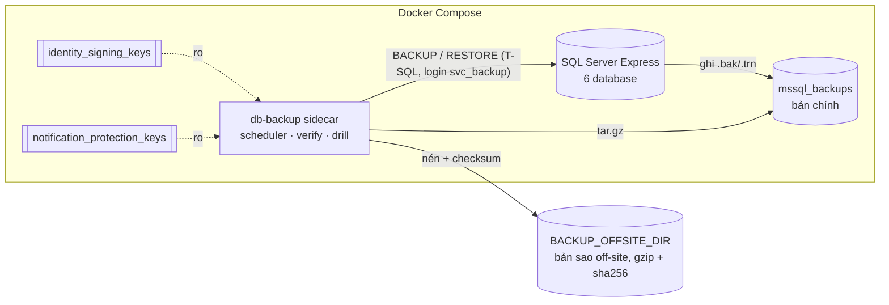

# Sao lưu & Khôi phục dữ liệu (Backup / Recovery)

> Hiện thực hóa mục tiêu RPO/RTO của [SLI_SLO_MATRIX §5.6](../tasks/SLI_SLO_MATRIX_MEMBER_A.md).
> Mã nguồn: [`backup/`](../backup) (sidecar), [`scripts/backup.ps1`](../scripts/backup.ps1) (công cụ vận hành),
> [`backend/sql/init-service-logins.sql`](../backend/sql/init-service-logins.sql) (recovery model + login `svc_backup`).

## 1. Mục tiêu

| Câu hỏi | Trả lời bằng |
|---|---|
| Mất tối đa bao nhiêu dữ liệu? (**RPO**) | Lịch log/diff theo từng DB, đo thật bằng *exposure* (`status.sh`) và diễn tập (`drill.sh`) |
| Khôi phục mất bao lâu? (**RTO**) | Thời gian restore đo trong diễn tập định kỳ |
| Backup có dùng được không? | `CHECKSUM` lúc ghi, `RESTORE VERIFYONLY` sau mỗi full/diff, diễn tập restore thật (+ `DBCC CHECKDB` khi chạy `-IntegrityCheck`) |
| Mất cả ổ chứa backup thì sao? | Bản sao off-site nén gzip + sha256 trên storage khác |
| Khôi phục DB rồi có chạy được không? | Lưu kèm volume khóa (JWT signing keys, data-protection keys); `db-init` tự map lại user ↔ login |

## 2. Kiến trúc



- **Vì sao sidecar?** SQL Server **Express** không có SQL Agent, không nén và không mã hóa backup. Sidecar dùng chính image `mssql/server` (có sẵn `sqlcmd`), chạy vòng lặp mỗi 60 s và gửi lệnh `BACKUP`/`RESTORE` qua T-SQL. File do tiến trình SQL Server ghi vào volume `mssql_backups`, volume này được mount **cùng đường dẫn** `/var/opt/mssql/backup` ở cả hai container.
- **Không phụ thuộc msdb:** lịch và chuỗi khôi phục được suy ra từ **tên file** (`<DB>_<yyyymmddThhmmssZ>_<FULL|DIFF|LOG>`), nên vẫn khôi phục được khi mất cả lịch sử backup trong msdb, và khi volume backup bị xóa thì tick kế tiếp tự chụp FULL mới.
- **Quyền tối thiểu:** sidecar đăng nhập bằng `svc_backup` (`dbcreator` + `db_backupoperator` trên từng DB + `VIEW SERVER STATE`), **không** dùng `sa` và không có quyền đọc dữ liệu.

## 3. Các phương pháp được kết hợp

| Phương pháp | Mục đích | Tần suất mặc định |
|---|---|---|
| **Full backup** | Gốc của mọi chuỗi khôi phục | 7 ngày / DB |
| **Differential** | Thay đổi kể từ bản full gần nhất → chuỗi khôi phục ngắn (full + 1 diff + ít log), RTO thấp | 4–12 giờ tùy DB |
| **Transaction-log backup** | Khôi phục **tới từng thời điểm** (`STOPAT`), RPO tính bằng phút; giữ log file không phình | 5 phút (Medical Records), 15 phút (Appointment/Scheduling/Queue) |
| **Tail-log backup** | Trước khi khôi phục tại chỗ: chụp nốt phần log chưa backup → **RPO = 0** nếu DB còn đọc được | Khi chạy `restore --replace` |
| **Copy-only snapshot** | Chụp trước thay đổi rủi ro (migration, import) mà **không** làm lệch gốc differential | Thủ công: `backup.ps1 snapshot` |
| **Kiểm tra toàn vẹn** | `WITH CHECKSUM` + `RESTORE VERIFYONLY` mỗi full/diff; file ghi dưới tên `.partial` và chỉ đổi tên khi đã kiểm tra xong; file lỗi vào `quarantine/` | Mỗi bản backup |
| **Bản sao off-site (3-2-1)** | Bản thứ hai trên storage khác, nén gzip (Express không tự nén), sha256 từng file | Sau mỗi tick |
| **Backup volume khóa** | `identity_signing_keys` (JWT) và `notification_protection_keys` (ASP.NET Data Protection) — thiếu chúng DB khôi phục được nhưng không dùng được | Khi nội dung đổi, tối thiểu hằng ngày |
| **Retention theo chuỗi** | Giữ đủ file để khôi phục tới **mọi thời điểm** trong cửa sổ (bản chính 8 ngày, off-site 35 ngày, snapshot 30 ngày) | Mỗi tick |
| **Diễn tập khôi phục** | Restore cạnh bên vào `<DB>_drill` + đo RPO/RTO, cả từ bản chính lẫn off-site; `DBCC CHECKDB` khi chạy thủ công với `-IntegrityCheck` | 7 ngày (và thủ công) |

## 4. Chính sách theo database ([`backup/policy.conf`](../backup/policy.conf))

| Database | Recovery model | Full | Diff | Log | RPO | RTO | Mất dữ liệu tối đa theo thiết kế |
|---|---|---|---|---|---:|---:|---|
| ClinicMedicalRecordsDB | FULL | 7 ngày | 4 giờ | 5 phút | 15 phút | 1 giờ | ≈ 6 phút |
| ClinicAppointmentDB | FULL | 7 ngày | 6 giờ | 15 phút | 1 giờ | 1 giờ | ≈ 16 phút |
| ClinicSchedulingDB | FULL | 7 ngày | 6 giờ | 15 phút | 1 giờ | 1 giờ | ≈ 16 phút |
| ClinicQueueDB | FULL | 7 ngày | 6 giờ | 15 phút | 1 giờ | 1 giờ | ≈ 16 phút |
| ClinicIdentityDB | SIMPLE | 7 ngày | 6 giờ | — | 24 giờ | 1 giờ | ≈ 6 giờ |
| ClinicNotificationDB | SIMPLE | 7 ngày | 12 giờ | — | 24 giờ | 4 giờ | ≈ 12 giờ |

*Vì sao Identity/Notification dùng SIMPLE:* RPO 24 giờ đạt được bằng full + diff; dữ liệu Identity thay đổi chậm (đăng ký, đổi mật khẩu) và refresh token mất thì người dùng chỉ cần đăng nhập lại; lịch sử thông báo dựng lại được một phần từ sự kiện. FULL recovery bắt buộc phải backup log đều đặn, nếu không log sẽ phình — nên chỉ bật ở nơi RPO cần.

Thay đổi lịch: sửa `policy.conf` (đơn vị phút) rồi `docker compose restart db-backup`. Recovery model nằm trong `init-service-logins.sql` (chạy lại bởi `db-init` mỗi lần `docker compose up`).

## 5. Chuỗi khôi phục tới một thời điểm

Với thời điểm đích *T* (UTC), `restore.sh` chọn:

1. **Full** mới nhất có thời điểm ≤ *T*;
2. **Diff** mới nhất sau bản full đó và ≤ *T* (nếu có);
3. Mọi **log** sau bản diff (hoặc full), tới và gồm bản log đầu tiên có thời điểm ≥ *T*; bản cuối được áp dụng với `STOPAT = T`.

Ví dụ: muốn quay về 10:07 với full lúc 00:00, diff lúc 06:00 và log mỗi 15 phút → `FULL 00:00 → DIFF 06:00 → LOG 06:15 … LOG 10:15 (STOPAT 10:07)`, tức 1 + 1 + 17 file thay vì 1 + 41 file log nếu không có differential.

## 6. Giám sát

| Tín hiệu | Ở đâu |
|---|---|
| **Exposure** từng DB (tuổi bản backup mới nhất = dữ liệu sẽ mất nếu đĩa hỏng lúc này) so với RPO; recovery model; chuỗi log đã bắt đầu chưa | `scripts/backup.ps1 status`, `reports/status.json` |
| Healthcheck container `db-backup` (unhealthy khi một DB vượt RPO, chuỗi log đứt, off-site tụt hậu, hoặc diễn tập gần nhất thất bại / quá hạn) | `docker compose ps` |
| Mục "Backups within RPO / last drill passed" | `scripts/check-slo-invariants.ps1` |
| Nhật ký từng bước (backup, verify, keys, restore, drill) dạng JSON | `scripts/backup.ps1 events`, `reports/events.jsonl` |

## 7. Diễn tập khôi phục (restore drill)

`drill.sh` (tự chạy mỗi `BACKUP_DRILL_INTERVAL_MIN`, lần đầu 30 phút sau khi khởi động; hoặc `./scripts/backup.ps1 drill`):

1. Với mỗi DB trong policy: restore chuỗi mới nhất **cạnh bên** vào `<DB>_drill` (DB thật không bị động tới);
2. Kiểm tra toàn vẹn rồi xóa bản khôi phục. Diễn tập tự động dựa vào `CHECKSUM` được kiểm lại trong lúc restore; `./scripts/backup.ps1 drill -IntegrityCheck` chạy thêm `DBCC CHECKDB`. SQL Server chỉ cho sysadmin/db_owner chạy CHECKDB, mà bản khôi phục giữ nguyên user `svc_backup` (chỉ có `db_backupoperator`) của DB gốc. Vì vậy lệnh này dùng login quản trị **một lần**, lấy từ `.env` và truyền qua `docker exec -e`; sidecar chạy liên tục không giữ mật khẩu quản trị.
3. Đo **RTO** = thời gian restore, **RPO** = thời điểm diễn tập − điểm khôi phục;
4. Restore thêm DB quan trọng nhất (dòng đầu policy) **từ bản off-site** để chứng minh tầng thứ hai dùng được;
5. Ghi `reports/drill-<ts>.json`; `backup.ps1 drill` chép sang `tests/load/evidence/backup-drill.json`.

Đạt khi: restore thành công, CHECKDB sạch (khi có chạy), RPO đo được ≤ RPO mục tiêu, thời gian restore ≤ RTO mục tiêu.

### 7.1. Kết quả kiểm chứng (27/11/2026, stack Docker Compose)

| Kiểm tra | Kết quả |
|---|---|
| Khởi động lần đầu | 6 bản FULL đã verify (6–28 MB, mỗi bản ≤ 1 s), lưu 2 volume khóa, 8 file chép off-site ngay tick đầu |
| DIFF / LOG thủ công | Đạt; `now -Type LOG` bỏ qua 2 DB SIMPLE (Identity, Notification) đúng thiết kế |
| Diễn tập `-IntegrityCheck` (cuối ngày, sau toàn bộ test tải) | **7/7 đạt**: restore 2–9 s mỗi DB với chuỗi tới 13 file (RTO mục tiêu 60 phút), `DBCC CHECKDB` sạch, gồm Medical Records khôi phục **từ bản off-site** (giải nén + sha256) trong 9 s. RPO đo được: 3–44 s cho các DB FULL; ~48 phút cho Identity/Notification (SIMPLE, chưa tới chu kỳ diff 6–12 giờ; mục tiêu 24 giờ) |
| Lịch tự động | Scheduler tự chụp log Medical Records mỗi ~5 phút và Appointment/Scheduling/Queue mỗi ~15 phút đúng `policy.conf` |
| Khôi phục tới thời điểm (PITR) | Ghi mốc *T* (2.261 lịch hẹn), chạy `smoke.js` tạo thêm lịch (2.265), restore cạnh bên `--at T` qua chuỗi FULL → DIFF → 3 LOG (`STOPAT`) trong 3 s: bản khôi phục có **đúng 2.261** lịch hẹn |
| Khôi phục tại chỗ có tail-log | Dừng `appointment-service`, chụp tail-log, restore 6 file trong 3 s, khởi động lại (healthy sau ~20 s): **2.269 → 2.269**, không mất bản ghi nào (RPO = 0) |
| Chuỗi log sau khôi phục tại chỗ | Log backup tiếp theo và diễn tập restore xuyên qua điểm khôi phục (7 file, cả off-site) đều đạt |
| Quyền tối thiểu | Đã xác nhận: `svc_backup` không chạy được CHECKDB và không đọc được dữ liệu kể cả trên bản khôi phục |

Bằng chứng: `tests/load/evidence/backup-drill.json`, `reports/events.jsonl` trong volume `mssql_backups`.

## 8. Runbook

Mọi lệnh chạy từ thư mục gốc repo; thời gian là **UTC**. Thêm `-DryRun` để xem chuỗi file sẽ dùng trước khi chạy thật.

### 8.1. Xóa/sửa nhầm dữ liệu (khôi phục cạnh bên tới thời điểm trước sự cố)
```powershell
./scripts/backup.ps1 restore -Database ClinicAppointmentDB -As ClinicAppointmentDB_pitr -At "2026-11-27 08:14:00"
# So sánh/copy các dòng cần thiết từ ClinicAppointmentDB_pitr về DB thật, rồi xóa bản tạm:
# DROP DATABASE ClinicAppointmentDB_pitr
```
DB thật vẫn phục vụ trong suốt quá trình.

### 8.2. Database hỏng / cần quay cả DB về trước sự cố (tại chỗ)
```powershell
./scripts/backup.ps1 restore -Database ClinicQueueDB -Replace                         # tới thời điểm mới nhất, RPO = 0
./scripts/backup.ps1 restore -Database ClinicQueueDB -Replace -At "2026-11-27 08:14:00" # quay về trước sự cố
```
Script tự dừng service sở hữu DB (`queue-service`), chụp tail-log, restore, mở lại DB rồi khởi động service. Nếu DB không còn đọc được để chụp tail-log, thêm `-NoTailLog` (chấp nhận mất phần sau bản log gần nhất ≤ `log_min`).

Sau khi quay một DB về quá khứ, các DB khác có thể đã ghi nhận sự kiện mới hơn (ví dụ Queue còn ticket của lịch hẹn mà Appointment không còn). Chạy `./scripts/check-slo-invariants.ps1` để phát hiện lệch và xử lý theo outbox/inbox (các consumer idempotent).

### 8.3. Mất volume backup chính → khôi phục từ off-site
```powershell
./scripts/backup.ps1 restore -Database ClinicMedicalRecordsDB -Replace -Source offsite -NoTailLog
```
File `.gz` được kiểm tra sha256, giải nén vào `restore-staging/` rồi restore; thư mục tạm tự xóa sau đó.

### 8.4. Dựng lại toàn bộ server (mất volume dữ liệu SQL)
1. `docker compose up -d db db-init db-backup` — `db-init` tạo lại login; sidecar khởi động.
2. Với từng DB: `./scripts/backup.ps1 restore -Database <DB> -Replace -NoTailLog` (thêm `-Source offsite` nếu mất cả volume backup).
3. Chạy lại `docker compose up -d db-init` để **map lại user trong DB với login mới** (login được tạo lại có SID mới; script dùng `ALTER USER … WITH LOGIN`).
4. Khôi phục volume khóa nếu mất (dừng service trước):
   ```powershell
   docker compose stop identity-service
   docker run --rm -v microservices_identity_signing_keys:/target -v microservices_mssql_backups:/backup:ro `
     mcr.microsoft.com/mssql/server:2022-latest bash -c "cd /target && tar xzf /backup/keys/identity-signing-keys_<ts>_KEYS.tar.gz"
   docker compose up -d
   ```
   (`microservices_` là tên project Compose; xem `docker volume ls`.)
5. `./scripts/check-slo-invariants.ps1` và `./scripts/backup.ps1 drill`.

### 8.5. Trước một thay đổi rủi ro
```powershell
./scripts/backup.ps1 snapshot -Database all -Label before-migration
```

## 9. Demo trên lớp (thời gian rút gọn)

1. Trong `.env`: `BACKUP_POLICY=policy.demo` và `BACKUP_DRILL_INTERVAL_MIN=20`, rồi `docker compose up -d db-backup`.
   Chuỗi full → diff → log xuất hiện trong khoảng 15 phút ([`policy.demo.conf`](../backup/policy.demo.conf): log mỗi 1–2 phút).
2. `./scripts/backup.ps1 status` — exposure từng DB luôn dưới RPO.
3. Ghi một mốc thời gian *T*, tạo vài lịch hẹn (UI hoặc `tests/load/smoke.js`), rồi
   `./scripts/backup.ps1 restore -Database ClinicAppointmentDB -As ClinicAppointmentDB_pitr -At "<T>"`: bản khôi phục **không có** các lịch hẹn tạo sau *T*, DB thật vẫn có.
4. `./scripts/backup.ps1 restore -Database ClinicAppointmentDB -Replace`: dừng service, tail-log, restore, khởi động lại — không mất lịch hẹn nào (RPO = 0).
5. `./scripts/backup.ps1 drill` — báo cáo RPO/RTO đo được, cả từ bản off-site.

Trả về lịch thật sau demo: xóa `BACKUP_POLICY` khỏi `.env` rồi `docker compose up -d db-backup`.

## 10. Cấu hình

| Biến `.env` | Mặc định | Ý nghĩa |
|---|---|---|
| `DB_BACKUP_PASSWORD` | *(bắt buộc)* | Mật khẩu login `svc_backup` |
| `BACKUP_POLICY` | `policy` | `policy` hoặc `policy.demo` (file trong `backup/`) |
| `BACKUP_OFFSITE_DIR` | `./backups/offsite` | Thư mục host chứa bản sao off-site (đặt sang ổ khác / thư mục đồng bộ cloud) |
| `BACKUP_RETENTION_DAYS` / `BACKUP_OFFSITE_RETENTION_DAYS` | 8 / 35 | Cửa sổ khôi phục tới-thời-điểm của bản chính / off-site |
| `BACKUP_DRILL_INTERVAL_MIN` | 10080 | Chu kỳ diễn tập tự động |
| `BACKUP_KEYS_INTERVAL_MIN` | 1440 | Chu kỳ tối thiểu lưu volume khóa (ngoài ra lưu ngay khi nội dung đổi) |
| `BACKUP_TICK_SECONDS` | 60 | Chu kỳ scheduler |

**Lần triển khai đầu tiên** trên stack đang chạy: thêm `DB_BACKUP_PASSWORD` vào `.env`, rồi `docker compose up -d`. `db-init` chuyển 4 DB sang FULL và tạo `svc_backup`; sidecar thấy chuỗi log chưa bắt đầu nên chụp FULL ngay ở tick đầu.

## 11. Giới hạn đã biết

- Backup **không mã hóa** (Express không hỗ trợ backup encryption). Bảo vệ bằng quyền truy cập volume/thư mục off-site; ở môi trường thật nên dùng storage có mã hóa sẵn.
- "Off-site" mặc định vẫn trên cùng máy (thư mục host) — đúng mô hình 3-2-1 chỉ khi `BACKUP_OFFSITE_DIR` trỏ tới thiết bị/địa điểm khác.
- RPO của Medical Records phụ thuộc sidecar đang chạy: khi sidecar dừng, healthcheck và `check-slo-invariants.ps1` báo vượt RPO, đồng thời log file của các DB FULL sẽ lớn dần cho tới khi backup log được tiếp tục.
- Restore một DB riêng lẻ về quá khứ có thể làm lệch với DB khác (mỗi service một DB, không có giao dịch phân tán) — xem lưu ý §8.2.
