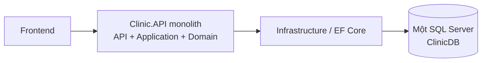

# Kịch bản thuyết trình dự án

> Gợi ý: 10–12 phút, 12 slide. Phần số liệu tải cần nói rõ hạn chế so sánh và dùng trạng thái trong báo cáo dự án; không gọi kết quả hiện tại là “microservice nhanh hơn”.

## Slide 1 — Tên đề tài và mục tiêu (30 giây)

**Trên slide:** Hệ thống đặt lịch khám, quản lý hàng đợi và hồ sơ y tế; chuyển đổi từ monolith sang microservices.

**Lời dẫn:** “Đề tài xây dựng một hệ thống phòng khám chạy được, chia nghiệp vụ thành các service, công bố API bằng OpenAPI, phối hợp nghiệp vụ qua orchestration và event choreography, đồng thời định nghĩa SLI/SLO/QoS và kiểm thử tải.”

## Slide 2 — Bài toán và tính năng (45 giây)

**Trên slide:** Patient booking; staff scheduling; receptionist check-in/queue; doctor consultation/medical record; notification; admin management.

**Lời dẫn:** “Người bệnh tìm ca khám và đặt lịch. Nhân viên vận hành lịch và hồ sơ bệnh nhân. Lễ tân check-in, gọi số; bác sĩ cập nhật hồ sơ khám. Hệ thống theo dõi trạng thái và gửi thông báo. Đây là một luồng liên tục nên các bounded context phải trao đổi dữ liệu nhưng vẫn giữ quyền sở hữu riêng.”

## Slide 3 — Monolith cũ: kiến trúc (45 giây)

**Trên slide:**

**Lời dẫn:** “Bản cũ là một backend triển khai duy nhất với các lớp API, Application, Domain và Infrastructure. Các module gọi nhau trong tiến trình và cùng dùng một ApplicationDbContext. Cách này đơn giản, ít network overhead, nhưng ownership dữ liệu và triển khai độc lập chưa rõ.”

## Slide 4 — CSDL cũ (60 giây)

**Trên slide:** ERD khái quát (đưa sơ đồ từ `PROJECT_REPORT.md`, mục 3.2; giữ nhóm bảng cốt lõi: Person/User/Employee/Doctor, Patient, Schedule, Appointment, Queue, MedicalReport).

**Lời dẫn:** “Một database chứa cả tài khoản/quyền, nhân sự, ca làm, bệnh nhân, lịch hẹn, queue, hồ sơ và thông báo. Appointment nối Patient với WorkSchedule; Doctor nối Employee; QueueTicket và MedicalReport gắn với Appointment. Dữ liệu chung giúp truy vấn và transaction dễ, nhưng thay đổi schema ở một miền có thể tác động miền khác.”

## Slide 5 — Vì sao phân rã (40 giây)

**Trên slide:** Ownership rõ; triển khai/mở rộng theo miền; lỗi được giới hạn; đổi lại là network failure, eventual consistency và vận hành phức tạp.

**Lời dẫn:** “Mục tiêu không phải thêm service cho đủ số lượng. Mục tiêu là để mỗi miền sở hữu quy tắc và dữ liệu của mình, đồng thời chấp nhận phải thiết kế retry, idempotency, observability và xử lý trạng thái trung gian.”

## Slide 6 — Service boundaries (60 giây)

**Trên slide:** Gateway; Identity; Staff & Scheduling; Appointment; Queue; Medical Records (gồm Patient); Notification.

**Lời dẫn:** “Frontend chỉ đi qua Clinic API Gateway. Identity sở hữu tài khoản; Scheduling sở hữu ca và slot; Appointment sở hữu lịch hẹn; Queue sở hữu số thứ tự; Medical Records sở hữu Patient và hồ sơ khám; Notification sở hữu inbox/delivery. Mỗi service có database logic riêng, dù trong Compose các database cùng nằm trên một SQL Server container.”

## Slide 7 — Kiến trúc tổng thể mới (60 giây)

**Trên slide:** Sơ đồ Mermaid từ `PROJECT_REPORT.md`, mục 4.1.

**Lời dẫn:** “Gateway định tuyến tới service owner. Appointment gọi Scheduling đồng bộ ở bước giữ chỗ; các thay đổi cần thông báo cho service khác được phát qua RabbitMQ. Prometheus/Jaeger hỗ trợ đo metrics và trace. Đây là kiến trúc chạy trong Docker Compose phục vụ đồ án, chưa phải cụm production phân tán nhiều node.”

## Slide 8 — Luồng nổi bật: booking orchestration/SAGA (75 giây)

**Trên slide:** Patient → Gateway → Appointment → reserve Scheduling → Appointment DB + Outbox → RabbitMQ → confirm → AppointmentConfirmed → Notification.

**Lời dẫn:** “Khi đặt lịch, Appointment kiểm tra idempotency và gọi Scheduling giữ slot. Appointment ghi trạng thái chờ cùng outbox trong transaction cục bộ. Worker sau đó xác nhận reservation và phát event. Nếu RabbitMQ tạm dừng, outbox giữ việc cần gửi để tiếp tục sau khi broker phục hồi. Đây là orchestration lai: Appointment điều phối phần đặt chỗ, còn notification và các consumer phản ứng theo event.”

## Slide 9 — Luồng choreography: check-in và khám (60 giây)

**Trên slide:** `AppointmentCheckedIn` → Queue ticket → Queue events → Medical Records encounter / Notification.

**Lời dẫn:** “Check-in vẫn gắn với AppointmentId. Queue consume event idempotent để một appointment không sinh vé trùng. Khi bác sĩ gọi số hoặc bắt đầu khám, trạng thái được phát để các miền liên quan cập nhật. Medical Records dùng AppointmentId làm encounter key, không thêm VisitId. Event choreography giảm gọi chéo đồng bộ nhưng buộc hệ thống bảo vệ duplicate, out-of-order và theo dõi event lag.”

## Slide 10 — OpenAPI, kiểm thử và vận hành (45 giây)

**Trên slide:** OpenAPI snapshots Gateway + 6 services; contract drift tests; unit/integration/failure tests; health/readiness; metrics/tracing; Docker Compose.

**Lời dẫn:** “API được mô tả bằng OpenAPI snapshots và có test phát hiện drift. Hệ thống cũng có các test backend, QoS, hợp đồng và failure workflow. Báo cáo runtime ngày 10/11 ghi 285/285 backend tests, 13/13 contract tests, 8/8 QoS tests và các luồng acceptance sau cleanup.”

## Slide 11 — SLA/SLO/QoS (45 giây)

**Trên slide:** Gateway availability ≥99%; API p95≤500ms/p99≤1500ms; 5xx≤1%; event lag p95≤5s; 0 overbooking/duplicate ticket; rate limit 100 req/min/partition.

**Lời dẫn:** “Đây là mục tiêu nghiệm thu trong môi trường Docker Compose, không phải cam kết SLA production. Request nghiệp vụ 409 và throttle 429 được đo riêng, không tính nhầm thành server failure. Các percentile được đo riêng ở từng boundary; không cộng p95 của các hop.”

## Slide 12 — Benchmark và tiến trình tối ưu (90 giây)

**Trên slide:**

| Lượt đo | Monolith booking API p95 | Micro booking API p95 | Ghi chú |
|---|---:|---:|---|
| Micro thô, 20 VU balanced | — | khoảng 1.9–2.35 s | Chưa đạt ngưỡng 500 ms |
| Sau tối ưu, 20 VU | 269 ms | 411 ms | Cả hai thấp hơn ngưỡng trong lượt này |
| Run “12 CPU”, 20 VU | 293 ms | 595 ms | Micro vượt ngưỡng 500 ms |
| High-load, 30 VU | 47 ms | 180 ms | Artifact có khác biệt workload/data và threshold flags cần xác minh |

**Lời dẫn:** “Các lượt đầu cho thấy microservice bị chậm ở booking, khoảng 1.9 đến 2.35 giây ở một số profile. Sau các thay đổi tối ưu và phân bổ tài nguyên, một lượt 20 VU giảm còn khoảng 411 ms, nhưng run 12 CPU sau đó là khoảng 595 ms và lại vượt SLO p95 500 ms. Lượt 30 VU có số p95 thấp hơn, nhưng số booking tạo được khác nhau, dữ liệu trạng thái khác nhau và artifact threshold không nhất quán; vì vậy không dùng nó để khẳng định microservice thắng monolith. Kết quả trung thực hiện nay là hệ thống mới chạy được và có SAGA/event tests, còn benchmark so sánh công bằng cần chạy lại với tài nguyên, dữ liệu, cleanup và seed được khóa.”

## Slide 13 — Kết luận và việc tiếp theo (40 giây)

**Trên slide:** Đạt phần phân rã/API/orchestration/SLO/runtime; còn benchmark đối chiếu chuẩn hóa và sanitize credential trong artifact.

**Lời dẫn:** “Phần kiến trúc và triển khai chính đã hoàn thành. Để đóng toàn bộ mục tiêu một cách có thể bảo vệ khi đánh giá, cần tạo benchmark đối chiếu sạch, lặp lại ít nhất ba lần, báo median/variance, kiểm tra threshold/exit code, cleanup dữ liệu và loại bỏ JWT khỏi artifact. Sau đó mới kết luận SLO và hiệu năng tương đối.”

## Phụ lục: nhắc người thuyết trình

- Dùng biểu đồ/screenshot được sinh từ sanitized evidence; không mở hay chiếu raw k6 JSON có `setup_data` chứa token.
- Nói rõ 12 CPU trong tên artifact và 12.5 CPU trong báo cáo có khác biệt cách ghi; xác nhận lại cấu hình chính xác khi chạy benchmark mới.
- Không trình bày `http_req_failed` như tỷ lệ lỗi server: với workload này, phần lớn là HTTP 409 expected contention. Báo cáo riêng 5xx metric.
- Nếu benchmark chưa chạy lại, gọi trạng thái là “đang hoàn tất kiểm chứng hiệu năng”, không gọi toàn bộ project đã đạt mọi acceptance.

## Bổ sung lời thuyết trình về kết quả tải — 17/11/2026

**Trên slide:** Booking high-load: 30 VU, 2.400 slot; median p95 API 253,6 ms, create thành công 387,8 ms, POST đến Confirmed 762 ms. Mixed normal: 20 VU, 71/29 đọc/ghi, p95 đọc/ghi 26,8/91,3 ms. Clinic peak: 30 VU, 68/32 đọc/ghi, p95 đọc/ghi 49,7/187,8 ms; booking create 343,8 ms; queue workflow 1.661 ms.

**Lời dẫn:** “Bên cạnh kịch bản booking tải cao, chúng tôi chạy thêm hai tải hỗn hợp đồng thời đọc, đặt lịch và thao tác queue. Cả hai profile đều không ghi nhận 5xx và đạt threshold đặt ra. Profile clinic peak hoàn tất 836 vòng đời check-in/queue; có 4 trên 16.852 iteration được đánh dấu chưa thành công, nên chúng tôi giữ con số này trong báo cáo. Đây chưa phải workload đo từ phòng khám thật và chưa chạy cùng profile trên monolith, vì vậy kết quả thể hiện khả năng hoạt động của các luồng trên cấu hình thử nghiệm, không khẳng định microservice nhanh hơn hệ thống cũ.”

Không so p95 booking high-load trực tiếp với p95 mixed-profile vì khác workload và cách tổng hợp. Chi tiết ở [báo cáo phase 9](../tasks/PHASE_9_LOAD_TEST_REPORT_MEMBER_A.md#21-nghiệm-thu-hai-profile-tải-hỗn-hợp--17112026).
