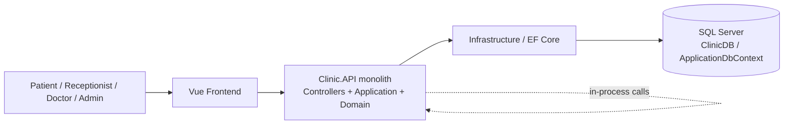
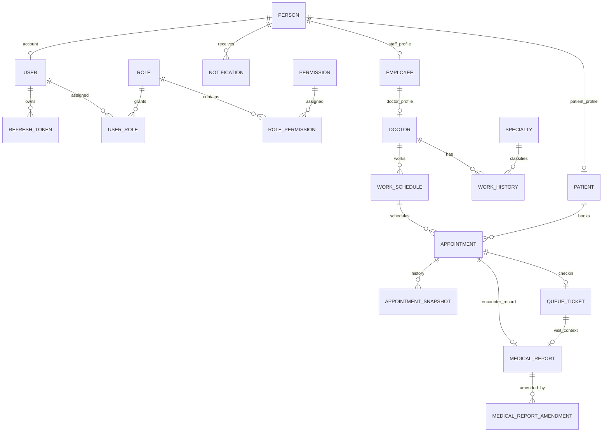
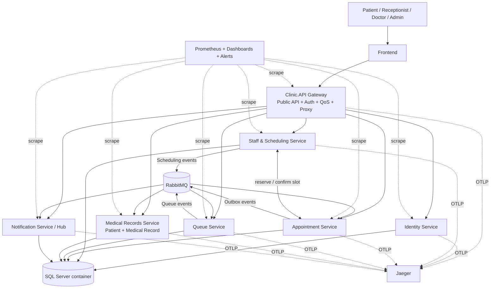

# Báo cáo dự án — Hệ thống đặt lịch khám, quản lý hàng đợi và hồ sơ y tế

> Ngày tổng hợp: 16/11/2026. Báo cáo đối chiếu mã nguồn trong hai working tree, tài liệu thiết kế/nghiệm thu và artifact benchmark đã lưu. Những số liệu tải được nêu có ngày chạy theo artifact (11/11/2026), không phải lượt chạy mới ngày 16/11.

## 1. Cơ sở lý thuyết

### 1.1. Monolith và microservices

Monolith triển khai các nghiệp vụ trong một ứng dụng, thường dùng chung mô hình miền và cơ sở dữ liệu. Cách này dễ chạy, kiểm thử giao dịch xuyên nghiệp vụ và có ít hop mạng, nhưng các miền khó phát hành, mở rộng và chịu lỗi độc lập.

Microservices phân chia hệ thống theo bounded context: mỗi service sở hữu nghiệp vụ, dữ liệu và API của nó. Các service có thể phát hành và mở rộng riêng; đổi lại, hệ thống phải xử lý giao tiếp mạng, lỗi một phần, eventual consistency, version hợp đồng và vận hành nhiều tiến trình. “Database per service” là quyền sở hữu dữ liệu logic riêng; trong dự án này các database vẫn nằm trên cùng SQL Server container, không phải các máy chủ database vật lý độc lập.

### 1.2. API contract và OpenAPI

OpenAPI mô tả endpoint, phương thức, schema request/response, lỗi và cơ chế bảo vệ API theo định dạng máy đọc được. Contract giúp frontend/Gateway và service thống nhất cách tích hợp, hỗ trợ Swagger, kiểm tra drift giữa schema được công bố với implementation và làm căn cứ cho contract testing. Contract không tự chứng minh API hoạt động đúng; cần kiểm thử tích hợp/runtime bổ sung.

### 1.3. Orchestration, choreography và SAGA

- **Orchestration:** một thành phần điều phối bước nghiệp vụ và biết bước tiếp theo cần gọi. Dễ thấy luồng tổng thể, nhưng điều phối viên có thể trở thành điểm tập trung logic.
- **Choreography:** các service phản ứng với event do service khác phát ra; không có một bộ điều phối trung tâm cho toàn bộ luồng. Các service ít phụ thuộc trực tiếp hơn, nhưng cần observability và quản lý event tốt.
- **SAGA:** giao dịch nghiệp vụ dài được tách thành các giao dịch cục bộ. Nếu bước sau thất bại, hệ thống dùng retry hoặc hành động bù thay vì giữ một transaction ACID xuyên nhiều database.
- **Outbox/inbox và idempotency:** outbox ghi thay đổi nghiệp vụ và event cần phát trong cùng transaction cục bộ; publisher gửi lại khi broker phục hồi. Inbox/idempotency chặn event hoặc request lặp gây tác dụng phụ trùng.

### 1.4. SLA, SLI, SLO và QoS

- **SLI** là chỉ số đo thực tế, ví dụ tỷ lệ request hợp lệ không lỗi 5xx hoặc p95 latency.
- **SLO** là mục tiêu nội bộ cho SLI trong cửa sổ và mẫu đo đã định nghĩa.
- **SLA** là cam kết với khách hàng, thường kèm trách nhiệm/biện pháp khi vi phạm. Ma trận trong repo là mục tiêu nghiệm thu và vận hành của đồ án, không phải hợp đồng SLA production.
- **QoS** là chính sách phục vụ như timeout, rate limit, retry, concurrency, idempotency và xử lý tải/quá tải.

## 2. Giới thiệu hệ thống

Đây là ứng dụng quản lý hoạt động phòng khám: bệnh nhân tìm bác sĩ/ca khám và đặt lịch; nhân viên quản lý bệnh nhân và lịch; lễ tân check-in, gọi số và điều phối hàng đợi; bác sĩ khám và cập nhật hồ sơ; hệ thống gửi thông báo và cung cấp trang theo dõi/vận hành.

Các năng lực chính trong sản phẩm hiện tại gồm xác thực và phân quyền; quản lý nhân sự, chuyên khoa, ca làm; tìm slot và đặt/hủy/đổi lịch; idempotency cho thao tác đặt; check-in và cấp số hàng đợi; gọi/bỏ qua/bắt đầu/kết thúc lượt theo vai trò; hồ sơ bệnh nhân và medical record gắn với AppointmentId; notification inbox/real-time; API Gateway; health/readiness, metrics, tracing và kịch bản benchmark.

## 3. Hệ thống monolith cũ

### 3.1. Kiến trúc và triển khai

Monolith cũ là một ứng dụng ASP.NET Core (`Clinic.API`) chia lớp API/Application/Domain/Infrastructure, một frontend và một SQL Server. Trong Docker Compose cũ, backend được publish ở cổng 5000, frontend ở 3000 và SQL Server ở 1433. Các nghiệp vụ gọi nhau trong cùng tiến trình và dùng một `ApplicationDbContext`; đây là điểm khác biệt chính so với các database ownership boundary hiện tại.

### 3.2. Thiết kế CSDL monolith

`ApplicationDbContext` đăng ký chung các nhóm bảng: `Persons`, `Users`, `Roles`, `Permissions`, bảng nối `UserRoles`/`RolePermissions`, `Employees`, `Doctors`, `Specialties`, `WorkHistories`, `WorkSchedules`, `ShiftRequests`, `Patients`, `Appointments`, `AppointmentSnapshots`, `QueueTickets`, `QueueCounters`, `MedicalReports`, `MedicalReportAmendments`, `MedicalAccessAudits`, `Notifications`, và `RefreshTokens`. Cấu hình EF Core nằm ở `backend/Clinic.Infrastructure.Sqlserver/Configurations`.

Sơ đồ dưới đây là ERD khái quát các quan hệ nghiệp vụ chính theo cấu hình EF, không liệt kê mọi cột/index/migration:

Một số quan hệ là tùy chọn (ví dụ Person có thể chưa có User; khách walk-in vẫn có thể có hồ sơ Person/Patient). `MedicalAccessAudits` được lưu cùng database nhưng cấu hình hiện tại chỉ khai báo khóa/index, không khai báo quan hệ FK trong EF nên không vẽ cạnh FK ở đây. ERD tập trung vào quan hệ được cấu hình trong monolith; không nên dùng nó như bản migration/schema vật lý đầy đủ.

## 4. Sản phẩm mới và phân rã nghiệp vụ

Frontend vẫn truy cập qua Clinic API Gateway. Gateway xác thực/định tuyến và proxy đến service owner. Sáu bounded context trong triển khai:

| Service | Sở hữu nghiệp vụ/dữ liệu chính |
|---|---|
| Identity | Tài khoản, credential, token, role/permission và các API xác thực |
| Staff & Scheduling | Nhân sự/bác sĩ, chuyên khoa, ca làm và reservation slot |
| Appointment | Appointment lifecycle, booking/change/cancel/check-in và outbox nghiệp vụ |
| Queue | Queue ticket/counter, số thứ tự và trạng thái gọi/khám |
| Medical Records | Patient profile, encounter context, medical report, amendment và audit |
| Notification | Inbox, delivery intent/outbox, provider result/replay và SignalR |

Các database logic là `ClinicIdentityDB`, `ClinicSchedulingDB`, `ClinicAppointmentDB`, `ClinicQueueDB`, `ClinicMedicalRecordsDB`, `ClinicNotificationDB`; được cấu hình riêng nhưng cùng dùng SQL Server service/container trong Compose. RabbitMQ vận chuyển event. Prometheus thu metrics, Jaeger nhận trace OTLP; dashboards/alert rules nằm dưới `observability/`.

### 4.1. Sơ đồ tổng quan

Sơ đồ thể hiện ownership và hướng giao tiếp logic; không hàm ý mỗi service đang chạy trên một SQL Server riêng. Một số event routing/consumer có thể khác theo event type.

### 4.2. Luồng phối hợp làm nổi bật orchestration/choreography

**Đặt lịch — điều phối có bước đồng bộ và SAGA nền:**

1. Gateway chuyển `POST /appointments` cùng idempotency key đến Appointment Service.
2. Appointment Service kiểm tra request và patient projection, gọi Scheduling Service để reserve slot. Đây là bước sync có thể trả contention `409`.
3. Appointment Service ghi appointment trạng thái chờ và outbox trong transaction của chính nó.
4. Publisher gửi event; confirmation worker phối hợp với Scheduling để confirm reservation. Khi thành công, Appointment chuyển trạng thái và phát `AppointmentConfirmed`.
5. Notification phản ứng với event để tạo inbox/delivery; luồng có thể retry và chống event lặp. Nếu broker gián đoạn, outbox giữ thông điệp chờ phục hồi.

Đây là luồng **điều phối lai**: bước reserve/confirm được Appointment điều khiển trực tiếp qua API, còn phát thông tin sang các bounded context khác dùng choreography qua event. Vì các DB độc lập, đây không phải transaction ACID duy nhất xuyên toàn hệ thống.

**Check-in → Queue → Medical Records/Notification — choreography:**

1. Appointment Service kiểm tra check-in theo AppointmentId, ghi trạng thái và `AppointmentCheckedIn` trong outbox.
2. Queue Service consume event idempotent, tạo đúng một ticket, cấp số trong phạm vi ngày/doctor và phát event kết quả nếu cần.
3. Queue state events thông báo việc gọi số/bắt đầu/kết thúc khám; Medical Records cập nhật encounter context theo AppointmentId, còn Notification tạo thông báo/inbox phù hợp.
4. Retry/event trùng không được tạo ticket hoặc encounter trùng; thứ tự và lifecycle được bảo vệ bởi state guard/idempotency.

### 4.3. OpenAPI và kiểm thử hợp đồng

Repo có OpenAPI snapshots cho Gateway và sáu service dưới `tasks/contracts/`, endpoints OpenAPI/Swagger trong ứng dụng, cùng `ApiContractDriftTests`. Đây đáp ứng thiết kế API và cơ chế phát hiện drift ở mức triển khai/test. Trước khi nộp, nên sinh lại snapshot từ đúng commit và đính kèm kết quả chạy `scripts/validate-api-contracts.ps1` (hoặc `.sh`) để chứng minh contract hiện hành, không chỉ dựa vào file snapshot có sẵn.

## 5. SLA/SLO/QoS

Ma trận chi tiết: [`../tasks/SLI_SLO_MATRIX_MEMBER_A.md`](../tasks/SLI_SLO_MATRIX_MEMBER_A.md). Các mục tiêu nghiệm thu chính đã ghi trong tài liệu:

| SLI/QoS | Mục tiêu dự án | Cách hiểu |
|---|---:|---|
| Availability tại Gateway | ≥ 99.0% | Loại expected 4xx, 401/403, contention 409, throttling 429 và client abort khỏi lỗi hệ thống; tính 5xx/502/503/504 là failure |
| API latency | p95 ≤ 500 ms; p99 ≤ 1,500 ms | Mỗi endpoint/boundary đo riêng; percentile các hop không cộng lại |
| Server error | ≤ 1.0% | Theo cửa sổ và mẫu tối thiểu đã quy định trong ma trận |
| Event processing lag | p95 ≤ 5 s | Từ thời điểm publish đến xử lý/ack theo định nghĩa SLI |
| DLQ | 0 message hợp lệ bị bỏ lại | Poison event cần cách ly, có thể chẩn đoán/replay an toàn |
| Invariants | 0 overbooking; 0 duplicate queue ticket | Kiểm tra bằng integration/load tests và đối soát trạng thái |
| Rate limiting | Fixed window, mặc định 100 request/phút/partition | Authenticated theo subject; anonymous theo remote IP; không tin `X-Forwarded-For` trong Compose trực tiếp |

Các ngưỡng này là mục tiêu đồ án trên môi trường Docker Compose. Không có căn cứ để trình bày như SLA production hoặc cam kết uptime theo tháng.

## 6. Kiểm thử và đánh giá mức hoàn thành

### 6.1. Phần đã có bằng chứng

- Phân rã ownership thành Gateway và sáu service; Compose có migration/health checks và database logic riêng.
- OpenAPI snapshots, Swagger/OpenAPI endpoints và contract drift tests.
- Orchestration lai cho booking/reservation và event choreography cho các workflow queue, medical records, notification.
- Tài liệu SLI/SLO/QoS, metrics, tracing, dashboard/alert rules; tài liệu nghiệm thu Phase 7–9 ghi solution backend 285/285, contract 13/13, QoS 8/8 và runtime acceptance sau cleanup ngày 10/11/2026.
- Runtime acceptance report ghi baseline, workflow booking, contention, broker degradation/recovery, soak, queue/medical record và event timing. Các con số ở đó thuộc từng workload cụ thể và không tự chứng minh mọi ngưỡng dưới mọi tải.

### 6.2. Benchmark monolith so với microservices gần nhất

Artifact 20 VU được đặt tên “12cpu” trong cả hai cây (báo cáo ghi cấu hình 12.5 CPU). Đây là phép so sánh gần đồng điều kiện rõ nhất hiện có:

| Chỉ số booking | Monolith | Microservices | Mục tiêu |
|---|---:|---:|---:|
| Booking API p95 | 293.4 ms | 594.7 ms | ≤ 500 ms |
| POST đến Confirmed p95 | 456.4 ms | 820.9 ms | ≤ 5,000 ms E2E |
| Business success / confirmation | 100% / 100% | 100% / 100% | ≥ 98% / ≥ 90% theo runner |
| 5xx | 0 | 0 | ≤ 1% |

Kết quả: hai bên hoàn tất nghiệp vụ trong lượt đo đó, nhưng microservice **không đạt p95 API 500 ms** trong run 12 CPU; monolith đạt. E2E và lỗi server đạt mục tiêu. Vì vậy không thể tuyên bố microservice nhanh hơn monolith theo benchmark này.

Artifact 30 VU `highload-*` cho thấy API p95 khoảng 47.1 ms monolith và 179.6 ms microservices; E2E p95 khoảng 106 ms và 524.3 ms; 5xx metric bằng 0. Tuy nhiên đây chưa phải so sánh cuối cùng có thể dùng để kết luận thắng/thua: số attempts và số booking tạo được khác nhau (28,312/2,400 so với 11,743/1,996); data state và tiến độ lấp slot khác nhau; script không dọn appointments đã tạo; cấu hình tài nguyên/commit/run provenance không được gắn với artifact; và JSON lưu threshold flags `false` ngay cả khi metric ghi p95/rate thỏa con số hiển thị. `http_req_failed` phần lớn đếm các 409 xung đột hợp lệ nên không được diễn giải như tỷ lệ 5xx.

### 6.3. Kết luận hoàn thành

**Đánh giá: hoàn thành phần kiến trúc/triển khai chính, nhưng chưa đủ căn cứ đóng mục tiêu kiểm thử tải so sánh một cách chặt chẽ.** Hệ thống chạy được và tài liệu/test cho thấy đã thực hiện các yêu cầu cốt lõi. Cổng còn mở là benchmark đối chiếu tái lập được và minh bạch, đồng thời phải xử lý artifact chứa JWT. Do đó báo cáo này không ghi “toàn bộ yêu cầu đã nghiệm thu” cho đến khi hoàn tất các mục sau.

### 6.4. Việc còn phải làm trước khi kết luận nghiệm thu toàn bộ

1. **Làm sạch evidence bí mật:** xóa/rotate nếu còn hiệu lực các JWT đã ghi trong `setup_data` của `highload-micro-booking-k6.json` và `highload-mono-booking-k6.json`; thay bằng artifact đã sanitize hoặc tạo JSON summary mới không lưu token, mật khẩu, PII. Không đưa raw artifact chứa credential vào báo cáo/commit.
2. **Sửa harness high-load:** cleanup phải theo dõi và hủy/đối soát appointment được tạo, kiểm tra số tồn trước/sau; không chỉ xóa ca làm do test tạo. Chạy mỗi hệ thống trên DB snapshot sạch hoặc dữ liệu namespace riêng.
3. **Khóa điều kiện so sánh:** cùng workload, seed, số VU/thời lượng, số slot khả dụng, dataset ban đầu, giới hạn CPU/RAM tổng, phiên bản image/commit và cùng thời gian warm-up. Chạy tối thiểu ba lượt cho mỗi hệ thống và báo median/variance cùng p95/p99.
4. **Sửa phân loại kết quả:** 409 expected contention phải được đo riêng; threshold outcome trong JSON phải khớp số liệu/exit code. Kiểm tra runner trả lỗi nếu threshold vượt; lưu log tóm tắt không chứa setup credentials.
5. **Đánh giá SLO:** chạy workload booking trên cùng cấu hình; nếu microservice p95 vẫn >500 ms thì tối ưu hoặc ghi nhận vi phạm và đề xuất/nghiệm thu lại mục tiêu có lý do. Không sửa ngưỡng chỉ để biến test thành pass.
6. **Đính kèm bằng chứng contract hiện tại:** chạy validator trên đúng commit, cập nhật OpenAPI snapshots nếu cần và ghi kết quả vào báo cáo nghiệm thu cuối.

### 6.5. Tối ưu code thực hiện sau khi lập báo cáo

Trong `Clinic.StaffScheduling.Service/Services/SchedulingManager.cs`, kiểm tra capacity trước đây đọc toàn bộ `TimeSlot` của các reservation còn hiệu lực về ứng dụng để vừa đếm vừa tìm slot trùng. Đã đổi thành một truy vấn aggregate theo `WorkScheduleId`, chỉ trả về tổng reservation và số lần slot yêu cầu xuất hiện. Khóa bản ghi schedule và filtered unique index hiện có vẫn giữ nguyên.

Thay đổi này giảm dữ liệu chuyển từ SQL Server và allocation trong service; chưa có benchmark sau sửa nên không khẳng định p95 đã giảm. Trước khi nghiệm thu, cần chạy test hiện có cho capacity/duplicate/concurrency và chạy lại benchmark cùng cấu hình đã khóa. Chưa thay đổi code các điểm phụ thuộc vào trace/đo tài nguyên như phân bổ CPU, pool size, timeout, polling hoặc khóa đồng bộ.

## 7. Tài liệu và nguồn đối chiếu

- Thiết kế/task tổng thể: [`../tasks/TASK_MEMBER_A.md`](../tasks/TASK_MEMBER_A.md), [`../tasks/TASK_MEMBER_B.md`](../tasks/TASK_MEMBER_B.md), các execution plan Phase 2–9.
- SLI/SLO/QoS: [`../tasks/SLI_SLO_MATRIX_MEMBER_A.md`](../tasks/SLI_SLO_MATRIX_MEMBER_A.md).
- Nghiệm thu tải A: [`../tasks/PHASE_9_LOAD_TEST_REPORT_MEMBER_A.md`](../tasks/PHASE_9_LOAD_TEST_REPORT_MEMBER_A.md).
- Nghiệm thu sau cleanup: [`../tasks/PHASE_7_9_FINAL_ACCEPTANCE_PLAN.md`](../tasks/PHASE_7_9_FINAL_ACCEPTANCE_PLAN.md).
- Benchmark history: [`../tasks/BENCHMARK_MONOLITH_VS_MICROSERVICES_FULL_HISTORY.md`](../tasks/BENCHMARK_MONOLITH_VS_MICROSERVICES_FULL_HISTORY.md).
- OpenAPI: [`../tasks/contracts/`](../tasks/contracts/), drift tests: `backend/Clinic.IntegrationTests/ApiContractDriftTests.cs`.
- Mã monolith đối chiếu: working tree `Clinic_Appointment_Booking_Queue_Management_System`, nhất là `backend/Clinic.Infrastructure.Sqlserver/Persistence/ApplicationDbContext.cs`, `Configurations/` và `docker-compose.yml`.

## Bổ sung kết quả kiểm thử tải mới nhất — 17/11/2026

Sau ba lượt booking-only high-load (30 VU, 2.400 slot), median p95 là 253,6 ms cho các response booking API, 387,8 ms cho request tạo booking thành công và 762 ms từ POST đến Confirmed; cả ba lượt không có 5xx và đã cleanup dữ liệu test.

Hai mixed-workload profile mới chạy trên microservices: normal (20 VU) có 71,30% request đọc / 28,70% ghi, p95 đọc 26,8 ms, ghi 91,3 ms, tạo booking 107,2 ms; clinic-peak (30 VU, bao gồm walk-in và queue) có 67,73% đọc / 32,27% ghi, p95 đọc 49,7 ms, ghi 187,8 ms, tạo booking 343,8 ms, queue workflow 1.661 ms. Cả hai không có 5xx và đạt các threshold đã khai báo. Peak có 4/16.852 workflow iteration chưa thành công (0,024%), dù toàn bộ 836 queue lifecycle đạt marker hoàn tất.

Đây là hai loại workload khác nhau, nên không suy ra rằng một loại nhanh hơn loại kia. Mixed profiles chưa chạy đối chứng trên monolith và chưa sử dụng tỷ lệ traffic đo tại phòng khám; vì vậy chúng chứng minh các luồng đã chọn hoạt động dưới tải hỗn hợp trên cấu hình hiện tại, chưa chứng minh ưu thế hiệu năng tổng thể. Chi tiết và evidence sanitize nằm trong [báo cáo phase 9](../tasks/PHASE_9_LOAD_TEST_REPORT_MEMBER_A.md#21-nghiệm-thu-hai-profile-tải-hỗn-hợp--17112026).
