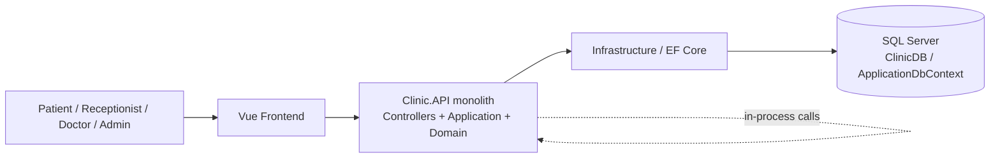
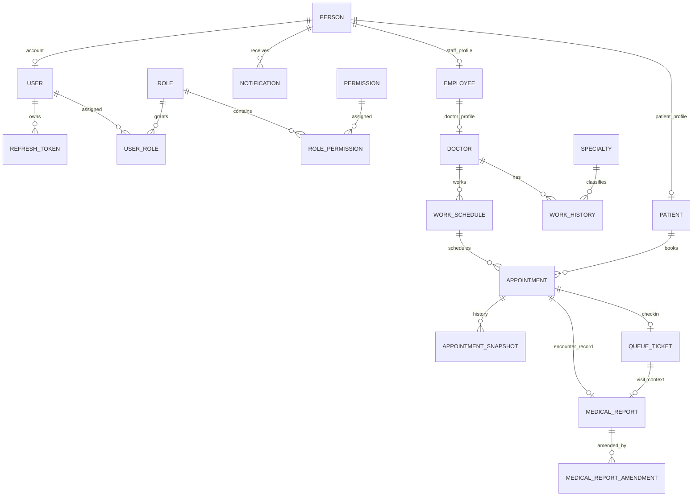
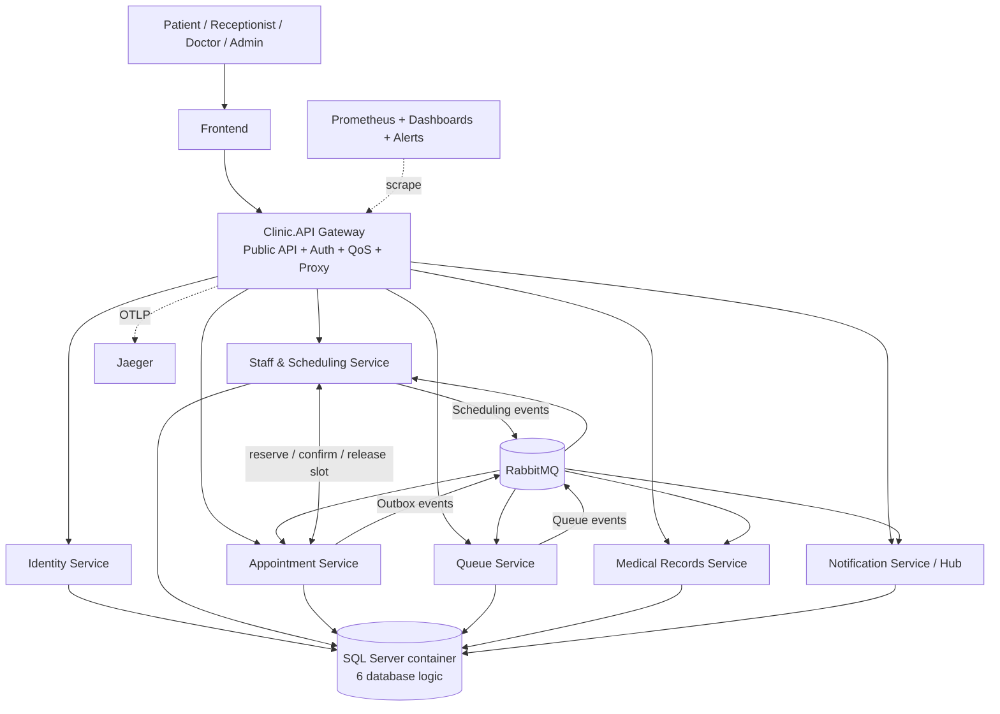

# Báo cáo dự án — Hệ thống đặt lịch khám, quản lý hàng đợi và hồ sơ y tế

> Ngày tổng hợp: 27/11/2026, trên commit `5dd739f` của nhánh `main` (microservices) và commit `1e64bfc` của nhánh `monolith`. Báo cáo đối chiếu mã nguồn, tài liệu thiết kế/nghiệm thu và artifact benchmark đã lưu trong repo. Mọi số liệu tải đều ghi ngày chạy theo artifact gốc (11/11, 17/11 và 22/11/2026); không có lượt chạy tải mới trong đợt tổng hợp này.

## 1. Cơ sở lý thuyết

### 1.1. Monolith và microservices

Monolith triển khai các nghiệp vụ trong một ứng dụng, thường dùng chung mô hình miền và cơ sở dữ liệu. Cách này dễ chạy, dễ kiểm thử giao dịch xuyên nghiệp vụ và có ít hop mạng, nhưng các miền khó phát hành, mở rộng và chịu lỗi độc lập.

Microservices phân chia hệ thống theo bounded context: mỗi service sở hữu nghiệp vụ, dữ liệu và API của nó. Các service có thể phát hành và mở rộng riêng; đổi lại, hệ thống phải xử lý giao tiếp mạng, lỗi một phần, eventual consistency, version hợp đồng và vận hành nhiều tiến trình. “Database per service” ở đây là quyền sở hữu dữ liệu logic riêng; trong dự án các database vẫn nằm trên cùng một SQL Server container, không phải các máy chủ database vật lý độc lập.

### 1.2. API contract và OpenAPI

OpenAPI mô tả endpoint, phương thức, schema request/response, lỗi và cơ chế bảo vệ API theo định dạng máy đọc được. Contract giúp frontend/Gateway và service thống nhất cách tích hợp, hỗ trợ Swagger, phát hiện drift giữa schema công bố với implementation và làm căn cứ cho contract testing. Contract không tự chứng minh API hoạt động đúng; cần kiểm thử tích hợp/runtime bổ sung.

### 1.3. Orchestration, choreography và SAGA

- **Orchestration:** một thành phần điều phối các bước nghiệp vụ và biết bước tiếp theo cần gọi. Dễ thấy luồng tổng thể, nhưng điều phối viên có thể trở thành điểm tập trung logic.
- **Choreography:** các service phản ứng với event do service khác phát ra; không có bộ điều phối trung tâm cho toàn bộ luồng. Các service ít phụ thuộc trực tiếp hơn, nhưng cần observability và quản lý event tốt.
- **SAGA:** giao dịch nghiệp vụ dài được tách thành các giao dịch cục bộ. Nếu bước sau thất bại, hệ thống dùng retry hoặc hành động bù thay vì giữ một transaction ACID xuyên nhiều database.
- **Outbox/inbox và idempotency:** outbox ghi thay đổi nghiệp vụ và event cần phát trong cùng transaction cục bộ; publisher gửi lại khi broker phục hồi. Inbox/idempotency chặn event hoặc request lặp gây tác dụng phụ trùng.

### 1.4. SLA, SLI, SLO và QoS

- **SLI** là chỉ số đo thực tế, ví dụ tỷ lệ request hợp lệ không lỗi 5xx hoặc p95 latency.
- **SLO** là mục tiêu nội bộ cho SLI trong cửa sổ và mẫu đo đã định nghĩa.
- **SLA** là cam kết với khách hàng, thường kèm trách nhiệm/biện pháp khi vi phạm. Ma trận trong repo là mục tiêu nghiệm thu và vận hành của đồ án, không phải hợp đồng SLA production.
- **QoS** là chính sách phục vụ như timeout, rate limit, retry, concurrency, idempotency và xử lý tải/quá tải.

## 2. Giới thiệu hệ thống

Ứng dụng quản lý hoạt động phòng khám: bệnh nhân tìm bác sĩ/ca khám và đặt lịch; nhân viên quản lý bệnh nhân và lịch; lễ tân check-in, gọi số và điều phối hàng đợi; bác sĩ khám và cập nhật hồ sơ; hệ thống gửi thông báo và cung cấp trang theo dõi/vận hành.

Các năng lực chính: xác thực và phân quyền; quản lý nhân sự, chuyên khoa, ca làm; tìm slot và đặt/hủy/đổi lịch; idempotency cho thao tác đặt; khách walk-in; check-in và cấp số hàng đợi; gọi/bỏ qua/bắt đầu/kết thúc lượt theo vai trò; hồ sơ bệnh nhân và medical record gắn với `AppointmentId`; notification inbox/real-time (SignalR); API Gateway; health/readiness, metrics, tracing và bộ kịch bản kiểm thử tải.

## 3. Hệ thống monolith cũ

### 3.1. Kiến trúc và triển khai

Monolith (nhánh `monolith`) là một ứng dụng ASP.NET Core (`Clinic.API`) chia lớp API/Application/Domain/Infrastructure, một frontend và một SQL Server. Các nghiệp vụ gọi nhau trong cùng tiến trình và dùng một `ApplicationDbContext`; đây là khác biệt chính so với ranh giới sở hữu dữ liệu của bản microservices. Để benchmark đối chứng, monolith được container hóa bằng `docker-compose.monolith.yml` (API ở cổng 5100) với tổng ngân sách CPU tương đương bản microservices.

### 3.2. Thiết kế CSDL monolith

`ApplicationDbContext` đăng ký chung các nhóm bảng: `Persons`, `Users`, `Roles`, `Permissions`, bảng nối `UserRoles`/`RolePermissions`, `Employees`, `Doctors`, `Specialties`, `WorkHistories`, `WorkSchedules`, `ShiftRequests`, `Patients`, `Appointments`, `AppointmentSnapshots`, `QueueTickets`, `QueueCounters`, `MedicalReports`, `MedicalReportAmendments`, `MedicalAccessAudits`, `Notifications` và `RefreshTokens`. Cấu hình EF Core nằm ở `backend/Clinic.Infrastructure.Sqlserver/Configurations`.

ERD khái quát các quan hệ nghiệp vụ chính theo cấu hình EF (không liệt kê mọi cột/index/migration):

Một số quan hệ là tùy chọn (ví dụ Person có thể chưa có User; khách walk-in vẫn có hồ sơ Person/Patient). `MedicalAccessAudits` nằm cùng database nhưng cấu hình chỉ khai báo khóa/index, không khai báo FK trong EF nên không vẽ cạnh ở đây.

## 4. Sản phẩm mới và phân rã nghiệp vụ

Frontend truy cập qua Clinic API Gateway (`Clinic.API` ở nhánh `main`, sau đợt cleanup chỉ còn vai trò Gateway). Gateway xác thực, áp QoS và proxy đến service sở hữu nghiệp vụ. Sáu bounded context:

| Service | Project | Sở hữu nghiệp vụ/dữ liệu chính | Database logic |
|---|---|---|---|
| Identity | `Clinic.Identity.Service` | Tài khoản, credential, token, role/permission | `ClinicIdentityDB` |
| Staff & Scheduling | `Clinic.StaffScheduling.Service` | Nhân sự/bác sĩ, chuyên khoa, ca làm, reservation slot | `ClinicSchedulingDB` |
| Appointment | `Clinic.Appointment.Service` | Vòng đời lịch hẹn, booking/đổi/hủy/check-in, walk-in, outbox | `ClinicAppointmentDB` |
| Queue | `Clinic.Queue.Service` | Queue ticket/counter, số thứ tự, trạng thái gọi/khám | `ClinicQueueDB` |
| Medical Records | `Clinic.MedicalRecords.Service` | Hồ sơ bệnh nhân, encounter, medical report, amendment, audit | `ClinicMedicalRecordsDB` |
| Notification | `Clinic.Notification.Service` | Inbox, delivery/outbox, provider result/replay, SignalR | `ClinicNotificationDB` |

Sáu database được cấu hình riêng nhưng cùng chạy trên service `db` (một SQL Server container) trong Compose. RabbitMQ vận chuyển event. Prometheus thu metrics (kèm `mssql-exporter`), Jaeger nhận trace OTLP; dashboard và alert rule nằm trong `observability/`. Mỗi container có giới hạn CPU/RAM trong `docker-compose.yml`.

### 4.1. Sơ đồ tổng quan

Mọi service đều được Prometheus scrape và gửi trace sang Jaeger; sơ đồ chỉ vẽ Gateway để gọn. Sơ đồ thể hiện quyền sở hữu và hướng giao tiếp logic, không hàm ý mỗi service có SQL Server riêng.

### 4.2. Luồng phối hợp: orchestration và choreography

**Đặt lịch — điều phối đồng bộ kết hợp SAGA nền:**

1. Gateway chuyển `POST /appointments` kèm idempotency key đến Appointment Service.
2. Appointment Service kiểm tra request và patient projection, gọi Scheduling để reserve slot. Đây là bước đồng bộ, có thể trả `409` khi tranh chấp slot. Reservation có hạn 10 phút; `ReservationExpirationWorker` thu hồi reservation quá hạn.
3. Appointment Service ghi appointment trạng thái chờ và outbox trong cùng transaction cục bộ.
4. `AppointmentConfirmationWorker` thăm dò định kỳ trên `ClinicAppointmentDB` (`NextConfirmationAttemptAt`, đánh thức tức thì qua `AppointmentWorkSignal`) và gọi đồng bộ Scheduling Service qua HTTP (`/confirm`) để xác nhận reservation (retry tối đa 4 lần với backoff; nếu vẫn thất bại thì release reservation) — bước xác nhận này không đi qua RabbitMQ. Khi thành công, appointment chuyển `Confirmed` và ghi `AppointmentConfirmed` vào Outbox để publisher phát qua RabbitMQ.
5. Notification phản ứng với `AppointmentConfirmed` để tạo inbox/delivery, có retry và chống event lặp. Nếu broker gián đoạn, Outbox giữ thông điệp đến khi broker phục hồi.

Đây là luồng **điều phối lai**: reserve/confirm do Appointment điều khiển trực tiếp qua API, còn việc lan truyền sang các bounded context khác dùng choreography qua event. Vì các database độc lập, đây không phải một transaction ACID xuyên toàn hệ thống.

**Hủy lịch:** Appointment ghi trạng thái hủy và `AppointmentCancelled` vào outbox, đồng thời gọi trực tiếp Scheduling để nhả slot (best-effort). Scheduling cũng consume event để nhả slot nên hai đường bổ trợ nhau.

**Check-in → Queue → Medical Records/Notification — choreography:**

1. Appointment kiểm tra check-in theo `AppointmentId`, ghi trạng thái và `AppointmentCheckedIn` vào outbox.
2. Queue consume event qua inbox (unique index), tạo đúng một ticket, cấp số theo ngày/bác sĩ. Lỗi tạm thời được đưa vào retry queue (tối đa 3 lần), quá hạn thì vào DLQ.
3. Queue phát event gọi số/bắt đầu/kết thúc khám; Medical Records cập nhật encounter theo `AppointmentId`, Notification tạo thông báo, Appointment nhận `queue.exam-completed` để đóng lịch hẹn.
4. Retry hoặc event trùng không tạo ticket/encounter trùng; thứ tự vòng đời được bảo vệ bằng state guard và idempotency.

### 4.3. OpenAPI và kiểm thử hợp đồng

Repo có OpenAPI snapshot cho Gateway và sáu service trong `tasks/contracts/` (kèm `api-catalog-baseline.json`), endpoint Swagger trong từng ứng dụng và `ApiContractDriftTests` trong `backend/Clinic.IntegrationTests`. Lượt nghiệm thu ngày 10/11/2026 ghi contract validation 13/13 pass. Trước khi nộp nên chạy lại `scripts/validate-api-contracts.ps1` trên đúng commit nộp và đính kèm kết quả.

## 5. SLA/SLO/QoS

Ma trận chi tiết (bản sửa đổi 27/11/2026): [`../tasks/SLI_SLO_MATRIX_MEMBER_A.md`](../tasks/SLI_SLO_MATRIX_MEMBER_A.md). Thay vì một bộ ngưỡng chung cho mọi service, SLO được **phân tầng theo mức quan trọng** và gắn với một **SLA mô phỏng** có cửa sổ đo, error budget và hệ quả vận hành:

| Thành phần | Nội dung chính |
|---|---|
| Phân tầng | Tier 1: Identity, Appointment + Scheduling, Queue · Tier 2: Medical Records · Tier 3: Notification |
| Availability (30 ngày, giờ phòng khám 07:00–20:00, T2–T7) | Thành phần: Gateway/Identity/SQL/RabbitMQ 99.9%; Appointment/Scheduling/Queue 99.7%; Medical Records 99.5%; Notification 99.0%. Hành trình E2E (tích các thành phần): đặt lịch, check-in, hồ sơ ≥ 99.0%; đăng nhập ≥ 99.5% |
| Độ trễ theo nhóm endpoint | Đọc p95 ≤ 300 ms / p99 ≤ 1 s; ghi p95 ≤ 500 ms / p99 ≤ 1.5 s; đăng nhập p95 ≤ 1 s (BCrypt); refresh p95 ≤ 300 ms |
| Workflow bất đồng bộ | Đặt lịch → Confirmed ≤ 5 s; check-in → số thứ tự ≤ 3 s; kết thúc khám → Completed ≤ 5 s; bắt đầu khám → mở encounter ≤ 5 s; sự kiện → inbox ≤ 10 s |
| Toàn vẹn | 0 overbooking, 0 vé trùng, 0 reservation mồ côi, 0 lịch treo Pending > 10 phút, 0 message hợp lệ trong DLQ, 100% truy cập bệnh án được audit |
| SLA & error budget | 99.0% ≈ 200 phút/30 ngày; ≥ 50% budget → ưu tiên độ tin cậy; ≥ 100% → đóng băng tính năng; cảnh báo burn-rate nhiều cửa sổ (14.4× / 6×) |
| QoS đồng bộ | Deadline lồng nhau (Gateway 5 s, Appointment→Scheduling 3 s, Identity 10 s), retry chỉ cho method an toàn hoặc lệnh idempotent, circuit breaker fail-fast 503 + `Retry-After`, lỗi phụ thuộc không làm mở breaker của service khỏe |
| Rate limiting | Theo tầng: bệnh nhân 100/phút, nhân viên 600/phút, ẩn danh 100/phút/IP; đăng nhập 10/phút/IP; đặt lịch 10/phút/bệnh nhân; Identity 20/phút/client thật |
| Degraded modes | Notification/Medical Records/Identity/RabbitMQ gián đoạn không làm hỏng đặt lịch & hàng đợi; Scheduling gián đoạn → đặt lịch thất bại nhanh, xem lịch hẹn vẫn hoạt động |
| Năng lực đăng nhập | BCrypt cost 10 (re-hash hash cũ khi đăng nhập), bulkhead 1 phép băm đồng thời + hàng chờ 4, quá tải → 503 + `Retry-After` thay vì timeout; Identity 1,5 CPU (lấy từ frontend 1,0 → 0,25 và Scheduling 1,5 → 1,0, tổng ngân sách không đổi); đo bằng `login-capacity.js` |
| RPO/RTO | Sidecar `db-backup`: full hằng tuần + differential + transaction-log (khôi phục tới từng thời điểm), tail-log khi khôi phục tại chỗ, verify checksum, bản sao off-site gzip + sha256, lưu volume khóa, diễn tập restore + `DBCC CHECKDB` định kỳ. Medical Records RPO 15 phút (log 5 phút), Appointment/Scheduling/Queue RPO 1 giờ (log 15 phút), Identity/Notification RPO 24 giờ; RTO ≤ 1 giờ ([BACKUP_RECOVERY.md](BACKUP_RECOVERY.md)) |

**SLA/SLO/QoS theo từng dịch vụ** (tóm tắt từ ma trận §2–§5; độ trễ là p95 đo tại Gateway):

| Dịch vụ | Tầng | Availability | Độ trễ / workflow | QoS chính | Chế độ suy giảm khi dịch vụ gặp sự cố | RPO / RTO |
|---|:---:|---:|---|---|---|---|
| API Gateway | — | 99,9% | Đọc ≤ 300 ms, ghi ≤ 500 ms | Rate limit theo tầng; deadline 5 s; retry chỉ GET; circuit breaker 503 + `Retry-After` | Điểm vào duy nhất (không có dự phòng trên Compose) | — |
| Identity | 1 | 99,9% | Đăng nhập ≤ 1 s, refresh ≤ 300 ms | 10 lượt đăng nhập/phút/IP; 20/phút/client tại Identity; bulkhead băm mật khẩu + load shedding | Request đã có token vẫn chạy (JWT kiểm tra cục bộ qua JWKS) | 24 giờ / 1 giờ |
| Staff & Scheduling | 1 | 99,7% | Đọc ≤ 300 ms | Appointment→Scheduling: deadline 3 s, retry 1 lần (lệnh idempotent), breaker | Đặt lịch mới lỗi nhanh 502/503/504; xem lịch hẹn, hàng đợi, hồ sơ vẫn chạy | 1 giờ / 1 giờ |
| Appointment | 1 | 99,7% | Ghi ≤ 500 ms; đặt lịch → Confirmed ≤ 5 s | `Idempotency-Key`; 10 lượt đặt/phút/bệnh nhân; lỗi Scheduling gắn `X-Clinic-Dependency-Failure` để không mở breaker | Outbox giữ sự kiện; worker xác nhận thử lại | 1 giờ / 1 giờ |
| Queue | 1 | 99,7% | Check-in → số thứ tự ≤ 3 s; consumer lag ≤ 5 s | Consumer idempotent; retry 5 s → 30 s → 2 phút rồi DLQ | Sự kiện chờ trong RabbitMQ | 1 giờ / 1 giờ |
| Medical Records | 2 | 99,5% | Ghi ≤ 500 ms; bắt đầu khám → encounter ≤ 5 s | Audit 100% truy cập; không ghi PHI vào log/trace | Đặt lịch/hàng đợi không ảnh hưởng; sự kiện xử lý khi phục hồi | 15 phút / 1 giờ |
| Notification | 3 | 99,0% | Sự kiện → inbox ≤ 10 s | 3 retry rồi DLQ | Thông báo trễ, luồng Tier 1 không ảnh hưởng | 24 giờ / 4 giờ |

Mỗi chính sách có kiểm chứng tự động (ma trận §6): bộ k6 trong `tests/load` dùng chung ngưỡng `lib/slo.js`, fault injection `scripts/run-fault-isolation.ps1`, đối soát `scripts/check-slo-invariants.ps1`, và integration test cho rate limit/resilience. Các ngưỡng là mục tiêu đồ án trên Docker Compose, không phải SLA production.

**Phát hiện khi chạy bộ test mới (27/11/2026):** (1) Identity giới hạn đăng nhập theo IP kết nối nên phía sau Gateway toàn hệ thống chỉ có 20 lượt đăng nhập/phút — đã sửa; (2) cấu hình circuit breaker ban đầu làm sự cố Scheduling lan sang cả route xem lịch hẹn — đã sửa; (3) Identity ở 0.5 CPU (BCrypt cost 11) chỉ xử lý ~2–3 lượt đăng nhập/giây và quá tải thành 504 — đã xử lý bằng cost 10 + re-hash, load shedding có `Retry-After`, chuyển 0.75 CPU từ frontend sang Identity, và tách đo năng lực đăng nhập (`login-capacity.js`) khỏi kịch bản đột biến đặt lịch (`spike.js` làm nóng phiên trước); (4) script import dữ liệu Identity từ monolith chèn permission theo Id nên đụng unique index `Name` với permission do Identity seed (cả transaction rollback trên stack mới) — đã đổi sang khớp theo tên và dùng chung bản đồ quyền hàng đợi với seed (`QueuePermissionCatalog`); (5) đột biến 40 lượt đặt/giây dồn vào ít ca làm việc làm lộ điểm nghẽn khóa `UPDLOCK` theo bản ghi `WorkSchedule` trong Scheduling (chưa sửa, xem §6.6).

## 6. Kiểm thử và kết quả

### 6.1. Kiểm thử chức năng và hợp đồng

Lượt nghiệm thu sau cleanup ngày 10/11/2026 ([`PHASE_7_9_FINAL_ACCEPTANCE_PLAN.md`](../tasks/PHASE_7_9_FINAL_ACCEPTANCE_PLAN.md)) ghi: toàn bộ backend solution **285/285 test pass**, contract validation **13/13**, QoS failure-policy **8/8**, cùng runtime acceptance cho baseline, booking, contention, broker degradation/recovery, soak, queue/medical record và event timing. Lượt chạy ngày 27/11/2026 ghi nhận **333/333** test .NET (8 project, gồm `GatewayQoSPolicyTests`, `IdentityAuthRateLimitTests`, `PasswordHashingTests`, `QueuePermissionCatalogTests`) và kiểm chứng SLA/QoS trên stack thật ở §6.6.

Trong đợt review này chưa chạy lại được bộ test vì máy tổng hợp không có .NET 10 SDK và Docker không hoạt động (xem mục 7.3).

### 6.2. Benchmark booking 20 VU (12,5 CPU mỗi hệ thống)

Cả hai stack có tổng giới hạn 12,5 CPU, chạy lần lượt, cùng script `tests/load/booking.js` (lưu ý trên đường ghi đặt lịch, Monolith backend có 7,5 CPU còn đường booking Microservices — Gateway + Appointment + Scheduling — có khoảng 4 CPU vì ngân sách chung gánh thêm Frontend, Prometheus, Jaeger và SQL exporter; bản Monolith benchmark cũng đã được chỉnh đồng bộ hóa luồng xác nhận từ 10/11). Lượt burst đầu ngày 11/11 (`iterations: 20`, thấp hơn sample floor 100 requests cho p95 trong ma trận SLO) cho p95 booking API 594,7 ms ở microservices và 293,4 ms ở monolith. Sau khi tối ưu truy vấn reserve (mục 6.5), ngày 17/11 đo lại mỗi bên ba lượt:

| Hệ thống | Booking API p95: lượt 1 / 2 / 3 | POST → Confirmed p95: lượt 1 / 2 / 3 | Ngưỡng p95 < 500 ms |
|---|---:|---:|---|
| Microservices | 983,8 / 417,4 / 449,0 ms | 1.529 / 729,6 / 661,1 ms | Lượt 1 không đạt, lượt 2–3 đạt |
| Monolith | 796,7 / 335,6 / 297,9 ms | 908,2 / 408,0 / 368,6 ms | Lượt 1 không đạt, lượt 2–3 đạt |

Mọi lượt đạt 101/101 check, 20/20 booking Confirmed và cleanup, 0 HTTP 5xx. Lượt đầu của cả hai bên chậm do khởi động nguội. Median p95 microservices giảm khoảng 24,5% so với mốc 594,7 ms nhưng vẫn cao hơn monolith khoảng 34% (449,0 so với 335,6 ms).

### 6.3. Booking high-load 30 VU, 2.400 slot

| Chỉ số (median của 3 lượt) | Monolith (22/11) | Microservices (17/11) |
|---|---:|---:|
| p95 mọi booking API | 190,2 ms | 253,6 ms |
| p95 API tạo booking thành công | 214,6 ms | 387,8 ms |
| p95 POST → Confirmed | 235 ms | 762 ms |
| Thông lượng booking Confirmed | 29,84/s | ≈ 29,72/s |
| 5xx | 0% | 0% |

Cả hai đạt mọi threshold, dữ liệu test được cleanup. Thông lượng xác nhận gần bằng nhau, còn latency monolith thấp hơn. Lưu ý: monolith dùng chung DB qua các lượt nên lịch sử appointment đã hủy tích lũy và p95 tăng theo thứ tự chạy (122 → 190 → 254 ms); một lượt monolith bị loại khỏi nhóm acceptance do teardown timeout.

### 6.4. Mixed workload (đọc/ghi hỗn hợp nhiều persona)

| Profile | Hệ thống | Tỷ lệ HTTP đọc / ghi | p95 đọc / ghi / tạo booking | Workflow thành công / 5xx | Queue lifecycle |
|---|---|---:|---:|---:|---:|
| normal, 20 VU, 5 phút | Monolith | 68,75% / 31,25% | 82,2 / 111,3 / 50,3 ms | 100% / 0% | Không áp dụng |
| normal, 20 VU, 5 phút | Microservices | 71,30% / 28,70% | 26,8 / 91,3 / 107,2 ms | 100% / 0% | Không áp dụng |
| clinic-peak, 30 VU, 5 phút (22/11) | Monolith | 64,00% / 36,00% | 276,7 / 362,4 / 287,8 ms | 94,81% / 2,90% | 0/865 (lỗi walk-in) |
| clinic-peak, 30 VU, 5 phút (22/11) | Microservices | 67,73% / 32,27% | 49,7 / 187,8 / 343,8 ms | 99,976% / 0% | 836/836 hoàn tất |

Ở profile normal (22/11), microservices có p95 đọc và ghi thấp hơn, monolith có p95 tạo booking thấp hơn. Ở lượt clinic-peak ngày 22/11, monolith **không đạt** do lỗi chức năng: luồng walk-in lấy `WorkSchedule` bằng `AsNoTracking` rồi thêm `Appointment` qua navigation graph, khiến EF Core insert lại schedule đã tồn tại (`DbUpdateException`).

#### Chạy lại `clinic-peak` và các kịch bản full-duration (27/11/2026)

Sau khi sửa lỗi walk-in trên nhánh `monolith` và chạy từng hệ thống tách biệt (tắt hoàn toàn hệ thống còn lại trước khi đo; nâng `AUTH_RATE_LIMIT_PERMIT_LIMIT=1000`, `ANONYMOUS_RATE_LIMIT_PERMIT_LIMIT=100000`, `IDENTITY_AUTH_RATE_LIMIT_PERMIT_LIMIT=1000` trên Microservices trong lúc chạy k6 rồi khôi phục mặc định sau khi đo), các lượt chạy full-duration thu được như sau:

| Kịch bản | Hệ thống | Tải / VUs / Thời lượng | p95 Read / Write / Login | Workflow Booking p95 | Availability / 5xx | Booking thành công |
|---|---|---|---:|---:|---:|---:|
| `clinic-peak` (`mixed-workload.js`) | Monolith | 500 VU, 14 phút (`40.183` iters, `58.276` reqs) | 12,53 / 41,76 / 188,75 ms | 57 ms | 100% (`57.774/57.774`) / 0% | 99,99% (`7.611/7.612`) |
| `clinic-peak` (`mixed-workload.js`) | Microservices | 500 VU, 14 phút (`39.932` iters, `65.218` reqs) | 46,36 / 147,59 / 229,19 ms | 480 ms | 100% (`64.373/64.373`) / 0% | 99,93% (`7.347/7.352`) |
| `load.js` | Monolith | 10/s, 60s warmup + 5m steady (`3.329` iters) | Read steady p95: 14,60 ms | — | 100% steady / 0% (`0/5.132`) | — |
| `load.js` | Microservices | 10/s, 60s warmup + 5m steady (`3.329` iters, `7.256` reqs) | 46,71 / 66,52 / 107,00 ms (steady) | 344 ms | 100% (`5.785/5.785`) / 0% (`0/6.273`) | 100% (`662/662`) |
| `booking-high-load.js` | Monolith | 20/s, 120s (`2.400` iters, `7.003` reqs) | 5,61 / 30,45 / — ms | 38 ms | 100% (`6.570/6.570`) / 0% | 82,00% (`1.968/2.400`) |
| `booking-high-load.js` | Microservices | 20/s, 120s (`2.400` iters) | Write p95: 57,70 ms | 339 ms | 98,55% / 1,337% (FAIL) | 79,35% (`1.829/2.305`) |

Ghi chú kỹ thuật cho lượt full-duration 27/11/2026:
- Ở `clinic-peak` 500 VU (14 phút), **cả Monolith và Microservices đều đạt toàn bộ ngưỡng SLO** (`thresholdsPassed: true`, `0%` 5xx, `0%` throttled). Monolith có latency thấp hơn rõ rệt (`12,53 ms` read, `41,76 ms` write, `57 ms` booking so với `46,36 ms`, `147,59 ms`, `480 ms` bên Microservices) nhờ giao dịch cục bộ không qua gateway/outbox.
- Ở `booking-high-load.js` trên Microservices, 228 VU khởi tạo đồng thời tại `t=0` không qua `warmSessions` gây bão đăng nhập khiến bulkhead Identity từ chối `95` request (`503`, `slo_server_errors = 1,337%` > `1%`, `slo_availability = 98,55%` < `99%`), và pha teardown dùng một tài khoản `admin1` hủy `1.829` lịch nên chạm ngưỡng Staff `600 req/min` (`61` lỗi `429`). Tuy nhiên trong suốt pha đặt lịch không có dropped iteration (`2.400/2.400`).
- Các file summary JSON mới được lưu tại `tests/load/evidence/*-latest.json`. Sau khi khôi phục rate limit mặc định, `scripts/check-slo-invariants.ps1` đạt **11/11 PASS**.

### 6.5. Tối ưu đã thực hiện

- **Truy vấn kiểm tra capacity khi reserve** (`SchedulingManager.cs`): trước đây đọc toàn bộ `TimeSlot` của các reservation còn hiệu lực về ứng dụng; nay dùng một truy vấn aggregate theo `WorkScheduleId`, giữ nguyên khóa bản ghi schedule và filtered unique index. Hiệu quả đã đo ở mục 6.2.
- **Đánh thức worker theo tín hiệu** (`AppointmentWorkSignal.cs`): outbox publisher và confirmation worker được đánh thức ngay khi có appointment/outbox mới, giảm thời gian chờ POST → Confirmed.
- **Connection pool** cấu hình `Min Pool Size`/`Max Pool Size` cho các service chịu tải ghi (Scheduling, Appointment, Queue, Identity).

### 6.6. Kiểm chứng SLA/QoS và khôi phục dữ liệu trên stack đang chạy — 27/11/2026

Các lượt chạy ngắn trên Docker Compose (một máy) sau khi rebuild Gateway và Identity, nhằm chứng minh mỗi chính sách ở §5 được thực thi, không phải benchmark lặp nhiều lượt:

| Chính sách / SLO | Kiểm chứng | Kết quả |
|---|---|---|
| Toàn bộ code | `dotnet test` (8 project) | **333/333 đạt** |
| Rate limit theo tầng, `Retry-After`, envelope, correlation ID | `qos-policy.js` với hạn mức mặc định | **10/10 đạt** |
| Deadline / retry / circuit breaker / không lan lỗi | `GatewayQoSPolicyTests` (9 test, gồm load shedding không mở breaker) | Đạt |
| Degraded modes | `run-fault-isolation.ps1` dừng Scheduling / Notification giữa tải | Đạt: đặt lịch lỗi nhanh 502/503/504, xem lịch hẹn 100%; dừng Notification thì lõi 100% |
| Đăng nhập (p95 ≤ 1 s) và quá tải có kiểm soát | `login-capacity.js` 2 → 20 lượt/s | **Đạt**: trong SLO tới ~10 lượt/s (trước: ~2); quá tải gấp đôi p95 lượt nhận ≤ 756 ms, shed p95 14 ms, 0 × 504 |
| Smoke mọi hành trình Tier 1 | `smoke.js` | Đạt: đọc p95 19 ms, ghi 78 ms, đăng nhập 181 ms |
| Đột biến mở lịch | `spike.js` (500 phiên làm nóng, 3 → 40 lượt/s vào 2 bác sĩ) | **Không đạt** (xem dưới) |
| RPO/RTO | `backup.ps1 drill -IntegrityCheck`, PITR, khôi phục tại chỗ | **7/7 đạt**, restore 2–9 s; PITR khớp đúng số bản ghi tại thời điểm *T*; tail-log mất 0 bản ghi ([BACKUP_RECOVERY.md §7.1](BACKUP_RECOVERY.md)) |
| Toàn vẹn sau tất cả các test | `check-slo-invariants.ps1` | **11/11 đạt** (0 overbooking, 0 vé trùng, DLQ = 0, backup trong RPO) |

**Phát hiện từ kịch bản đột biến.** Đăng nhập không còn là nút cổ chai (p95 233 ms). Nhưng trong ~25 s đầu đợt tăng từ 3 lên 40 lượt/s, p95 đọc/ghi lên ~9,5/9,9 s và 11,6% request lỗi (504 theo deadline Gateway). Khi các slot hết, lượt đặt trả 409 rất nhanh và hệ thống trở lại bình thường; pha recovery đạt SLO (p95 18/23 ms). Log cho thấy mọi service cùng chậm và thời gian lệnh SQL tăng trong đúng cửa sổ đó. Nguyên nhân: `SchedulingManager` khóa `UPDLOCK, ROWLOCK` bản ghi `WorkSchedule` khi giữ chỗ, nên mọi lượt đặt vào cùng một ca (ở đây chỉ 4 ca nóng) xếp hàng nối tiếp. Khóa này bảo đảm đúng sức chứa — kiểm tra bất biến xác nhận 0 overbooking — nhưng đánh đổi bằng độ trễ khi có điểm nóng.

Hướng xử lý đề xuất (chưa làm): thay bước đếm + chèn trong khóa bằng một bộ đếm chỗ cập nhật nguyên tử (`UPDATE … SET Reserved = Reserved + 1 WHERE Reserved < Capacity`) để rút ngắn thời gian giữ khóa. Kèm theo đó, giới hạn đồng thời cho route đặt lịch tại Gateway, trả 503 + `Retry-After` thay vì để request chờ tới deadline (giống bulkhead của Identity). Sau đó chạy lại `spike.js`.

**Lưu ý harness:** gọi qua cổng publish của Docker Desktop (`host.docker.internal`) làm rơi kết nối lúc hàng trăm VU mở kết nối cùng lúc. Vì vậy kịch bản đột biến được chạy trong mạng Compose (`run-k6.ps1 -Network microservices_default`), xem `tests/load/README.md` §5.

### 6.7. Nhận định so sánh

Với các lượt đo ngày 22/11 và các lượt full-duration ngày 27/11/2026 (sau khi đã sửa lỗi walk-in của monolith), cả hai kiến trúc đều vượt qua kịch bản `clinic-peak` 500 VU trong 14 phút với 0% lỗi 5xx. Monolith có latency đọc/ghi/booking thấp hơn (ít hop mạng, giao dịch cục bộ), còn Microservices đáp ứng tốt tải hỗn hợp có Queue ở `clinic-peak` nhưng nhạy cảm hơn với spike đăng nhập đồng thời ở `t=0` (`booking-high-load.js`) do bulkhead Identity và giới hạn rate limit theo tài khoản. Các kết quả này vẫn cần lưu ý điều kiện đo: chưa khôi phục DB snapshot sạch giữa mọi lượt và chưa thu CPU/RAM hai stack theo cùng một chuẩn.

## 7. Kết quả review hệ thống (27/11/2026)

Review tĩnh trên commit `5dd739f`, tập trung vào độ tin cậy messaging, invariant dữ liệu, bảo mật cấu hình và tính chính xác của bằng chứng.

### 7.1. Điểm đã xác minh tốt

- Ranh giới dữ liệu đúng như thiết kế: mỗi service chỉ có connection string tới database của mình; giao tiếp liên service qua HTTP client có cấu hình hoặc RabbitMQ.
- Invariant được bảo vệ ở tầng database: unique index cho queue ticket theo appointment và số thứ tự, unique idempotency key cho appointment, unique `EventId` cho outbox, unique inbox message ở Queue.
- Queue, Medical Records và Notification có retry queue + DLX; Notification có API liệt kê và replay delivery dead-lettered qua Gateway (`AdminController`).
- Reservation có thời hạn và worker thu hồi, nên confirm thất bại không giữ slot vĩnh viễn. Hủy lịch nhả slot bằng hai đường (gọi trực tiếp + event).
- Bảo mật cấu hình: JWT ký bằng khóa bất đối xứng lưu trong volume (`Jwt__SigningKeyDirectory`); mật khẩu RabbitMQ bắt buộc lấy từ `.env` (Compose báo lỗi nếu thiếu); repo chỉ có `.env.example`.

### 7.2. Vấn đề cần xử lý

| # | Mức độ | Vấn đề | Ảnh hưởng | Đề xuất |
|---|---|---|---|---|
| 1 | Cao | 10 file evidence đã commit trong `tests/load/evidence/` còn chứa JWT: `raw_contention.json`, `raw_load.json`, `raw_smoke.json`, `raw_spike.json`, `highload-micro-booking-k6.json` và 5 file `review-*-booking-k6.json`. Token là token dev (issuer `http://localhost:5000`), đã hết hạn từ 04/11/2026. | Không khai thác được trên môi trường khác, nhưng vi phạm quy tắc “không lưu token trong evidence” mà chính tài liệu dự án đặt ra, và lộ cấu trúc claim/role. | Sanitize hoặc xóa các file raw, chỉ giữ summary; xoay khóa ký Identity nếu khóa dev đã dùng ở môi trường dùng chung; cân nhắc làm sạch lịch sử git trước khi công khai repo. |
| 2 | Trung bình | `AppointmentEventConsumer` và `SchedulingEventConsumer` gọi `BasicNack(requeue: false)` với **mọi** exception, nhưng queue của chúng không khai báo dead-letter exchange. | Lỗi tạm thời (DB timeout, deadlock) làm broker **xóa hẳn** message. Mất `queue.exam-completed` khiến appointment không chuyển Completed; mất `appointment.cancelled` ở Scheduling chỉ được bù nếu lệnh release trực tiếp thành công. Trái với SLO “0 message hợp lệ bị bỏ lại”. | Áp dụng cùng mẫu retry queue + DLX như Queue/Medical Records; phân biệt lỗi tạm thời với poison message; thêm test mô phỏng lỗi DB khi consume. |
| 3 | Đã xử lý (27/11) | Lỗi walk-in của monolith đã được sửa và chạy lại full-duration `clinic-peak` (500 VU, 14 phút) đạt `thresholdsPassed: true` (`100%` availability, `0%` 5xx). | Đã có số liệu đối chứng `clinic-peak` hợp lệ giữa Monolith và Microservices (mục 6.4). | Giữ test hồi quy walk-in trong CI của nhánh `monolith`. |
| 4 | Thấp | Sáu database logic chạy trên một SQL Server container (giới hạn 4 CPU). | Điểm lỗi đơn và tài nguyên dùng chung; một service tải nặng có thể làm chậm các service khác, không phản ánh khả năng mở rộng độc lập. | Ghi rõ là giới hạn của môi trường đồ án; nếu cần chứng minh cô lập lỗi, tách ít nhất DB của Appointment/Scheduling sang instance riêng. |
| 5 | Thấp | `DB_SA_PASSWORD` có giá trị mặc định trong `docker-compose.yml`, trong khi RabbitMQ bắt buộc cấu hình qua `.env`. Mọi service kết nối DB bằng tài khoản `sa`. | Chạy Compose không có `.env` vẫn dùng mật khẩu công khai; service có toàn quyền trên mọi database. | Bắt buộc `DB_SA_PASSWORD` như RabbitMQ (`:?`); tạo login riêng cho từng service, chỉ cấp quyền trên database của service đó. |

### 7.3. Giới hạn của đợt review

- Không chạy lại test backend: máy không có .NET 10 SDK (dù repo có `.tools/dotnet-install.ps1`) và Docker Desktop không chạy. Kết quả 285/285 dựa trên lượt nghiệm thu ngày 10/11/2026.
- Không chạy lại benchmark; mọi số liệu tải lấy từ artifact đã lưu.
- Review tĩnh tập trung vào backend và cấu hình; frontend chỉ kiểm tra qua việc test spec có trong repo.

## 8. Đánh giá mức hoàn thành

**Hoàn thành phần kiến trúc và triển khai chính.** Đã phân rã thành Gateway và sáu service có database riêng, có OpenAPI và drift test, outbox/inbox/idempotency, SAGA cho đặt lịch, choreography cho check-in/queue/hồ sơ/thông báo, SLI/SLO/QoS cùng metrics, tracing, dashboard, alert, và bộ kiểm thử tải gồm smoke, load, spike, soak, contention, high-load và mixed workload.

**Chưa đủ căn cứ để đóng hoàn toàn mục tiêu kiểm thử tải so sánh**, và còn hai lỗ hổng độ tin cậy/vệ sinh dữ liệu cần xử lý trước khi nộp.

### 8.1. Việc cần làm trước khi nghiệm thu toàn bộ

1. **Làm sạch evidence chứa JWT** (vấn đề 1), ưu tiên trước khi chia sẻ repo hoặc chiếu artifact.
2. **Bổ sung retry + DLX cho consumer Appointment và Scheduling** (vấn đề 2), rồi chạy lại test.
3. **Đã hoàn thành sửa lỗi walk-in monolith và chạy lại full-duration `clinic-peak`, `load.js`, `booking-high-load.js`** trên cả hai hệ thống (mục 6.4). Tiếp tục bổ sung warm-up session / phân tán tài khoản teardown cho `booking-high-load.js` trên Microservices nếu cần đạt ngưỡng `thresholdsPassed: true` cho burst 228 VU tại `t=0`.
4. **Lặp benchmark có trạng thái dữ liệu tái lập:** khôi phục cùng DB snapshot/seed trước mỗi lượt, tối thiểu ba lượt mỗi profile, báo median và khoảng biến thiên.
5. **Thu tài nguyên ngang nhau:** chuỗi `docker stats` cùng chu kỳ cho mọi container của cả hai stack. CPU trên 100% nghĩa là dùng nhiều hơn một logical core, không phải vượt quota.
6. **Chạy lại toàn bộ test và contract validator** trên commit nộp, ghi kết quả vào báo cáo nghiệm thu cuối.

## 9. Tài liệu và nguồn đối chiếu

- Thiết kế/task tổng thể: [`../tasks/TASK_MEMBER_A.md`](../tasks/TASK_MEMBER_A.md), [`../tasks/TASK_MEMBER_B.md`](../tasks/TASK_MEMBER_B.md), các execution plan Phase 0–9 trong `tasks/`.
- SLI/SLO/QoS: [`../tasks/SLI_SLO_MATRIX_MEMBER_A.md`](../tasks/SLI_SLO_MATRIX_MEMBER_A.md).
- Kiểm thử tải: [`../tasks/PHASE_9_LOAD_TEST_REPORT_MEMBER_A.md`](../tasks/PHASE_9_LOAD_TEST_REPORT_MEMBER_A.md) (mục 18–22), [`PHASE_9_LOAD_TEST_REPORT_MEMBER_B.md`](PHASE_9_LOAD_TEST_REPORT_MEMBER_B.md), [`../tests/load/README.md`](../tests/load/README.md).
- Sao lưu & khôi phục (RPO/RTO): [`BACKUP_RECOVERY.md`](BACKUP_RECOVERY.md).
- Nghiệm thu sau cleanup: [`../tasks/PHASE_7_9_FINAL_ACCEPTANCE_PLAN.md`](../tasks/PHASE_7_9_FINAL_ACCEPTANCE_PLAN.md).
- Lịch sử benchmark: [`../tasks/BENCHMARK_MONOLITH_VS_MICROSERVICES_FULL_HISTORY.md`](../tasks/BENCHMARK_MONOLITH_VS_MICROSERVICES_FULL_HISTORY.md).
- OpenAPI: [`../tasks/contracts/`](../tasks/contracts/); drift test: `backend/Clinic.IntegrationTests/ApiContractDriftTests.cs`.
- Vận hành: [`MEMBER_B_OPERATIONS_RUNBOOK.md`](MEMBER_B_OPERATIONS_RUNBOOK.md), [`PHASE_0_OPERATIONS_AND_ACCEPTANCE.md`](PHASE_0_OPERATIONS_AND_ACCEPTANCE.md).
- Mã monolith đối chứng: nhánh `monolith`, nhất là `backend/Clinic.Infrastructure.Sqlserver/Persistence/ApplicationDbContext.cs`, `Configurations/` và `docker-compose.monolith.yml`.

## 10. Cập nhật rà soát & khắc phục — 27/11/2026

Sau rà soát mã nguồn và hạ tầng trên cả hai nhánh, các điểm sau đã được sửa trực tiếp trong codebase (lưu ý toàn bộ số liệu benchmark ngày 17/11 và 22/11 ở mục 6 đều đo trước đợt cập nhật này):

- **Kiểm soát truy cập & xác thực nội bộ (Microservices):** Bổ sung kiểm tra quyền sở hữu (`patientId`) cho `Cancel` và `Reschedule` tại `AppointmentService`; bảo vệ toàn bộ API reservation và `/internal/events/appointment-cancelled` của `StaffScheduling.Service` bằng `X-Clinic-Service-Token`; chặn người dùng thường giả mạo `IsWalkIn=true` hoặc hồ sơ bệnh nhân khi đặt lịch; loại bỏ publish port trực tiếp (`5001`–`5006`) khỏi host trong `docker-compose.yml` (chuyển sang `expose` nội bộ mạng Docker).
- **Toàn vẹn SAGA, Idempotency & Optimistic Concurrency:** Phát hành và giải phóng slot theo `SchedulingReservationId` (thay vì xóa nhầm slot của bệnh nhân khác); `ConfirmAppointmentAsync` gọi xác nhận slot với Scheduling; khóa kiểm tra idempotency theo `schedule/slot/patient` và trạng thái còn hiệu lực; cập nhật `SchedulingReservationId` khi `Reschedule`, chặn reschedule lịch `CheckedIn` (đồng thời hủy queue ticket nếu nhận `IsRescheduleRelease`); bổ sung `RowVersion` (`IsRowVersion()`) cho `SlotReservation`, `Appointment`, `QueueTicket` kèm concurrency guard giữa `AppointmentConfirmationWorker` và thao tác hủy lịch; sửa quy tắc hủy 24 giờ sang giờ địa phương (`ClinicTime.ToUtc`), chặn `ProcessExamCompletedAsync` ghi đè lịch `Cancelled` và kích hoạt bộ lọc `specialtyId` trong `GetSummaryAsync`.
- **Quan sát, SLO, RabbitMQ DLQ & Contract:** Khai báo explicit histogram buckets cho `clinic.queue.consumer.lag` và `clinic.queue.ticket.processing` để đo lag thực tế thay vì bị kẹp bucket 5s; chuẩn hóa `alert.rules.yml` theo `job="clinic-api"`, loại `400|401|403|404|409|422|429`, sửa `for:` (`2m`/`1m`/`3m`); cấu hình Prometheus scrape `/metrics/per-object` của RabbitMQ và sửa regex DLQ (`.*([.-]dlq|\.dead)$`) để bắt đủ cả `outbox-dlq`; tách dọn queue `.events` v1 sang channel riêng tránh đóng nhầm channel consumer khi khởi động trên broker sạch (nếu nâng cấp trên volume cũ có queue v1 còn message tồn, cần purge/xóa thủ công một lần qua RabbitMQ UI `:15672`); giới hạn `ReservationsController` trên Gateway về `Roles = "Admin"` và chuyển script lấy token/degradation sang đăng nhập qua Gateway `:5000`; khôi phục mặc định `RATE_LIMIT_PERMIT_LIMIT=100` trong `docker-compose.yml` (khi chạy k6 dùng chung token bệnh nhân cần nâng tạm `RATE_LIMIT_PERMIT_LIMIT=100000` rồi trả về `100`); đồng bộ OpenAPI Gateway (`PATCH` trả `200 OK` với `AppointmentDto`, giữ nguyên mã lỗi Scheduling proxy và `403` trên `/reservations`).
- **Monolith walk-in & Tối ưu SQL:** Sửa `CreateWalkInAppointment` trên nhánh `monolith` chỉ chọn ca khám đúng ngày địa phương hôm nay còn hiệu lực (`ws.Date == todayLocal && ws.ShiftEnd > nowTime`), bổ sung integration test trực tiếp với SQL Server; trước đó đã bật RCSI và cấp login riêng cho 6 DB logic trên container SQL Server.
