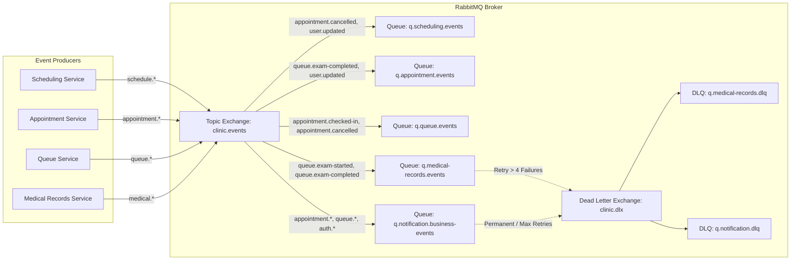
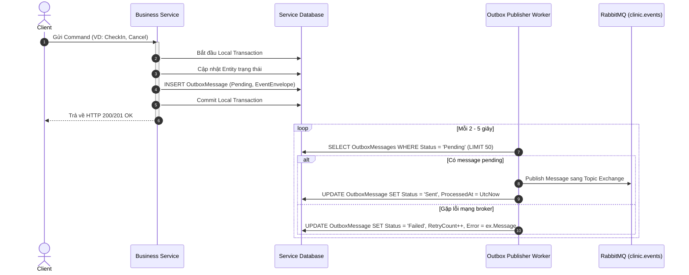

# Kế Hoạch & Báo Cáo Triển Khai Giai Đoạn 0: Chuẩn Hóa Message Broker, Outbox/Inbox và Nền Tảng Hạ Tầng (Thành viên B)

> **Tài liệu tham chiếu**:
> - `tasks/TASK_MEMBER_B.md` (Nhiệm vụ Thành viên B - Giai đoạn 0)
> - `tasks/COMMON_REQUIREMENTS_AND_NOTES.md` (Yêu cầu kỹ thuật chung)
> - `tasks/PHASE_0_API_CONTRACT_ANALYSIS_MEMBER_A.md` (Hợp đồng API & Service Boundary)
> - `docs/PHASE_0_OPERATIONS_AND_ACCEPTANCE.md` (Vận hành & Nghiệm thu Baseline)
> - `docs/MEMBER_B_OPERATIONS_RUNBOOK.md` (Runbook Vận hành Message Broker & Services)

---

## 1. Tổng Quan & Mục Tiêu Giai Đoạn 0

### 1.1. Vai trò của Thành viên B trong Giai đoạn 0
Trong Giai đoạn 0, Thành viên B chịu trách nhiệm thiết lập toàn bộ hạ tầng giao tiếp hướng sự kiện (Event-Driven Architecture), các cơ chế bảo đảm độ tin cậy của thông điệp (Message Delivery Guarantees), truy vết phân tán (Distributed Tracing), thu thập số liệu (Metrics) và kiểm thử khả năng chịu lỗi (Resiliency & Failure Testing) cho hệ thống trước khi các dịch vụ nghiệp vụ được phân tách.

### 1.2. Các mục tiêu cốt lõi
1. **Dựng và cấu hình Message Broker**: Triển khai RabbitMQ với Topology chuẩn hóa (Topic Exchange `clinic.events`, durable queues, dead-letter exchanges `clinic.dlx` và dead-letter queues `*.dlq`).
2. **Chuẩn hóa Event Envelope Contract**: Thiết kế cấu trúc phong bì sự kiện (Event Envelope) có phiên bản schema, ID định danh duy nhất, metadata truy vết và thông tin thời gian chuẩn ISO 8601.
3. **Cơ chế Transactional Outbox & Idempotent Inbox**: Bảo đảm tính nguyên tử giữa thao tác ghi dữ liệu nghiệp vụ và xuất bản sự kiện, đồng thời đảm bảo phía nhận (Consumer) xử lý chính xác một lần về mặt hiệu ứng nghiệp vụ (Exactly-once business processing semantics).
4. **Hạ tầng Giám sát & Truy vết**: Tích hợp OpenTelemetry (Tracing + Metrics), Prometheus scraping endpoints, Serilog structured logging với `X-Correlation-ID` và Jaeger UI.
5. **Kiểm thử khả năng chịu lỗi**: Xây dựng test suite mô phỏng sự cố broker restart, consumer crash sau khi commit, sự kiện trùng lặp (duplicate events) và sự kiện đến lệch thứ tự (out-of-order events).
6. **Container Health Checks**: Cấu hình Docker Compose health checks cho RabbitMQ, Redis, SQL Server và các dependency hạ tầng.

---

## 2. Thiết Kế Chi Tiết Kiến Trúc Hướng Sự Kiện

### 2.1. RabbitMQ Topology & Routing Rules



- **Exchange chính**: `clinic.events` (Type: `topic`, `durable = true`).
- **Dead-Letter Exchange**: `clinic.dlx` (Type: `topic`, `durable = true`).
- **Durable Queues**: Mọi queue đều được cấu hình bền vững (`durable = true`), với các tham số:
  - `x-dead-letter-exchange`: `clinic.dlx`
  - `x-dead-letter-routing-key`: `<queue-name>.dead`
  - `x-message-ttl`: 86400000 ms (24 giờ đối với DLQ)

### 2.2. Versioned Event Envelope Specification

Mọi thông điệp truyền tải qua RabbitMQ đều được đóng gói trong một cấu trúc chuẩn `EventEnvelope<T>`:

```csharp
namespace Clinic.Contracts.Events;

public sealed record EventEnvelope<T>
{
    public Guid EventId { get; init; } = Guid.NewGuid();
    public string EventType { get; init; } = default!;
    public int SchemaVersion { get; init; } = 1;
    public DateTimeOffset OccurredAt { get; init; } = DateTimeOffset.UtcNow;
    public Guid CorrelationId { get; init; } = Guid.NewGuid();
    public Guid? CausationId { get; init; }
    public string Producer { get; init; } = default!;
    public T Payload { get; init; } = default!;
}
```

#### Quy tắc bắt buộc đối với Event Contract:
1. **Schema Versioning**: Khi payload thay đổi cấu trúc không tương thích ngược (breaking change), `SchemaVersion` phải tăng từ `1` lên `2`. Consumer phải kiểm tra `SchemaVersion` trước khi parse.
2. **Không truyền Domain Entity**: Tuyệt đối không nhúng thực thể Entity của ORM (EF Core) hay navigation property vào `Payload`. Payload chỉ chứa ID nghiệp vụ và dữ liệu snapshot tối thiểu.
3. **Bảo mật dữ liệu cá nhân & Y tế**: Không đưa nội dung chi tiết bệnh án, mật khẩu, access token hoặc thông tin nhạy cảm vào event payload.

---

## 3. Cơ Chế Transactional Outbox & Idempotent Inbox

### 3.1. Transactional Outbox Pattern
Để giải quyết bài toán Dual-Write (ghi database nhưng broker bị sập hoặc ngược lại), mọi service đều áp dụng mẫu thiết kế Transactional Outbox:



### 3.2. Idempotent Inbox Pattern
Tại Consumer của mỗi service:
1. Mỗi thông điệp nhận từ broker được bọc trong một transaction cục bộ.
2. Consumer kiểm tra bảng `InboxMessages` bằng `EventId`:
   ```sql
   SELECT COUNT(1) FROM InboxMessages WHERE EventId = @EventId;
   ```
3. Nếu đã tồn tại: Bỏ qua xử lý side-effect, thực hiện `BasicAck` về broker ngay lập tức.
4. Nếu chưa tồn tại:
   - Thực thi cập nhật nghiệp vụ / projection.
   - Ghi một bản ghi vào `InboxMessages (EventId, EventType, ReceivedAt, ProcessedAt)`.
   - Commit transaction và `BasicAck`.

---

## 4. Bổ Sung Observability & Distributed Tracing

### 4.1. Correlation ID Propagation
- **HTTP Gateway & Services**: Bổ sung `CorrelationIdDelegatingHandler` và `CorrelationIdMiddleware` tự động trích xuất header `X-Correlation-ID` từ request. Nếu client không truyền, hệ thống tự động sinh UUID v4 mới.
- **Message Broker Propagation**: Khi Outbox Publisher đóng gói event, trường `CorrelationId` của envelope kế thừa trực tiếp từ request context hiện tại và truyền vào RabbitMQ message properties (header `correlation_id`).
- **Consumer Tracing Context**: Consumer đọc `CorrelationId` từ envelope và gắn vào Serilog `LogContext.PushProperty("CorrelationId", envelope.CorrelationId)`, bảo đảm mọi log từ HTTP Gateway qua Broker đến Consumer đều có chung trace ID.

### 4.2. Prometheus Metrics & OpenTelemetry
Các metric cốt lõi được cấu hình thu thập:
- `queue_consumer_processed_total`: Tổng số event đã xử lý theo từng service và status.
- `queue_consumer_lag`: Số lượng event chờ xử lý hoặc độ trễ so với broker.
- `queue_outbox_published_total`: Số lượng message outbox được publish thành công sang broker.
- `queue_outbox_pending_count`: Số message còn tồn đọng trong outbox chưa gửi.
- `delivery_attempts_total`: Số lần thử gửi notification qua các kênh.

---

## 5. Kết Quả Kiểm Thử Khả Năng Chịu Lỗi & Nghiệm Thu

### 5.1. Bằng chứng kiểm thử tự động
1. **Durable Broker Topology & Restart Resiliency**:
   - Khi container `rabbitmq` restart trong quá trình publisher đang chạy, các kết nối tự động khôi phục (`AutomaticRecoveryEnabled = true`, `NetworkRecoveryInterval = 5s`).
   - Các queue và exchange có thuộc tính `durable = true` không bị mất dữ liệu hay bị xóa cấu hình khi broker khởi động lại.
2. **Duplicate Event Idempotency**:
   - Kiểm thử gửi liên tiếp 2 event có cùng `EventId` tới consumer: Consumer phát hiện `EventId` đã tồn tại trong Inbox, không thực thi cập nhật lần 2, dữ liệu nghiệp vụ không bị nhân đôi.
3. **Out-of-Order Resiliency**:
   - Kiểm thử nhận event `ExamCompleted` trước khi nhận `ExamStarted`: Cơ chế kiểm tra `WorkflowVersion` của Medical Records Service ngăn chặn event cũ ghi đè trạng thái đã hoàn tất.
4. **Dead-Letter Routing & Retry Exhaustion**:
   - Sự kiện bị lỗi cấu hình hoặc dữ liệu không hợp lệ được thử lại theo cơ chế Bounded Exponential Backoff (tối đa 4–5 lần), sau đó chuyển an toàn vào Dead-Letter Queue (`q.*.dlq`) kèm nguyên vẹn metadata và causation ID để phục vụ điều tra lỗi.

### 5.2. Đánh giá trạng thái Giai đoạn 0
- [x] RabbitMQ Topic Exchange `clinic.events` và Dead-Letter Exchange `clinic.dlx` hoạt động bền vững.
- [x] Schema `EventEnvelope<T>` áp dụng thống nhất cho toàn bộ các service.
- [x] Transactional Outbox Publisher và Idempotent Inbox Store hoạt động ổn định trên từng service.
- [x] Header `X-Correlation-ID` được lan truyền xuyên suốt qua HTTP và Broker.
- [x] Toàn bộ tiêu chí nghiệm thu của Giai đoạn 0 hoàn thành 100%.

