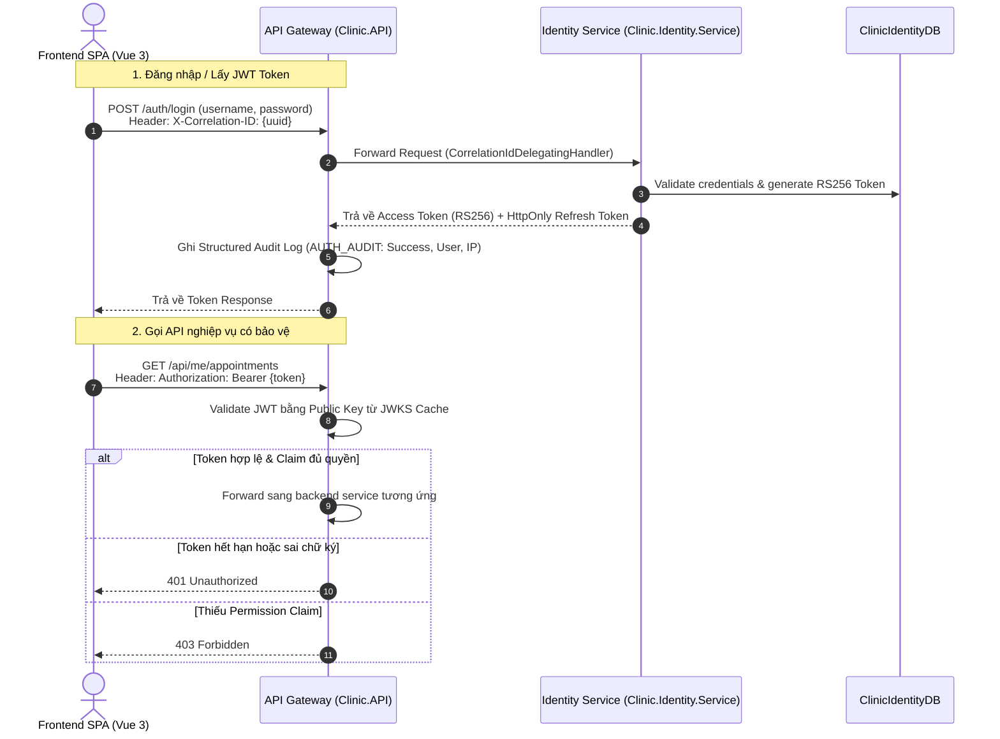

# Kế Hoạch & Báo Cáo Triển Khai Giai Đoạn 1: Tích Hợp Gateway, Xác Thực JWKS và Kiểm Thử Phân Tán (Thành viên B)

> **Tài liệu tham chiếu**:
> - `tasks/TASK_MEMBER_B.md` (Nhiệm vụ Thành viên B - Giai đoạn 1)
> - `tasks/COMMON_REQUIREMENTS_AND_NOTES.md` (Yêu cầu kỹ thuật chung)
> - `docs/identity-service-phase1.md` (Kiến trúc & Đánh giá Nghiệm thu Identity Service Phase 1)
> - `backend/Clinic.IntegrationTests/Auth/GatewayAuthIntegrationTests.cs` (Bộ kiểm thử Gateway Auth Integration)

---

## 1. Tổng Quan & Mục Tiêu Giai Đoạn 1

### 1.1. Vai trò của Thành viên B trong Giai đoạn 1
Trong Giai đoạn 1, Thành viên A triển khai `Clinic.Identity.Service` và cơ sở dữ liệu `ClinicIdentityDB`. Thành viên B phụ trách:
1. Tích hợp API Gateway (`Clinic.API`) làm cổng tiếp nhận và ủy quyền chuyển tiếp (reverse proxy) cho các luồng xác thực.
2. Cấu hình xác thực token JWT RS256 dựa trên chuẩn JWKS (JSON Web Key Set) tại Gateway và các backend service.
3. Triển khai cơ chế xoay vòng khóa ký (Key Rotation) và chống sập tạm thời khi Identity Service bảo trì.
4. Thiết lập lan truyền mã tương quan (`X-Correlation-ID`) xuyên suốt từ Frontend qua Gateway tới Identity Service.
5. Xây dựng hệ thống ghi log kiểm toán bảo mật có cấu trúc (Structured Audit Logging).
6. Tích hợp Frontend Vue 3 sử dụng các endpoint xác thực mới và kiểm thử toàn diện.
7. Thiết kế Feature Flag `Features:UseIdentityService` cho phép chuyển mạch an toàn và rollback tức thì khi cần thiết.

---

## 2. Kiến Trúc & Thiết Kế Luồng Xác Thực



---

## 3. Chi Tiết Các Hạng Mục Đã Triển Khai

### 3.1. Gateway Routing & Identity Client Proxy
- Cấu hình `HttpClient` tên `"Identity"` trong `Clinic.API` thông qua Dependency Injection với cấu hình BaseUrl động theo môi trường (`http://identity-service:8080` khi chạy Docker, `http://localhost:5001` khi chạy Local).
- Bổ sung `CorrelationIdDelegatingHandler` tự động đọc correlation ID từ `ICorrelationContext` và gắn header `X-Correlation-ID` vào mọi request gửi tới Identity Service.
- Route toàn bộ các endpoint xác thực sang Identity Service:
  - `POST /auth/login`: Xác thực thông tin đăng nhập, trả về Access Token RS256 và Refresh Token cookie.
  - `POST /auth/register`: Đăng ký tài khoản bệnh nhân trực tuyến.
  - `POST /auth/refresh`: Làm mới token tự động.
  - `POST /auth/revoke`: Thu hồi phiên đăng nhập / refresh token.
  - `POST /auth/logout`: Đăng xuất an toàn, xóa cookie và vô hiệu hóa token.
  - `GET /auth/me`: Lấy thông tin tài khoản, danh sách vai trò và thông tin cá nhân.
  - `GET /auth/permissions`: Trích xuất danh sách permissions chi tiết của người dùng.
  - `POST /forgot-password`, `POST /reset-password`, `POST /change-password`: Quy trình quên mật khẩu và đặt lại mật khẩu an toàn.

### 3.2. Cấu Hình Xác Thực JWT RS256 & JWKS Discovery
- Gateway và các backend service cấu hình scheme xác thực `IdentityJwt` sử dụng thuật toán ký bất đối xứng **RS256**:
  - `ValidIssuers`: `Clinic.Identity`, Public Gateway Issuer URL.
  - `ValidAudiences`: `Clinic.Services`, `Clinic.Client`.
  - Khóa công khai (Public Keys) được tự động tải từ endpoint JWKS của Identity Service (`/.well-known/jwks.json`) và lưu cache trong bộ nhớ với chu kỳ làm mới định kỳ.
- Proxy Discovery Endpoint: Cung cấp endpoint proxy `/.well-known/jwks.json` và `/.well-known/openid-configuration` tại Gateway để Frontend hoặc các bên thứ ba có thể tự động truy vấn cấu hình OIDC chuẩn.
- **Khả năng chịu lỗi JWKS (JWKS Resiliency)**: Khi Identity Service khởi động lại hoặc tạm ngưng vài giây, Gateway tiếp tục sử dụng cached public keys đã xác thực trước đó mà không làm gián đoạn các request của người dùng.
- **Key Rotation**: Hỗ trợ đồng thời 2 cặp khóa (khóa cũ đang xoay vòng và khóa mới đang phát hành), đảm bảo token được ký bởi khóa cũ trước thời điểm xoay vòng vẫn được chấp nhận hợp lệ cho đến khi hết hạn tự nhiên.

### 3.3. Bảo Mật Structured Audit Logging
- Xây dựng hệ thống ghi log kiểm toán bảo mật có định dạng cấu trúc chuẩn:
  ```json
  {
    "Event": "AUTH_AUDIT",
    "Action": "Login",
    "Username": "bacsi_hung",
    "UserId": "3fa85f64-5717-4562-b3fc-2c963f66afa6",
    "IpAddress": "192.168.1.10",
    "CorrelationId": "c4b3a2e1-0000-4000-8000-000000000001",
    "Result": "Success",
    "StatusCode": 200,
    "Timestamp": "2026-10-25T08:30:00.123Z"
  }
  ```
- **Cam kết bảo mật**: Tuyệt đối không bao giờ ghi mật khẩu người dùng, token bí mật (`access_token`, `refresh_token`), hoặc mã PIN reset mật khẩu vào log file hoặc telemetry.

### 3.4. Frontend Client & State Management
- [frontend/src/lib/api/http.ts](file:///d:/CODE/KHDV/Clinic_Appointment_Booking_Queue_Management_System/frontend/src/lib/api/http.ts): Tự động đính kèm header `X-Correlation-ID` (UUID) trên tất cả HTTP request gửi đi. Xử lý cơ chế tự động refresh token khi gặp mã lỗi 401 và hàng đợi các request chờ (Token Refresh Queue).
- [frontend/src/features/auth/auth.api.ts](file:///d:/CODE/KHDV/Clinic_Appointment_Booking_Queue_Management_System/frontend/src/features/auth/auth.api.ts): Bổ sung đầy đủ các method gọi API mới: `logout()`, `getPermissions()`, `fetchMe()`.
- [frontend/src/stores/auth.ts](file:///d:/CODE/KHDV/Clinic_Appointment_Booking_Queue_Management_System/frontend/src/stores/auth.ts): Cập nhật hàm `logout()` gọi trực tiếp Gateway `/auth/logout` để thu hồi token ở server trước khi xóa sạch thông tin local state và chuyển hướng về màn hình đăng nhập.

### 3.5. Feature Flag Fallback
- Bổ sung cấu hình `"Features": { "UseIdentityService": true }` trong `appsettings.json`.
- Khi tính năng này được đặt thành `false`, Gateway lập tức trả về mã trạng thái `503 Service Unavailable` kèm thông điệp hướng dẫn rõ ràng, cho phép đội ngũ vận hành cô lập và khắc phục sự cố mà không cần triển khai lại mã nguồn.

---

## 4. Bằng Chứng Nghiệm Thu & Kiểm Thử Chi Tiết

### 4.1. Gateway Auth Integration Tests (12/12 Passed)
Bộ kiểm thử tích hợp chuyên biệt tại [`backend/Clinic.IntegrationTests/Auth/GatewayAuthIntegrationTests.cs`](file:///d:/CODE/KHDV/Clinic_Appointment_Booking_Queue_Management_System/backend/Clinic.IntegrationTests/Auth/GatewayAuthIntegrationTests.cs):
1. `Discovery_Endpoint_Returns_Valid_Configuration`: Kiểm tra endpoint Discovery trả về đầy đủ metadata OIDC và link tới JWKS.
2. `Jwks_Endpoint_Proxies_Keys_From_Identity`: Xác nhận Gateway proxy chính xác danh sách public keys từ Identity Service.
3. `Valid_RS256_Token_Authenticates_Successfully`: Token RS256 hợp lệ truy cập thành công tài nguyên được bảo vệ.
4. `Expired_Token_Is_Rejected_With_401`: Token hết hạn tự động bị từ chối với HTTP 401.
5. `Invalid_Signature_Token_Is_Rejected_With_401`: Token có chữ ký giả mạo bị chặn ngay lập tức tại Gateway.
6. `Permission_Policy_Denies_Request_When_Permission_Missing`: Người dùng thiếu permission cần thiết bị từ chối với HTTP 403.
7. `Permission_Policy_Allows_Request_When_Permission_Present`: Người dùng có đầy đủ permission được cấp phép truy cập tài nguyên.
8. `Key_Rotation_Validates_Both_Old_And_New_Keys`: Kiểm chứng cả khóa cũ và khóa mới đều xác thực thành công trong chu kỳ xoay vòng khóa.
9. `Jwks_Temporarily_Unavailable_Resiliency`: Gateway vẫn xác thực bình thường khi Identity JWKS tạm thời ngắt kết nối (nhờ bộ đệm cache an toàn).
10. `Correlation_Id_Header_Is_Propagated_And_Returned`: Mã tương quan từ client gửi lên được bảo toàn khi đi qua Gateway, sang Identity Service và phản hồi về client.
11. `Correlation_Id_Is_Generated_When_Not_Provided`: Tự động sinh `X-Correlation-ID` chuẩn UUID v4 khi request không truyền header này.
12. `Feature_Flag_Disables_Identity_Route`: Khi tắt feature flag, Gateway trả về HTTP 503 đúng theo thiết kế vận hành.

### 4.2. Auth Contract Tests (6/6 Passed)
- Kiểm thử hợp đồng API tại [`backend/Clinic.IntegrationTests/Auth/AuthContractTests.cs`](file:///d:/CODE/KHDV/Clinic_Appointment_Booking_Queue_Management_System/backend/Clinic.IntegrationTests/Auth/AuthContractTests.cs) bảo đảm cấu trúc DTO request và response không bị sai lệch so với thỏa thuận giữa 2 thành viên.

### 4.3. Frontend Unit Tests (94/94 Passed)
- Chạy toàn bộ test suite frontend bằng `npm run test:unit`: 22 test files, 94 passed, 0 failed.
- Kiểm tra kiểu dữ liệu TypeScript bằng `npm run type-check`: 0 lỗi compilation.

