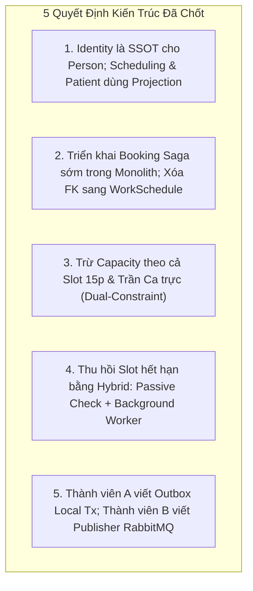
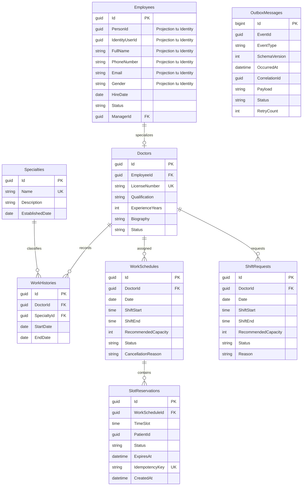
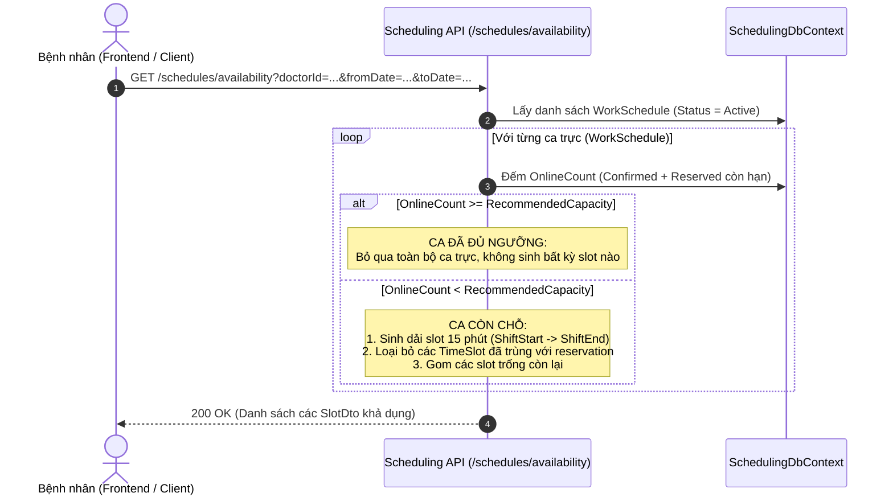
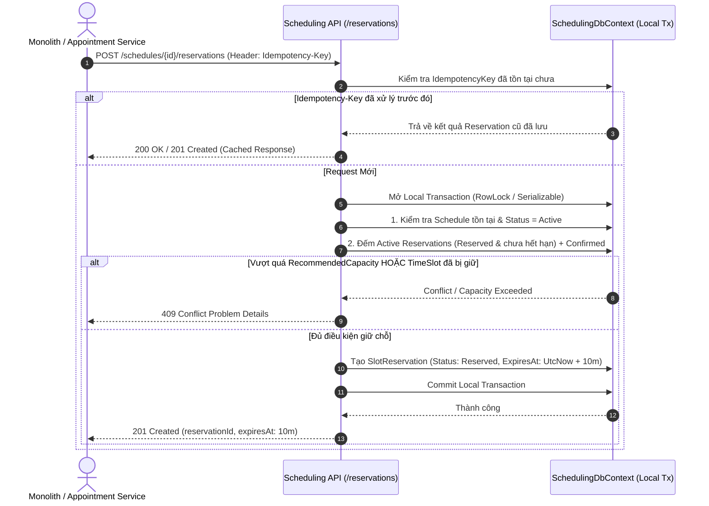
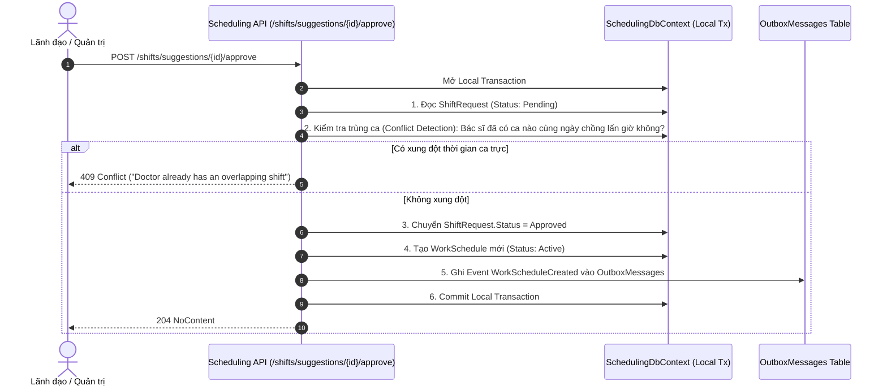
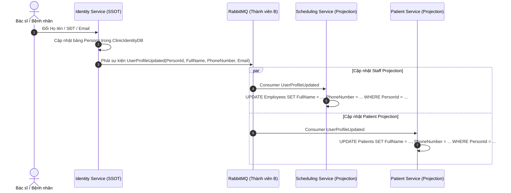

# Kế Hoạch Triển Khai Giai Đoạn 2: Tách Staff & Scheduling Service

> **Tài liệu tham chiếu**:
>
> - `tasks/TASK_MEMBER_A.md` (Nhiệm vụ Thành viên A - Giai đoạn 2)
> - `tasks/TASK_MEMBER_B.md` (Nhiệm vụ Thành viên B - Giai đoạn 2)
> - `tasks/COMMON_REQUIREMENTS_AND_NOTES.md` (Yêu cầu kỹ thuật chung)
> - `tasks/PHASE_0_API_CONTRACT_ANALYSIS.md` (Phân tích API Contract & Service Boundary)
> - `docs/identity-service-phase1.md` (Bài học kinh nghiệm & Tiền lệ từ Giai đoạn 1)

---

## 1. Tổng Quan & Mục Tiêu Giai Đoạn 2

### 1.1. Mục tiêu cốt lõi

Giai đoạn 2 tập trung vào việc tách toàn bộ chức năng quản lý nhân sự y tế, bác sĩ, chuyên khoa, lịch làm việc và năng lực phục vụ (capacity) ra khỏi Monolith để hình thành một microservice độc lập: **Staff & Scheduling Service** (`Clinic.Scheduling.Service`).

Dịch vụ này sở hữu cơ sở dữ liệu riêng biệt (`ClinicSchedulingDB`), không chia sẻ bảng, không liên kết khóa ngoại (Foreign Key) và không thực hiện truy vấn trực tiếp xuyên database với bất kỳ dịch vụ nào khác.

### 1.2. Quyết định kiến trúc nền tảng: Mô hình "Single Identity – Role-Specific Projections"

Hệ thống **duy trì trọn vẹn khả năng 1 con người nhận nhiều vai trò** (ví dụ: Bác sĩ vừa có thể khám bệnh, vừa có thể là Bệnh nhân tự đặt lịch khám cho chính mình).

Kiến trúc thống nhất như sau:

1. **Identity Service làm Nguồn sự thật duy nhất (Single Source of Truth - SSOT)** cho tài khoản và nhân thân cơ bản: Sở hữu bảng `Users` và `Persons` (`PersonProfile` gồm `FullName`, `PhoneNumber`, `Email`, `DateOfBirth`, `Gender`, `Address`) trong `ClinicIdentityDB`.
2. **Các Business Services (Scheduling, Medical/Patient) sử dụng Projection (Bản chiếu)**:
    - Trong `Clinic.Scheduling.Service`: `Employee` và `Doctor` lưu projection các trường nhân thân (`PersonId`, `IdentityUserId`, `FullName`, `PhoneNumber`, `Email`, `Gender`) để phục vụ truy vấn tại chỗ siêu tốc mà không cần gọi RPC sang Identity.
    - Trong `Medical / Patient Service` (hiện ở `ClinicDB`, tương lai tách riêng ở GĐ 5): `Patient` lưu projection các trường nhân thân (`PersonId`, `IdentityUserId`, `FullName`, `PhoneNumber`, `DateOfBirth`, `Gender`, `Address`) kết hợp dữ liệu y tế (BHYT, tiền sử bệnh).
3. **Đồng bộ hóa qua Event-Driven**: Khi người dùng cập nhật thông tin tại Identity Service, sự kiện `UserProfileUpdated` được phát qua Message Broker để các service tự cập nhật bản chiếu của mình.
4. **Bệnh nhân vãng lai (Walk-in)**: Lễ tân tạo trực tiếp `Patient` trong Patient Service với `IdentityUserId = null`. Khi bệnh nhân đăng ký tài khoản online sau này bằng cùng số điện thoại, Identity Service sẽ liên kết `IdentityUserId` vào hồ sơ `Patient` sẵn có.
5. **Tiền đề vững chắc cho Giai đoạn 5 (Tách Patient Service)**: Đến GĐ 5, việc tách `Patient` thành service riêng hoàn toàn độc lập và sạch sẽ, không bị vướng mắc khóa ngoại với bất kỳ service nào.

### 1.3. Các Aggregate và Entity chuyển giao quyền sở hữu

| Entity / Aggregate               | Vai trò nghiệp vụ trong Scheduling Service                                                                                                             |
| :------------------------------- | :----------------------------------------------------------------------------------------------------------------------------------------------------- |
| `Employee`                       | Quản lý thông tin nghề nghiệp, ngày vào làm, cấp trên, kèm **bản chiếu nhân thân** (`PersonId`, `IdentityUserId`, `FullName`, `PhoneNumber`, `Email`). |
| `Doctor`                         | Quản lý thông tin chuyên môn bác sĩ, số CCHN, học vị, kinh nghiệm, liên kết `EmployeeId`.                                                              |
| `Specialty`                      | Danh mục chuyên khoa lâm sàng.                                                                                                                         |
| `WorkHistory`                    | Lịch sử phân công bác sĩ vào các chuyên khoa qua các thời kỳ.                                                                                          |
| `WorkSchedule`                   | Ca làm việc của bác sĩ theo ngày, khung giờ và hạn mức năng lực phục vụ (`RecommendedCapacity`).                                                       |
| `ShiftRequest`                   | Đề xuất đăng ký ca, đổi ca của bác sĩ chờ ban quản lý phê duyệt.                                                                                       |
| `SlotReservation` _(Entity mới)_ | Quản lý giữ chỗ tạm thời (có timeout & idempotency) để loại bỏ hoàn toàn nguy cơ overbooking.                                                          |
| `OutboxMessage` _(Entity mới)_   | Lưu trữ các sự kiện lịch trực trong cùng local transaction để publisher gửi sang Message Broker.                                                       |

---

## 2. Các Quyết Định Kiến Trúc Đã Chốt Cho Giai Đoạn 2

Dựa trên quá trình đối soát và thống nhất định hướng, dưới đây là **5 quyết định kiến trúc chính thức**:

### 2.1. Quyết định 1: Quản lý Nhân thân & Mô hình Đa vai trò (Multi-Role)

- **Nguồn sự thật (SSOT)**: `Clinic.Identity.Service` (`ClinicIdentityDB`) sở hữu bảng `Persons` (`PersonProfile`).
- **Liên kết**: `IdentityUser` lưu `PersonId`, `PatientId`, `DoctorId`, `EmployeeId` và nhúng trực tiếp vào Claims của Access Token (`sub`, `personId`, `roles`, `patientId`, `doctorId`, `employeeId`).
- **Bản chiếu (Projection)**: `Clinic.Scheduling.Service` lưu thông tin nhân sự `Employee` có sẵn các cột projection: `IdentityUserId`, `PersonId`, `FullName`, `PhoneNumber`, `Email`, `Gender`. Khi truy vấn danh sách bác sĩ, lịch trực, service đọc trực tiếp từ DB của mình.
- **Bệnh nhân vãng lai**: Lễ tân tạo hồ sơ trong Patient Service với `IdentityUserId = null`.
- **Đồng bộ Event**: Khi đổi thông tin cá nhân, Identity Service phát `UserProfileUpdated` để Scheduling Service cập nhật bản chiếu.

---

### 2.2. Quyết định 2: Tách biệt Quan hệ giữa `Appointment` và `WorkSchedule`

- **Tái cấu trúc bảng `Appointments` trong `ClinicDB`**:
    1. Thêm các cột denormalized: `DoctorId` (Guid), `DoctorName` (nvarchar 200), `SpecialtyName` (nvarchar 100), `ScheduleDate` (DateOnly).
    2. Xóa bỏ Foreign Key `FK_Appointments_WorkSchedules_WorkScheduleId` trong `ClinicDB`.
    3. Cập nhật các câu query lịch hẹn đọc trực tiếp từ các cột denormalized, không còn navigation property `WorkSchedule`.
- **Triển khai Booking Saga sớm trong Monolith (`Clinic.API`)**:
    - Tại `CreateAppointmentCommandHandler`:
        1. Gọi HTTP API `POST /schedules/{id}/reservations` sang `Clinic.Scheduling.Service` để giữ chỗ (kèm `Idempotency-Key`).
        2. Nếu thành công, lưu `Appointment` mới vào `ClinicDB` với trạng thái `Pending`.
        3. Gọi HTTP API `POST .../confirm` để chốt giữ chỗ $\rightarrow$ Chuyển `Appointment.Status = Confirmed`.
        4. Nếu bước lưu `Appointment` thất bại, gọi `POST .../release` để giải phóng slot ngay lập tức.
    - **Lợi ích**: Cắt đứt hoàn toàn FK/join xuyên service ngay từ GĐ 2, tạo nền tảng để đến Giai đoạn 3 tách `Appointment Service` chỉ là chuyển code sang project mới.

---

### 2.3. Quyết định 3: Quy tắc trừ Capacity, Hiển thị Slot Online và Cơ chế Linh hoạt cho Khách Vãng lai (Walk-in)

Thống nhất quy tắc quản lý năng lực ca trực và sinh slot giữa 2 luồng: **Đặt lịch Online** và **Tiếp nhận Khách vãng lai (Walk-in)**:

1. **Phân biệt rạch ròi 2 luồng đặt lịch**:
    - **Luồng Đặt lịch Online (Bệnh nhân tự đặt qua Web/App)**:
        - Bắt buộc tuân thủ hạn mức `RecommendedCapacity` (Hạn mức đề xuất cho online).
        - Bắt buộc tuân thủ slot 15 phút cố định, chống trùng lặp giờ giữa các bệnh nhân online.
    - **Luồng Khách vãng lai (Lễ tân tiếp nhận tại quầy - Walk-in)**:
        - Lễ tân có thể trao đổi linh hoạt với bác sĩ đang trực để quyết định có nhận thêm bệnh nhân hay không.
        - **Được phép đặt vượt ngưỡng đề xuất (`RecommendedCapacity`)**: Bác sĩ có thể nhận thêm ca ngoài định mức khi có ca khẩn cấp hoặc khi bác sĩ đồng ý tăng cường tiếp nhận.
        - **Không bị ràng buộc bởi Unique Slot 15 phút**: Bệnh nhân vãng lai có thể được xếp vào khám chèn/khám tiếp theo mà không chiếm slot đặt trước của bệnh nhân online (`Appointments.IsWalkIn = true`).
2. **Khoảng cách và Sinh Slot cho Online**:
    - Khoảng thời gian giữa mỗi slot là **15 phút**.
    - Các slot 15 phút được **sinh động phủ kín toàn bộ thời lượng ca trực** (từ `ShiftStart` đến `ShiftEnd`). Ví dụ ca 08:00 - 11:30 sẽ sinh ra các slot: 08:00, 08:15, 08:30, ..., 11:15 để người đặt lịch tự do chọn mốc thời gian phù hợp.
3. **Quy tắc Chặn khi Ca trực Đạt/Vượt Ngưỡng (`RecommendedCapacity`)**:
    - Mỗi ca làm việc có một hạn mức `RecommendedCapacity` (ví dụ: `RecommendedCapacity = 10`).
    - Tổng số lượt đặt online được tính bằng:
      $$\text{OnlineCount} = \text{Count}(\text{SlotReservations where Status = 'Confirmed' OR (Status = 'Reserved' AND ExpiresAt > UtcNow)})$$
    - Các lịch hẹn vãng lai (`IsWalkIn = true`) **không tính vào `OnlineCount`**.
    - **Hành vi khi xem lịch (Availability)**: Khi người dùng xem danh sách ca để đặt lịch online, **nếu một ca trực nào đã đạt hoặc vượt ngưỡng (`OnlineCount >= RecommendedCapacity`), hệ thống SẼ KHÔNG TRẢ VỀ BẤT KỲ SLOT NÀO CỦA CA ĐÓ NỮA**, mặc dù về mặt lý thuyết ca đó vẫn còn các mốc 15 phút chưa ai đặt. Ca trực được coi như đã "Hết chỗ" (Full) đối với luồng online.
4. **Kiểm tra 2 Lớp Nguyên Tử khi Giữ Chỗ Online (`ReserveSlot`)**:
    - Khi gửi yêu cầu `POST /schedules/{scheduleId}/reservations`:
        - **Lớp 1 (Kiểm tra Ngưỡng Ca)**: Nếu `OnlineCount >= RecommendedCapacity` $\rightarrow$ Từ chối ngay với mã lỗi `409 Conflict ("Ca làm việc đã đủ số lượng đặt khám online.")`.
        - **Lớp 2 (Kiểm tra Khung giờ cụ thể)**: Nếu khung giờ cụ thể đó (`TimeSlot`) đã có người khác giữ chỗ (`Reserved` chưa hết hạn) hoặc đã xác nhận (`Confirmed`) $\rightarrow$ Từ chối với mã lỗi `409 Conflict ("Khung giờ này đã được người khác đặt.")`.
        - Nếu thỏa mãn cả 2 lớp trong transaction: Tạo `SlotReservation` mới với `Status = Reserved`, `ExpiresAt = UtcNow + 10m`.

- Thực hiện kiểm tra và ghi nhận trong 1 local database transaction có khóa dòng (RowLock / Serializable) để đảm bảo không bao giờ bị overbooking khi có nhiều request online gửi đồng thời.

---

### 2.4. Quyết định 4: Cơ chế thu hồi Reservation khi hết hạn (Hybrid Expiration)

- **Passive Expiration (Thời gian thực)**: Trong query `GetAvailability` và command `ReserveSlot`, bất kỳ reservation nào có `Status == Reserved && ExpiresAt <= UtcNow` được tự động coi là đã hết hạn và không chiếm capacity.
- **Active Expiration (Background Worker)**: Một `IHostedService` (`ReservationExpirationWorker`) chạy định kỳ mỗi 30 giây trong Scheduling Service để cập nhật trạng thái các reservation quá hạn thành `Expired` và ghi log/metrics cho Thành viên B theo dõi.

---

### 2.5. Quyết định 5: Phân định ranh giới Outbox và Message Broker

- **Thành viên A**:
    - Thiết kế bảng `OutboxMessages` trong `SchedulingDbContext`.
    - Cài đặt `IOutboxWriter` để serialize domain events (`WorkScheduleCreated`, `WorkScheduleUpdated`, `WorkScheduleCancelled`) theo chuẩn `EventEnvelope<T>` và ghi vào `OutboxMessages` trong cùng local transaction của EF Core khi duyệt ca, sửa ca, hủy ca.
- **Thành viên B**:
    - Triển khai `OutboxPublisher` (Background Service) đọc bảng `OutboxMessages` để đẩy sang RabbitMQ.
    - Triển khai Consumer và Contract Test cho các sự kiện này.

---

## 3. Thiết Kế Kiến Trúc Dịch Vụ Staff & Scheduling

### 3.1. Cấu trúc Project

- **Project**: `backend/Clinic.Scheduling.Service/Clinic.Scheduling.Service.csproj` (.NET 10.0 Web API).
- **Test Project**: `backend/Clinic.Scheduling.Service.Tests/Clinic.Scheduling.Service.Tests.csproj` (xUnit).
- **Dependencies**: Tham chiếu `Clinic.Contracts` (để dùng chung `EventEnvelope<T>` và `WorkScheduleEvents`). Không phụ thuộc vào `Clinic.Domain` hay `Clinic.Infrastructure.Sqlserver` của Monolith.

### 3.2. Thiết Kế Cơ Sở Dữ Liệu `ClinicSchedulingDB`

Mỗi bảng trong `ClinicSchedulingDB` hoàn toàn độc lập, có audit columns (`CreatedAt`, `UpdatedAt`, `IsDeleted`):

---

### 3.3. Các Quy Trình Nghiệp Vụ Cốt Lõi (Workflows)

#### Quy trình 1: Tra cứu khung giờ khả dụng (GetAvailability) với kiểm tra ngưỡng ca trực

#### Quy trình 2: Giữ chỗ slot (ReserveSlot) với kiểm tra Capacity nguyên tử & Idempotency

#### Quy trình 2: Duyệt ca làm việc (Approve Shift Request & Conflict Detection)

#### Quy trình 3: Đồng bộ Thông tin Cá nhân khi có thay đổi (UserProfileUpdated)

---

## 4. Kế Hoạch Thực Hiện Chi Tiết Từng Bước (Step-by-Step Execution Plan)

### Bước 1: Khởi Tạo Service & Thiết Lập Hạ Tầng Cơ Bản

1. **Tạo Project mới**:
    - `dotnet new webapi -n Clinic.Scheduling.Service -o backend/Clinic.Scheduling.Service`.
    - `dotnet new xunit -n Clinic.Scheduling.Service.Tests -o backend/Clinic.Scheduling.Service.Tests`.
    - Thêm vào `backend/Clinic.sln`.
    - Tham chiếu `Clinic.Contracts` vào `Clinic.Scheduling.Service`.
2. **Cài đặt thư viện**:
    - `Microsoft.EntityFrameworkCore.SqlServer` (10.x).
    - `Microsoft.EntityFrameworkCore.Design` (10.x).
    - `Microsoft.AspNetCore.Authentication.JwtBearer` (10.x).
    - `FluentValidation.AspNetCore`.
3. **Cấu hình Xác thực JWT độc lập qua JWKS (Identity Service)**:
    - Trong `Program.cs`, cấu hình `JwtBearer` sử dụng `MetadataAddress` hoặc `IssuerSigningKeyResolver` trỏ tới discovery endpoint `http://identity-service:8080/.well-known/jwks.json`. Không truy cập `ClinicIdentityDB`.
4. **Cấu hình Docker & Docker Compose**:
    - Tạo `backend/Clinic.Scheduling.Service/Dockerfile`.
    - Thêm service `scheduling-service` vào `docker-compose.yml`:
        - Cổng host: `5002:8080`.
        - Biến môi trường: `ConnectionStrings__SchedulingConnection`, `Jwt__Issuer`, `Jwt__Audience`, v.v.
        - Health check: `/healthz` và `/readyz`.

---

### Bước 2: Xây Dựng Domain Model & Persistence Layer (`ClinicSchedulingDB`)

1. **Định nghĩa các Entity**:
    - `Employee`: `Id`, `PersonId`, `IdentityUserId`, `FullName`, `PhoneNumber`, `Email`, `Gender`, `HireDate`, `Status`, `ManagerId`.
    - `Doctor`: `Id`, `EmployeeId`, `LicenseNumber`, `Qualification`, `ExperienceYears`, `Biography`, `Status`.
    - `Specialty` & `WorkHistory`: Chuyên khoa và quá trình công tác.
    - `WorkSchedule`: Lịch trực, trạng thái (`Active`, `Full`, `Cancelled`), hạn mức `RecommendedCapacity`.
    - `ShiftRequest`: Đề xuất trực, các phương thức domain: `Approve()`, `Reject()`, `Cancel()`.
    - `SlotReservation`: Bản ghi giữ chỗ với các trường:
        - `Id` (Guid), `WorkScheduleId` (Guid), `TimeSlot` (TimeOnly), `PatientId` (Guid).
        - `Status` (Enum: `Reserved`, `Confirmed`, `Released`, `Expired`).
        - `ExpiresAt` (DateTimeOffset - UTC).
        - `IdempotencyKey` (string - có Unique Index).
    - `OutboxMessage`: Bảng lưu sự kiện tích hợp.
2. **Tạo `SchedulingDbContext` & Fluent API Configurations**:
    - Cấu hình Unique Index cho `SlotReservation(WorkScheduleId, TimeSlot)` có điều kiện filter: `[Status] IN ('Reserved', 'Confirmed')`.
    - Cấu hình Unique Index cho `SlotReservation.IdempotencyKey`.
3. **Tạo Initial Migration**:
    - Tạo migration `20261021_InitialSchedulingSchema` cho `ClinicSchedulingDB`.

---

### Bước 3: Viết Kịch Bản Di Chuyển & Đối Soát Dữ Liệu

1. **Tạo kịch bản Import Dữ liệu**:
    - Tạo tệp `backend/Clinic.Scheduling.Service/Persistence/import-from-clinicdb.sql`:
        - Copy an toàn các bản ghi từ `ClinicDB.dbo.Specialties`, `ClinicDB.dbo.WorkHistories`, `ClinicDB.dbo.WorkSchedules`, `ClinicDB.dbo.ShiftRequests`.
        - Nạp dữ liệu vào `Employees`: JOIN giữa `ClinicDB.dbo.Employees`, `ClinicDB.dbo.Persons` và `ClinicIdentityDB.dbo.Users` để nạp đủ các trường projection nhân thân (`FullName`, `PhoneNumber`, `Email`, `Gender`, `IdentityUserId`).
        - Nạp dữ liệu vào `Doctors` từ `ClinicDB.dbo.Doctors`.
        - Script được thiết kế idempotent (chạy nhiều lần không gây trùng khóa).
2. **Tạo kịch bản Đối soát Dữ liệu**:
    - Tạo tệp `backend/Clinic.Scheduling.Service/Persistence/verify-scheduling-import.sql`:
        - Đối soát tổng số lượng bản ghi giữa 2 database (Yêu cầu `MismatchCount = 0`).
        - Kiểm tra toàn vẹn các cặp liên kết `Doctor -> Employee`.
3. **Thêm container `scheduling-data-importer` vào `docker-compose.yml`** (tương tự như `identity-data-importer` ở Phase 1).

---

### Bước 4: Xây Dựng Bộ API Nghiệp Vụ Cốt Lõi

1. **API Tra cứu Lịch & Khung giờ khả dụng (Availability API)**:
    - Endpoint: `GET /schedules/availability` (hỗ trợ alias `GET /slots`).
    - Query: `doctorId`, `specialtyId`, `fromDate`, `toDate`.
    - **Thuật toán sinh slot & chặn ngưỡng**:
        1. Truy vấn các `WorkSchedule` đang `Active` trong khoảng thời gian yêu cầu.
        2. Với mỗi ca trực, đếm tổng số lượt giữ chỗ/đặt online đang có hiệu lực:
           $$\text{OnlineCount} = \text{Count}(\text{SlotReservations where Status = 'Confirmed' OR (Status = 'Reserved' AND ExpiresAt > UtcNow)})$$
        3. **Kiểm tra ngưỡng đầy ca (`RecommendedCapacity`)**:
            - Nếu $\text{OnlineCount} \ge \text{RecommendedCapacity}$: **Bỏ qua toàn bộ ca trực này (không trả về bất kỳ slot nào)**, kể cả khi vẫn còn mốc giờ 15 phút chưa có ai đặt. Ca trực được xem là đã hết chỗ online.
        4. Nếu $\text{OnlineCount} < \text{RecommendedCapacity}$:
            - Sinh danh sách các khung giờ 15 phút phủ kín từ `ShiftStart` đến `ShiftEnd` (ví dụ `08:00`, `08:15`, `08:30`...).
            - Đánh dấu hoặc loại bỏ các khung giờ đã có người giữ chỗ (`Reserved` chưa hết hạn) hoặc đã xác nhận (`Confirmed`).
            - Trả về danh sách các slot trống còn lại để bệnh nhân tự do lựa chọn.
    - **Cam kết**: Tính toán hoàn toàn trên ca trực và reservations nội bộ của Scheduling Service, tuyệt đối không query sang `Appointments` table hay `ClinicDB`.

2. **Cụm API Reservation (Giữ chỗ - Xác nhận - Bồi hoàn)**:
    - `POST /schedules/{scheduleId}/reservations`:
        - Header bắt buộc: `Idempotency-Key`.
        - Body: `{ "timeSlot": "08:30:00", "patientId": "guid" }`.
        - Xử lý: Kiểm tra Idempotency $\rightarrow$ Bắt đầu Transaction có RowLock $\rightarrow$ **Kiểm tra 2 lớp**:
            1. Tổng số lượt đặt online hợp lệ (`OnlineCount`) phải $< \text{RecommendedCapacity}$ (nếu $\ge$, trả `409 Conflict: Ca làm việc đã đủ số lượng đặt online`).
            2. Khung giờ `timeSlot` cụ thể không được trùng với reservation active nào (nếu trùng, trả `409 Conflict: Khung giờ đã được người khác đặt`).
               $\rightarrow$ Tạo `SlotReservation` với hạn 10 phút $\rightarrow$ Commit Transaction $\rightarrow$ Trả về `201 Created`.
    - `POST /schedules/{scheduleId}/reservations/{reservationId}/confirm`:
        - Chuyển trạng thái `SlotReservation` từ `Reserved` sang `Confirmed`.
    - `POST /schedules/{scheduleId}/reservations/{reservationId}/release`:
        - Chuyển trạng thái `SlotReservation` từ `Reserved` sang `Released` để hồi phục capacity ngay lập tức.

3. **Background Service Tự Động Giải Phóng Slot Quá Hạn**:
    - Tạo `ReservationExpirationWorker : BackgroundService`.
    - Chu kỳ chạy: Mỗi 30 giây.
    - Nhiệm vụ: `UPDATE SlotReservations SET Status = 'Expired' WHERE Status = 'Reserved' AND ExpiresAt <= GETUTCDATE()`.

4. **Nghiệp vụ Phê Duyệt Ca & Phát Hiện Xung Đột (Shift Request Approval)**:
    - Endpoint: `POST /shifts/suggestions/{id}/approve`.
    - Logic: Kiểm tra xung đột lịch của bác sĩ trong cùng ngày $\rightarrow$ Chuyển `ShiftRequest.Status = Approved` $\rightarrow$ Thêm `WorkSchedule` $\rightarrow$ Ghi `WorkScheduleCreated` vào bảng `OutboxMessages` $\rightarrow$ Commit trong 1 local transaction.

---

### Bước 5: Tích Hợp Outbox Message Cho Schedule Events

1. **Định dạng Event Envelope**:
    - Sử dụng `EventEnvelope<WorkScheduleCreated>`, `EventEnvelope<WorkScheduleUpdated>`, `EventEnvelope<WorkScheduleCancelled>` từ `Clinic.Contracts`.
2. **Cài đặt `IOutboxWriter`**:
    - Service ghi dữ liệu outbox trực tiếp vào `SchedulingDbContext.OutboxMessages`.
    - Đảm bảo `producer = "Clinic.Scheduling.Service"`, `schemaVersion = 1`.
3. **Phối hợp với Thành viên B**:
    - Cung cấp schema bảng `OutboxMessages` và các event types để Thành viên B cấu hình RabbitMQ publisher worker.
    - Chuẩn bị consumer đón nhận sự kiện `UserProfileUpdated` từ Identity Service để cập nhật projection trong `Employees`.

---

### Bước 6: Cắt Chuyển (Cutover) & Tái Cấu Trúc Phía Monolith (`Clinic.API`)

1. **Bổ sung migration cho `Appointments` trong `ClinicDB`**:
    - Thêm các cột: `DoctorId` (Guid), `DoctorName` (nvarchar 200), `SpecialtyName` (nvarchar 100), `ScheduleDate` (DateOnly).
    - Chạy script data backfill để điền thông tin các cột này từ `WorkSchedules` và `Doctors` hiện có.
    - **Xóa bỏ Foreign Key** `FK_Appointments_WorkSchedules_WorkScheduleId` trong `ClinicDB`.
2. **Tích hợp Quy trình Đặt Lịch tại `CreateAppointmentCommandHandler`**:
    - Đăng ký `HttpClient` gọi tới `Clinic.Scheduling.Service`.
    - **Trường hợp 1: Bệnh nhân Đặt lịch Online (`IsWalkIn = false`)**:
        1. Gọi `POST /schedules/{id}/reservations` (ReserveSlot) kèm `Idempotency-Key` (bị ràng buộc bởi `RecommendedCapacity` và slot 15p).
        2. Nếu thành công, lưu `Appointment` mới vào `ClinicDB` với trạng thái `Pending` (`IsWalkIn = false`).
        3. Gọi `POST /schedules/{id}/reservations/{resId}/confirm` để chốt giữ chỗ $\rightarrow$ Chuyển `Appointment.Status = Confirmed`.
        4. Nếu bước lưu `Appointment` gặp lỗi, gọi `POST /schedules/{id}/reservations/{resId}/release` để giải phóng slot.
    - **Trường hợp 2: Lễ tân Tiếp nhận Khách Vãng lai tại Quầy (`IsWalkIn = true`)**:
        - Lễ tân trao đổi linh hoạt với bác sĩ để tiếp nhận khám trực tiếp.
        - **Bỏ qua bước `ReserveSlot` online**: Không cần giữ chỗ slot 15p cố định và **được phép vượt ngưỡng đề xuất (`RecommendedCapacity`)**.
        - Lưu trực tiếp `Appointment` vào `ClinicDB` với `IsWalkIn = true`, `Status = Confirmed` (hoặc `CheckedIn`), gán `WorkScheduleId`, `DoctorId` và thời điểm tiếp nhận thực tế.
        - Không tính vào `OnlineCount`, đảm bảo không ảnh hưởng đến hạn mức và trải nghiệm của các bệnh nhân đặt online.
3. **Chuyển hướng API Gateway**:
    - Cấu hình các route `/doctors/**`, `/shifts/**`, `/specialties/**`, `/employees/**`, `/schedules/**` chuyển tiếp sang `Clinic.Scheduling.Service`.
4. **Áp dụng Migration Dọn Dẹp (`RemoveSchedulingEntitiesFromClinicDb`)**:
    - Sau khi đối soát dữ liệu và kiểm thử phát hành thành công, áp dụng migration xóa các bảng `ShiftRequests`, `WorkSchedules`, `WorkHistories`, `Doctors`, `Employees`, `Specialties` khỏi `ClinicDB`.

---

### Bước 7: Kiểm Thử Tự Động & Tiêu Chí Nghiệm Thu (Acceptance)

1. **Unit Tests (`Clinic.Scheduling.Service.Tests`)**:
    - Test logic duyệt ca: Không cho duyệt ca đã bắt đầu hoặc ca có khung giờ chồng lấn với ca khác của bác sĩ.
    - Test logic tính slot khả dụng dựa trên khoảng cách 15 phút.
    - Test vòng đời trạng thái của `SlotReservation` (`Reserved -> Confirmed`, `Reserved -> Released`, `Reserved -> Expired`).

2. **Concurrency & Race-Condition Tests**:
    - Viết test mô phỏng **20 request gửi đồng thời** cùng đặt 1 slot duy nhất hoặc ca chỉ còn đúng 1 slot trống:
        - Kết quả mong muốn: Đúng **1 request thành công (201 Created)**, 19 request còn lại nhận **409 Conflict** (không bao giờ xảy ra overbooking).

3. **Idempotency & Timeout Tests**:
    - Gửi 2 request giống nhau với cùng `Idempotency-Key`: Request thứ hai phải trả về dữ liệu của request thứ nhất, không trừ thêm capacity.
    - Tạo reservation với hạn 1 giây, đợi 2 giây: kiểm tra `GetAvailability` phải hiển thị lại slot đó là khả dụng.

---

## 5. Kế Hoạch Rollback Dự Phòng (Rollback Strategy)

1. **Giai đoạn trước khi xóa bảng legacy ở `ClinicDB`**:
    - Nếu `Clinic.Scheduling.Service` gặp lỗi nghiêm trọng trong quá trình cutover:
        - Giữ nguyên dữ liệu trong `ClinicSchedulingDB` để điều tra log.
        - Cấu hình API Gateway chuyển ngược các route `/doctors`, `/shifts`, `/schedules` về Monolith.
        - Phục hồi lại code gọi trực tiếp trong Monolith.
2. **Giai đoạn sau khi xóa bảng legacy ở `ClinicDB`**:
    - Khôi phục `ClinicDB` từ bản snapshot backup đã thực hiện ngay trước thời điểm cutover.
    - Đồng bộ ngược các lịch hẹn phát sinh trong thời gian chạy thử nghiệm.

---

## 6. Bảng Tổng Hợp Trách Nhiệm Giữa Thành Viên A và Thành Viên B (GĐ 2)

| Nội dung công việc                                           | Thành viên A (Backend & Data) | Thành viên B (Broker, QA & Obs) |
| :----------------------------------------------------------- | :---------------------------: | :-----------------------------: |
| Tạo service `Clinic.Scheduling.Service` & cấu hình JWKS      |          **Chủ trì**          |            Phối hợp             |
| Thiết kế Schema `ClinicSchedulingDB` & EF Migrations         |          **Chủ trì**          |          Hỗ trợ review          |
| Xây dựng API `GetAvailability`, `ReserveSlot`, `ReleaseSlot` |          **Chủ trì**          |          Hỗ trợ review          |
| Triển khai logic Atomic Capacity, Concurrency Lock & Timeout |          **Chủ trì**          |        Kiểm thử độc lập         |
| Bảng `OutboxMessages` & Ghi Outbox trong local transaction   |          **Chủ trì**          |          Hỗ trợ format          |
| Triển khai `OutboxPublisher` đẩy event sang RabbitMQ         |            Hỗ trợ             |           **Chủ trì**           |
| Xây dựng Consumer cho các schedule events & Profile Sync     |            Hỗ trợ             |           **Chủ trì**           |
| Viết Concurrency Test & Contract Test tự động                |           Phối hợp            |           **Chủ trì**           |
| Cấu hình Metrics (Reservation latency, failures, lag)        |            Hỗ trợ             |           **Chủ trì**           |
| Tái cấu trúc Monolith `Appointments` và bỏ FK xuyên service  |          **Chủ trì**          |            Phối hợp             |

---

## 7. Báo Cáo Nghiệm Thu Các Hạng Mục Đã Triển Khai Và Thay Đổi Thực Tế

### 7.1. Trạng Thái Hoàn Thành Các Bước Kỹ Thuật

Các hạng mục nền tảng, reservation/availability và Booking Saga trong kế hoạch ban đầu đã được triển khai và có bằng chứng kiểm thử. Báo cáo triển khai cutover quản lý Staff & Scheduling ngày 2026-10-24 được ghi ở mục 8.7. Route cutover đã thực hiện; việc gỡ model/schema Clinic và nhập/đối soát dữ liệu cũ vẫn còn mở.

1. **Bước 1 (Hạ tầng)**: Đã tạo `Clinic.Scheduling.Service` (.NET 10 Web API), thiết lập JWT Bearer qua discovery/JWKS của Identity Service (`/.well-known/jwks.json`), cấu hình Docker và Docker Compose.
2. **Bước 2 (Domain & Database)**: Thiết lập schema `ClinicSchedulingDB` với các bảng độc lập (`Employees`, `Doctors`, `Specialties`, `WorkHistories`, `WorkSchedules`, `ShiftRequests`, `SlotReservations`, `OutboxMessages`).
3. **Bước 3 (Di chuyển dữ liệu)**: Kịch bản import `import-from-clinicdb.sql` và kịch bản đối soát `verify-scheduling-import.sql` bảo đảm dữ liệu toàn vẹn giữa `ClinicDB` và `ClinicSchedulingDB`.
4. **Bước 4 (API nghiệp vụ cốt lõi)**:
    - Xây dựng API Availability (`GET /schedules/availability` / `/slots`) áp dụng Dual-Constraint capacity rule.
    - Xây dựng bộ API Reservation (`POST .../reservations`, `POST .../confirm`, `POST .../release`) với hạn 10 phút, RowLock transaction và Idempotency.
    - Background worker `ReservationExpirationWorker` chạy mỗi 30s giải phóng các slot quá hạn.
    - Duyệt ca `ShiftRequest.Approve()` atomic kèm conflict detection (trùng ca trong ngày).
5. **Bước 5 (Outbox & Integration Events)**:
    - Ghi outbox trong cùng local transaction cho `WorkScheduleCreated`, `WorkScheduleUpdated`, `WorkScheduleCancelled`.
    - Consumer cập nhật projection nhân viên khi nhận `UserProfileUpdated`.
6. **Bước 6 (Cutover phía Monolith)**:
    - Denormalize các trường `DoctorId`, `DoctorName`, `SpecialtyName`, `ScheduleDate` vào bảng `Appointments`.
    - Xóa bỏ hoàn toàn Foreign Key `FK_Appointments_WorkSchedules_WorkScheduleId`.
    - Xóa bỏ hoàn toàn entity và bảng thừa `BookingSlot` khỏi `ClinicDB`.
    - Cài đặt Booking Saga trong `CreateAppointmentCommandHandler` (`ReserveSlot -> CreateAppointment -> ConfirmSlot / ReleaseSlot`).
7. **Bước 7 (Kiểm thử & Nghiệm thu)**:
    - `Clinic.Scheduling.Service.Tests`: 100% passed.
    - `Clinic.IntegrationTests` (`BaselineBusinessWorkflowTests`): 3/3 passed.
    - Không còn foreign key hoặc join xuyên database giữa Monolith và Scheduling Service.

### 7.2. Các Điểm Điều Chỉnh Kỹ Thuật Thực Tế So Với Thiết Kế Ban Đầu

Trong quá trình phát triển, kiểm thử và tích hợp thực tế, 6 nội dung kỹ thuật sau đã được tinh chỉnh:

1. **Xóa Bỏ Hoàn Toàn Entity & Bảng `BookingSlot` Trong Monolith (`ClinicDB`)**:
    - _Thực tế_: Trước đây trong Monolith tồn tại bảng `BookingSlots` được sinh trước. Khi quyền sở hữu lịch trực và năng lực phục vụ chuyển giao sang Scheduling Service, việc duy trì bảng `BookingSlots` trong `ClinicDB` trở nên dư thừa và gây phân mảnh dữ liệu.
    - _Điều chỉnh_: Toàn bộ entity `BookingSlot`, cấu hình `BookingSlotConfiguration` và bảng tương ứng trong `ClinicDB` đã được xóa bỏ hoàn toàn. Việc tính toán slot và giữ chỗ được ủy quyền 100% cho `Clinic.Scheduling.Service` qua cơ chế sinh slot động và bảng `SlotReservations`.

2. **Bổ Sung Quy Tắc Chặn Slot Trong Quá Khứ & Giới Hạn Tối Thiểu 30 Phút (`>= UtcNow + 30m`)**:
    - _Thực tế_: Thuật toán ban đầu sinh tất cả các slot từ `ShiftStart` đến `ShiftEnd` trong ngày, dẫn đến việc người dùng có thể thấy và đặt các slot thuộc ca trực của ngày hiện tại nhưng giờ khám đã trôi qua.
    - _Điều chỉnh_: Logic sinh slot tại `SchedulingManager` và Monolith `GetDoctorSchedulesForBooking` đã được bổ sung bộ lọc: chỉ sinh và hiển thị các slot trong tương lai cách thời điểm hiện tại tối thiểu 30 phút (`slotDateTimeUtc >= nowUtc.AddMinutes(30)`).

3. **Chuẩn Hóa Múi Giờ: UTC tại Backend & Giờ Địa Phương (GMT+7) tại Frontend**:
    - _Thực tế_: Backend chuẩn hóa lưu trữ và trả về toàn bộ mốc thời gian dạng UTC (ISO 8601). Tuy nhiên trên giao diện khám bệnh của Bác sĩ (`DoctorExaminationView.vue`), thời gian bắt đầu khám (`startExam`) bị hiển thị thô theo UTC, gây lệch 7 tiếng so với giờ thực tế của người dùng.
    - _Điều chỉnh_: Cập nhật frontend để chuyển đổi và format thời gian khám theo múi giờ địa phương của trình duyệt (GMT+7) khi hiển thị.

4. **Khắc Phục Lỗi Quản Lý Phiên & Điều Hướng Đa Vai Trò (Multi-Role) trên Frontend**:
    - _Header Profile_: Tên người dùng không cập nhật khi đăng xuất tài khoản này và đăng nhập tài khoản khác (phải F5 thủ công). Đã khắc phục bằng cách xóa sạch state khi logout và kích hoạt `fetchMe` đồng bộ profile ngay khi đăng nhập thành công.
    - _Sidebar Navigation_: Người dùng có nhiều vai trò (ví dụ: Lễ tân + Bác sĩ + Bệnh nhân) khi chọn vai trò Bác sĩ/Bệnh nhân thì Sidebar bên trái vẫn ghim cứng menu của Lễ tân. Đã sửa logic Sidebar để phản ứng linh hoạt theo `activeRole` được người dùng chọn.

5. **Gộp (Squash) Các Migration Trong Giai Đoạn 2 Phía Monolith (`ClinicDB`)**:
    - _Thực tế_: Trong quá trình phát triển Giai đoạn 2, nhiều migration trung gian được tạo ra (thêm cột denormalized, xóa FK, xóa BookingSlot).
    - _Điều chỉnh_: Toàn bộ các migration của giai đoạn 2 phía `Clinic.Infrastructure.Sqlserver` đã được gộp lại thành 1 migration duy nhất sạch sẽ: `20261021175324_DecoupleSchedulingAndRemoveBookingSlots.cs`.

6. **Tự Động Hóa Vòng Đời Database Kiểm Thử Tích Hợp (`ApiContractFactory.cs`)**:
    - _Thực tế_: Khi chạy `BaselineBusinessWorkflowTests`, hệ thống tạo database tạm `ClinicBaselineTests_<guid>`. Do Web Host và connection pool chưa giải phóng khi gọi `EnsureDeletedAsync`, SQL Server từ chối xóa DB, dẫn đến tồn đọng 21 database test trên SQL Server.
    - _Điều chỉnh_: Cập nhật `ApiContractFactory.DisposeAsync` để dừng WebHost trước (`base.DisposeAsync()`), dọn dẹp connection pool (`SqlConnection.ClearAllPools()`), kết nối tới `master` và thực thi lệnh ngắt kết nối cưỡng bức `SET SINGLE_USER WITH ROLLBACK IMMEDIATE; DROP DATABASE ...`. Đồng thời bổ sung bộ dọn dẹp mồ côi (Orphan Cleanup) quét và xóa các DB test từ các PID đã chết.

---

## 8. Rà Soát Phần Còn Thiếu Và Kế Hoạch Hoàn Tất Cutover API (2026-10-24)

### 8.1. Kết luận hiện trạng

Scheduling Service đã có schema độc lập và các năng lực cốt lõi cho availability, giữ/chốt/nhả reservation, cùng một phần API đọc/ghi lịch và xử lý đề xuất. Booking Saga đã gọi Scheduling Service, đồng thời Clinic đã bỏ FK từ Appointment sang WorkSchedule.

Tuy nhiên, các controller `EmployeesController`, `DoctorsController`, `SpecialtiesController` và `ShiftsController` trong Clinic vẫn gửi nhiều thao tác vào MediatR handlers của Clinic. `ApplicationDbContext` vẫn khai báo các DbSet Employee, Doctor, Specialty, WorkSchedule, WorkHistory và ShiftRequest. `GET /doctors/{doctorId}/available` còn dùng `GetDoctorSchedulesForBooking` đọc WorkSchedule local. Scheduling endpoints hiện tại chưa thay thế đủ các route ghi/tạo/danh sách. Vì vậy Scheduling DB chưa phải nguồn dữ liệu duy nhất cho toàn bộ Staff & Scheduling.

### 8.2. Quyền sở hữu dữ liệu mục tiêu

- **Identity Service** sở hữu tài khoản, mật khẩu, role/permission, IdentityUser và hồ sơ nhân thân cơ bản (PersonProfile). Identity không sở hữu thông tin nghề nghiệp hoặc lịch làm việc.
- **Scheduling Service** là nguồn sự thật cho Employee, Doctor, Specialty, WorkHistory, WorkSchedule, ShiftRequest và reservation liên quan.
- **Patient/Clinic hiện tại** tiếp tục sở hữu Patient và dữ liệu y tế theo phạm vi các giai đoạn sau. `Person` legacy trong Clinic chỉ được giữ tạm nếu còn use case cụ thể; không tiếp tục là nguồn sự thật cho hồ sơ Employee/Doctor sau cutover.
- Scheduling lưu projection tại chỗ cho các trường nhân thân cần truy vấn (ví dụ PersonId, IdentityUserId, FullName, PhoneNumber, Email, Gender), cập nhật qua event Identity; không join/truy vấn trực tiếp sang database khác.
- Appointment/Queue chỉ giữ ID và snapshot cần cho nghiệp vụ của chính service đó; không phụ thuộc FK hoặc query trực tiếp Scheduling DB.

Quyết định này làm rõ/supersede mô tả sở hữu ban đầu trong tài liệu Phase 1: sau cutover Phase 2, Identity sở hữu tài khoản và nhân thân cơ bản; Scheduling sở hữu Employee/Doctor và dữ liệu nghề nghiệp/lịch.

### 8.3. Khoảng trống API cần đóng

| Nhóm               | Hiện trạng cần thay thế                                                                                                          | Năng lực Scheduling cần có trước khi chuyển route                                                                |
| ------------------ | -------------------------------------------------------------------------------------------------------------------------------- | ---------------------------------------------------------------------------------------------------------------- |
| Employee           | Các route danh sách/chi tiết/tạo/cập nhật/trạng thái và hồ sơ (`/employees/**`) còn đi qua Clinic handlers.                      | CRUD/read, profile hiện tại, provision/link IdentityUser, lọc/phân trang và quản lý trạng thái.                  |
| Doctor             | Các route đọc/ghi hồ sơ, doctor hiện tại, specialty/status, danh sách công khai và thông tin phục vụ đặt lịch còn đi qua Clinic. | CRUD/read, thao tác specialty/status, profile hiện tại theo claims, truy vấn công khai/đặt lịch và availability. |
| Specialty          | Đọc/chi tiết/tạo/cập nhật/trạng thái (`/specialties/**`) còn thuộc Clinic.                                                       | Đầy đủ query/command, validation và quyền truy cập tương đương API hiện có.                                      |
| WorkSchedule       | Tạo ca trực trực tiếp, truy vấn theo bác sĩ/ngày và một số luồng lịch còn dùng Clinic.                                           | Tạo, list/detail/filter, update/cancel, availability; kiểm tra overlap/capacity trong transaction cục bộ.        |
| ShiftRequest       | Tạo, list/detail, update/cancel/approve/reject còn phân tán giữa Clinic và Scheduling.                                           | Tạo/truy vấn đề xuất, chỉnh sửa/hủy, approve/reject; conflict detection và outbox trong local transaction.       |
| Schema và handlers | Clinic còn entity, repository, mapping, migration/table và handler Staff/Scheduling.                                             | Chuyển caller; sau đó gỡ model/schema legacy khỏi Clinic bằng migration phù hợp.                                 |

Trước khi chuyển từng route, lập bảng đối chiếu chính xác HTTP method + route + authorization policy + request/response DTO từ controller hiện tại sang endpoint Scheduling. Giữ contract Frontend bằng proxy ở Clinic API/Gateway khi phù hợp; không để hai service cùng ghi một dữ liệu.

### 8.4. Kế hoạch thực hiện theo thứ tự

#### Bước 0 — Chốt contract và kiểm kê caller

1. Liệt kê controller, handler, repository, frontend API call và consumer đang đọc/ghi Employee, Doctor, Specialty, WorkHistory, WorkSchedule, ShiftRequest hoặc Person liên quan nhân viên.
2. Ghi route, quyền/role, DTO, lỗi HTTP và hành vi nghiệp vụ hiện tại vào contract matrix.
3. Đánh dấu nguồn sự thật cho từng trường: Identity, Scheduling, Patient/Clinic, Appointment hoặc Queue; xác định dữ liệu projection/event.
4. Phân loại dữ liệu Clinic hiện tại. Chuẩn bị import idempotent có dry-run, mapping ID và báo cáo số bản ghi; chưa xóa bảng.

**Hoàn tất khi:** không còn caller hoặc trường dữ liệu Staff/Scheduling nào chưa có owner và đích chuyển.

#### Bước 1 — Hoàn thiện Employee và onboarding

1. Bổ sung query/command Employee còn thiếu trong Scheduling: list/detail/create/update/status và profile hiện tại.
2. Chuẩn hóa onboarding giữa Identity account và Scheduling Employee profile theo quy trình idempotent. Nếu Clinic API làm BFF/orchestrator, nó chỉ gọi hai service và xử lý retry/compensation; không lưu Employee trong Clinic.
3. Ràng buộc duy nhất IdentityUserId ↔ Employee và kiểm tra role/claims ở API boundary.
4. Chuyển `/employees/**` sang Scheduling (trực tiếp hoặc qua proxy), rồi gỡ handlers/repositories Employee không còn dùng.

**Hoàn tất khi:** tạo/liên kết tài khoản, xem/cập nhật hồ sơ và đổi trạng thái qua API mới; retry không tạo bản ghi trùng.

#### Bước 2 — Hoàn thiện Doctor, Specialty và WorkHistory

1. Bổ sung tạo/cập nhật/đọc hồ sơ Doctor, doctor hiện tại, trạng thái, specialty và WorkHistory.
2. Bổ sung CRUD/lookup cho Specialty theo contract hiện tại.
3. Làm consumer `UserProfileUpdated` idempotent; định nghĩa hành vi khi hồ sơ chưa được provision hoặc event sai thứ tự.
4. Chuyển `/doctors/**`, `/specialties/**` và danh sách bác sĩ dùng khi đặt lịch sang Scheduling.

**Hoàn tất khi:** không còn thao tác/truy vấn Doctor, Specialty hoặc WorkHistory dựa vào Clinic DB; authorization giữ đúng hành vi.

#### Bước 3 — Hoàn thiện WorkSchedule và ShiftRequest

1. Bổ sung tạo lịch trực, list/detail/filter theo doctor/date, update/cancel và các API tạo/list/detail/update/cancel ShiftRequest còn thiếu.
2. Đặt validation overlap, thời gian, capacity, chuyển trạng thái và ghi outbox trong cùng transaction Scheduling.
3. Chuẩn hóa approve/reject và idempotency; kiểm thử hai request đồng thời không thể tạo lịch mâu thuẫn.
4. Chuyển `/shifts/**`, route lịch trực và `GET /doctors/{id}/available` sang Scheduling. Xóa `GetDoctorSchedulesForBooking` hoặc thay bằng client gọi availability Scheduling.

**Hoàn tất khi:** Clinic không còn đọc/ghi WorkSchedule hoặc ShiftRequest; luồng chọn lịch lấy dữ liệu hoàn toàn từ Scheduling.

#### Bước 4 — Cutover route, Frontend và event contracts

1. Giữ URL công khai qua proxy/BFF khi có thể; nếu đổi URL, cập nhật Frontend và kiểm tra màn hình Staff/Admin/Doctor/đặt lịch.
2. Áp dụng JWT claims/policies nhất quán; không query Role DB Clinic để quyết định quyền Employee/Doctor.
3. Xác nhận outbox/publisher, consumer Identity profile event và downstream consumers hoạt động idempotent. Phối hợp Thành viên B cho publisher/contract tests thuộc phạm vi của họ.
4. Sau cutover, khóa đường ghi cũ để ngăn dual-write.

#### Bước 5 — Import và gỡ schema legacy

1. Chạy import Clinic → Scheduling và đối soát IDs, counts, Employee-Doctor, Specialty-WorkHistory, schedules và requests.
2. Kiểm tra các account claims/link (`employeeId`, `doctorId`) trỏ tới dữ liệu tồn tại. Định nghĩa cơ chế cập nhật link nếu Identity đang giữ các ID này.
3. Khi không còn code path đọc/ghi, bỏ DbSet, entity configuration, repository, handler, DI registration và mapping Staff/Scheduling khỏi Clinic.
4. Tạo migration Clinic bỏ bảng Employee/Doctor/Specialty/WorkHistory/WorkSchedule/ShiftRequest và FK/navigation legacy tương ứng. Chỉ giữ `Person` nếu có consumer Patient cụ thể; không xóa dữ liệu Patient.
5. Xác nhận Appointment/Queue chỉ giữ ID/snapshot cần thiết và không còn FK/join tới Scheduling.

#### Bước 6 — Kiểm thử hồi quy và nghiệm thu

1. Unit tests cho validation nghiệp vụ và authorization của command/query.
2. API integration/contract tests cho toàn bộ route Employee, Doctor, Specialty, ShiftRequest, WorkSchedule; gồm lỗi, phân quyền, phân trang và idempotency.
3. Integration tests cho Identity provisioning/profile projection, event retry/duplicate, outbox và concurrency/conflict.
4. Regression tests đặt lịch online, walk-in, availability, appointment và các màn Staff/Doctor/Admin.
5. Build Docker Compose và chạy E2E qua Frontend hoặc curl; kiểm tra log và xác nhận không còn query Clinic Staff tables.
6. Chỉ đánh dấu Giai đoạn 2 hoàn tất khi toàn bộ tiêu chí mục 8.6 đạt và có bằng chứng.

### 8.5. Rủi ro cần xử lý

- **Provisioning hai service:** Identity account thành công nhưng Employee profile thất bại (hoặc ngược lại). Dùng idempotency, trạng thái provisioning và retry/compensation; không giả định có distributed transaction.
- **Profile hai bản:** Identity là SSOT cho nhân thân; Scheduling chỉ giữ projection. Không cho Scheduling sửa profile thuộc Identity nếu không có luồng đồng bộ được định nghĩa.
- **Claims lỗi thời:** thay đổi liên kết/trạng thái có thể khiến token cũ còn quyền. Xác định chính sách refresh/token lifetime hoặc kiểm tra trạng thái phù hợp.
- **Route chồng lấn:** proxy và Clinic handler cùng tồn tại có thể gây dual-write. Xác nhận traffic đi đúng nơi và khóa đường ghi cũ sau cutover.
- **Schema legacy:** import và tạo schema Scheduling không tự xóa bảng Clinic hoặc ngăn code cũ tiếp tục ghi. Chỉ drop sau khi mọi caller đã chuyển và đối soát pass.
- **Tài liệu Phase 1:** nội dung về quyền sở hữu ban đầu là lịch sử; mục 8.2 là quyết định chuẩn sau khi Phase 2 cutover hoàn tất.

### 8.6. Tiêu chí đóng Giai đoạn 2

- Toàn bộ route nghiệp vụ Employee, Doctor, Specialty, WorkSchedule và ShiftRequest được phục vụ bởi Scheduling (trực tiếp hoặc qua proxy); không còn Clinic handler làm nguồn đọc/ghi.
- `GET /doctors/{doctorId}/available` và mọi luồng chọn lịch không truy vấn Clinic WorkSchedule.
- Scheduling là SSOT cho Staff/Scheduling; Identity profile chỉ được sao chép bằng projection/event.
- Import/đối soát có kết quả rõ ràng; account links và quan hệ nội bộ Scheduling hợp lệ.
- Clinic không còn entity/DbSet/repository/configuration và bảng legacy Staff/Scheduling sau migration. `Person`/`Patient` chỉ còn theo ownership/use case đã ghi nhận.
- Không có FK hoặc truy vấn database xuyên service; Appointment/Queue dùng ID/snapshot.
- API/Frontend contract, authorization, tests và luồng Docker thực tế đều pass; báo cáo nghiệm thu có bằng chứng cụ thể.

### 8.7. Cập nhật thực hiện ngày 2026-10-24

#### Đã triển khai

- Clinic API giữ nguyên URL công khai và chuyển `/employees/**`, `/doctors/**`, `/specialties/**`, `/shifts/**`, các route lịch trực và availability sang Scheduling qua `SchedulingProxyMiddleware`. Các route queue dưới `/doctors/{id}/queue` tiếp tục thuộc Queue Service.
- Các thao tác cần phối hợp Identity được giữ tại Clinic API làm orchestration: tạo/liên kết tài khoản và hồ sơ Employee/Doctor, sửa profile nhân thân, đồng bộ role/link sang Identity. Dữ liệu nghề nghiệp, specialty, work history, lịch trực và shift request được ghi/đọc tại Scheduling.
- Scheduling đã nhận API còn thiếu cho Employee, Doctor, Specialty, WorkSchedule và ShiftRequest, cùng kiểm tra quyền, phân trang, kiểm tra xung đột lịch và event `WorkScheduleCreated` trong transaction cục bộ.
- Employee Scheduling projection có `DateOfBirth` và `Address`; migration `20261024030812_AddEmployeeIdentityProfileFields` đã được áp dụng vào `ClinicSchedulingDB` trong Docker.
- `GET /doctors` và `GET /specialties` giữ response envelope tương thích. Hai endpoint trả 200 qua Clinic API và trực tiếp từ Scheduling trong smoke check.
- Integration test fixture giờ giả lập Scheduling cho contract test provisioning; test shift suggestion kiểm tra routing boundary thay vì xác nhận bản ghi trong Clinic DB.

#### Kiểm chứng

- `Clinic.Application.UnitTests`: 84/84 pass sau khi chuyển fixture sang Appointment snapshot.
- `Clinic.Domain.UnitTests`: 40/40 pass sau khi xóa test Staff/Scheduling legacy.
- `Clinic.Infrastructure.UnitTests`: 18/18 pass; `Clinic.Contracts.UnitTests`: 3/3 pass.
- Full solution pass `271/271`: Domain 40/40, Application 84/84, Contracts 3/3, Infrastructure 18/18, Scheduling 35/35, Queue 44/44, Identity 4/4, Appointment 32/32 và Integration 11/11.
- `docker compose build scheduling-service identity-service backend`: thành công.
- `docker compose up -d --build --wait`: toàn bộ stack khởi động healthy.
- Smoke host trả HTTP 200 cho frontend, backend `/readyz`, `/doctors`, `/specialties` và Scheduling `/doctors`; `ClinicDB` xác nhận `LegacyTablesRemaining = 0`.

#### Kết luận nghiệm thu

API ownership, import/đối soát, schema cutover, test suite và Docker smoke đã hoàn tất. Các luồng xác thực API được kiểm chứng bởi Integration/Service tests; frontend container và public contract smoke đều trả 200.

Giai đoạn 2 đạt các tiêu chí đóng tại mục 8.6 và được đánh dấu **hoàn tất**.

### 8.8. Kiểm chứng bổ sung cho thay đổi lịch Staff/Scheduling ngày 2026-10-25

Các thay đổi tiếp nối sau khi dọn schema Phase 2 đã hoàn tất phần API quản lý lịch còn thiếu và khả năng tương thích UI:

- `GET /admin/doctors/brief` đọc bác sĩ từ Scheduling, không phụ thuộc Identity để dựng danh sách phân ca; `GET /doctors/shifts` hiển thị cả bác sĩ chưa có lịch trong khoảng ngày.
- Doctor list nhận bộ lọc giới tính dạng enum số hoặc chuỗi; employee/specialty/doctor pagination hoạt động khi thiếu tham số query và Specialty hỗ trợ cả `page` lẫn `pageNumber`.
- DTO và frontend đồng bộ tên trường profile, specialty, thời gian ca và `RecommendedCapacity`.
- `SchedulingOutboxPublisher` được đăng ký trong môi trường chạy ngoài test. Endpoint nhận `UserProfileUpdated` nội bộ yêu cầu `X-Clinic-Service-Token`.

Kiểm chứng mới nhất:

- `dotnet test backend/Clinic.slnx --no-restore`: **273/273 pass**; trong đó Scheduling 37/37, Integration 11/11 và các project khác đều pass.
- Frontend `npm run type-check` và `npm run build`: pass.
- `docker compose build scheduling-service backend frontend`: pass; `docker compose up -d --wait scheduling-service backend frontend`: các container mục tiêu healthy.
- Runtime smoke: `/readyz`, `/doctors`, `/specialties?pageNumber=2&pageSize=2` và frontend đều trả 200; `/internal/events/user-profile-updated` không có token trả 401.

Build có cảnh báo NuGet hiện hữu `System.Security.Cryptography.Pkcs 9.0.4` (moderate/high advisory); không làm fail build hoặc tests. Theo dõi và cập nhật package trong đợt dependency maintenance.
