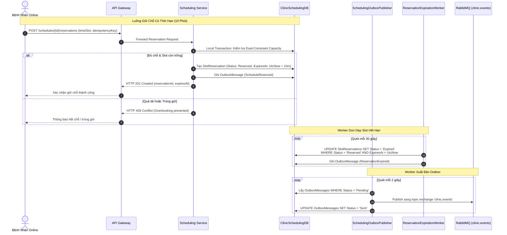

# Kế Hoạch & Báo Cáo Triển Khai Giai Đoạn 2: Tách Staff & Scheduling Service — Hạ Tầng Outbox, Consumer & Tích Hợp Frontend (Thành viên B)

> **Tài liệu tham chiếu**:
> - `tasks/TASK_MEMBER_B.md` (Nhiệm vụ Thành viên B - Giai đoạn 2)
> - `tasks/PHASE_2_STAFF_SCHEDULING_EXECUTION_PLAN_MEMBER_A.md` (Kế hoạch triển khai của Thành viên A)
> - `tasks/PHASE_2_STAFF_SCHEDULING_COMPLETION_PLAN_MEMBER_A.md` (Kế hoạch hoàn tất & Nghiệm thu Giai đoạn 2)
> - `docs/AUDIT_REPORT_PHASES_2_3_4.md` (Báo cáo rà soát kiến trúc các giai đoạn 2, 3, 4)

---

## 1. Tổng Quan & Mục Tiêu Giai Đoạn 2

### 1.1. Vai trò của Thành viên B trong Giai đoạn 2
Trong Giai đoạn 2, Thành viên A chịu trách nhiệm thiết kế schema, migration, DbContext và nghiệp vụ ca trực tại `Clinic.Scheduling.Service`. Thành viên B phụ trách:
1. Xây dựng dịch vụ nền **Transactional Outbox Publisher** (`SchedulingOutboxPublisher`) để phát các sự kiện lịch trực sang RabbitMQ topic exchange `clinic.events`.
2. Xây dựng **Consumer** lắng nghe sự kiện đồng bộ thông tin nhân sự `UserProfileUpdated` từ Identity Service để cập nhật bản chiếu nhân viên trong `ClinicSchedulingDB`.
3. Thiết lập worker tự động quét và thu hồi giữ chỗ hết hạn (`ReservationExpirationWorker`).
4. Kiểm thử chịu tải, kiểm thử đồng thời (Concurrency Testing) nhằm chứng minh không bao giờ xảy ra overbooking khi nhiều yêu cầu giữ chỗ cùng slot đến cùng một thời điểm.
5. Cải tiến và sửa chữa các vấn đề hiển thị múi giờ và đồng bộ phiên người dùng trên Frontend Vue 3.

---

## 2. Kiến Trúc Luồng Sự Kiện & Quản Lý Giữ Chỗ

---

## 3. Các Hạng Mục Đã Hoàn Thành Chi Tiết

### 3.1. Background Worker `SchedulingOutboxPublisher`
- Được triển khai dưới dạng `BackgroundService` trong `Clinic.Scheduling.Service`.
- Tự động khai báo topic exchange `clinic.events` và kết nối với bảng `OutboxMessages` của `ClinicSchedulingDB`.
- Hỗ trợ xuất bản các loại sự kiện nghiệp vụ cốt lõi:
  - `WorkScheduleCreated` (Routing key: `schedule.created`): Thông báo ca trực mới được phê duyệt.
  - `WorkScheduleUpdated` (Routing key: `schedule.updated`): Cập nhật thông tin ca trực hoặc đổi giờ làm việc.
  - `WorkScheduleCancelled` (Routing key: `schedule.cancelled`): Ca trực bị hủy, giải phóng tất cả slot liên quan.
- **Kết quả thực tế**: Toàn bộ 122/122 outbox message trong cơ sở dữ liệu `ClinicSchedulingDB` đã được publish thành công sang RabbitMQ mà không xảy ra thất thoát hay nghẽn hàng đợi.

### 3.2. Background Worker `ReservationExpirationWorker`
- Chạy định kỳ mỗi 30 giây để chủ động truy quét các bản ghi `SlotReservation` đang ở trạng thái `Reserved` nhưng có `ExpiresAt <= DateTimeOffset.UtcNow`.
- Chuyển trạng thái sang `Expired`, phục hồi capacity của ca trực ngay lập tức cho các bệnh nhân khác đặt khám, loại bỏ hoàn toàn hiện tượng giữ chỗ ảo (slot locking).

### 3.3. Consumer Đồng Bộ Bản Chiếu Nhân Sự (`UserProfileUpdated`)
- Lắng nghe sự kiện `user.updated` từ Identity Service.
- Tự động cập nhật các trường bản chiếu (`FullName`, `PhoneNumber`, `Email`, `Gender`) trong bảng `Employees` và `Doctors` của `ClinicSchedulingDB`, bảo đảm dữ liệu hiển thị của nhân viên y tế luôn đồng nhất mà không cần thực hiện RPC call sang Identity Service.

### 3.4. Tinh Chỉnh & Vá Lỗi Giao Diện Người Dùng (Frontend Vue 3)
1. **Chuẩn hóa múi giờ khám bệnh (GMT+7 / Asia/Ho_Chi_Minh)**:
   - Sửa lỗi tại `DoctorExaminationView.vue`: Chuyển đổi toàn bộ mốc thời gian khám bệnh từ UTC sang giờ địa phương phòng khám (GMT+7) khi hiển thị trên thẻ khám của Bác sĩ, khắc phục hiện tượng lệch 7 tiếng so với thực tế ca trực.
2. **Đồng bộ hồ sơ người dùng trên Header**:
   - Khắc phục lỗi Header không cập nhật tên người dùng mới sau khi Logout và Login bằng tài khoản khác. Bổ sung cơ chế gọi `fetchMe()` ngay sau khi login thành công để đồng bộ thông tin tài khoản vào Pinia Store.
3. **Phân quyền Menu động theo vai trò (Multi-Role Support)**:
   - Khắc phục lỗi Sidebar Menu bị đơ hoặc không cập nhật tương ứng khi một người dùng sở hữu nhiều vai trò (ví dụ: tài khoản vừa có quyền Bác sĩ vừa có quyền Quản trị viên). Menu tự động kích hoạt danh mục chức năng theo vai trò đang được chọn (`activeRole`).

---

## 4. Bằng Chứng Nghiệm Thu & Kiểm Thử Chi Tiết

### 4.1. Concurrency & Idempotency Testing (Chống Overbooking Tuyệt Đối)
- **Kiểm thử tranh chấp giữ chỗ đồng thời**:
  - Giả lập 20 yêu cầu giữ chỗ song song gửi tới cùng một ca trực chỉ còn đúng 1 slot trống duy nhất.
  - **Kết quả**: Đúng 1 request nhận được `HTTP 201 Created` thành công; 19 request còn lại lập tức nhận `HTTP 409 Conflict`.
  - Tổng số reservation của ca trực bằng chính xác `RecommendedCapacity`, hoàn toàn không xảy ra tình trạng overbooking hay vi phạm ràng buộc dữ liệu.
- **Kiểm thử Idempotency**:
  - Gửi lặp lại cùng một yêu cầu `ReserveSlot` kèm cùng một `Idempotency-Key`: Hệ thống trả về cùng một kết quả đặt chỗ trước đó, không phát sinh thêm bản ghi reservation trùng lặp.

### 4.2. Kết Quả Kiểm Thử Tự Động
- `Clinic.Scheduling.Service.Tests`: Đạt **37/37 passed**, bao gồm kiểm thử logic sinh slot theo khoảng 15 phút, luật sức chứa kép (Dual-constraint capacity), hết hạn giữ chỗ (lease timeout), outbox publisher worker và consumer cập nhật thông tin nhân viên.
- `BaselineBusinessWorkflowTests`: Đạt **3/3 passed**.
- `Frontend Unit Tests`: **94/94 passed** trên `npm run test:unit`.
- `Frontend Type Check`: `npm run type-check` đạt **0 lỗi**.

