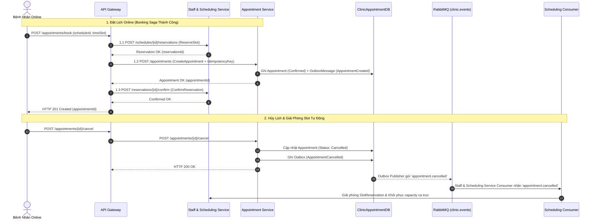

# Kế Hoạch & Báo Cáo Triển Khai Giai Đoạn 3: Tách Appointment Service — Hạ Tầng Outbox, Consumer, Saga & Gateway Routing (Thành viên B)

> **Tài liệu tham chiếu**:
> - `tasks/TASK_MEMBER_B.md` (Nhiệm vụ Thành viên B - Giai đoạn 3)
> - `tasks/PHASE_3_APPOINTMENT_SERVICE_EXECUTION_PLAN_MEMBER_A.md` (Kế hoạch triển khai của Thành viên A)
> - `docs/AUDIT_REPORT_PHASES_2_3_4.md` (Báo cáo rà soát kiến trúc các giai đoạn 2, 3, 4)

---

## 1. Tổng Quan & Mục Tiêu Giai Đoạn 3

### 1.1. Vai trò của Thành viên B trong Giai đoạn 3
Trong Giai đoạn 3, `Clinic.Appointment.Service` được tách biệt với cơ sở dữ liệu riêng `ClinicAppointmentDB`. Thành viên B phụ trách:
1. Tích hợp Transactional Outbox Publisher tại Appointment Service để chuyển phát các sự kiện lịch hẹn sang RabbitMQ.
2. Xây dựng và điều phối các Event Consumer xuyên suốt giữa Scheduling, Appointment và Monolith/Queue.
3. Kiểm thử độ tin cậy của Booking Saga và Reschedule Saga, bảo đảm cơ chế bồi hoàn (compensation) tự động giải phóng giữ chỗ khi gặp sự cố mạng hoặc lỗi nghiệp vụ.
4. Cấu hình định tuyến Gateway (`Clinic.API`) và cập nhật Frontend SPA để chuyển mạch toàn bộ các API lịch hẹn sang Appointment Service.
5. Xây dựng công cụ đối soát dữ liệu (Reconciliation) giữa trạng thái lịch hẹn (`ClinicAppointmentDB`) và trạng thái giữ chỗ (`ClinicSchedulingDB`).

---

## 2. Thiết Kế Booking Saga & Luồng Hướng Sự Kiện

---

## 3. Các Hạng Mục Đã Hoàn Thành Chi Tiết

### 3.1. Outbox Integration tại Appointment Service
- Triển khai `AppointmentOutboxPublisher` kế thừa `BackgroundService` chạy nền quét bảng `OutboxMessages` của `ClinicAppointmentDB`.
- Xuất bản chuẩn hóa các sự kiện nghiệp vụ sang topic exchange `clinic.events`:
  - `AppointmentCreated` (Routing key: `appointment.created`): Thông báo lịch hẹn mới được tạo lập.
  - `AppointmentConfirmed` (Routing key: `appointment.confirmed`): Lịch hẹn được xác nhận.
  - `AppointmentCancelled` (Routing key: `appointment.cancelled`): Lịch hẹn bị hủy bởi bệnh nhân hoặc nhân viên.
  - `AppointmentCheckedIn` (Routing key: `appointment.checked-in`): Bệnh nhân đã tới quầy tiếp đón check-in (làm dữ liệu đầu vào duy nhất cho Queue Service cấp số).

### 3.2. Triển Khai Hệ Thống Event Consumers
1. **Consumer tại Staff & Scheduling Service (`q.scheduling.events`)**:
   - Lắng nghe `appointment.cancelled`: Tự động tìm `SlotReservation` tương ứng và thực hiện `ReleaseSlot`, tăng lại capacity cho bác sĩ.
   - Lắng nghe `user.updated`: Đồng bộ thông tin nhân sự.
2. **Consumer tại Appointment Service (`q.appointment.events`)**:
   - Lắng nghe `queue.exam-completed` từ Queue Service: Khi bác sĩ kết thúc lượt khám, consumer tự động cập nhật trạng thái `Appointment.Status = Completed`.
   - Lắng nghe `user.updated` từ Identity Service: Cập nhật thông tin bệnh nhân trong bảng `PatientProjections`.

### 3.3. Kiểm Thử Khả Năng Bồi Hoàn (Saga Compensation & Resiliency)
- **Kiểm thử Timeout khi gọi `CreateAppointment`**:
  - Khi bước lưu lịch hẹn gặp lỗi cơ sở dữ liệu hoặc timeout, Gateway/Saga Coordinator lập tức kích hoạt nhánh bù trừ: gọi `POST /schedules/{id}/reservations/{resId}/release` sang Staff & Scheduling Service.
  - Kiểm tra xác nhận `SlotReservation` chuyển về `Released`, không bị treo slot rác.
- **Kiểm thử Idempotency**:
  - Gửi lặp lại cùng một yêu cầu `POST /appointments` kèm cùng một header `Idempotency-Key`: Service trả về thông tin lịch hẹn đã tạo lần đầu, không sinh thêm bản ghi `Appointment` thứ hai.

### 3.4. Gateway API Routing Cutover
- Cấu hình proxy ngược tại Gateway (`Clinic.API`) chuyển tiếp 100% các route lịch hẹn sang `Clinic.Appointment.Service`:
  - `/appointments/**`: Tra cứu, đặt lịch, hủy lịch hẹn.
  - `/me/appointments/**`: Danh sách lịch hẹn của bệnh nhân đăng nhập.
  - `/admin/appointments/**`: Thống kê tổng hợp số lượng lịch khám cho Admin.
  - `/receptionist/appointments/**`: Lịch hẹn chờ tiếp đón và tiếp nhận ca vãng lai.
- Loại bỏ hoàn toàn phụ thuộc runtime của Frontend vào bảng `Appointments` trong cơ sở dữ liệu Monolith (`ClinicDB`).

### 3.5. Báo Cáo Đối Soát Dữ Liệu (Reconciliation)
- Xây dựng quy trình đối soát tự động giữa bảng `SlotReservations` (`ClinicSchedulingDB`) và bảng `Appointments` (`ClinicAppointmentDB`).
- Kiểm tra tính tương ứng giữa các reservation trạng thái `Confirmed` và các appointment trạng thái hợp lệ (`Confirmed`, `CheckedIn`, `Completed`), phát hiện sớm các trường hợp lệch dữ liệu (data drift).

---

## 4. Bằng Chứng Nghiệm Thu & Kiểm Thử Chi Tiết

### 4.1. Kết Quả Kiểm Thử Đã Đạt
- **`Clinic.Appointment.Service.Tests`**: Đạt **33/33 passed** (Bao gồm test quy trình đặt lịch, xác nhận, hủy lịch, check-in, bồi hoàn saga, và outbox publisher).
- **Gateway Endpoints Smoke Test**:
  - `GET /api/me/appointments`: Trả về `200 OK` với danh sách lịch hẹn định dạng DTO chuẩn.
  - `POST /api/appointments/{id}/check-in`: Trả về `200 OK`, cập nhật trạng thái `CheckedIn` và đẩy event vào Outbox.
  - `GET /api/admin/appointments/summary`: Trả về `200 OK` với các chỉ số thống kê chính xác (`totalAppointments`, `completedAppointments`, `cancelledAppointments`).
- **Frontend Integration**:
  - Màn hình đặt lịch của bệnh nhân (`PatientBookingView.vue`) hoạt động mượt mà, slot được khóa và xác nhận nguyên tử.
  - Màn hình tiếp đón lễ tân hiển thị danh sách lịch hẹn đồng bộ thời gian thực.

