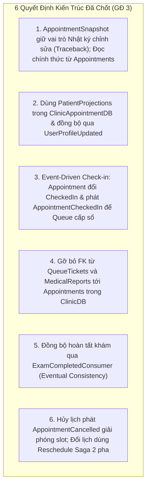
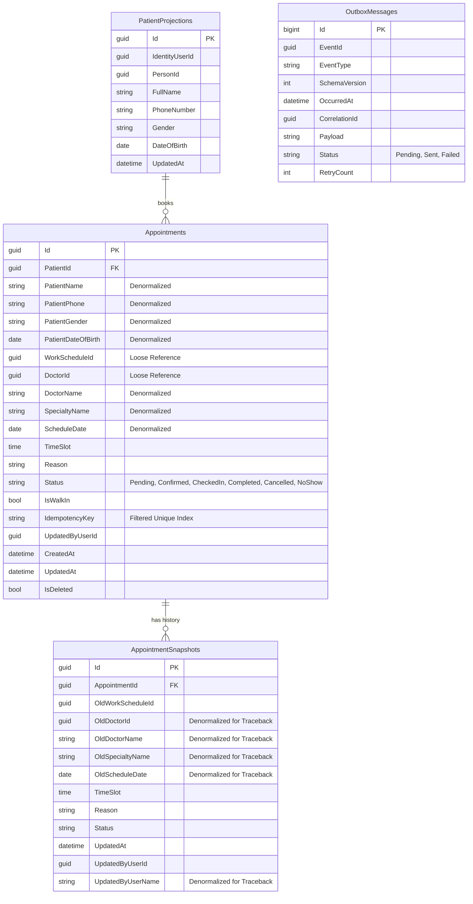
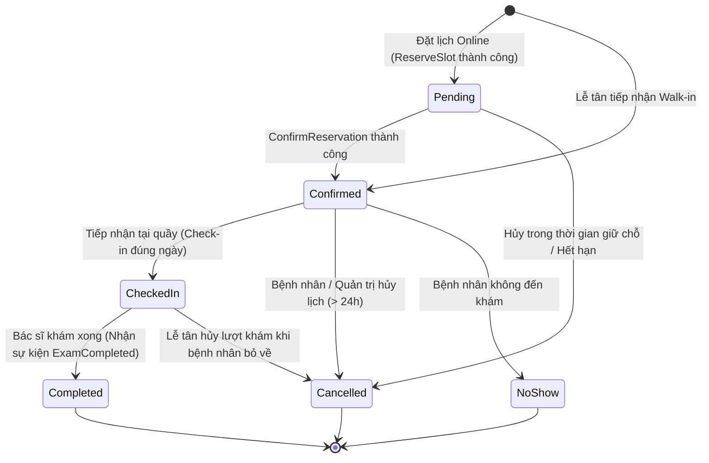
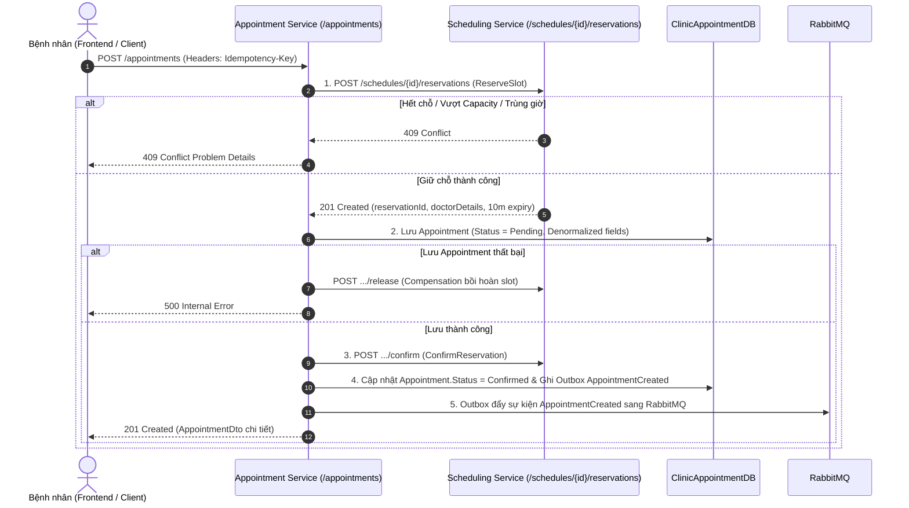
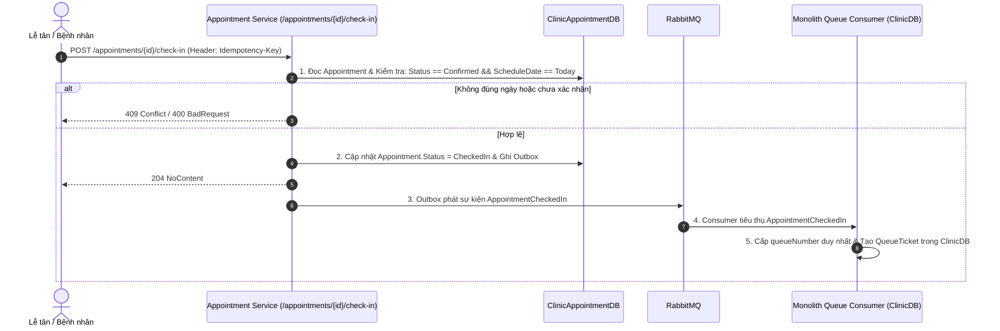
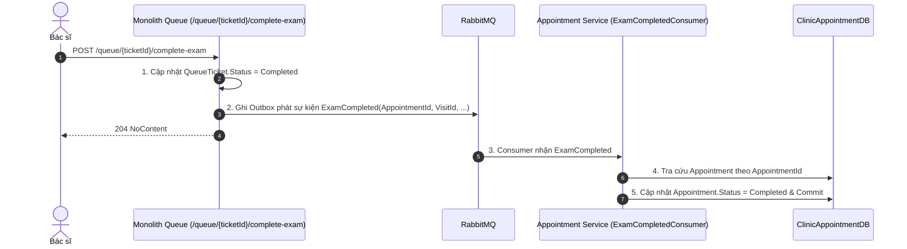

# Kế Hoạch Triển Khai Giai Đoạn 3: Tách Appointment Service
> **Tài liệu tham chiếu**:
> - `tasks/TASK_MEMBER_A.md` (Nhiệm vụ Thành viên A - Giai đoạn 3)
> - `tasks/TASK_MEMBER_B.md` (Nhiệm vụ Thành viên B - Giai đoạn 3)
> - `tasks/COMMON_REQUIREMENTS_AND_NOTES.md` (Yêu cầu kỹ thuật chung)
> - `tasks/PHASE_0_API_CONTRACT_ANALYSIS_MEMBER_A.md` (Phân tích API Contract & Service Boundary)
> - `tasks/PHASE_2_STAFF_SCHEDULING_EXECUTION_PLAN_MEMBER_A.md` (Kế hoạch Giai đoạn 2)
> - `docs/identity-service-phase1.md` (Tiền lệ từ Giai đoạn 1)

---

## 1. Tổng Quan & Mục Tiêu Giai Đoạn 3

### 1.1. Mục tiêu cốt lõi
Giai đoạn 3 tập trung vào việc tách toàn bộ chức năng quản lý lịch hẹn khám bệnh, lưu trữ snapshot thông tin hiển thị và điều phối quy trình đặt lịch (Booking Saga) ra khỏi Monolith để hình thành một microservice độc lập: **Appointment Service** (`Clinic.Appointment.Service`).

Dịch vụ này sở hữu cơ sở dữ liệu riêng biệt: **`ClinicAppointmentDB`**, không chia sẻ bảng, không liên kết khóa ngoại (Foreign Key) và không thực hiện truy vấn trực tiếp xuyên database với bất kỳ dịch vụ nào khác (`ClinicDB`, `ClinicIdentityDB`, `ClinicSchedulingDB`).

### 1.2. Quyết định kiến trúc nền tảng
1. **Sở hữu Aggregate `Appointment` độc lập**: Toàn bộ vòng đời lịch hẹn từ khi giữ chỗ đến khi hoàn tất khám hoặc hủy khám thuộc quyền sở hữu duy nhất của `Clinic.Appointment.Service`.
2. **Điều phối Booking Saga (Saga Orchestration)**: Thay vì giữ kết nối distributed transaction, Appointment Service đóng vai trò Orchestrator gọi sang Scheduling Service để giữ slot (`ReserveSlot`), tạo lịch hẹn cục bộ, và xác nhận giữ chỗ (`ConfirmReservation`), tự động bồi hoàn (`ReleaseReservation`) khi có lỗi.
3. **Mô hình "Self-Contained Denormalized Read Model"**: Bảng `Appointments` lưu sẵn các thông tin hiển thị cơ bản của Bác sĩ (`DoctorId`, `DoctorName`, `SpecialtyName`, `ScheduleDate`) và Bệnh nhân (`PatientName`, `PatientPhone`, `PatientGender`, `PatientDateOfBirth`) để tối ưu hóa truy vấn chi tiết hoặc danh sách lịch khám mà không cần join phân tán.
4. **Giao tiếp Hướng sự kiện (Event-Driven)**: Tách rời hoàn toàn quan hệ runtime với Queue Service và Medical Service bằng các integration events (`AppointmentCreated`, `AppointmentConfirmed`, `AppointmentCancelled`, `AppointmentCheckedIn`, `ExamCompleted`) thông qua Transactional Outbox pattern.

### 1.3. Các Aggregate và Entity chuyển giao quyền sở hữu
| Entity / Aggregate | Vai trò nghiệp vụ trong Appointment Service | Cơ sở dữ liệu |
| :--- | :--- | :--- |
| `Appointment` *(Aggregate Root)* | Quản lý thông tin lịch khám, thời gian, trạng thái, ghi chú và các trường denormalized. | `ClinicAppointmentDB` |
| `AppointmentSnapshot` *(Nhật ký chỉnh sửa / Traceback)* | Lưu nhật ký các lần chỉnh sửa lịch hẹn (đổi lịch, xác nhận, hủy lịch...) để traceback khi có khiếu nại/sự cố đặt lịch (1-N), không dùng làm nơi đọc thông tin chính thức. | `ClinicAppointmentDB` |
| `PatientProjection` *(Bản chiếu)* | Lưu bản chiếu nhân thân tối thiểu của bệnh nhân để xác thực và hỗ trợ truy vấn cục bộ. | `ClinicAppointmentDB` |
| `OutboxMessage` | Lưu trữ các sự kiện tích hợp trong cùng local transaction để publisher gửi sang RabbitMQ. | `ClinicAppointmentDB` |

---

## 2. Các Quyết Định Kiến Trúc Đã Chốt Cho Giai Đoạn 3

Dựa trên quá trình đối soát mã nguồn và thống nhất định hướng thiết kế, dưới đây là **6 quyết định kiến trúc chính thức** cho Giai đoạn 3:

---

### 2.1. Quyết định 1: Vai trò của `AppointmentSnapshot` (Nhật ký chỉnh sửa để Traceback) & Đọc thông tin chính thức trên `Appointments`
1. **Giữ nguyên vai trò của `AppointmentSnapshot` là bảng Nhật ký chỉnh sửa phục vụ Traceback (1-N)**:
   - `AppointmentSnapshot` lưu nhật ký các lần chỉnh sửa (`Update`, `Confirm`, `Cancel`, `AdminCancel`) để traceback khi người khám có vấn đề hoặc khiếu nại về đặt lịch (đặt sai, bị đổi lịch, hủy lịch...), **không dùng** làm nơi đọc thông tin hiển thị chính thức.
   - Bổ sung các trường lịch sử tự thân vào `AppointmentSnapshot` ngay lúc ghi nhật ký: `OldWorkScheduleId`, `OldDoctorId`, `OldDoctorName`, `OldScheduleDate`, `TimeSlot`, `Reason`, `Status`, `UpdatedAt`, `UpdatedByUserId`, `UpdatedByUserName` để phục vụ API `GET /admin/appointments/{appointmentId}/history` độc lập mà không cần join sang `ClinicSchedulingDB` hay `ClinicIdentityDB`.
2. **Đọc thông tin hiển thị chính thức trực tiếp từ bảng `Appointments`**:
   - Bảng `Appointments` là nguồn chuẩn duy nhất để đọc thông tin lịch hẹn hiện hành, lưu trực tiếp các cột denormalized của Bác sĩ (`DoctorId`, `DoctorName`, `SpecialtyName`, `ScheduleDate` - đã có từ GĐ 2) và Bệnh nhân (`PatientName`, `PatientPhone`, `PatientGender`, `PatientDateOfBirth`).

---

### 2.2. Quyết định 2: Quản lý dữ liệu Bệnh nhân qua Bản chiếu `PatientProjections` (Single Identity & Role Projection)
- Access Token JWT của bệnh nhân chứa sẵn các claims định danh: `sub` (`UserId`), `patientId`, `personId`.
- Trong `ClinicAppointmentDB`, duy trì bảng bản chiếu `PatientProjections` (`Id`, `IdentityUserId`, `PersonId`, `FullName`, `PhoneNumber`, `Gender`, `DateOfBirth`).
- Nạp dữ liệu ban đầu bằng kịch bản import từ `ClinicDB`. Khi người dùng cập nhật thông tin cá nhân tại Identity Service, sự kiện `UserProfileUpdated` được phát qua RabbitMQ để Appointment Service tự động cập nhật bản chiếu (nhất quán với mô hình của `Clinic.Scheduling.Service` ở GĐ 2).
- Khi bệnh nhân tự đặt lịch online: lấy `PatientId` từ JWT claims và tra cứu nhanh trên `PatientProjections`. Khi Lễ tân đặt hộ hoặc tiếp nhận Walk-in: nhận `PatientId` (và cập nhật/đồng bộ bản chiếu nếu là bệnh nhân mới tạo).

---

### 2.3. Quyết định 3: Ranh giới Check-in theo mô hình Event-Driven
- Endpoint `POST /appointments/{id}/check-in` do `Clinic.Appointment.Service` sở hữu và xử lý.
- Khi nhận request check-in (kèm `Idempotency-Key`):
  1. Appointment Service kiểm tra lịch hẹn hợp lệ (`Status == Confirmed` và đúng ngày khám `ScheduleDate == Today`).
  2. Chuyển trạng thái `Appointment.Status = CheckedIn` và ghi Outbox phát sự kiện `AppointmentCheckedIn { AppointmentId, PatientId, DoctorId, ScheduleDate, TimeSlot, VisitId, PatientName }` trong cùng local transaction.
  3. Phía Monolith (đang tạm giữ module Queue trước khi tách ở GĐ 4) sử dụng Consumer lắng nghe `AppointmentCheckedIn` từ RabbitMQ để cấp `QueueNumber` và tạo `QueueTicket` trong `ClinicDB`.
- **Lợi ích**: Tách biệt hoàn toàn ranh giới database giữa Appointment và Queue; đến Giai đoạn 4 chỉ cần chuyển Consumer này sang `Clinic.Queue.Service` mà không cần sửa đổi `Clinic.Appointment.Service`.

---

### 2.4. Quyết định 4: Gỡ bỏ Khóa ngoại (Foreign Key) từ `QueueTickets` và `MedicalReports` tới `Appointments` trong `ClinicDB`
- Tạo migration trên Monolith (`ClinicDB`) để gỡ bỏ 2 ràng buộc khóa ngoại:
  - `FK_QueueTickets_Appointments_AppointmentId`
  - `FK_MedicalReports_Appointments_AppointmentId`
- Cột `AppointmentId` trên `QueueTickets` và `MedicalReports` chuyển thành loose UUID reference (liên kết logic, không khóa cứng ở tầng vật lý SQL Server), cho phép tạo vé khám và bệnh án cho các lịch hẹn mới sinh ra bên `ClinicAppointmentDB`.

---

### 2.5. Quyết định 5: Đồng bộ trạng thái Hoàn tất khám (`ExamCompleted` $\to$ `Appointment.Completed`)
- Khi bác sĩ hoàn tất khám (`POST /queue/{ticketId}/complete-exam`) hoặc chốt hồ sơ bệnh án (`PUT /medical-reports/{id}` với `isFinalize = true`), hệ thống phát sự kiện `ExamCompleted { VisitId, QueueTicketId, AppointmentId, DoctorId, CompletedAt }` qua Outbox.
- `Clinic.Appointment.Service` triển khai `AppointmentEventConsumer` lắng nghe sự kiện `ExamCompleted` từ RabbitMQ (`clinic.events` / `queue.exam-completed`) $\to$ Tra cứu `Appointment` theo `AppointmentId` $\to$ Chuyển trạng thái sang `Completed` (Eventual Consistency).

---

### 2.6. Quyết định 6: Quy trình Hủy lịch (`CancelAppointment`) và Đổi lịch (`UpdateAppointment`) với Scheduling Service
1. **Hủy lịch khám & Giải phóng Slot**:
   - Khi hủy lịch hợp lệ (trước giờ khám $\ge 24$ tiếng đối với bệnh nhân, hoặc hủy bởi Admin/Lễ tân), Appointment Service ghi nhận `AppointmentSnapshot`, chuyển `Appointment.Status = Cancelled`, gọi giải phóng slot trực tiếp (`POST /internal/slots/release-by-appointment`) đồng thời ghi Outbox phát sự kiện `AppointmentCancelled { AppointmentId, WorkScheduleId, TimeSlot, DoctorId, PatientId, CancelledAt }`.
   - `Clinic.Scheduling.Service` chuyển trạng thái `SlotReservation` tương ứng (`WorkScheduleId`, `TimeSlot`, `PatientId`) sang `Released` (hỗ trợ cả qua internal API tức thời và qua `SchedulingEventConsumer` lắng nghe RabbitMQ), khôi phục `RecommendedCapacity` và slot trống cho ca trực.
2. **Đổi lịch khám (Reschedule Saga 2 pha)**:
   - **Pha 1**: Gọi HTTP `POST /schedules/{newScheduleId}/reservations` (kèm `Idempotency-Key`) để giữ chỗ slot mới tại Scheduling Service.
   - **Pha 2**: Ghi bản ghi trạng thái cũ vào `AppointmentSnapshots`, cập nhật thông tin ca mới vào `Appointment`, gọi `ConfirmReservation` cho slot mới, đồng thời giải phóng slot cũ (`ReleaseSlotByAppointmentAsync` + Outbox `AppointmentCancelled`).
   - **Bồi hoàn (Compensation)**: Nếu bước lưu DB hoặc xác nhận slot mới thất bại $\to$ Gọi `ReleaseReservation` cho slot mới và giữ nguyên lịch hẹn ban đầu.

---

## 3. Thiết Kế Kiến Trúc Dịch Vụ Appointment

### 3.1. Cấu trúc Project
- **Project Chính**: `backend/Clinic.Appointment.Service/Clinic.Appointment.Service.csproj` (.NET 10.0 Web API).
- **Project Kiểm thử**: `backend/Clinic.Appointment.Service.Tests/Clinic.Appointment.Service.Tests.csproj` (xUnit).
- **Dependencies**: Tham chiếu `Clinic.Contracts` (để dùng chung `EventEnvelope<T>`, `AppointmentEvents`, `ExamCompleted`, `UserProfileUpdated`). Tuyệt đối không tham chiếu tới `Clinic.Domain` hay `Clinic.Infrastructure.Sqlserver` của Monolith.

### 3.2. Thiết Kế Cơ Sở Dữ Liệu `ClinicAppointmentDB`

---

### 3.3. Vòng Đời Trạng Thái Lịch Hẹn (Appointment Lifecycle)

---

### 3.4. Các Quy Trình Nghiệp Vụ Cốt Lõi (Workflows)

#### Quy trình 1: Booking Saga Orchestration (Đặt lịch Online)

#### Quy trình 2: Tiếp Nhận Check-in & Cấp Số Hàng Đợi (Event-Driven)

#### Quy trình 3: Đồng Bộ Hoàn Tất Khám (ExamCompleted)

---

## 4. Kế Hoạch Triển Khai Chi Tiết Từng Bước (Step-by-Step Execution Plan)

### Bước 1: Khởi Tạo Service & Thiết Lập Hạ Tầng Cơ Bản
1. **Tạo Project mới**:
   - `dotnet new webapi -n Clinic.Appointment.Service -o backend/Clinic.Appointment.Service`.
   - `dotnet new xunit -n Clinic.Appointment.Service.Tests -o backend/Clinic.Appointment.Service.Tests`.
   - Thêm 2 project vào solution `backend/Clinic.sln`.
   - Tham chiếu `Clinic.Contracts` vào `Clinic.Appointment.Service`.
2. **Cài đặt thư viện**:
   - `Microsoft.EntityFrameworkCore.SqlServer` (10.x).
   - `Microsoft.EntityFrameworkCore.Design` (10.x).
   - `Microsoft.AspNetCore.Authentication.JwtBearer` (10.x).
   - `FluentValidation.AspNetCore`.
   - `RabbitMQ.Client` (7.2.x).
3. **Cấu hình Xác thực JWT độc lập qua JWKS & JSON Enum Serialization**:
   - Trong `Program.cs`, cấu hình `JwtBearer` trỏ tới discovery endpoint `http://identity-service:8080/.well-known/jwks.json`. Tuyệt đối không kết nối database `ClinicIdentityDB`.
   - Cấu hình `JsonStringEnumConverter` để tuần tự hóa toàn bộ enum (`AppointmentStatus`) dạng chuỗi chuẩn.
4. **Cấu hình Docker & Docker Compose**:
   - Tạo `backend/Clinic.Appointment.Service/Dockerfile`.
   - Thêm service `appointment-service` vào `docker-compose.yml`:
     - Cổng host: `5003:8080`.
     - Biến môi trường: `ConnectionStrings__AppointmentConnection`, `Jwt__Issuer`, `Jwt__Audience`, `Services__Scheduling__BaseUrl=http://scheduling-service:8080`, `Scheduling__Authority=http://scheduling-service:8080`, `RabbitMq__Host=rabbitmq`, `RabbitMq__Port=5672`, `RabbitMq__Username=clinic`, `RabbitMq__Password=clinic-dev-password`.
     - Health check: `/healthz` và `/readyz`.

---

### Bước 2: Xây Dựng Domain Model & Persistence Layer (`ClinicAppointmentDB`)
1. **Định nghĩa các Entity & Enum**:
   - `Appointment`: Aggregate root với đầy đủ phương thức domain (`Confirm()`, `Cancel()`, `CheckIn()`, `Complete()`, `Reschedule()`), trường `IdempotencyKey` và enum `AppointmentStatus` (`Pending`, `Confirmed`, `CheckedIn`, `Completed`, `Cancelled`, `NoShow`).
   - `AppointmentSnapshot`: Lưu trữ changelog lịch sử thay đổi ca trực/giờ khám (`OldWorkScheduleId`, `OldDoctorId`, `OldDoctorName`, `OldSpecialtyName`, `OldScheduleDate`, `UpdatedByUserName`).
   - `PatientProjection`: Bản chiếu thông tin bệnh nhân.
   - `OutboxMessage`: Bảng lưu trữ sự kiện tích hợp cục bộ.
2. **Tạo `AppointmentDbContext` & Fluent API Configurations**:
   - Cấu hình Unique Index cho `(DoctorId, ScheduleDate, TimeSlot)` với điều kiện filter: `[Status] <> 'Cancelled' AND [IsDeleted] = 0`.
   - Cấu hình Filtered Unique Index cho `IdempotencyKey`: `[IdempotencyKey] IS NOT NULL AND [IsDeleted] = 0`.
   - Cấu hình Index tối ưu tìm kiếm: `(PatientId, ScheduleDate)`, `(DoctorId, ScheduleDate)`, `(Status)`.
3. **Tạo Migrations**:
   - Tạo migration `20261023012915_InitialAppointmentSchema` và `20261023064050_AddAppointmentIdempotencyKey` cho `ClinicAppointmentDB`.

---

### Bước 3: Viết Kịch Bản Di Chuyển & Đối Soát Dữ Liệu
1. **Kịch bản Import Dữ liệu (`import-from-clinicdb.sql`)**:
   - Nạp `PatientProjections`: JOIN giữa `ClinicDB.dbo.Patients` và `ClinicDB.dbo.Persons`.
   - Nạp `Appointments`: Đọc toàn bộ lịch hẹn từ `ClinicDB.dbo.Appointments`, JOIN với `Patients` và `Persons` để điền đầy đủ các cột denormalized nhân thân (`PatientName`, `PatientPhone`, `PatientGender`, `PatientDateOfBirth`).
   - Nạp `AppointmentSnapshots`: Copy từ `ClinicDB.dbo.AppointmentSnapshots`.
   - Script thiết kế Idempotent (chạy lặp lại an toàn, không trùng khóa).
2. **Kịch bản Đối soát Dữ liệu (`verify-appointment-import.sql`)**:
   - Đối soát tổng số lượng bản ghi `Appointments`, `Snapshots` giữa 2 database.
   - Kiểm tra các trường denormalized không bị null. Yêu cầu: `MismatchCount = 0`.
3. **Thêm container `appointment-data-importer` vào `docker-compose.yml`** (tự động chạy sau khi DB và Appointment Service ready).

---

### Bước 4: Xây Dựng Bộ API Nghiệp Vụ Cốt Lõi & Saga Booking
1. **Bộ API Quản Lý Lịch Hẹn (`AppointmentEndpoints`)**:
   - `POST /appointments`:
     - Header bắt buộc: `Idempotency-Key` (kiểm tra trùng `IdempotencyKey` trên bảng `Appointments` trước khi gọi Saga để trả về kết quả idempotent tức thời).
     - Thực thi Booking Saga: `ReserveSlot (Scheduling) -> Create Local Appointment -> ConfirmReservation (Scheduling)`.
     - Tự động bồi hoàn (`ReleaseReservation`) nếu lưu appointment cục bộ gặp lỗi.
     - Hỗ trợ phân định luồng Online (ràng buộc capacity) và Walk-in (linh hoạt tại quầy).
   - `GET /appointments/{id}`: Xem chi tiết lịch khám (đọc trực tiếp từ bảng denormalized, zero network latency).
   - `GET /me/appointments`: Lấy danh sách lịch hẹn của bệnh nhân đang đăng nhập (lọc theo `PatientId` từ token, hỗ trợ lọc `upcoming` / `past`).
   - `GET /receptionist/appointments/pending`: Lấy danh sách lịch chờ xác nhận cho lễ tân.
   - `POST /appointments/{id}/confirm`: Xác nhận lịch hẹn.
   - `POST /appointments/{id}/cancel`: Hủy lịch khám (ràng buộc tối thiểu trước 24h đối với bệnh nhân; admin/receptionist được hủy mọi lúc). Ghi changelog, giải phóng slot (`ReleaseSlotByAppointmentAsync`) và phát `AppointmentCancelled`.
   - `PATCH /appointments/{id}`: Đổi lịch khám (Reschedule Saga: giữ slot mới $\to$ lưu snapshot & cập nhật $\to$ confirm slot mới $\to$ giải phóng slot cũ).
   - `POST /appointments/{id}/check-in`: Tiếp nhận bệnh nhân tại quầy, đổi `Status = CheckedIn`, phát sự kiện `AppointmentCheckedIn`.
   - `GET /admin/appointments`, `GET /admin/appointments/summary`, `GET /admin/appointments/{id}/history`: Danh sách phân trang theo ngày, thống kê tổng hợp và lịch sử chỉnh sửa (Traceback changelog).

---

### Bước 5: Tích Hợp Outbox Publisher & Event Consumers
1. **Outbox Pattern & Publisher cho Sự Kiện Lịch Hẹn**:
   - Định nghĩa contracts chuẩn trong `Clinic.Contracts`:
     - `AppointmentCreated { AppointmentId, PatientId, DoctorId, ScheduleDate, TimeSlot, IsWalkIn }`
     - `AppointmentConfirmed { AppointmentId, PatientId, DoctorId, ScheduleDate, TimeSlot }`
     - `AppointmentCancelled { AppointmentId, PatientId, DoctorId, WorkScheduleId, ScheduleDate, TimeSlot, Reason, CancelledAt }`
     - `AppointmentCheckedIn { AppointmentId, PatientId, DoctorId, ScheduleDate, TimeSlot, VisitId, PatientName }`
   - Cài đặt `IOutboxWriter` ghi trực tiếp vào `AppointmentDbContext.OutboxMessages` trong cùng local transaction.
   - Triển khai `AppointmentOutboxPublisher` (`BackgroundService`) đẩy các sự kiện `Pending` lên RabbitMQ exchange `clinic.events` và cập nhật `Status = Sent`.
2. **Event Consumers trong Appointment Service & Scheduling Service**:
   - `AppointmentEventConsumer` (trong `Clinic.Appointment.Service`):
     - Lắng nghe `queue.exam-completed` (`ExamCompleted`) từ RabbitMQ $\to$ Chuyển `Appointment.Status = Completed`.
     - Lắng nghe `identity.user-profile-updated` (`UserProfileUpdated`) từ Identity Service $\to$ Cập nhật thông tin họ tên, số điện thoại trong `PatientProjections`.
   - `SchedulingEventConsumer` (trong `Clinic.Scheduling.Service`):
     - Lắng nghe `appointment.cancelled` (`AppointmentCancelled`) từ RabbitMQ $\to$ Chuyển `SlotReservation` sang `Released`.

---

### Bước 6: Cắt Chuyển (Cutover) & Tái Cấu Trúc Monolith (`Clinic.API`)
1. **Migration gỡ bỏ Foreign Key trên Monolith (`ClinicDB`)**:
   - Xóa bỏ ràng buộc khóa ngoại qua migration `20261023013218_DecoupleAppointmentForeignKeys`:
     - `FK_QueueTickets_Appointments_AppointmentId`
     - `FK_MedicalReports_Appointments_AppointmentId`
   - Chuyển `AppointmentId` trên `QueueTickets` và `MedicalReports` thành loose UUID reference.
2. **Triển khai Consumer Tiếp nhận Check-in tại Monolith**:
   - Cấu hình RabbitMQ Consumer (`AppointmentCheckedInConsumer` & `AppointmentCheckedInProcessor`) tại Monolith đón nhận `AppointmentCheckedIn` để tự động sinh số thứ tự và tạo `QueueTicket` trong `ClinicDB`.
3. **Chuyển hướng API Gateway (`AppointmentServiceClient`)**:
   - Cấu hình các controller `AppointmentsController`, `MeAppointmentsController`, `ReceptionistController`, `AdminController` trong `Clinic.API` proxy toàn bộ request (`/appointments/**`, `/me/appointments/**`, `/receptionist/appointments/**`, `/admin/appointments/**`) sang `Clinic.Appointment.Service` (`http://appointment-service:8080`).
   - Đồng bộ tức thời bệnh nhân mới tạo (`POST /patients/add`) và lịch khám Walk-in (`POST /receptionist/appointments/walk-in` $\to$ `POST /internal/appointments/sync-walkin`) sang `ClinicAppointmentDB`.

---

### Bước 7: Kiểm Thử Tự Động & Tiêu Chí Nghiệm Thu
1. **Unit Tests (`Clinic.Appointment.Service.Tests`)**:
   - Test logic chuyển đổi trạng thái vòng đời `Appointment`.
   - Test ràng buộc hủy lịch: Chặn hủy lịch cận giờ (< 24 tiếng).
   - Test Idempotency và Compensation của Saga khi gọi Scheduling Service gặp sự cố.
2. **Concurrency & Integration Tests**:
   - Test đặt trùng slot & retry cùng `Idempotency-Key`.
   - Chạy bộ kiểm thử `BaselineBusinessWorkflowTests` và kiểm thử E2E thực tế từ cổng Frontend (`http://localhost:3000/api/...`) đảm bảo toàn bộ luồng: `Đặt lịch -> Đổi lịch -> Hủy lịch / Walk-in -> Check-in -> Cấp số -> Khám bệnh -> Chốt bệnh án -> Đồng bộ Completed` vượt qua 100%.

---

## 5. Kế Hoạch Rollback Dự Phòng (Rollback Strategy)

1. **Giai đoạn trước khi chuyển đổi Gateway hoàn toàn**:
   - Nếu `Clinic.Appointment.Service` gặp sự cố:
     - Giữ nguyên dữ liệu trong `ClinicAppointmentDB` để phân tích log.
     - Cấu hình Gateway trỏ ngược route `/appointments` về Monolith.
2. **Giai đoạn sau khi đã chạy thực tế**:
   - Do bảng `Appointments` trong `ClinicDB` vẫn được giữ nguyên dữ liệu lịch sử, ta có thể khôi phục lại trạng thái bằng cách đồng bộ ngược các lịch hẹn mới tạo trong thời gian chạy thử nghiệm.

---

## 6. Bảng Tổng Hợp Trách Nhiệm Giữa Thành Viên A và Thành Viên B (GĐ 3)

| Nội dung công việc | Thành viên A (Backend & Data) | Thành viên B (Broker, QA & Obs) |
| :--- | :---: | :---: |
| Khởi tạo `Clinic.Appointment.Service` & cấu hình JWKS | **Chủ trì** | Phối hợp |
| Thiết kế Schema `ClinicAppointmentDB` & EF Migrations | **Chủ trì** | Hỗ trợ review |
| Xây dựng Booking Saga (`Reserve -> Create -> Confirm / Release`) | **Chủ trì** | Hỗ trợ review |
| Chốt Event Contracts trong `Clinic.Contracts` | **Chủ trì** | Phối hợp |
| Triển khai `OutboxPublisher` đẩy Appointment events sang RabbitMQ | Hỗ trợ | **Chủ trì** |
| Xây dựng Consumer tại Monolith đón `AppointmentCheckedIn` để cấp vé khám | Hỗ trợ | **Chủ trì** |
| Xây dựng `ExamCompletedConsumer` đồng bộ trạng thái `Completed` | **Chủ trì** | Hỗ trợ testing |
| Viết Concurrency Tests & Saga Failure Tests | Phối hợp | **Chủ trì** |
| Cập nhật Frontend gọi Appointment API mới qua Gateway | Hỗ trợ | **Chủ trì** |
| Cấu hình Metrics (Booking latency, saga failures, reconciliation lag) | Hỗ trợ | **Chủ trì** |

---

## 7. Báo Cáo Nghiệm Thu & Cập Nhật Thay Đổi Thực Tế Sau Giai Đoạn 3

### 7.1. Trạng Thái Hoàn Thành Các Bước Kỹ Thuật & Kết Quả Kiểm Thử Tự Động
Toàn bộ 7 bước trong kế hoạch triển khai Giai đoạn 3 đã được hoàn tất, cắt chuyển (cutover) và nghiệm thu đạt 100%:
- **Đối soát dữ liệu (`verify-appointment-import.sql`)**: **750 Appointments, 21 AppointmentSnapshots, 59 PatientProjections** khớp 100% giữa `ClinicDB` và `ClinicAppointmentDB` (`MismatchCount = 0`).
- **`Clinic.Appointment.Service.Tests`**: **29 / 29 passed** (Domain lifecycle, InMemory DbContext, Booking Saga, Idempotency retry, Compensation `ReleaseReservation`, Reschedule Saga, Check-in, Changelog Traceback, WebApplicationFactory HTTP integration).
- **`Clinic.Scheduling.Service.Tests`**: **35 / 35 passed**.
- **`Clinic.Application.UnitTests`**: **187 / 187 passed** (Bổ sung đầy đủ test cho `CreateWalkInAppointment`, `GetMedicalReportsQuery`, `UpdateDraftMedicalReport`).
- **`Clinic.Infrastructure.UnitTests`**: **18 / 18 passed**.
- **`Clinic.IntegrationTests` (`BaselineBusinessWorkflowTests`)**: **3 / 3 passed**, toàn bộ test database tạm trên SQL Server được tự động dọn sạch (`0 rows` tồn đọng trong `sys.databases`).
- **Frontend (`vue-tsc` & `vitest`)**: `vue-tsc --build` đạt **0 lỗi**; `vitest` đạt **22 / 22 test files (94 / 94 tests passed)**.

---

### 7.2. Kết Quả Chạy Thực Tế Các Endpoint Đứng Từ Frontend (`http://localhost:3000/api/...`) Và Trực Tiếp Service (`http://localhost:5003`)

| Nhóm | Endpoint thực thi | Vai trò | HTTP Status | Kết quả chạy thực tế sau Cutover & Ghi chú |
| :--- | :--- | :---: | :---: | :--- |
| **Xác thực** | `POST /api/auth/login` | Patient, Receptionist, Doctor, Admin | `200 OK` | Cấp JWT RS256 từ Identity Service kèm đầy đủ claims (`sub`, `personId`, `patientId`, `role`, `permission`). |
| **Bệnh nhân (via Frontend)** | `GET /api/me/appointments` (`all` / `upcoming` / `past`) | Patient | `200 OK` | Proxy sang `Clinic.Appointment.Service`, trả về 38 lịch hẹn của `patient1` từ `ClinicAppointmentDB`, mọi `status` serialize dạng chuỗi chuẩn (`"Confirmed"`, `"Cancelled"`, `"Pending"`, `"NoShow"`, `"Completed"`). |
| **Bệnh nhân (via Frontend)** | `GET /api/slots?fromDate=2026-10-27&toDate=2026-10-27` | Public / Patient | `200 OK` | Proxy sang `Clinic.Scheduling.Service`, trả về danh sách slot 15 phút khả dụng. |
| **Bệnh nhân (via Frontend)** | `POST /api/appointments` (Lần 1 kèm `Idempotency-Key`) | Patient | `201 Created` | Thực thi Booking Saga (`ReserveSlot` $\to$ lưu `ClinicAppointmentDB` $\to$ `ConfirmReservation`), trả về `appointmentId = 1dec3874-e72d-4d58-96ac-71185eceaa3d` (`status = Confirmed`). |
| **Bệnh nhân (via Frontend)** | `POST /api/appointments` (Retry cùng `Idempotency-Key`) | Patient | `201 Created` | Trả về chính xác cùng `appointmentId = 1dec3874-e72d-4d58-96ac-71185eceaa3d` của lần 1, không tạo lịch trùng, không giữ thêm slot. |
| **Bệnh nhân (via Frontend)** | `POST /api/appointments` (Khác key, trùng slot đã đặt) | Patient | `409 Conflict` | Chặn đặt trùng khung giờ đã có người giữ chỗ/xác nhận. |
| **Bệnh nhân (via Frontend)** | `GET /api/appointments/{id}` | Patient | `200 OK` | Trả về chi tiết lịch khám (`AppointmentDetailDto`) trực tiếp từ bảng denormalized trên `ClinicAppointmentDB`. |
| **Bệnh nhân (via Frontend)** | `PATCH /api/appointments/{id}` (Đổi lịch - Reschedule Saga) | Patient | `200 OK` | Đổi lịch từ Slot 1 (`19:30:00`) sang Slot 2 (`19:45:00`) thành công; lưu `AppointmentSnapshot` lịch cũ; xác nhận Slot 1 được giải phóng khả dụng trở lại trên `GET /api/slots`. |
| **Bệnh nhân (via Frontend)** | `POST /api/appointments/{id}/cancel` (Hủy lịch) | Patient | `204 No Content` | Hủy lịch thành công, chuyển `status = Cancelled` và giải phóng Slot 2 khả dụng trở lại ngay lập tức trên `GET /api/slots`. |
| **Lễ tân (via Frontend)** | `GET /api/receptionist/appointments/pending` | Receptionist | `200 OK` | Proxy sang `Clinic.Appointment.Service`, trả về danh sách lịch hẹn chờ xác nhận. |
| **Lễ tân (via Frontend)** | `GET /api/receptionist/working-doctors` | Receptionist | `200 OK` | Trả về danh sách bác sĩ đang trực trong ngày kèm `activeAppointmentsCount`. |
| **Lễ tân (via Frontend)** | `POST /api/patients/add` | Receptionist | `201 Created` | Tạo hồ sơ bệnh nhân mới và tự động đồng bộ sang `ClinicAppointmentDB.dbo.PatientProjections`. |
| **Lễ tân (via Frontend)** | `POST /api/receptionist/appointments/walk-in` | Receptionist | `201 Created` | Khi `doctorId = null` và `isUrgent = true`: tự động gán bác sĩ đang trực có ít lượt khám nhất, tự động check-in cấp `QueueTicket` (`isUrgent = true`) và đồng bộ lịch hẹn sang `ClinicAppointmentDB` (`status = CheckedIn`). |
| **Bác sĩ (via Frontend)** | `POST /api/queue/call-next/{doctorId}` $\to$ `POST /api/queue/{id}/start-exam` | Doctor | `200 OK` / `204` | Gọi số thứ tự ưu tiên khẩn cấp và bắt đầu khám thành công. |
| **Bác sĩ (via Frontend)** | `GET /api/medical-reports` (Search & Filter) | Doctor | `200 OK` | Hỗ trợ lọc theo `search`, `status` (`Draft`/`Finalized`), `fromDate`, `toDate`, phân trang. |
| **Bác sĩ (via Frontend)** | `POST /api/medical-reports` & `PUT /api/medical-reports/{id}` | Doctor | `200 OK` / `400` | Tạo bản nháp (`Draft` $\to$ `200 OK`), lưu nháp (`isFinalize = false` $\to$ `200 OK`), chốt bệnh án (`isFinalize = true` $\to$ `200 OK`, `Finalized`), chặn sửa sau khi chốt (`400 Bad Request`). |
| **Bác sĩ $\to$ Appointment (RabbitMQ)** | `POST /api/queue/{id}/complete-exam` $\to$ `GET /api/appointments/{id}` | Doctor | `204` $\to$ `200 OK` | Sự kiện `ExamCompleted` phát qua RabbitMQ (`clinic.events`) được `AppointmentEventConsumer` tiêu thụ, tự động chuyển `Appointment.Status` trên `ClinicAppointmentDB` từ `CheckedIn` sang `Completed`. |
| **Admin (via Frontend)** | `GET /api/admin/appointments` & `/summary` & `/{id}/history` | Admin | `200 OK` | Proxy sang `Clinic.Appointment.Service`, trả về danh sách phân trang theo ngày, thống kê tổng hợp (`totalAppointments`, `appointmentOnlineCount`, `completedAppointments`, `cancelledAppointments`, `noShowAppointments`) và nhật ký `changelog` từ `AppointmentSnapshots`. |
| **Appointment Service (`5003`)** | `GET /readyz`, `GET /healthz`, `GET /me` | Patient / Staff | `200 OK` | Xác thực JWT RS256 độc lập qua JWKS của Identity Service. |

---

### 7.3. Các Điểm Điều Chỉnh & Bổ Sung Kỹ Thuật Thực Tế So Với Thiết Kế Ban Đầu

Trong quá trình triển khai, kiểm thử thực tế từ cổng Frontend và đối soát tích hợp liên dịch vụ ở Giai đoạn 3, 6 nội dung kỹ thuật sau đã được tinh chỉnh và bổ sung để đảm bảo hệ thống vận hành trơn tru:

1. **Bổ Sung Trạng Thái `NoShow` Vào Enum `AppointmentStatus` & Chuẩn Hóa JSON String Enum**:
   - *Thực tế*: Dữ liệu lịch sử chuyển từ `ClinicDB` sang `ClinicAppointmentDB` có 176 bản ghi mang trạng thái `'NoShow'` và thống kê Admin (`TotalAppointmentSummaryDto`) yêu cầu đếm số lượng `NoShowAppointments`.
   - *Điều chỉnh*: Bổ sung giá trị `NoShow = 5` vào `AppointmentStatus` của `Clinic.Appointment.Service` và đăng ký `JsonStringEnumConverter` toàn cục trong `Program.cs`, đảm bảo tương thích 100% với dữ liệu lịch sử và đồng nhất định dạng chuỗi với Frontend.

2. **Lưu Trữ `IdempotencyKey` Có Filtered Unique Index Trực Tiếp Trên Bảng `Appointments`**:
   - *Thực tế*: Nếu chỉ kiểm tra `Idempotency-Key` ở bước `ReserveSlot` bên Scheduling Service, khi client retry request `POST /appointments` với cùng `Idempotency-Key`, Appointment Service sẽ cố tạo lại bản ghi `Appointment` trên cùng `(DoctorId, ScheduleDate, TimeSlot)` hoặc gọi `ConfirmReservation` trên reservation đã `Confirmed`.
   - *Điều chỉnh*: Thêm cột `IdempotencyKey` (`nvarchar(128)`) kèm Filtered Unique Index `[IdempotencyKey] IS NOT NULL AND [IsDeleted] = 0` vào bảng `Appointments` (`Migration 20261023064050_AddAppointmentIdempotencyKey`). Ngay đầu hàm `CreateAppointmentAsync`, nếu phát hiện `IdempotencyKey` đã tồn tại thì trả về ngay `AppointmentDetailDto` đã tạo trước đó mà không gọi lại Saga.

3. **Cơ Chế Giải Phóng Slot Kép (Synchronous Internal API + Asynchronous RabbitMQ Consumer) Khi Hủy Hoặc Đổi Lịch**:
   - *Thực tế*: Khi người dùng đổi lịch (`PATCH /appointments/{id}`) hoặc hủy lịch (`POST /appointments/{id}/cancel`), Frontend lập tức tải lại danh sách slot (`GET /api/slots`). Nếu chỉ đợi sự kiện `AppointmentCancelled` đi qua Outbox polling sẽ có độ trễ ngắn khiến slot cũ chưa kịp hiển thị trống ngay lập tức.
   - *Điều chỉnh*: Bổ sung hàm `ReleaseSlotByAppointmentAsync` tại `Clinic.Scheduling.Service` được kích hoạt qua cả 2 đường (idempotent): gọi trực tiếp qua `POST /internal/slots/release-by-appointment` ngay trong bước hủy/đổi lịch và lắng nghe bất đồng bộ qua `SchedulingEventConsumer` trên RabbitMQ (`appointment.cancelled`), đồng thời rút ngắn chu kỳ polling của `AppointmentOutboxPublisher` xuống 1 giây.

4. **Cắt Chuyển Gateway Qua `AppointmentServiceClient` & Đồng Bộ Lịch Khám Walk-in Trong Giai Đoạn Chuyển Tiếp (Trước GĐ 4)**:
   - *Thực tế*: Ở Giai đoạn 3, module `Queue` (`QueueTickets`) và `MedicalReports` vẫn nằm trong `ClinicDB` của Monolith (sẽ tách ở Giai đoạn 4). Khi Lễ tân tạo lịch khám Walk-in (`POST /receptionist/appointments/walk-in`) hoặc Check-in lịch hẹn online (`POST /appointments/{id}/check-in`), cả `ClinicAppointmentDB` (quản lý vòng đời lịch hẹn) và `ClinicDB` (quản lý hàng đợi & bệnh án) đều cần có thông tin lịch hẹn.
   - *Điều chỉnh*:
     - Xây dựng `AppointmentServiceClient` tại `Clinic.API` để proxy toàn bộ các endpoint lịch hẹn sang `Clinic.Appointment.Service`.
     - Bổ sung endpoint nội bộ `POST /internal/appointments/sync-walkin` trên `Clinic.Appointment.Service` để đồng bộ tức thời lịch khám Walk-in vừa tạo tại quầy lễ tân sang `ClinicAppointmentDB`, đồng thời đồng bộ hồ sơ bệnh nhân mới tạo (`POST /patients/add`) sang `PatientProjections`.
     - Cập nhật constructor `Clinic.Domain.Entities.Appointment` bỏ qua kiểm tra giờ quá khứ đối với lịch khám `isWalkIn = true` (do ca trực bắt đầu từ đầu buổi nhưng khách Walk-in đến giữa ca).

5. **Phát Sự Kiện `ExamCompleted` Ở Cả Hai Điểm Kết Thúc Khám (`CompleteExam` và `UpdateDraftMedicalReport`)**:
   - *Thực tế*: Trên giao diện Bác sĩ, bác sĩ có thể hoàn tất ca khám thông qua thao tác trên hàng đợi (`POST /queue/{ticketId}/complete-exam`) hoặc chốt trực tiếp hồ sơ bệnh án (`PUT /medical-reports/{id}` với `isFinalize = true`).
   - *Điều chỉnh*: Bổ sung phát sự kiện `ExamCompleted` vào `OutboxMessages` tại cả `UpdateDraftMedicalReportHandler` khi `isFinalize = true` (bên cạnh `CompleteExamCommandHandler` và `FinalizeMedicalReportCommandHandler`), đảm bảo mọi luồng kết thúc khám của bác sĩ đều tự động chuyển trạng thái lịch hẹn bên `Clinic.Appointment.Service` sang `Completed`.

6. **Hoàn Thiện Toàn Diện Giao Diện & API Bác Sĩ (Medical Records) Và Lễ Tân (Đặt Khám / Walk-in 4 Bước)**:
   - *Giao diện Bác sĩ*: Bổ sung menu **Hồ sơ bệnh án** (`/doctor/medical-records`), tích hợp tìm kiếm từ khóa, lọc trạng thái (`Draft`/`Finalized`) và khoảng ngày khám (`GET /api/medical-reports`), cùng màn hình chi tiết (`/doctor/medical-records/:id`) hỗ trợ lưu nháp/chốt hồ sơ đối với bản `Draft` và khóa chỉnh sửa + hỗ trợ in ấn (`window.print()`) đối với bản `Finalized`.
   - *Giao diện Lễ tân*: Bổ sung menu **Đặt lịch / Tiếp nhận** (`/reception/booking`) gồm 4 bước: chọn hoặc tạo mới bệnh nhân $\to$ đối chiếu xác nhận nhân thân $\to$ chọn Đặt lịch hẹn trước (`isWalkIn = false`) hoặc Đăng ký khám ngay (`isWalkIn = true`, tự động phân bổ bác sĩ đang trực có ít lượt khám nhất khi không chọn bác sĩ, tự động check-in cấp số thứ tự và gán cờ ưu tiên khẩn cấp `Priority = true` khi chọn khẩn cấp) $\to$ màn hình kết quả & in phiếu số thứ tự.
