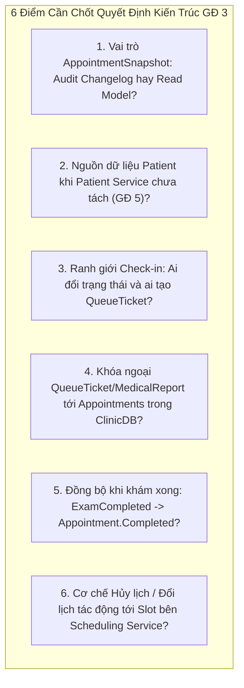
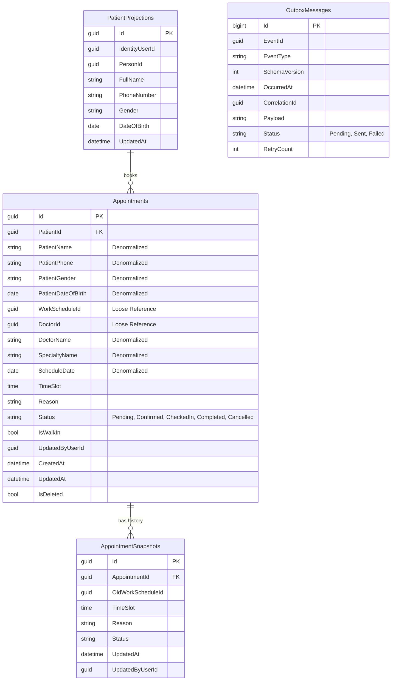
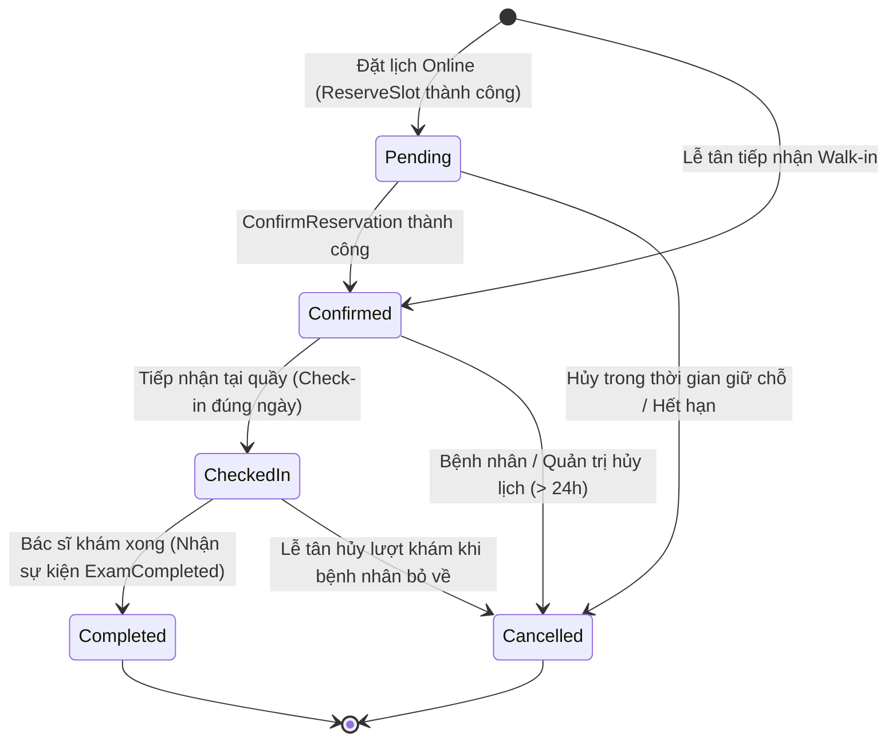
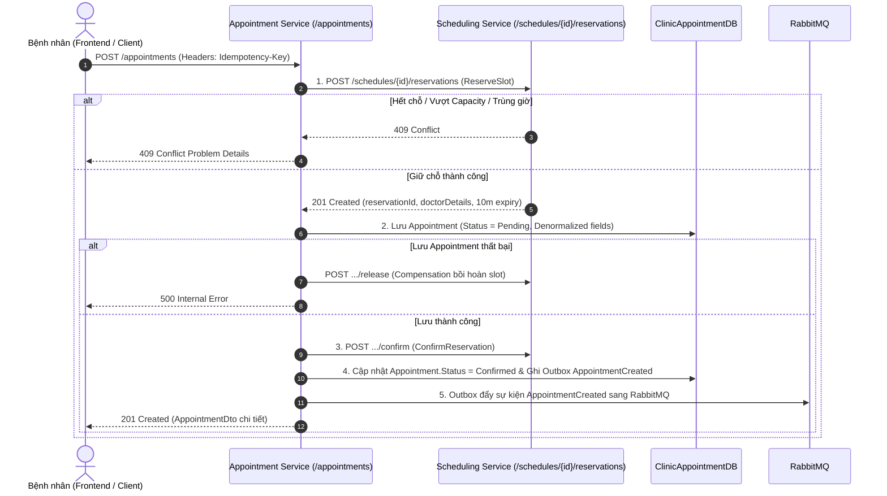
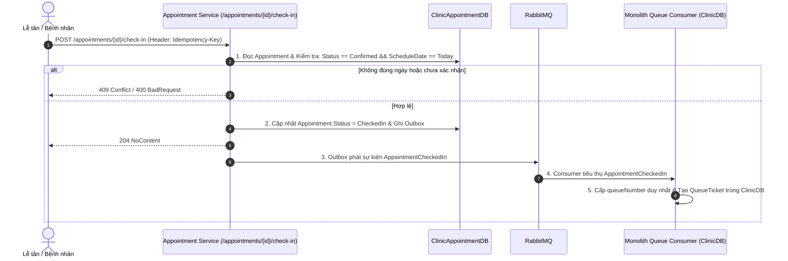
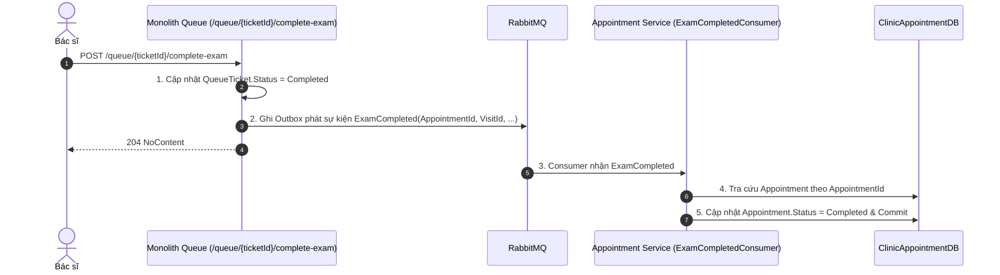

# Kế Hoạch Triển Khai Giai Đoạn 3: Tách Appointment Service
> **Tài liệu tham chiếu**:
> - `tasks/TASK_MEMBER_A.md` (Nhiệm vụ Thành viên A - Giai đoạn 3)
> - `tasks/TASK_MEMBER_B.md` (Nhiệm vụ Thành viên B - Giai đoạn 3)
> - `tasks/COMMON_REQUIREMENTS_AND_NOTES.md` (Yêu cầu kỹ thuật chung)
> - `tasks/PHASE_0_API_CONTRACT_ANALYSIS_MEMBER_A.md` (Phân tích API Contract & Service Boundary)
> - `tasks/PHASE_2_STAFF_SCHEDULING_EXECUTION_PLAN_MEMBER_A.md` (Kế hoạch Giai đoạn 2)
> - `docs/identity-service-phase1.md` (Tiền lệ từ Giai đoạn 1)

---

## 1. Tổng Quan & Mục Tiêu Giai Đoạn 3

### 1.1. Mục tiêu cốt lõi
Giai đoạn 3 tập trung vào việc tách toàn bộ chức năng quản lý lịch hẹn khám bệnh, lưu trữ snapshot thông tin hiển thị và điều phối quy trình đặt lịch (Booking Saga) ra khỏi Monolith để hình thành một microservice độc lập: **Appointment Service** (`Clinic.Appointment.Service`).

Dịch vụ này sở hữu cơ sở dữ liệu riêng biệt: **`ClinicAppointmentDB`**, không chia sẻ bảng, không liên kết khóa ngoại (Foreign Key) và không thực hiện truy vấn trực tiếp xuyên database với bất kỳ dịch vụ nào khác (`ClinicDB`, `ClinicIdentityDB`, `ClinicSchedulingDB`).

### 1.2. Quyết định kiến trúc nền tảng
1. **Sở hữu Aggregate `Appointment` độc lập**: Toàn bộ vòng đời lịch hẹn từ khi giữ chỗ đến khi hoàn tất khám hoặc hủy khám thuộc quyền sở hữu duy nhất của `Clinic.Appointment.Service`.
2. **Điều phối Booking Saga (Saga Orchestration)**: Thay vì giữ kết nối distributed transaction, Appointment Service đóng vai trò Orchestrator gọi sang Scheduling Service để giữ slot (`ReserveSlot`), tạo lịch hẹn cục bộ, và xác nhận giữ chỗ (`ConfirmReservation`), tự động bồi hoàn (`ReleaseReservation`) khi có lỗi.
3. **Mô hình "Self-Contained Denormalized Read Model"**: Bảng `Appointments` lưu sẵn các thông tin hiển thị cơ bản của Bác sĩ (`DoctorId`, `DoctorName`, `SpecialtyName`, `ScheduleDate`) và Bệnh nhân (`PatientName`, `PatientPhone`, `PatientGender`, `PatientDateOfBirth`) để tối ưu hóa truy vấn chi tiết hoặc danh sách lịch khám mà không cần join phân tán.
4. **Giao tiếp Hướng sự kiện (Event-Driven)**: Tách rời hoàn toàn quan hệ runtime với Queue Service và Medical Service bằng các integration events (`AppointmentCreated`, `AppointmentConfirmed`, `AppointmentCancelled`, `AppointmentCheckedIn`, `ExamCompleted`) thông qua Transactional Outbox pattern.

### 1.3. Các Aggregate và Entity chuyển giao quyền sở hữu
| Entity / Aggregate | Vai trò nghiệp vụ trong Appointment Service | Cơ sở dữ liệu |
| :--- | :--- | :--- |
| `Appointment` *(Aggregate Root)* | Quản lý thông tin lịch khám, thời gian, trạng thái, ghi chú và các trường denormalized. | `ClinicAppointmentDB` |
| `AppointmentSnapshot` *(Changelog)* | Lưu trữ lịch sử các lần đổi ca, đổi giờ khám, lý do thay đổi hoặc hủy lịch (1-N). | `ClinicAppointmentDB` |
| `PatientProjection` *(Bản chiếu)* | Lưu bản chiếu nhân thân tối thiểu của bệnh nhân để xác thực và hỗ trợ truy vấn cục bộ. | `ClinicAppointmentDB` |
| `OutboxMessage` | Lưu trữ các sự kiện tích hợp trong cùng local transaction để publisher gửi sang RabbitMQ. | `ClinicAppointmentDB` |

---

## 2. Phân Tích & Giải Quyết 6 Điểm Mâu Thuẫn Thiết Kế Cốt Lõi

Trước khi bước vào triển khai, 6 điểm mâu thuẫn / xung đột kiến trúc sau đây đã được rà soát và thống nhất phương án xử lý:



---

### 2.1. Mâu thuẫn 1: Vai trò của `AppointmentSnapshot` (Audit History hay Denormalized Read Model?)

- **Bối cảnh & Xung đột**:
  - Trong Monolith (`AppointmentSnapshot.cs`), entity này là **Changelog / Audit Log** (quan hệ 1-N). Mỗi khi cập nhật (`Update`) hoặc hủy (`Cancel`), domain tự động ghi lại: `OldWorkScheduleId`, `TimeSlot`, `Reason`, `Status`, `UpdatedAt`, `UpdatedByUserId`.
  - Trong tài liệu kiến trúc (`PHASE_0_API_CONTRACT_ANALYSIS.md` mục 3.4), `AppointmentSnapshot` lại được mô tả như một **Bản sao thông tin hiển thị tĩnh (1-1)**: `PatientFullName`, `DoctorFullName`, `SpecialtyName`, `RoomNumber`, `ContactPhone` để chống join phân tán.
- **Phương án đề xuất**:
  - *Phương án 1.1 (Khuyên dùng - Đã chốt)*:
    - **Denormalize trực tiếp vào bảng `Appointments`**: Bổ sung các cột thông tin hiển thị: `PatientName` (nvarchar 200), `PatientPhone` (nvarchar 20), `PatientGender` (nvarchar 10), `PatientDateOfBirth` (DateOnly) trực tiếp vào bảng `Appointments` (song song với các cột `DoctorName`, `SpecialtyName`, `ScheduleDate` đã có từ GĐ 2). Bảng `Appointments` tự nó là Self-Contained Read Model, truy vấn danh sách và chi tiết đạt hiệu năng tối đa (Zero Join).
    - **Duy trì bảng `AppointmentSnapshots` làm Changelog (1-N)**: Bảng này chỉ lưu lại lịch sử thay đổi ca/giờ/lý do mỗi khi đổi lịch hoặc hủy lịch, phục vụ tính năng `GetAppointmentChangelogQuery`.
  - *Phương án 1.2*: Tách thành 2 bảng riêng biệt: `AppointmentViewSnapshots` (1-1) và `AppointmentChangelogs` (1-N). Gây cồng kềnh bảng không cần thiết.
- **Quyết định**: **Áp dụng Phương án 1.1**.

---

### 2.2. Mâu thuẫn 2: Nguồn dữ liệu Bệnh nhân (`Patient`) khi Patient Service chưa được tách (GĐ 5 mới tách)

- **Bối cảnh & Xung đột**:
  - Thông tin bệnh nhân hiện tại: Tài khoản và nhân thân cơ bản (`Persons`) nằm ở `ClinicIdentityDB`; Hồ sơ y tế (`Patients`) vẫn tạm thời nằm ở `ClinicDB` của Monolith. Đến Giai đoạn 5 mới chính thức tách `Patient Service`.
  - Khi đặt lịch hẹn qua Appointment Service (`POST /appointments`), service cần biết `PatientId`, `FullName`, `PhoneNumber` để kiểm tra quyền và lưu snapshot. Appointment Service tuyệt đối không được truy cập trực tiếp `ClinicDB`.
- **Phương án đề xuất**:
  - *Phương án 2.1 (Khuyên dùng - Đã chốt)*:
    - **Single Identity & Role Projection**: Access Token JWT của bệnh nhân đã có sẵn các claims: `sub` (UserId), `patientId`, `personId`.
    - Tạo bảng bản chiếu nhẹ `PatientProjections` (`Id`, `IdentityUserId`, `PersonId`, `FullName`, `PhoneNumber`, `Gender`, `DateOfBirth`) trong `ClinicAppointmentDB`.
    - Nạp dữ liệu ban đầu bằng kịch bản import từ `ClinicDB`. Khi người dùng đổi thông tin cá nhân, Identity Service phát `UserProfileUpdated`, Appointment Service đón nhận để cập nhật bản chiếu (đồng nhất với cách `Clinic.Scheduling.Service` đã làm với `Employees` ở GĐ 2).
    - Khi đặt lịch online: Lấy `PatientId` từ Token claims. Khi Lễ tân đặt hộ hoặc Walk-in: Lễ tân truyền `PatientId` (kèm thông tin họ tên, số điện thoại) trong request body.
  - *Phương án 2.2*: Gọi đồng bộ HTTP sang Monolith `/internal/patients/{id}`. Nhược điểm: Tạo network latency và phụ thuộc đồng bộ.
- **Quyết định**: **Áp dụng Phương án 2.1**.

---

### 2.3. Mâu thuẫn 3: Ranh giới Check-in: Ai đổi trạng thái `CheckedIn` và ai tạo `QueueTicket`?

- **Bối cảnh & Xung đột**:
  - Monolith hiện tại xử lý `POST /appointments/{id}/check-in` bằng cách vừa đổi `Appointment.Status = CheckedIn`, vừa insert bản ghi `QueueTicket` vào `ClinicDB` trong cùng 1 transaction.
  - Trong Giai đoạn 3, `Appointment` chuyển sang `ClinicAppointmentDB`, nhưng `QueueTicket` vẫn ở `ClinicDB` (Giai đoạn 4 mới tách Queue Service). Appointment Service không thể và không được phép insert trực tiếp `QueueTicket` vào `ClinicDB`.
- **Phương án đề xuất**:
  - *Phương án 3.1 (Khuyên dùng - Đã chốt - Event-Driven Check-in)*:
    - Endpoint `POST /appointments/{id}/check-in` chuyển giao cho `Appointment Service` quản lý.
    - Appointment Service kiểm tra điều kiện hợp lệ (`Status == Confirmed`, đúng ngày khám `ScheduleDate == Today`) $\to$ Chuyển `Appointment.Status = CheckedIn` $\to$ Ghi Outbox phát sự kiện `AppointmentCheckedIn { AppointmentId, PatientId, DoctorId, ScheduleDate, TimeSlot, VisitId, PatientName }`.
    - Phía Monolith: Cấu hình một Consumer lắng nghe `AppointmentCheckedIn` từ RabbitMQ để tự động cấp số và tạo `QueueTicket` trong `ClinicDB`.
    - *Lợi ích dài hạn*: Đúng chuẩn kiến trúc Event-Driven. Đến Giai đoạn 4 tách Queue Service, chỉ cần chuyển Consumer này từ Monolith sang `Queue Service` mà **không cần sửa đổi bất kỳ dòng code nào của Appointment Service**.
  - *Phương án 3.2*: Tạm thời để endpoint Check-in ở Monolith. Monolith tạo `QueueTicket` rồi gọi HTTP sang Appointment Service để đổi trạng thái. Nhược điểm: Nhập nhằng quyền sở hữu vòng đời lịch hẹn.
- **Quyết định**: **Áp dụng Phương án 3.1**.

---

### 2.4. Mâu thuẫn 4: Khóa ngoại của `QueueTicket` và `MedicalReport` tới `Appointments` trong `ClinicDB`

- **Bối cảnh & Xung đột**:
  - Bảng `QueueTickets` và `MedicalReports` trong `ClinicDB` đang có Foreign Key `FK_QueueTickets_Appointments_AppointmentId` và `FK_MedicalReports_Appointments_AppointmentId`.
  - Khi tách `Appointments` sang `ClinicAppointmentDB`, nếu giữ lại 2 Foreign Key này trong `ClinicDB`, dữ liệu hàng đợi và bệnh án sẽ bị "khóa cứng" vào bảng legacy của Monolith, không thể tiếp nhận các lịch hẹn mới được tạo từ Appointment Service.
- **Phương án đề xuất**:
  - *Phương án 4.1 (Khuyên dùng - Đã chốt)*:
    - Tạo migration trên `ClinicDB` để **DROP hoàn toàn 2 Foreign Key**:
      ```sql
      ALTER TABLE QueueTickets DROP CONSTRAINT FK_QueueTickets_Appointments_AppointmentId;
      ALTER TABLE MedicalReports DROP CONSTRAINT FK_MedicalReports_Appointments_AppointmentId;
      ```
    - Cột `AppointmentId` trên `QueueTickets` và `MedicalReports` trở thành loose reference identifier (UUID độc lập).
    - Bảng `Appointments` cũ trong `ClinicDB` được giữ nguyên dữ liệu lịch sử để tra cứu chuyển tiếp.
- **Quyết định**: **Áp dụng Phương án 4.1**.

---

### 2.5. Mâu thuẫn 5: Đồng bộ trạng thái khi Khám xong (`ExamCompleted` $\to$ `Appointment.Completed`)

- **Bối cảnh & Xung đột**:
  - Khi bác sĩ khám xong một ca (`POST /queue/{ticketId}/complete-exam`), Monolith hiện tại đang gọi trực tiếp `queueTicket.Appointment.Complete(...)` trong local transaction.
  - Khi `Appointment` nằm ở `ClinicAppointmentDB`, Queue (Monolith) không thể sửa trực tiếp bảng `Appointments` được nữa.
- **Phương án đề xuất**:
  - Queue (Monolith) đã có sẵn logic phát sự kiện `ExamCompleted { VisitId, QueueTicketId, AppointmentId, DoctorId, CompletedAt }` qua Outbox.
  - Tại `Clinic.Appointment.Service`: Triển khai `ExamCompletedConsumer` lắng nghe sự kiện `ExamCompleted` từ RabbitMQ $\to$ Tra cứu `Appointment` theo `AppointmentId` $\to$ Cập nhật trạng thái `Appointment.Status = Completed` (Eventual Consistency).
- **Quyết định**: **Triển khai `ExamCompletedConsumer` trong Appointment Service**.

---

### 2.6. Mâu thuẫn 6: Quy trình Hủy lịch (`CancelAppointment`) và Đổi lịch (`UpdateAppointment`) với Scheduling Service

- **Bối cảnh & Xung đột**:
  - Khi Hủy lịch: Cần giải phóng slot tương ứng trong Scheduling Service để phục hồi `RecommendedCapacity` cho bệnh nhân khác đặt chỗ.
  - Khi Đổi lịch: Cần giữ chỗ slot tại ca mới (`ReserveSlot`), nếu thành công thì cập nhật lịch hẹn và giải phóng slot ở ca cũ; nếu giữ chỗ ca mới thất bại thì phải giữ nguyên lịch hẹn cũ (chống mất lịch).
- **Phương án đề xuất**:
  - **Hủy lịch khám (Cancellation)**:
    - Appointment Service chuyển trạng thái `Appointment.Status = Cancelled`, ghi Outbox phát sự kiện:
      `AppointmentCancelled { AppointmentId, WorkScheduleId, TimeSlot, DoctorId, PatientId, CancelledAt }`.
    - Scheduling Service lắng nghe sự kiện `AppointmentCancelled` $\to$ Chuyển trạng thái `SlotReservation` thành `Released` $\to$ Phục hồi capacity ca trực tức thì.
  - **Đổi lịch khám (Reschedule Saga)**:
    - Pha 1: Gọi HTTP `POST /schedules/{newScheduleId}/reservations` (kèm `Idempotency-Key`) để giữ chỗ slot mới.
    - Pha 2: Cập nhật thông tin ca mới vào `Appointment`, ghi changelog vào `AppointmentSnapshots`, gọi `ConfirmReservation` cho slot mới, và phát sự kiện giải phóng slot cũ.
    - Pha 3 (Bồi hoàn): Nếu pha 2 thất bại $\to$ Gọi `ReleaseReservation` cho slot mới, giữ nguyên trạng thái lịch hẹn ban đầu.
- **Quyết định**: **Áp dụng quy trình trên**.

---

## 3. Thiết Kế Kiến Trúc Dịch Vụ Appointment

### 3.1. Cấu trúc Project
- **Project Chính**: `backend/Clinic.Appointment.Service/Clinic.Appointment.Service.csproj` (.NET 10.0 Web API).
- **Project Kiểm thử**: `backend/Clinic.Appointment.Service.Tests/Clinic.Appointment.Service.Tests.csproj` (xUnit).
- **Dependencies**: Tham chiếu `Clinic.Contracts` (để dùng chung `EventEnvelope<T>`, `AppointmentEvents`, `ExamCompleted`, `UserProfileUpdated`). Tuyệt đối không tham chiếu tới `Clinic.Domain` hay `Clinic.Infrastructure.Sqlserver` của Monolith.

### 3.2. Thiết Kế Cơ Sở Dữ Liệu `ClinicAppointmentDB`



---

### 3.3. Vòng Đời Trạng Thái Lịch Hẹn (Appointment Lifecycle)



---

### 3.4. Các Quy Trình Nghiệp Vụ Cốt Lõi (Workflows)

#### Quy trình 1: Booking Saga Orchestration (Đặt lịch Online)


#### Quy trình 2: Tiếp Nhận Check-in & Cấp Số Hàng Đợi (Event-Driven)


#### Quy trình 3: Đồng Bộ Hoàn Tất Khám (ExamCompleted)


---

## 4. Kế Hoạch Triển Khai Chi Tiết Từng Bước (Step-by-Step Execution Plan)

### Bước 1: Khởi Tạo Service & Thiết Lập Hạ Tầng Cơ Bản
1. **Tạo Project mới**:
   - `dotnet new webapi -n Clinic.Appointment.Service -o backend/Clinic.Appointment.Service`.
   - `dotnet new xunit -n Clinic.Appointment.Service.Tests -o backend/Clinic.Appointment.Service.Tests`.
   - Thêm 2 project vào solution `backend/Clinic.sln`.
   - Tham chiếu `Clinic.Contracts` vào `Clinic.Appointment.Service`.
2. **Cài đặt thư viện**:
   - `Microsoft.EntityFrameworkCore.SqlServer` (10.x).
   - `Microsoft.EntityFrameworkCore.Design` (10.x).
   - `Microsoft.AspNetCore.Authentication.JwtBearer` (10.x).
   - `FluentValidation.AspNetCore`.
3. **Cấu hình Xác thực JWT độc lập qua JWKS**:
   - Trong `Program.cs`, cấu hình `JwtBearer` trỏ tới discovery endpoint `http://identity-service:8080/.well-known/jwks.json`. Tuyệt đối không kết nối database `ClinicIdentityDB`.
4. **Cấu hình Docker & Docker Compose**:
   - Tạo `backend/Clinic.Appointment.Service/Dockerfile`.
   - Thêm service `appointment-service` vào `docker-compose.yml`:
     - Cổng host: `5003:8080`.
     - Biến môi trường: `ConnectionStrings__AppointmentConnection`, `Jwt__Issuer`, `Jwt__Audience`, `Scheduling__Authority=http://scheduling-service:8080`.
     - Health check: `/healthz` và `/readyz`.

---

### Bước 2: Xây Dựng Domain Model & Persistence Layer (`ClinicAppointmentDB`)
1. **Định nghĩa các Entity**:
   - `Appointment`: Aggregate root với đầy đủ phương thức domain (`Confirm()`, `Cancel()`, `CheckIn()`, `Complete()`, `Reschedule()`).
   - `AppointmentSnapshot`: Lưu trữ changelog lịch sử thay đổi ca trực/giờ khám.
   - `PatientProjection`: Bản chiếu thông tin bệnh nhân.
   - `OutboxMessage`: Bảng lưu trữ sự kiện tích hợp cục bộ.
2. **Tạo `AppointmentDbContext` & Fluent API Configurations**:
   - Cấu hình Unique Index cho `(DoctorId, ScheduleDate, TimeSlot)` với điều kiện filter: `[Status] <> 'Cancelled' AND [IsDeleted] = 0`.
   - Cấu hình Index tối ưu tìm kiếm: `(PatientId, ScheduleDate)`, `(DoctorId, ScheduleDate)`, `(Status)`.
3. **Tạo Initial Migration**:
   - Tạo migration `20261023_InitialAppointmentSchema` cho `ClinicAppointmentDB`.

---

### Bước 3: Viết Kịch Bản Di Chuyển & Đối Soát Dữ Liệu
1. **Kịch bản Import Dữ liệu (`import-from-clinicdb.sql`)**:
   - Nạp `PatientProjections`: JOIN giữa `ClinicDB.dbo.Patients` và `ClinicDB.dbo.Persons`.
   - Nạp `Appointments`: Đọc toàn bộ lịch hẹn từ `ClinicDB.dbo.Appointments`, JOIN với `Patients` và `Persons` để điền đầy đủ các cột denormalized nhân thân (`PatientName`, `PatientPhone`, `PatientGender`, `PatientDateOfBirth`).
   - Nạp `AppointmentSnapshots`: Copy từ `ClinicDB.dbo.AppointmentSnapshots`.
   - Script thiết kế Idempotent (chạy lặp lại an toàn, không trùng khóa).
2. **Kịch bản Đối soát Dữ liệu (`verify-appointment-import.sql`)**:
   - Đối soát tổng số lượng bản ghi `Appointments`, `Snapshots` giữa 2 database.
   - Kiểm tra các trường denormalized không bị null. Yêu cầu: `MismatchCount = 0`.
3. **Thêm container `appointment-data-importer` vào `docker-compose.yml`** (tự động chạy sau khi DB và Appointment Service ready).

---

### Bước 4: Xây Dựng Bộ API Nghiệp Vụ Cốt Lõi & Saga Booking
1. **Bộ API Quản Lý Lịch Hẹn (`AppointmentsController`)**:
   - `POST /appointments`:
     - Header bắt buộc: `Idempotency-Key`.
     - Thực thi Booking Saga: `ReserveSlot (Scheduling) -> Create Local Appointment -> ConfirmReservation (Scheduling)`.
     - Tự động bồi hoàn (`ReleaseReservation`) nếu lưu appointment cục bộ gặp lỗi.
     - Hỗ trợ phân định luồng Online (ràng buộc capacity) và Walk-in (linh hoạt tại quầy).
   - `GET /appointments/{id}`: Xem chi tiết lịch khám (đọc trực tiếp từ bảng denormalized, zero network latency).
   - `GET /me/appointments`: Lấy danh sách lịch hẹn của bệnh nhân đang đăng nhập (lọc theo `PatientId` từ token, hỗ trợ lọc `upcoming` / `past`).
   - `GET /receptionist/appointments/pending`: Lấy danh sách lịch chờ xác nhận cho lễ tân.
   - `POST /appointments/{id}/confirm`: Xác nhận lịch hẹn.
   - `POST /appointments/{id}/cancel`: Hủy lịch khám (ràng buộc tối thiểu trước 24h đối với bệnh nhân; admin/receptionist được hủy mọi lúc). Ghi changelog và phát `AppointmentCancelled`.
   - `PATCH /appointments/{id}`: Đổi lịch khám (Reschedule Saga: giữ slot mới $\to$ cập nhật $\to$ hủy slot cũ).
   - `POST /appointments/{id}/check-in`: Tiếp nhận bệnh nhân tại quầy, đổi `Status = CheckedIn`, phát sự kiện `AppointmentCheckedIn`.

---

### Bước 5: Tích Hợp Outbox Message & Event Consumers
1. **Outbox Pattern cho Sự Kiện Lịch Hẹn**:
   - Định nghĩa contracts chuẩn trong `Clinic.Contracts`:
     - `AppointmentCreated { AppointmentId, PatientId, DoctorId, ScheduleDate, TimeSlot, IsWalkIn }`
     - `AppointmentConfirmed { AppointmentId, PatientId, DoctorId, ScheduleDate, TimeSlot }`
     - `AppointmentCancelled { AppointmentId, PatientId, DoctorId, ScheduleDate, TimeSlot, Reason }`
     - `AppointmentCheckedIn { AppointmentId, PatientId, DoctorId, ScheduleDate, TimeSlot, VisitId, PatientName }`
   - Cài đặt `IOutboxWriter` ghi trực tiếp vào `AppointmentDbContext.OutboxMessages` trong cùng local transaction.
2. **Event Consumers trong Appointment Service**:
   - `ExamCompletedConsumer`: Lắng nghe sự kiện `ExamCompleted` từ RabbitMQ $\to$ Chuyển `Appointment.Status = Completed`.
   - `UserProfileUpdatedConsumer`: Lắng nghe sự kiện `UserProfileUpdated` từ Identity Service $\to$ Cập nhật thông tin họ tên, số điện thoại trong `PatientProjections`.

---

### Bước 6: Cắt Chuyển (Cutover) & Tái Cấu Trúc Monolith (`Clinic.API`)
1. **Migration gỡ bỏ Foreign Key trên Monolith (`ClinicDB`)**:
   - Xóa bỏ ràng buộc khóa ngoại:
     - `FK_QueueTickets_Appointments_AppointmentId`
     - `FK_MedicalReports_Appointments_AppointmentId`
   - Chuyển `AppointmentId` trên `QueueTickets` và `MedicalReports` thành loose UUID reference.
2. **Triển khai Consumer Tiếp nhận Check-in tại Monolith**:
   - Cấu hình RabbitMQ Consumer tại Monolith đón nhận `AppointmentCheckedIn` để tự động sinh số thứ tự và tạo `QueueTicket` trong `ClinicDB` (bảo toàn toàn bộ luồng vận hành hàng đợi phòng khám hiện tại).
3. **Chuyển hướng API Gateway**:
   - Cấu hình route `/appointments/**` và `/me/appointments/**` chuyển tiếp sang `Clinic.Appointment.Service`.

---

### Bước 7: Kiểm Thử Tự Động & Tiêu Chí Nghiệm Thu
1. **Unit Tests (`Clinic.Appointment.Service.Tests`)**:
   - Test logic chuyển đổi trạng thái vòng đời `Appointment`.
   - Test ràng buộc hủy lịch: Chặn hủy lịch cận giờ (< 24 tiếng).
   - Test Idempotency và Compensation của Saga khi gọi Scheduling Service gặp sự cố.
2. **Concurrency & Integration Tests**:
   - Test 20 request đặt cùng 1 slot đồng thời: Đúng 1 request thành công (201 Created), 19 request còn lại nhận 409 Conflict.
   - Chạy bộ kiểm thử `BaselineBusinessWorkflowTests` đảm bảo toàn bộ luồng End-to-End: `Đặt lịch -> Check-in -> Cấp số -> Khám bệnh -> Chốt bệnh án` vượt qua 100%.

---

## 5. Kế Hoạch Rollback Dự Phòng (Rollback Strategy)

1. **Giai đoạn trước khi chuyển đổi Gateway hoàn toàn**:
   - Nếu `Clinic.Appointment.Service` gặp sự cố:
     - Giữ nguyên dữ liệu trong `ClinicAppointmentDB` để phân tích log.
     - Cấu hình Gateway trỏ ngược route `/appointments` về Monolith.
2. **Giai đoạn sau khi đã chạy thực tế**:
   - Do bảng `Appointments` trong `ClinicDB` vẫn được giữ nguyên dữ liệu lịch sử, ta có thể khôi phục lại trạng thái bằng cách đồng bộ ngược các lịch hẹn mới tạo trong thời gian chạy thử nghiệm.

---

## 6. Bảng Tổng Hợp Trách Nhiệm Giữa Thành Viên A và Thành Viên B (GĐ 3)

| Nội dung công việc | Thành viên A (Backend & Data) | Thành viên B (Broker, QA & Obs) |
| :--- | :---: | :---: |
| Khởi tạo `Clinic.Appointment.Service` & cấu hình JWKS | **Chủ trì** | Phối hợp |
| Thiết kế Schema `ClinicAppointmentDB` & EF Migrations | **Chủ trì** | Hỗ trợ review |
| Xây dựng Booking Saga (`Reserve -> Create -> Confirm / Release`) | **Chủ trì** | Hỗ trợ review |
| Chốt Event Contracts trong `Clinic.Contracts` | **Chủ trì** | Phối hợp |
| Triển khai `OutboxPublisher` đẩy Appointment events sang RabbitMQ | Hỗ trợ | **Chủ trì** |
| Xây dựng Consumer tại Monolith đón `AppointmentCheckedIn` để cấp vé khám | Hỗ trợ | **Chủ trì** |
| Xây dựng `ExamCompletedConsumer` đồng bộ trạng thái `Completed` | **Chủ trì** | Hỗ trợ testing |
| Viết Concurrency Tests & Saga Failure Tests | Phối hợp | **Chủ trì** |
| Cập nhật Frontend gọi Appointment API mới qua Gateway | Hỗ trợ | **Chủ trì** |
| Cấu hình Metrics (Booking latency, saga failures, reconciliation lag) | Hỗ trợ | **Chủ trì** |
