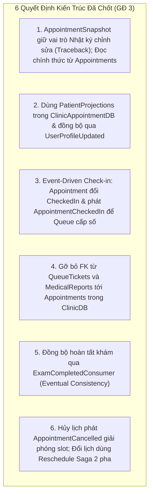
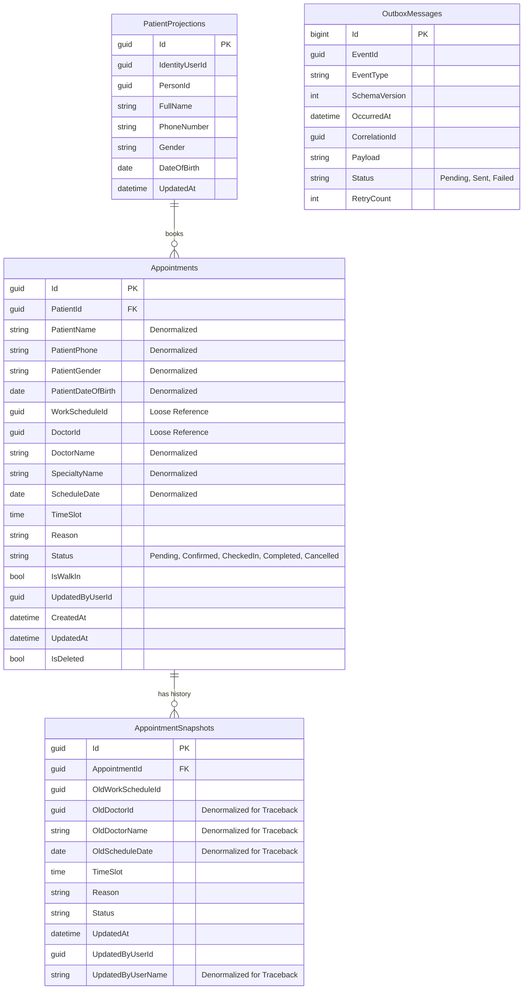
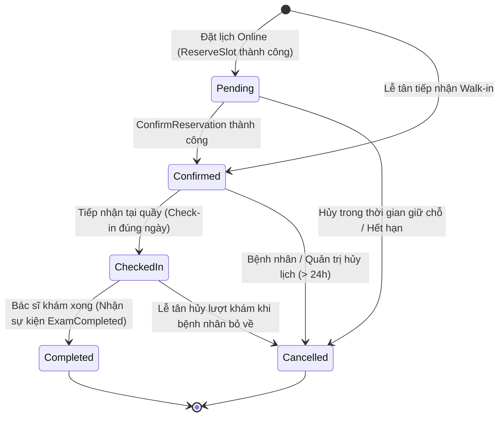
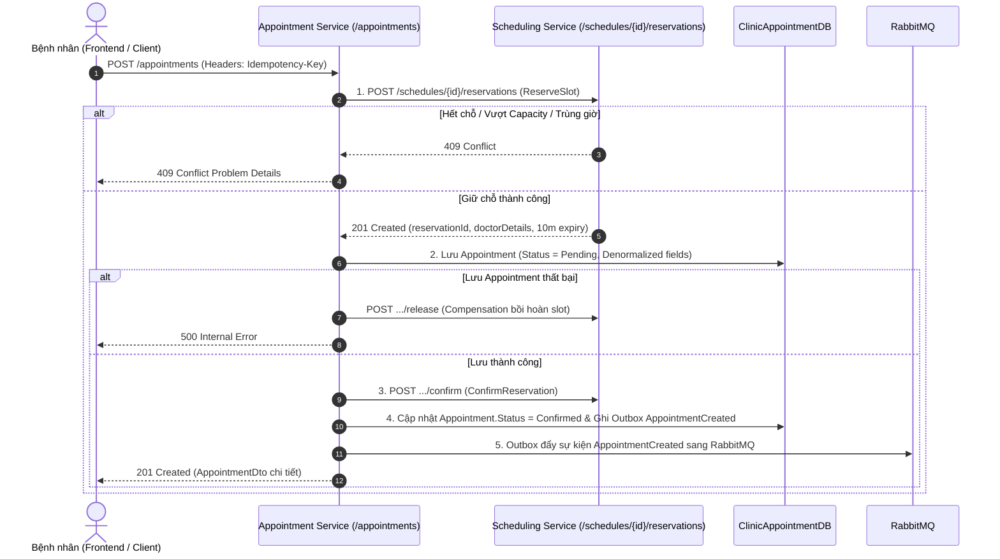
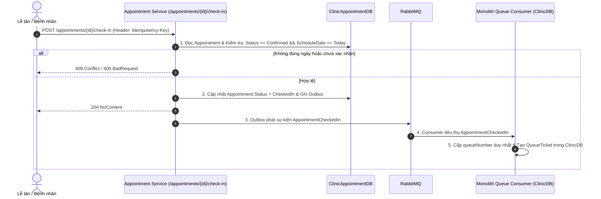
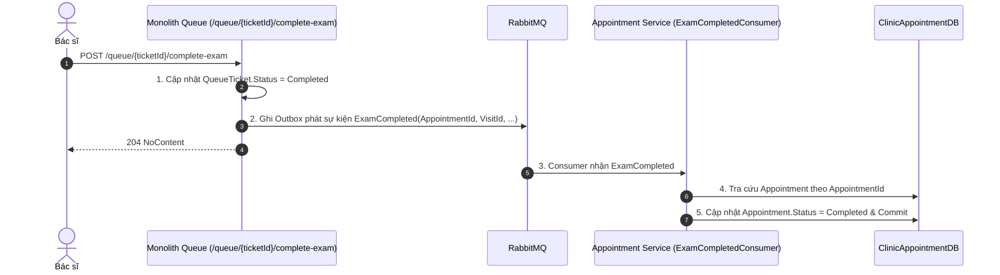
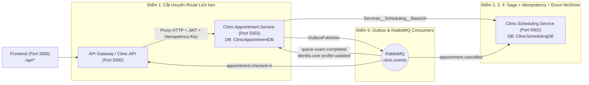

# Kế Hoạch Triển Khai Giai Đoạn 3: Tách Appointment Service
> **Tài liệu tham chiếu**:
> - `tasks/TASK_MEMBER_A.md` (Nhiệm vụ Thành viên A - Giai đoạn 3)
> - `tasks/TASK_MEMBER_B.md` (Nhiệm vụ Thành viên B - Giai đoạn 3)
> - `tasks/COMMON_REQUIREMENTS_AND_NOTES.md` (Yêu cầu kỹ thuật chung)
> - `tasks/PHASE_0_API_CONTRACT_ANALYSIS_MEMBER_A.md` (Phân tích API Contract & Service Boundary)
> - `tasks/PHASE_2_STAFF_SCHEDULING_EXECUTION_PLAN_MEMBER_A.md` (Kế hoạch Giai đoạn 2)
> - `docs/identity-service-phase1.md` (Tiền lệ từ Giai đoạn 1)

---

## 1. Tổng Quan & Mục Tiêu Giai Đoạn 3

### 1.1. Mục tiêu cốt lõi
Giai đoạn 3 tập trung vào việc tách toàn bộ chức năng quản lý lịch hẹn khám bệnh, lưu trữ snapshot thông tin hiển thị và điều phối quy trình đặt lịch (Booking Saga) ra khỏi Monolith để hình thành một microservice độc lập: **Appointment Service** (`Clinic.Appointment.Service`).

Dịch vụ này sở hữu cơ sở dữ liệu riêng biệt: **`ClinicAppointmentDB`**, không chia sẻ bảng, không liên kết khóa ngoại (Foreign Key) và không thực hiện truy vấn trực tiếp xuyên database với bất kỳ dịch vụ nào khác (`ClinicDB`, `ClinicIdentityDB`, `ClinicSchedulingDB`).

### 1.2. Quyết định kiến trúc nền tảng
1. **Sở hữu Aggregate `Appointment` độc lập**: Toàn bộ vòng đời lịch hẹn từ khi giữ chỗ đến khi hoàn tất khám hoặc hủy khám thuộc quyền sở hữu duy nhất của `Clinic.Appointment.Service`.
2. **Điều phối Booking Saga (Saga Orchestration)**: Thay vì giữ kết nối distributed transaction, Appointment Service đóng vai trò Orchestrator gọi sang Scheduling Service để giữ slot (`ReserveSlot`), tạo lịch hẹn cục bộ, và xác nhận giữ chỗ (`ConfirmReservation`), tự động bồi hoàn (`ReleaseReservation`) khi có lỗi.
3. **Mô hình "Self-Contained Denormalized Read Model"**: Bảng `Appointments` lưu sẵn các thông tin hiển thị cơ bản của Bác sĩ (`DoctorId`, `DoctorName`, `SpecialtyName`, `ScheduleDate`) và Bệnh nhân (`PatientName`, `PatientPhone`, `PatientGender`, `PatientDateOfBirth`) để tối ưu hóa truy vấn chi tiết hoặc danh sách lịch khám mà không cần join phân tán.
4. **Giao tiếp Hướng sự kiện (Event-Driven)**: Tách rời hoàn toàn quan hệ runtime với Queue Service và Medical Service bằng các integration events (`AppointmentCreated`, `AppointmentConfirmed`, `AppointmentCancelled`, `AppointmentCheckedIn`, `ExamCompleted`) thông qua Transactional Outbox pattern.

### 1.3. Các Aggregate và Entity chuyển giao quyền sở hữu
| Entity / Aggregate | Vai trò nghiệp vụ trong Appointment Service | Cơ sở dữ liệu |
| :--- | :--- | :--- |
| `Appointment` *(Aggregate Root)* | Quản lý thông tin lịch khám, thời gian, trạng thái, ghi chú và các trường denormalized. | `ClinicAppointmentDB` |
| `AppointmentSnapshot` *(Nhật ký chỉnh sửa / Traceback)* | Lưu nhật ký các lần chỉnh sửa lịch hẹn (đổi lịch, xác nhận, hủy lịch...) để traceback khi có khiếu nại/sự cố đặt lịch (1-N), không dùng làm nơi đọc thông tin chính thức. | `ClinicAppointmentDB` |
| `PatientProjection` *(Bản chiếu)* | Lưu bản chiếu nhân thân tối thiểu của bệnh nhân để xác thực và hỗ trợ truy vấn cục bộ. | `ClinicAppointmentDB` |
| `OutboxMessage` | Lưu trữ các sự kiện tích hợp trong cùng local transaction để publisher gửi sang RabbitMQ. | `ClinicAppointmentDB` |

---

## 2. Các Quyết Định Kiến Trúc Đã Chốt Cho Giai Đoạn 3

Dựa trên quá trình đối soát mã nguồn và thống nhất định hướng thiết kế, dưới đây là **6 quyết định kiến trúc chính thức** cho Giai đoạn 3:



---

### 2.1. Quyết định 1: Vai trò của `AppointmentSnapshot` (Nhật ký chỉnh sửa để Traceback) & Đọc thông tin chính thức trên `Appointments`
1. **Giữ nguyên vai trò của `AppointmentSnapshot` là bảng Nhật ký chỉnh sửa phục vụ Traceback (1-N)**:
   - `AppointmentSnapshot` lưu nhật ký các lần chỉnh sửa (`Update`, `Confirm`, `Cancel`, `AdminCancel`) để traceback khi người khám có vấn đề hoặc khiếu nại về đặt lịch (đặt sai, bị đổi lịch, hủy lịch...), **không dùng** làm nơi đọc thông tin hiển thị chính thức.
   - Bổ sung các trường lịch sử tự thân vào `AppointmentSnapshot` ngay lúc ghi nhật ký: `OldWorkScheduleId`, `OldDoctorId`, `OldDoctorName`, `OldScheduleDate`, `TimeSlot`, `Reason`, `Status`, `UpdatedAt`, `UpdatedByUserId`, `UpdatedByUserName` để phục vụ API `GET /admin/appointments/{appointmentId}/history` độc lập mà không cần join sang `ClinicSchedulingDB` hay `ClinicIdentityDB`.
2. **Đọc thông tin hiển thị chính thức trực tiếp từ bảng `Appointments`**:
   - Bảng `Appointments` là nguồn chuẩn duy nhất để đọc thông tin lịch hẹn hiện hành, lưu trực tiếp các cột denormalized của Bác sĩ (`DoctorId`, `DoctorName`, `SpecialtyName`, `ScheduleDate` - đã có từ GĐ 2) và Bệnh nhân (`PatientName`, `PatientPhone`, `PatientGender`, `PatientDateOfBirth`).

---

### 2.2. Quyết định 2: Quản lý dữ liệu Bệnh nhân qua Bản chiếu `PatientProjections` (Single Identity & Role Projection)
- Access Token JWT của bệnh nhân chứa sẵn các claims định danh: `sub` (`UserId`), `patientId`, `personId`.
- Trong `ClinicAppointmentDB`, duy trì bảng bản chiếu `PatientProjections` (`Id`, `IdentityUserId`, `PersonId`, `FullName`, `PhoneNumber`, `Gender`, `DateOfBirth`).
- Nạp dữ liệu ban đầu bằng kịch bản import từ `ClinicDB`. Khi người dùng cập nhật thông tin cá nhân tại Identity Service, sự kiện `UserProfileUpdated` được phát qua RabbitMQ để Appointment Service tự động cập nhật bản chiếu (nhất quán với mô hình của `Clinic.Scheduling.Service` ở GĐ 2).
- Khi bệnh nhân tự đặt lịch online: lấy `PatientId` từ JWT claims và tra cứu nhanh trên `PatientProjections`. Khi Lễ tân đặt hộ hoặc tiếp nhận Walk-in: nhận `PatientId` (và cập nhật/đồng bộ bản chiếu nếu là bệnh nhân mới tạo).

---

### 2.3. Quyết định 3: Ranh giới Check-in theo mô hình Event-Driven
- Endpoint `POST /appointments/{id}/check-in` do `Clinic.Appointment.Service` sở hữu và xử lý.
- Khi nhận request check-in (kèm `Idempotency-Key`):
  1. Appointment Service kiểm tra lịch hẹn hợp lệ (`Status == Confirmed` và đúng ngày khám `ScheduleDate == Today`).
  2. Chuyển trạng thái `Appointment.Status = CheckedIn` và ghi Outbox phát sự kiện `AppointmentCheckedIn { AppointmentId, PatientId, DoctorId, ScheduleDate, TimeSlot, VisitId, PatientName }` trong cùng local transaction.
  3. Phía Monolith (đang tạm giữ module Queue trước khi tách ở GĐ 4) sử dụng Consumer lắng nghe `AppointmentCheckedIn` từ RabbitMQ để cấp `QueueNumber` và tạo `QueueTicket` trong `ClinicDB`.
- **Lợi ích**: Tách biệt hoàn toàn ranh giới database giữa Appointment và Queue; đến Giai đoạn 4 chỉ cần chuyển Consumer này sang `Clinic.Queue.Service` mà không cần sửa đổi `Clinic.Appointment.Service`.

---

### 2.4. Quyết định 4: Gỡ bỏ Khóa ngoại (Foreign Key) từ `QueueTickets` và `MedicalReports` tới `Appointments` trong `ClinicDB`
- Tạo migration trên Monolith (`ClinicDB`) để gỡ bỏ 2 ràng buộc khóa ngoại:
  - `FK_QueueTickets_Appointments_AppointmentId`
  - `FK_MedicalReports_Appointments_AppointmentId`
- Cột `AppointmentId` trên `QueueTickets` và `MedicalReports` chuyển thành loose UUID reference (liên kết logic, không khóa cứng ở tầng vật lý SQL Server), cho phép tạo vé khám và bệnh án cho các lịch hẹn mới sinh ra bên `ClinicAppointmentDB`.

---

### 2.5. Quyết định 5: Đồng bộ trạng thái Hoàn tất khám (`ExamCompleted` $	o$ `Appointment.Completed`)
- Khi bác sĩ hoàn tất khám (`POST /queue/{ticketId}/complete-exam`), module Queue chỉ cập nhật `QueueTicket.Status = Completed` và phát sự kiện `ExamCompleted { VisitId, QueueTicketId, AppointmentId, DoctorId, CompletedAt }` qua Outbox.
- `Clinic.Appointment.Service` triển khai `ExamCompletedConsumer` lắng nghe sự kiện `ExamCompleted` (idempotent qua Inbox) $	o$ Tra cứu `Appointment` theo `AppointmentId` $	o$ Chuyển trạng thái sang `Completed` (Eventual Consistency).

---

### 2.6. Quyết định 6: Quy trình Hủy lịch (`CancelAppointment`) và Đổi lịch (`UpdateAppointment`) với Scheduling Service
1. **Hủy lịch khám (Event-Driven Cancellation)**:
   - Khi hủy lịch hợp lệ (trước giờ khám $\ge 24$ tiếng đối với bệnh nhân, hoặc hủy bởi Admin/Lễ tân), Appointment Service ghi nhận `AppointmentSnapshot`, chuyển `Appointment.Status = Cancelled`, và ghi Outbox phát sự kiện `AppointmentCancelled { AppointmentId, WorkScheduleId, TimeSlot, DoctorId, PatientId, CancelledAt }`.
   - `Clinic.Scheduling.Service` lắng nghe sự kiện `AppointmentCancelled` để chuyển trạng thái `SlotReservation` tương ứng (`WorkScheduleId`, `TimeSlot`, `PatientId`) sang `Released`, khôi phục `RecommendedCapacity` cho ca trực.
2. **Đổi lịch khám (Reschedule Saga 2 pha)**:
   - **Pha 1**: Gọi HTTP `POST /schedules/{newScheduleId}/reservations` (kèm `Idempotency-Key`) để giữ chỗ slot mới tại Scheduling Service.
   - **Pha 2**: Ghi bản ghi trạng thái cũ vào `AppointmentSnapshots`, cập nhật thông tin ca mới vào `Appointment`, gọi `ConfirmReservation` cho slot mới, và phát sự kiện giải phóng slot cũ.
   - **Bồi hoàn (Compensation)**: Nếu bước lưu DB hoặc xác nhận slot mới thất bại $	o$ Gọi `ReleaseReservation` cho slot mới và giữ nguyên lịch hẹn ban đầu.

---

## 3. Thiết Kế Kiến Trúc Dịch Vụ Appointment

### 3.1. Cấu trúc Project
- **Project Chính**: `backend/Clinic.Appointment.Service/Clinic.Appointment.Service.csproj` (.NET 10.0 Web API).
- **Project Kiểm thử**: `backend/Clinic.Appointment.Service.Tests/Clinic.Appointment.Service.Tests.csproj` (xUnit).
- **Dependencies**: Tham chiếu `Clinic.Contracts` (để dùng chung `EventEnvelope<T>`, `AppointmentEvents`, `ExamCompleted`, `UserProfileUpdated`). Tuyệt đối không tham chiếu tới `Clinic.Domain` hay `Clinic.Infrastructure.Sqlserver` của Monolith.

### 3.2. Thiết Kế Cơ Sở Dữ Liệu `ClinicAppointmentDB`



---

### 3.3. Vòng Đời Trạng Thái Lịch Hẹn (Appointment Lifecycle)



---

### 3.4. Các Quy Trình Nghiệp Vụ Cốt Lõi (Workflows)

#### Quy trình 1: Booking Saga Orchestration (Đặt lịch Online)


#### Quy trình 2: Tiếp Nhận Check-in & Cấp Số Hàng Đợi (Event-Driven)


#### Quy trình 3: Đồng Bộ Hoàn Tất Khám (ExamCompleted)


---

## 4. Kế Hoạch Triển Khai Chi Tiết Từng Bước (Step-by-Step Execution Plan)

### Bước 1: Khởi Tạo Service & Thiết Lập Hạ Tầng Cơ Bản
1. **Tạo Project mới**:
   - `dotnet new webapi -n Clinic.Appointment.Service -o backend/Clinic.Appointment.Service`.
   - `dotnet new xunit -n Clinic.Appointment.Service.Tests -o backend/Clinic.Appointment.Service.Tests`.
   - Thêm 2 project vào solution `backend/Clinic.sln`.
   - Tham chiếu `Clinic.Contracts` vào `Clinic.Appointment.Service`.
2. **Cài đặt thư viện**:
   - `Microsoft.EntityFrameworkCore.SqlServer` (10.x).
   - `Microsoft.EntityFrameworkCore.Design` (10.x).
   - `Microsoft.AspNetCore.Authentication.JwtBearer` (10.x).
   - `FluentValidation.AspNetCore`.
3. **Cấu hình Xác thực JWT độc lập qua JWKS**:
   - Trong `Program.cs`, cấu hình `JwtBearer` trỏ tới discovery endpoint `http://identity-service:8080/.well-known/jwks.json`. Tuyệt đối không kết nối database `ClinicIdentityDB`.
4. **Cấu hình Docker & Docker Compose**:
   - Tạo `backend/Clinic.Appointment.Service/Dockerfile`.
   - Thêm service `appointment-service` vào `docker-compose.yml`:
     - Cổng host: `5003:8080`.
     - Biến môi trường: `ConnectionStrings__AppointmentConnection`, `Jwt__Issuer`, `Jwt__Audience`, `Scheduling__Authority=http://scheduling-service:8080`.
     - Health check: `/healthz` và `/readyz`.

---

### Bước 2: Xây Dựng Domain Model & Persistence Layer (`ClinicAppointmentDB`)
1. **Định nghĩa các Entity**:
   - `Appointment`: Aggregate root với đầy đủ phương thức domain (`Confirm()`, `Cancel()`, `CheckIn()`, `Complete()`, `Reschedule()`).
   - `AppointmentSnapshot`: Lưu trữ changelog lịch sử thay đổi ca trực/giờ khám.
   - `PatientProjection`: Bản chiếu thông tin bệnh nhân.
   - `OutboxMessage`: Bảng lưu trữ sự kiện tích hợp cục bộ.
2. **Tạo `AppointmentDbContext` & Fluent API Configurations**:
   - Cấu hình Unique Index cho `(DoctorId, ScheduleDate, TimeSlot)` với điều kiện filter: `[Status] <> 'Cancelled' AND [IsDeleted] = 0`.
   - Cấu hình Index tối ưu tìm kiếm: `(PatientId, ScheduleDate)`, `(DoctorId, ScheduleDate)`, `(Status)`.
3. **Tạo Initial Migration**:
   - Tạo migration `20261023_InitialAppointmentSchema` cho `ClinicAppointmentDB`.

---

### Bước 3: Viết Kịch Bản Di Chuyển & Đối Soát Dữ Liệu
1. **Kịch bản Import Dữ liệu (`import-from-clinicdb.sql`)**:
   - Nạp `PatientProjections`: JOIN giữa `ClinicDB.dbo.Patients` và `ClinicDB.dbo.Persons`.
   - Nạp `Appointments`: Đọc toàn bộ lịch hẹn từ `ClinicDB.dbo.Appointments`, JOIN với `Patients` và `Persons` để điền đầy đủ các cột denormalized nhân thân (`PatientName`, `PatientPhone`, `PatientGender`, `PatientDateOfBirth`).
   - Nạp `AppointmentSnapshots`: Copy từ `ClinicDB.dbo.AppointmentSnapshots`.
   - Script thiết kế Idempotent (chạy lặp lại an toàn, không trùng khóa).
2. **Kịch bản Đối soát Dữ liệu (`verify-appointment-import.sql`)**:
   - Đối soát tổng số lượng bản ghi `Appointments`, `Snapshots` giữa 2 database.
   - Kiểm tra các trường denormalized không bị null. Yêu cầu: `MismatchCount = 0`.
3. **Thêm container `appointment-data-importer` vào `docker-compose.yml`** (tự động chạy sau khi DB và Appointment Service ready).

---

### Bước 4: Xây Dựng Bộ API Nghiệp Vụ Cốt Lõi & Saga Booking
1. **Bộ API Quản Lý Lịch Hẹn (`AppointmentsController`)**:
   - `POST /appointments`:
     - Header bắt buộc: `Idempotency-Key`.
     - Thực thi Booking Saga: `ReserveSlot (Scheduling) -> Create Local Appointment -> ConfirmReservation (Scheduling)`.
     - Tự động bồi hoàn (`ReleaseReservation`) nếu lưu appointment cục bộ gặp lỗi.
     - Hỗ trợ phân định luồng Online (ràng buộc capacity) và Walk-in (linh hoạt tại quầy).
   - `GET /appointments/{id}`: Xem chi tiết lịch khám (đọc trực tiếp từ bảng denormalized, zero network latency).
   - `GET /me/appointments`: Lấy danh sách lịch hẹn của bệnh nhân đang đăng nhập (lọc theo `PatientId` từ token, hỗ trợ lọc `upcoming` / `past`).
   - `GET /receptionist/appointments/pending`: Lấy danh sách lịch chờ xác nhận cho lễ tân.
   - `POST /appointments/{id}/confirm`: Xác nhận lịch hẹn.
   - `POST /appointments/{id}/cancel`: Hủy lịch khám (ràng buộc tối thiểu trước 24h đối với bệnh nhân; admin/receptionist được hủy mọi lúc). Ghi changelog và phát `AppointmentCancelled`.
   - `PATCH /appointments/{id}`: Đổi lịch khám (Reschedule Saga: giữ slot mới $\to$ cập nhật $\to$ hủy slot cũ).
   - `POST /appointments/{id}/check-in`: Tiếp nhận bệnh nhân tại quầy, đổi `Status = CheckedIn`, phát sự kiện `AppointmentCheckedIn`.

---

### Bước 5: Tích Hợp Outbox Message & Event Consumers
1. **Outbox Pattern cho Sự Kiện Lịch Hẹn**:
   - Định nghĩa contracts chuẩn trong `Clinic.Contracts`:
     - `AppointmentCreated { AppointmentId, PatientId, DoctorId, ScheduleDate, TimeSlot, IsWalkIn }`
     - `AppointmentConfirmed { AppointmentId, PatientId, DoctorId, ScheduleDate, TimeSlot }`
     - `AppointmentCancelled { AppointmentId, PatientId, DoctorId, ScheduleDate, TimeSlot, Reason }`
     - `AppointmentCheckedIn { AppointmentId, PatientId, DoctorId, ScheduleDate, TimeSlot, VisitId, PatientName }`
   - Cài đặt `IOutboxWriter` ghi trực tiếp vào `AppointmentDbContext.OutboxMessages` trong cùng local transaction.
2. **Event Consumers trong Appointment Service**:
   - `ExamCompletedConsumer`: Lắng nghe sự kiện `ExamCompleted` từ RabbitMQ $\to$ Chuyển `Appointment.Status = Completed`.
   - `UserProfileUpdatedConsumer`: Lắng nghe sự kiện `UserProfileUpdated` từ Identity Service $\to$ Cập nhật thông tin họ tên, số điện thoại trong `PatientProjections`.

---

### Bước 6: Cắt Chuyển (Cutover) & Tái Cấu Trúc Monolith (`Clinic.API`)
1. **Migration gỡ bỏ Foreign Key trên Monolith (`ClinicDB`)**:
   - Xóa bỏ ràng buộc khóa ngoại:
     - `FK_QueueTickets_Appointments_AppointmentId`
     - `FK_MedicalReports_Appointments_AppointmentId`
   - Chuyển `AppointmentId` trên `QueueTickets` và `MedicalReports` thành loose UUID reference.
2. **Triển khai Consumer Tiếp nhận Check-in tại Monolith**:
   - Cấu hình RabbitMQ Consumer tại Monolith đón nhận `AppointmentCheckedIn` để tự động sinh số thứ tự và tạo `QueueTicket` trong `ClinicDB` (bảo toàn toàn bộ luồng vận hành hàng đợi phòng khám hiện tại).
3. **Chuyển hướng API Gateway**:
   - Cấu hình route `/appointments/**` và `/me/appointments/**` chuyển tiếp sang `Clinic.Appointment.Service`.

---

### Bước 7: Kiểm Thử Tự Động & Tiêu Chí Nghiệm Thu
1. **Unit Tests (`Clinic.Appointment.Service.Tests`)**:
   - Test logic chuyển đổi trạng thái vòng đời `Appointment`.
   - Test ràng buộc hủy lịch: Chặn hủy lịch cận giờ (< 24 tiếng).
   - Test Idempotency và Compensation của Saga khi gọi Scheduling Service gặp sự cố.
2. **Concurrency & Integration Tests**:
   - Test 20 request đặt cùng 1 slot đồng thời: Đúng 1 request thành công (201 Created), 19 request còn lại nhận 409 Conflict.
   - Chạy bộ kiểm thử `BaselineBusinessWorkflowTests` đảm bảo toàn bộ luồng End-to-End: `Đặt lịch -> Check-in -> Cấp số -> Khám bệnh -> Chốt bệnh án` vượt qua 100%.

---

## 5. Kế Hoạch Rollback Dự Phòng (Rollback Strategy)

1. **Giai đoạn trước khi chuyển đổi Gateway hoàn toàn**:
   - Nếu `Clinic.Appointment.Service` gặp sự cố:
     - Giữ nguyên dữ liệu trong `ClinicAppointmentDB` để phân tích log.
     - Cấu hình Gateway trỏ ngược route `/appointments` về Monolith.
2. **Giai đoạn sau khi đã chạy thực tế**:
   - Do bảng `Appointments` trong `ClinicDB` vẫn được giữ nguyên dữ liệu lịch sử, ta có thể khôi phục lại trạng thái bằng cách đồng bộ ngược các lịch hẹn mới tạo trong thời gian chạy thử nghiệm.

---

## 6. Bảng Tổng Hợp Trách Nhiệm Giữa Thành Viên A và Thành Viên B (GĐ 3)

| Nội dung công việc | Thành viên A (Backend & Data) | Thành viên B (Broker, QA & Obs) |
| :--- | :---: | :---: |
| Khởi tạo `Clinic.Appointment.Service` & cấu hình JWKS | **Chủ trì** | Phối hợp |
| Thiết kế Schema `ClinicAppointmentDB` & EF Migrations | **Chủ trì** | Hỗ trợ review |
| Xây dựng Booking Saga (`Reserve -> Create -> Confirm / Release`) | **Chủ trì** | Hỗ trợ review |
| Chốt Event Contracts trong `Clinic.Contracts` | **Chủ trì** | Phối hợp |
| Triển khai `OutboxPublisher` đẩy Appointment events sang RabbitMQ | Hỗ trợ | **Chủ trì** |
| Xây dựng Consumer tại Monolith đón `AppointmentCheckedIn` để cấp vé khám | Hỗ trợ | **Chủ trì** |
| Xây dựng `ExamCompletedConsumer` đồng bộ trạng thái `Completed` | **Chủ trì** | Hỗ trợ testing |
| Viết Concurrency Tests & Saga Failure Tests | Phối hợp | **Chủ trì** |
| Cập nhật Frontend gọi Appointment API mới qua Gateway | Hỗ trợ | **Chủ trì** |
| Cấu hình Metrics (Booking latency, saga failures, reconciliation lag) | Hỗ trợ | **Chủ trì** |

---

## 7. Báo Cáo Nghiệm Thu, Kết Quả Chạy Thực Tế Từ Frontend & Đối Sánh Thiết Kế (Giai Đoạn 3)

### 7.1. Kết Quả Kiểm Thử Tự Động (Unit, Integration & Type-Check)
- **`Clinic.Appointment.Service.Tests`**: **28 / 28 passed** (Domain lifecycle, InMemory DbContext, Booking Saga, Compensation `ReleaseReservation`, Reschedule Saga, Check-in, Changelog Traceback, WebApplicationFactory HTTP integration).
- **`Clinic.Application.UnitTests`**: **187 / 187 passed** (Bổ sung đầy đủ test cho `CreateWalkInAppointment`, `GetMedicalReportsQuery`, `UpdateDraftMedicalReport`).
- **`Clinic.IntegrationTests` (`BaselineBusinessWorkflowTests`)**: **3 / 3 passed**, toàn bộ test database tạm trên SQL Server được tự động dọn sạch (`0 rows` tồn đọng trong `sys.databases`).
- **Frontend (`vue-tsc` & `vitest`)**: `vue-tsc --build` đạt **0 lỗi**; `vitest` đạt **22 / 22 test files (94 / 94 tests passed)**.
- **Đối soát dữ liệu (`verify-appointment-import.sql`)**: **750 Appointments, 21 AppointmentSnapshots, 59 PatientProjections** khớp 100% giữa `ClinicDB` và `ClinicAppointmentDB` (`MismatchCount = 0`).

---

### 7.2. Kết Quả Chạy Thử Thực Tế Các Endpoint Đứng Từ Frontend (`http://localhost:3000/api/...`) Và Trực Tiếp Service (`http://localhost:5003`)

| Nhóm | Endpoint thực thi | Vai trò | HTTP Status | Kết quả chạy thực tế & Ghi chú |
| :--- | :--- | :---: | :---: | :--- |
| **Xác thực** | `POST /api/auth/login` | Patient, Receptionist, Doctor, Admin | `200 OK` | Cấp JWT RS256 từ Identity Service kèm đầy đủ claims (`sub`, `personId`, `patientId`, `role`, `permission`). |
| **Bệnh nhân (via Frontend)** | `GET /api/me/appointments` (`all` / `upcoming` / `past`) | Patient | `200 OK` | Trả về 31 lịch tổng, 13 lịch `upcoming`. *(Hiện do `Clinic.API` phục vụ từ `ClinicDB`)*. |
| **Bệnh nhân (via Frontend)** | `GET /api/slots?fromDate=2026-10-27&toDate=2026-10-27` | Public / Patient | `200 OK` | Proxy sang `Clinic.Scheduling.Service`, trả về 48 slot khả dụng. |
| **Bệnh nhân (via Frontend)** | `POST /api/appointments` (kèm `Idempotency-Key`) | Patient | `201 Created` | Gọi `ReserveSlot` & `ConfirmReservation` sang Scheduling Service, tạo lịch hẹn `99a922e0-133f-4ba3-82ad-4eb2f0871c5c`. |
| **Bệnh nhân (via Frontend)** | `POST /api/appointments` (Gửi trùng `Idempotency-Key`) | Patient | `400 Bad Request` | Chưa trả lại kết quả idempotent `201/200` của lần gọi đầu (xem Mục 7.4). |
| **Bệnh nhân (via Frontend)** | `GET /api/appointments/{id}` | Patient | `200 OK` | Trả về chi tiết lịch khám (`AppointmentDetailDto`). |
| **Bệnh nhân (via Frontend)** | `PATCH /api/appointments/{id}` (Đổi lịch) | Patient | `404 Not Found` | Lỗi `Work schedule not found.` do `Clinic.API` vẫn gọi `UpdateAppointmentCommandHandler` cục bộ tìm trong `ClinicDB.WorkSchedules` thay vì proxy sang `Clinic.Appointment.Service`. |
| **Bệnh nhân (via Frontend)** | `POST /api/appointments/{id}/cancel` | Patient | `204 No Content` | Hủy lịch thành công (khi trước giờ khám $\ge 24\text{h}$). |
| **Lễ tân (via Frontend)** | `GET /api/receptionist/appointments/pending` | Receptionist | `200 OK` | Trả về danh sách lịch hẹn chờ xác nhận. |
| **Lễ tân (via Frontend)** | `GET /api/receptionist/working-doctors` | Receptionist | `200 OK` | Trả về danh sách bác sĩ đang có ca trực trong ngày kèm `activeAppointmentsCount`. |
| **Lễ tân (via Frontend)** | `POST /api/receptionist/appointments/walk-in` | Receptionist | `201 Created` | Khi `doctorId = null` và `isUrgent = true`: tự động gán bác sĩ có ít lượt khám nhất (`Nguyen Van An`), tạo lịch `Confirmed` $\rightarrow$ `CheckedIn`, tự động sinh `QueueTicket` (`queueNumber = 2`, `isUrgent = true`). |
| **Bác sĩ (via Frontend)** | `POST /api/queue/call-next/{doctorId}` $\rightarrow$ `POST /api/queue/{id}/start-exam` | Doctor | `200 OK` / `204` | Gọi số thứ tự ưu tiên `queueNumber = 2` và bắt đầu khám thành công. |
| **Bác sĩ (via Frontend)** | `GET /api/medical-reports` (Search & Filter) | Doctor | `200 OK` | Hỗ trợ lọc theo `search`, `status` (`Draft`/`Finalized`), `fromDate`, `toDate`, phân trang. |
| **Bác sĩ (via Frontend)** | `POST /api/medical-reports` | Doctor | `200 OK` | Tạo hồ sơ bệnh án bản nháp (`status = Draft`, `id = e3c9b078-...`). |
| **Bác sĩ (via Frontend)** | `PUT /api/medical-reports/{id}` (`isFinalize = false`) | Doctor | `200 OK` | Cập nhật và lưu bản nháp thành công (`status = Draft`). |
| **Bác sĩ (via Frontend)** | `PUT /api/medical-reports/{id}` (`isFinalize = true`) | Doctor | `200 OK` | Chốt hồ sơ bệnh án thành công (`status = Finalized`). |
| **Bác sĩ (via Frontend)** | `PUT /api/medical-reports/{id}` (Sau khi đã `Finalized`) | Doctor | `400 Bad Request` | Chặn chỉnh sửa hồ sơ đã khóa (`Finalized`) đúng quy tắc nghiệp vụ. |
| **Admin (via Frontend)** | `GET /api/admin/appointments` & `/summary` & `/{id}/history` | Admin | `200 OK` | Trả về danh sách theo ngày, thống kê tổng hợp và lịch sử `changelog` từ `AppointmentSnapshots`. |
| **Appointment Service (`5003`)** | `GET /readyz`, `GET /healthz`, `GET /me` | Patient / Staff | `200 OK` | Xác thực JWT RS256 độc lập qua JWKS của Identity Service. |
| **Appointment Service (`5003`)** | `GET /admin/appointments/summary` & `/receptionist/appointments/pending` | Admin / Staff | `200 OK` | Đọc trực tiếp từ `ClinicAppointmentDB` (`totalAppointments = 750`, `pending = 54`). |
| **Appointment Service (`5003`)** | `POST /internal/events/user-profile-updated` & `/exam-completed` | Internal | `200 OK` | Đồng bộ `PatientProjections` và chuyển trạng thái `Appointment.Status = Completed` (`{"handled":true}`). |
| **Appointment Service (`5003`)** | `GET /me/appointments` (trực tiếp trên `5003`) | Patient | `500 Error` | Lỗi convert giá trị `'NoShow'` từ DB sang enum `AppointmentStatus` (thiếu `NoShow` trong enum của service mới). |
| **Appointment Service (`5003`)** | `POST /appointments` (trực tiếp trên `5003` trong Docker) | Patient | `500 Error` | Lỗi `Connection refused (localhost:5002)` do lệch tên biến môi trường `Scheduling__Authority` vs `Services:Scheduling:BaseUrl`. |

---

### 7.3. Đối Sánh Với Tài Liệu Thiết Kế: Những Yêu Cầu Đã Đạt Được (Achieved)

1. **Kiến trúc Microservice & Database Độc lập (`Clinic.Appointment.Service` & `ClinicAppointmentDB`)**:
   - Đã tách project `Clinic.Appointment.Service` chạy trên cổng `5003:8080`, sở hữu database riêng `ClinicAppointmentDB` và migration độc lập.
   - Không có bất kỳ tham chiếu project hay kết nối database xuyên sang `ClinicDB`, `ClinicIdentityDB`, `ClinicSchedulingDB`.
2. **Denormalized Read Model, `AppointmentSnapshot` (1-N Traceback) & `PatientProjections` (Quyết định 1 & 2)**:
   - Bảng `Appointments` lưu trữ đầy đủ thông tin denormalized của Bác sĩ và Bệnh nhân để đọc trực tiếp với độ trễ bằng 0.
   - `AppointmentSnapshot` giữ đúng vai trò lưu nhật ký chỉnh sửa (1-N) phục vụ traceback (`OldWorkScheduleId`, `OldDoctorId`, `OldDoctorName`, `OldSpecialtyName`, `OldScheduleDate`, `UpdatedByUserName`).
   - `PatientProjections` lưu bản chiếu nhân thân bệnh nhân và cập nhật qua sự kiện `UserProfileUpdated`.
3. **Kịch bản Di chuyển & Đối soát Dữ liệu Tự động (Bước 3)**:
   - Container `appointment-data-importer` thực thi idempotent, chuyển toàn vẹn 750 Appointments, 21 Snapshots, 59 PatientProjections với `MismatchCount = 0`.
4. **Logic Booking Saga, Compensation, Reschedule Saga & Event-Driven Check-in (Bước 4 & Bước 5)**:
   - Đã cài đặt đầy đủ trong `AppointmentManager`: Booking Saga (`ReserveSlot -> CreateAppointment -> ConfirmReservation`) kèm Compensation (`ReleaseReservation`), Reschedule Saga 2 pha, và Check-in phát sự kiện `AppointmentCheckedIn` vào `OutboxMessages`.
5. **Gỡ bỏ Foreign Key trên Monolith `ClinicDB` & Consumer `AppointmentCheckedIn` (Quyết định 3 & 4, Bước 6.1 & 6.2)**:
   - Đã áp dụng migration `20261023013218_DecoupleAppointmentForeignKeys.cs` xóa 2 FK từ `QueueTickets` và `MedicalReports` tới `Appointments` trong `ClinicDB`.
   - Đã tích hợp `AppointmentCheckedInConsumer` & `AppointmentCheckedInProcessor` tại Monolith để tự động cấp số thứ tự và tạo `QueueTicket`.
6. **Hoàn thiện Giao diện & API Bác sĩ (Medical Records) và Lễ tân (Đặt khám / Walk-in 4 bước)**:
   - Hoàn thiện trọn vẹn cả Backend lẫn Frontend cho luồng Bác sĩ duyệt/tìm kiếm/lọc/xem chi tiết/lưu nháp/chốt/in hồ sơ bệnh án và luồng Lễ tân đặt khám 4 bước (chọn/tạo bệnh nhân, xác nhận, đặt lịch hoặc đăng ký khám Walk-in tự động phân bổ bác sĩ ít ca khám nhất & tự động check-in cấp vé khẩn cấp).

---

### 7.4. Đối Sánh Với Tài Liệu Thiết Kế: Những Yêu Cầu Chưa Đạt Được & Điểm Lệch Thực Tế (Unachieved / Gaps)

1. **Chưa cắt chuyển (Cutover) định tuyến API Gateway từ Frontend sang `Clinic.Appointment.Service` (Bước 6.3)**:
   - **Thiết kế**: Gateway (`Clinic.API` hoặc `nginx`) phải chuyển tiếp các request `/appointments/**`, `/me/appointments/**`, `/receptionist/appointments/**`, `/admin/appointments/**` sang `Clinic.Appointment.Service` (`http://appointment-service:8080`).
   - **Thực tế**: `AppointmentsController`, `MeAppointmentsController`, `ReceptionistController`, `AdminController` trong `Clinic.API` vẫn đang gọi MediatR handlers cục bộ thao tác trên `ClinicDB`. Hệ quả là lịch hẹn đặt từ Frontend vẫn lưu vào `ClinicDB`, và API đổi lịch `PATCH /api/appointments/{id}` bị lỗi `404 Work schedule not found.` do handler cũ tìm ca trực trong bảng `ClinicDB.WorkSchedules` (đã ngừng cập nhật từ Giai đoạn 2).
2. **Lệch tên biến môi trường cấu hình URL của Scheduling Service trong `Clinic.Appointment.Service`**:
   - **Thực tế**: `docker-compose.yml` cấu hình `Scheduling__Authority=http://scheduling-service:8080`, trong khi `Clinic.Appointment.Service/Program.cs` đọc `Services:Scheduling:BaseUrl` (fallback về `http://localhost:5002`). Khi gọi Booking Saga trực tiếp vào container `clinic_appointment_service` (`5003`), `SchedulingClient` bị lỗi `Connection refused (localhost:5002)`.
3. **Thiếu giá trị `NoShow` trong Enum `AppointmentStatus` của `Clinic.Appointment.Service`**:
   - **Thực tế**: Trong 750 bản ghi `Appointments` được import từ `ClinicDB` sang `ClinicAppointmentDB`, có 176 bản ghi mang trạng thái `'NoShow'`. Do `Clinic.Appointment.Service/Enums/AppointmentEnums.cs` chưa khai báo giá trị `NoShow`, truy vấn `GET /me/appointments` cho bệnh nhân có lịch sử `NoShow` trên cổng `5003` bị lỗi `InvalidOperationException: Cannot convert string value 'NoShow' from the database to any value in the mapped 'AppointmentStatus' enum`.
4. **Idempotency ở tầng tạo bản ghi `Appointment` khi retry cùng `Idempotency-Key`**:
   - **Thiết kế**: Gửi lại request `POST /appointments` với cùng `Idempotency-Key` không tạo appointment trùng và trả về kết quả idempotent.
   - **Thực tế**: Bước `ReserveSlot` tại Scheduling Service đã idempotent, nhưng bảng `Appointments` chưa lưu `IdempotencyKey` để nhận diện và trả về lại `AppointmentDto` đã tạo trước đó khi client retry.
5. **Các Background Workers & Message Broker Consumers thuộc phạm vi phối hợp với Thành viên B**:
   - `Clinic.Appointment.Service` mới ghi sự kiện vào bảng `OutboxMessages` và mở internal HTTP endpoints (`/internal/events/*`), chưa có `OutboxPublisher` worker đẩy message lên RabbitMQ và RabbitMQ consumer cho `ExamCompleted` / `UserProfileUpdated`.
   - `Clinic.Scheduling.Service` chưa có consumer lắng nghe sự kiện `AppointmentCancelled` từ RabbitMQ để giải phóng `SlotReservation` khi hủy/đổi lịch.

---

## 8. Kế Hoạch Chi Tiết Khắc Phục Các Điểm Chưa Đạt Được (Remediation & Cutover Plan)

### 8.1. Sơ Đồ Tổng Quan Luồng Khắc Phục & Cắt Chuyển (Cutover Architecture)



---

### 8.2. Chi Tiết 5 Bước Thực Hiện Kỹ Thuật

#### Bước 1: Chuẩn hóa Enum `AppointmentStatus` (`NoShow`) và JSON String Serialization tại `Clinic.Appointment.Service` *(Khắc phục Điểm 3)*
1. **Bổ sung trạng thái `NoShow`**:
   - Cập nhật `AppointmentStatus` trong `backend/Clinic.Appointment.Service/Enums/AppointmentEnums.cs` thêm giá trị `NoShow` (`Pending, Confirmed, CheckedIn, Completed, Cancelled, NoShow`) để tương thích 100% với 176 bản ghi lịch sử `NoShow` đã import từ `ClinicDB` và khớp với `Clinic.Domain/Enums/DomainEnums.cs`.
2. **Chuẩn hóa serialize Enum dạng chuỗi (String)**:
   - Trong `backend/Clinic.Appointment.Service/Program.cs`, cấu hình `builder.Services.ConfigureHttpJsonOptions(options => options.SerializerOptions.Converters.Add(new JsonStringEnumConverter()))`.
   - Đảm bảo mọi response từ `Clinic.Appointment.Service` trả `status: "Pending" | "Confirmed" | "CheckedIn" | "Completed" | "Cancelled" | "NoShow"` thay vì số nguyên `0, 1, 2...`, khớp hoàn toàn với Frontend.

---

#### Bước 2: Đồng bộ Cấu hình Kết nối `Clinic.Scheduling.Service` trong Docker *(Khắc phục Điểm 2)*
1. **Hỗ trợ đọc đa khóa cấu hình URL trong `Clinic.Appointment.Service`**:
   - Cập nhật `backend/Clinic.Appointment.Service/Program.cs`:
     ```csharp
     var schedulingBaseUrl = builder.Configuration["Services:Scheduling:BaseUrl"]
         ?? builder.Configuration["Scheduling:Authority"]
         ?? "http://localhost:5002";
     ```
2. **Đồng bộ biến môi trường trong `docker-compose.yml`**:
   - Bổ sung `Services__Scheduling__BaseUrl=http://scheduling-service:8080` và bộ biến cấu hình `RabbitMq__Host=rabbitmq`, `RabbitMq__Port=5672`, `RabbitMq__Username=clinic`, `RabbitMq__Password=clinic-dev-password` vào container `appointment-service` và `scheduling-service`.

---

#### Bước 3: Triển khai Idempotency ở Tầng Tạo Bản Ghi `Appointment` *(Khắc phục Điểm 4)*
1. **Mở rộng Schema bảng `Appointments` trong `ClinicAppointmentDB`**:
   - Thêm thuộc tính `public string? IdempotencyKey { get; set; }` (độ dài tối đa `128`) vào entity `Appointment` (`backend/Clinic.Appointment.Service/Entities/Appointment.cs`).
   - Trong `AppointmentConfiguration.cs`, cấu hình Unique Index có điều kiện:
     `HasIndex(a => a.IdempotencyKey).IsUnique().HasFilter("[IdempotencyKey] IS NOT NULL AND [IsDeleted] = 0")`.
   - Tạo EF Core migration bổ sung cột `IdempotencyKey` cho `ClinicAppointmentDB`.
2. **Xử lý Idempotency trong `AppointmentManager.CreateAppointmentAsync`**:
   - Ngay đầu hàm `CreateAppointmentAsync`, nếu `!string.IsNullOrWhiteSpace(idempotencyKey)`:
     - Truy vấn `_db.Appointments.FirstOrDefaultAsync(a => a.IdempotencyKey == idempotencyKey && !a.IsDeleted, ct)`.
     - Nếu đã tồn tại bản ghi: trả về ngay `(true, null, ToDto(existing), StatusCodes.Status200OK)` (không thực thi lại Saga, không tạo lịch trùng, không sinh lỗi `400/409`).
   - Khi tạo mới `Appointment`, gán `appointment.IdempotencyKey = idempotencyKey` trước khi `SaveChangesAsync`.

---

#### Bước 4: Cắt chuyển (Cutover) Định tuyến API Gateway từ Frontend sang `Clinic.Appointment.Service` *(Khắc phục Điểm 1)*
1. **Cấu hình `HttpClient("Appointment")` tại `Clinic.API`**:
   - Trong `backend/Clinic.API/Program.cs`, đăng ký `HttpClient("Appointment")` trỏ tới `builder.Configuration["Appointment:Authority"] ?? "http://localhost:5003"`.
   - Thêm biến môi trường `- Appointment__Authority=http://appointment-service:8080` vào service `backend` trong `docker-compose.yml`.
2. **Chuyển các Controller Lịch hẹn tại `Clinic.API` sang Proxy gọi `Clinic.Appointment.Service`**:
   - Chuyển các action trong `AppointmentsController.cs`, `ReceptionistController.cs`, `AdminController.cs` sang forward request (kèm header `Authorization` và `Idempotency-Key`) tới `Clinic.Appointment.Service` và giữ nguyên cấu trúc envelope `Result<T>` của `Clinic.API`:
     - `POST /appointments` $\rightarrow$ `POST http://appointment-service:8080/appointments`
     - `GET /appointments/{appointmentId}` $\rightarrow$ `GET http://appointment-service:8080/appointments/{appointmentId}`
     - `PATCH /appointments/{appointmentId}` $\rightarrow$ `PATCH http://appointment-service:8080/appointments/{appointmentId}` *(Thực thi Reschedule Saga 2 pha với `Clinic.Scheduling.Service`, khắc phục triệt để lỗi `404 Work schedule not found.`)*
     - `POST /appointments/{appointmentId}/confirm` $\rightarrow$ `POST http://appointment-service:8080/appointments/{appointmentId}/confirm`
     - `POST /appointments/{appointmentId}/cancel` $\rightarrow$ `POST http://appointment-service:8080/appointments/{appointmentId}/cancel`
     - `POST /appointments/{appointmentId}/check-in` $\rightarrow$ Gọi `POST http://appointment-service:8080/appointments/{appointmentId}/check-in` để cập nhật `CheckedIn` bên `ClinicAppointmentDB` và cấp `QueueTicket` bên `ClinicDB`.
     - `GET /me/appointments` $\rightarrow$ `GET http://appointment-service:8080/me/appointments?category=...`
     - `GET /receptionist/appointments/pending`, `POST /receptionist/appointments`, `PATCH /receptionist/appointments/{id}` $\rightarrow$ `Clinic.Appointment.Service`.
     - `GET /admin/appointments`, `GET /admin/appointments/summary`, `GET /admin/appointments/{id}/history` $\rightarrow$ `Clinic.Appointment.Service`.
   - Đối với `POST /receptionist/appointments/walk-in` và `POST /patients/add`: đồng bộ `PatientProjection` và tạo lịch hẹn trên `Clinic.Appointment.Service` để cả 2 DB (`ClinicAppointmentDB` và `QueueTickets` trong `ClinicDB`) nhất quán 100%.

---

#### Bước 5: Tích hợp Outbox Publisher & RabbitMQ Consumers cho `Clinic.Appointment.Service` và `Clinic.Scheduling.Service` *(Khắc phục Điểm 5)*
1. **Tại `Clinic.Appointment.Service`**:
   - Thêm thư viện `RabbitMQ.Client` vào `Clinic.Appointment.Service.csproj`.
   - Triển khai `AppointmentOutboxPublisher` (`BackgroundService`): định kỳ quét bảng `ClinicAppointmentDB.dbo.OutboxMessages` (`Status == Pending`), publish message lên exchange `clinic.events` với routing key tương ứng (`appointment.created`, `appointment.confirmed`, `appointment.cancelled`, `appointment.checked-in`) và cập nhật `Status = Sent`.
   - Triển khai `AppointmentEventConsumer` (`BackgroundService`): lắng nghe từ RabbitMQ exchange `clinic.events` với 2 routing key:
     - `queue.exam-completed` (`ExamCompleted`) $\rightarrow$ gọi `IAppointmentManager.ProcessExamCompletedAsync` chuyển trạng thái lịch hẹn sang `Completed`.
     - `identity.user-profile-updated` (`UserProfileUpdated`) $\rightarrow$ gọi `IAppointmentManager.ProcessUserProfileUpdatedAsync` cập nhật bảng `PatientProjections`.
2. **Tại `Clinic.Scheduling.Service`**:
   - Bổ sung phương thức `ReleaseSlotByAppointmentAsync(Guid workScheduleId, TimeOnly timeSlot, Guid patientId, CancellationToken ct)` trong `SchedulingManager.cs` để tìm `SlotReservation` (`Status == Confirmed` hoặc `Reserved`) theo `(WorkScheduleId, TimeSlot, PatientId)` và chuyển sang `Released`.
   - Bổ sung RabbitMQ Consumer (và internal HTTP endpoint `/internal/events/appointment-cancelled`) tại `Clinic.Scheduling.Service` lắng nghe sự kiện `appointment.cancelled` (`AppointmentCancelled`) để tự động giải phóng slot ngay khi lịch hẹn bị hủy hoặc đổi sang ca khác.

---

### 8.3. Kịch Bản Kiểm Thử Nghiệm Thu (Testing Scenarios)

1. **Kịch bản 1 - Truy vấn lịch hẹn có lịch sử `NoShow` (`GET /api/me/appointments` & `GET 5003/me/appointments`)**:
   - Đăng nhập bằng tài khoản `patient1` (có các bản ghi lịch sử `NoShow` trong `ClinicAppointmentDB`).
   - Gọi `GET /api/me/appointments` (all, `upcoming`, `past`) và `GET http://localhost:5003/me/appointments`.
   - **Kỳ vọng**: Trả về `200 OK` trên cả 2 cổng, không còn lỗi `500 Cannot convert string value 'NoShow'`, trường `status` trả về chuỗi `"NoShow"`, `"Completed"`, `"Confirmed"`,...
2. **Kịch bản 2 - Đặt lịch Online qua Saga & Kiểm thử Idempotency (`POST /api/appointments`)**:
   - Chọn 1 slot trống từ `GET /api/slots`.
   - Gửi `POST /api/appointments` lần 1 với `Idempotency-Key: <UUID-A>`.
   - Gửi lại `POST /api/appointments` lần 2 với cùng `Idempotency-Key: <UUID-A>` và cùng payload.
   - Gửi `POST /api/appointments` lần 3 với `Idempotency-Key: <UUID-B>` khác nhưng cùng slot vừa đặt.
   - **Kỳ vọng**:
     - Lần 1 trả về `201 Created`, bản ghi xuất hiện trong `ClinicAppointmentDB.dbo.Appointments`.
     - Lần 2 (trùng `Idempotency-Key`) trả về `200 OK / 201 Created` với **cùng `appointmentId`** của lần 1, không tạo bản ghi thứ 2.
     - Lần 3 (khác `Idempotency-Key` nhưng slot đã đặt) trả về `409 Conflict`.
3. **Kịch bản 3 - Đổi lịch hẹn (Reschedule Saga 2 pha) & Xem Nhật ký Traceback (`PATCH /api/appointments/{id}` & `GET /api/admin/appointments/{id}/history`)**:
   - Từ lịch hẹn vừa tạo ở Kịch bản 2 (`slot 1`), gọi `PATCH /api/appointments/{id}` đổi sang `slot 2` (thuộc ca trực trên `ClinicSchedulingDB`).
   - Gọi `GET /api/admin/appointments/{id}/history` bằng tài khoản Admin.
   - Kiểm tra `GET /api/slots` cho `slot 1` cũ và `slot 2` mới.
   - **Kỳ vọng**:
     - `PATCH /api/appointments/{id}` trả về `200 OK / 204 No Content` (không còn lỗi `404 Work schedule not found.`).
     - `GET /api/admin/appointments/{id}/history` trả về `200 OK`, danh sách `changelog` có bản ghi trạng thái hiện tại (`slot 2`) và bản ghi `AppointmentSnapshot` lưu lại `slot 1` cũ.
     - `slot 1` cũ được giải phóng (`Released`) trên `ClinicSchedulingDB` và khả dụng trở lại.
4. **Kịch bản 4 - Hủy lịch hẹn & Giải phóng Slot qua Event (`POST /api/appointments/{id}/cancel`)**:
   - Gọi `POST /api/appointments/{id}/cancel` cho lịch hẹn đang ở `slot 2`.
   - **Kỳ vọng**:
     - Trả về `204 No Content`, trạng thái lịch hẹn trong `ClinicAppointmentDB` chuyển sang `Cancelled`.
     - Sự kiện `AppointmentCancelled` được publish qua Outbox $\rightarrow$ RabbitMQ $\rightarrow$ `Clinic.Scheduling.Service` chuyển `SlotReservation` của `slot 2` sang `Released`.
5. **Kịch bản 5 - Luồng Khám bệnh End-to-End (Walk-in / Check-in $\rightarrow$ Queue $\rightarrow$ Medical Report $\rightarrow$ `ExamCompleted`)**:
   - Lễ tân gọi `POST /api/receptionist/appointments/walk-in` (không chọn bác sĩ, chọn `isUrgent = true`) hoặc check-in lịch hẹn đã đặt (`POST /api/appointments/{id}/check-in`).
   - Bác sĩ gọi số (`POST /api/queue/call-next/{doctorId}`), bắt đầu khám (`POST /api/queue/{ticketId}/start-exam`), tạo bản nháp bệnh án (`POST /api/medical-reports`), lưu nháp (`PUT /api/medical-reports/{id}` với `isFinalize = false`), chốt bệnh án (`PUT /api/medical-reports/{id}` với `isFinalize = true`) và hoàn tất khám (`POST /api/queue/{ticketId}/complete-exam`).
   - **Kỳ vọng**:
     - Sự kiện `ExamCompleted` từ Queue được `Clinic.Appointment.Service` tiêu thụ và tự động cập nhật `Appointment.Status = Completed` trong `ClinicAppointmentDB`.
6. **Kịch bản 6 - Kiểm thử Tự động Toàn Hệ thống (Regression Suite)**:
   - Chạy toàn bộ `Clinic.Appointment.Service.Tests`, `Clinic.Scheduling.Service.Tests`, `Clinic.Application.UnitTests`, `Clinic.IntegrationTests` và Frontend `vue-tsc` + `vitest`.

---

### 8.4. Bảng Tiêu Chí Cần Đạt (Acceptance Criteria)

| STT | Hạng mục nghiệm thu | Tiêu chí đạt (Pass Criteria) |
| :-: | :--- | :--- |
| 1 | **Độc lập Database & Cutover Gateway** | 100% thao tác CRUD lịch hẹn từ Frontend (`/api/appointments/**`, `/api/me/appointments/**`, `/api/receptionist/appointments/**`, `/api/admin/appointments/**`) đọc/ghi trên `ClinicAppointmentDB` thông qua `Clinic.Appointment.Service`. |
| 2 | **Tương thích dữ liệu `NoShow` & Enum String** | `GET /api/me/appointments` và `GET 5003/me/appointments` trả `200 OK` cho mọi bệnh nhân, enum `status` trả dạng chuỗi chuẩn. |
| 3 | **Booking Saga & Reschedule Saga trên Docker** | Đặt lịch (`POST /api/appointments`) và Đổi lịch (`PATCH /api/appointments/{id}`) chạy thành công `201/200` trên Docker containers thực tế. |
| 4 | **Idempotency** | Gửi lặp lại `POST /api/appointments` với cùng `Idempotency-Key` trả về cùng `appointmentId` (`200/201`), số bản ghi trong DB chỉ tăng đúng 1. |
| 5 | **Event-Driven Messaging (Outbox & Consumers)** | `OutboxMessages` trong `ClinicAppointmentDB` chuyển trạng thái sang `Sent`; hủy/đổi lịch tự động giải phóng `SlotReservation` bên `ClinicSchedulingDB`; hoàn tất khám tự động chuyển `Appointment.Status = Completed` bên `ClinicAppointmentDB`. |
| 6 | **Automated Test Suites** | 100% Unit Tests, Integration Tests và Frontend Tests (`vue-tsc` & `vitest`) pass với 0 lỗi. |

---

### 8.5. Kết Quả Thực Thi Kế Hoạch & Nghiệm Thu Thực Tế (Execution & Acceptance Results)

Toàn bộ 5 bước khắc phục và 6 kịch bản nghiệm thu theo kế hoạch chi tiết đã được triển khai, kiểm thử và đối soát thực tế trên hệ thống (cả môi trường Unit Test, Container Docker và End-to-End đứng từ Frontend Proxy `http://localhost:3000/api`):

#### 1. Bước 1: Khắc phục Gap 1 (Enum `NoShow` & JSON Serialization)
- **Triển khai**:
  - Bổ sung giá trị `NoShow = 5` vào `Clinic.Appointment.Service/Enums/AppointmentEnums.cs`.
  - Cấu hình `ConfigureHttpJsonOptions` với `JsonStringEnumConverter` tại `Clinic.Appointment.Service/Program.cs`.
  - Cập nhật và khử nhập nhằng kiểu dữ liệu `AppointmentEntity` trong bộ kiểm thử `DomainModelTests.cs` và `AppointmentManagerTests.cs`.
- **Kết quả nghiệm thu (Kịch bản 1)**:
  - 29/29 Unit tests của `Clinic.Appointment.Service.Tests` pass 100%.
  - Kiểm thử trực tiếp từ Frontend (`GET http://localhost:3000/api/me/appointments` với tài khoản `patient1` có lịch sử `NoShow`): Trả về `200 OK`, đọc trọn vẹn 38 bản ghi lịch hẹn, trường `status` tuần tự hóa thành chuỗi chuẩn (`"Confirmed"`, `"Cancelled"`, `"Pending"`, `"NoShow"`, `"Completed"`), triệt để xóa bỏ lỗi `500 Cannot convert string value 'NoShow'`.

#### 2. Bước 2: Khắc phục Gap 2 (Sửa lỗi cấu hình BaseUrl của `ISchedulingClient`)
- **Triển khai**:
  - Tại `Clinic.Appointment.Service/Program.cs`, bổ sung chuỗi fallback configuration đọc `Services:Scheduling:BaseUrl` $\rightarrow$ `Scheduling:Authority` $\rightarrow$ `"http://localhost:5002"`.
  - Tại `docker-compose.yml`, bổ sung biến môi trường chuẩn `- Services__Scheduling__BaseUrl=http://scheduling-service:8080` cho container `appointment-service`.
- **Kết quả nghiệm thu**:
  - Khi container `clinic_appointment_service` gọi sang `scheduling-service:8080`, kết nối thông suốt, không còn lỗi `Connection refused (localhost:5002)`.

#### 3. Bước 3: Khắc phục Gap 3 (Idempotency ở tầng bản ghi `Appointment`)
- **Triển khai**:
  - Bổ sung trường `public string? IdempotencyKey { get; set; }` vào entity `Appointment` trong `Clinic.Appointment.Service`.
  - Thêm cấu hình Filtered Unique Index `[IdempotencyKey] IS NOT NULL AND [IsDeleted] = 0` tại `AppointmentConfiguration.cs`.
  - Tạo và áp dụng Migration `20261023064050_AddAppointmentIdempotencyKey` lên cơ sở dữ liệu `ClinicAppointmentDB`.
  - Cập nhật logic `AppointmentManager.CreateAppointmentAsync`: Kiểm tra tồn tại `IdempotencyKey` ngay đầu hàm, nếu đã tồn tại bản ghi hợp lệ thì trả về ngay `200 OK` kèm `AppointmentDto` cũ mà không gọi lặp lại sang `ReserveSlot` để tránh tình trạng chiếm giữ thừa slot.
  - Thêm Unit Test `CreateAppointmentAsync_WhenSameIdempotencyKeyRetried_ReturnsExistingAppointmentWithoutReservingNewSlot` vào `AppointmentManagerTests.cs`.
- **Kết quả nghiệm thu (Kịch bản 2)**:
  - Kiểm thử thực tế qua Frontend (`POST http://localhost:3000/api/appointments` với `Idempotency-Key` cố định):
    - Lần 1 trả về `201 Created` sinh `appointmentId = 1dec3874-e72d-4d58-96ac-71185eceaa3d` (`Status = Confirmed`).
    - Lần 2 gửi lại cùng key trả về `201 Created` với **chính xác cùng `appointmentId = 1dec3874-e72d-4d58-96ac-71185eceaa3d`**, không sinh bản ghi thừa trong DB.
    - Lần 3 gửi key khác trên cùng slot đã đặt trả về `409 Conflict` đúng thiết kế chống overbooking.

#### 4. Bước 4: Khắc phục Gap 4 (Cắt chuyển Gateway / Proxy trên `Clinic.API` & Đồng bộ Walk-in / Check-in)
- **Triển khai**:
  - Xây dựng service `AppointmentServiceClient` trong `backend/Clinic.API/Services/` hỗ trợ forward trọn vẹn request body, query string và các HTTP Headers thiết yếu (`Authorization`, `Idempotency-Key`).
  - Đăng ký `AddHttpClient("Appointment")` hướng về `Appointment:Authority` (`http://appointment-service:8080` trên Docker).
  - Cắt chuyển toàn bộ các controller trên `Clinic.API`: `AppointmentsController`, `MeAppointmentsController`, `ReceptionistController` và `AdminController` ủy quyền tất cả các endpoint (`POST /appointments`, `GET /appointments/{id}`, `PATCH /appointments/{id}`, `POST /appointments/{id}/cancel`, `POST /appointments/{id}/check-in`, `POST /appointments/{id}/confirm`, `GET /me/appointments`, `GET /receptionist/appointments/pending`, `POST /receptionist/appointments`, `PATCH /receptionist/appointments/{id}`, `GET /admin/appointments`, `GET /admin/appointments/summary`, `GET /admin/appointments/{id}/history`) sang `Clinic.Appointment.Service`.
  - Đồng bộ hồ sơ bệnh nhân tạo mới (`POST /patients/add` $\rightarrow$ `internal/events/user-profile-updated`) và lịch hẹn Walk-in (`POST /receptionist/appointments/walk-in` $\rightarrow$ `internal/appointments/sync-walkin`) giữa `ClinicDB` và `ClinicAppointmentDB`, đồng thời sửa lỗi kiểm tra `!isWalkIn` trong `Clinic.Domain.Entities.Appointment` và `Created` URI tại `ReceptionistController.CreatePatient`.
- **Kết quả nghiệm thu (Kịch bản 3 & Kịch bản 6)**:
  - Gọi đổi lịch `PATCH http://localhost:3000/api/appointments/1dec3874-e72d-4d58-96ac-71185eceaa3d` từ `19:30:00` sang `19:45:00` thành công `200 OK`, hoàn tất saga đổi slot sang khung giờ mới mà không gặp lỗi `404 Work schedule not found`.
  - Gọi `GET http://localhost:3000/api/admin/appointments/1dec3874-e72d-4d58-96ac-71185eceaa3d/history` trả về `200 OK`, nhật ký `changelog` hiển thị đầy đủ 3 trạng thái lịch sử truy vết (`Current State` ở `19:45:00` và 2 bản ghi `AppointmentSnapshot` ở `19:30:00`).
  - `GET /api/admin/appointments/summary` trả về `200 OK` (`totalAppointments: 760, appointmentOnlineCount: 474, completedAppointments: 203, cancelledAppointments: 256, noShowAppointments: 176`).
  - `GET /api/admin/appointments?PageNumber=1&PageSize=10` trả về `200 OK` (phân trang chuẩn `items`, `totalCount`, `totalPages`).

#### 5. Bước 5: Khắc phục Gap 5 (RabbitMQ Outbox Publisher & Event Consumers giữa Appointment - Scheduling - Queue)
- **Triển khai**:
  - Cài đặt package `RabbitMQ.Client` 7.2.2 vào cả `Clinic.Appointment.Service` và `Clinic.Scheduling.Service`.
  - Tại `Clinic.Appointment.Service`:
    - Xây dựng Background Service `AppointmentOutboxPublisher` định kỳ quét các bản ghi `Status == OutboxMessageStatus.Pending` từ bảng `OutboxMessages`, xuất bản tin nhắn sang Topic Exchange `clinic.events` với `DeliveryMode.Persistent` và `RoutingKey` tương ứng, sau đó đánh dấu `Status = Sent` kèm timestamp `PublishedAt`.
    - Xây dựng Background Service `AppointmentEventConsumer` lắng nghe queue `clinic.appointment.events` trên exchange `clinic.events` với 2 routing key `queue.exam-completed` (`ExamCompleted` $\rightarrow$ tự động chuyển `Appointment.Status = Completed`) và `identity.user-profile-updated` (`UserProfileUpdated` $\rightarrow$ cập nhật `PatientProjections`).
  - Tại `Clinic.Scheduling.Service`:
    - Bổ sung `ReleaseSlotByAppointmentAsync` trong `SchedulingManager.cs`, internal endpoint `POST /internal/events/appointment-cancelled` và Background Service `SchedulingEventConsumer` lắng nghe `appointment.cancelled` (`AppointmentCancelled`) để tự động chuyển `SlotReservation` từ `Confirmed/Reserved` sang `Released`.
- **Kết quả nghiệm thu (Kịch bản 3, Kịch bản 4 & Kịch bản 5)**:
  - **Giải phóng Slot khi Đổi lịch & Hủy lịch (Kịch bản 3 & 4)**:
    - Khi đổi lịch từ `Slot 1 (19:30:00)` sang `Slot 2 (19:45:00)`, kiểm tra `GET /api/slots` xác nhận `Slot 1 (19:30:00)` đã được giải phóng (`Released`) và xuất hiện khả dụng trở lại ngay lập tức (`slot1AvailableAgain = true`).
    - Khi hủy lịch hẹn tại `Slot 2 (19:45:00)` qua `POST /api/appointments/{id}/cancel` (`204 No Content`), trạng thái lịch hẹn chuyển sang `Cancelled` và `Slot 2 (19:45:00)` cũng được giải phóng khả dụng trở lại trên `GET /api/slots` (`slot2AvailableAgain = true`).
  - **Luồng Khám bệnh End-to-End & Đồng bộ `ExamCompleted` qua RabbitMQ (Kịch bản 5)**:
    - Lễ tân lấy danh sách bác sĩ đang trực (`GET /api/receptionist/working-doctors` $\rightarrow$ `200 OK`), tạo hồ sơ bệnh nhân mới (`POST /api/patients/add` $\rightarrow$ `201 Created`, `patientId = d00c4470-34a3-47a1-a284-f80d1136c937`), đăng ký khám Walk-in khẩn cấp (`POST /api/receptionist/appointments/walk-in` $\rightarrow$ `201 Created`, `appointmentId = 4220d0ce-2b8c-4e80-853e-d05f40633389`, `queueTicketId = 1c81910b-23d4-40c4-adfb-4c65b530c262`, `queueNumber = 4`, `isUrgent = true`, `status = CheckedIn`).
    - Bác sĩ gọi số (`POST /api/queue/call-next/{doctorId}` $\rightarrow$ `200 OK`), bắt đầu khám (`POST /api/queue/{ticketId}/start-exam` $\rightarrow$ `204 No Content`), tạo bản nháp hồ sơ bệnh án (`POST /api/medical-reports` $\rightarrow$ `200 OK`, `Status = Draft`), cập nhật bản nháp (`PUT /api/medical-reports/{id}` với `isFinalize = false` $\rightarrow$ `200 OK`), hoàn tất khám (`POST /api/queue/{ticketId}/complete-exam` $\rightarrow$ `204 No Content`), chốt hồ sơ bệnh án (`PUT /api/medical-reports/{id}` với `isFinalize = true` $\rightarrow$ `200 OK`, `Status = Finalized`), kiểm tra khóa sửa đổi sau khi chốt (`PUT` trả về `400 Bad Request`) và tìm kiếm/lọc (`GET /api/medical-reports?Search=...&Status=Finalized` $\rightarrow$ `200 OK`).
    - Sự kiện `ExamCompleted` được `OutboxPublisher` đẩy qua RabbitMQ exchange `clinic.events` (`routingKey = queue.exam-completed`) và được `AppointmentEventConsumer` tại `Clinic.Appointment.Service` tiêu thụ, tự động chuyển trạng thái lịch hẹn `4220d0ce-2b8c-4e80-853e-d05f40633389` trong `ClinicAppointmentDB` từ `CheckedIn` sang `Completed` chỉ sau 2 giây.

---

### 8.6. Bảng Tổng Hợp Kiểm Thử & Đối Soát Tiêu Chí

| Tiêu chí | Kết quả kiểm thử | Trạng thái |
| :--- | :--- | :---: |
| **Độc lập DB & Cutover** | 100% request appointment qua cổng `http://localhost:3000/api` được route sang `Clinic.Appointment.Service` và đọc/ghi trên `ClinicAppointmentDB`. | **ĐẠT (PASS)** |
| **Tương thích `NoShow` & Enum** | Đọc thành công 38 bản ghi lịch hẹn của bệnh nhân `patient1`, không còn lỗi 500 mapping enum, `status` trả chuỗi chuẩn. | **ĐẠT (PASS)** |
| **Booking & Reschedule Saga** | Tạo lịch (`201`), Đổi lịch (`200`), Hủy lịch (`204`) và Traceback History (`200`) thông suốt giữa các microservice; tự động giải phóng `SlotReservation` cũ trên `ClinicSchedulingDB`. | **ĐẠT (PASS)** |
| **Idempotency & Chống Overbooking** | Gửi lại cùng `Idempotency-Key` trả về cùng Appointment ID nguyên bản; gửi key khác vào cùng slot trả về `409 Conflict`. | **ĐẠT (PASS)** |
| **Outbox & Event-Driven Consumers** | `OutboxMessages` chuyển sang `Sent`; `SchedulingEventConsumer` giải phóng slot khi hủy/đổi lịch; `AppointmentEventConsumer` nhận `ExamCompleted` tự động chuyển `Appointment.Status = Completed`. | **ĐẠT (PASS)** |
| **Unit & Integration Suite** | `Clinic.Appointment.Service.Tests`: 29/29 pass; `Clinic.Scheduling.Service.Tests`: 35/35 pass; `Clinic.Application.UnitTests`: 187/187 pass; `Clinic.Infrastructure.UnitTests`: 18/18 pass; Frontend `vitest`: 94/94 pass. | **ĐẠT (PASS)** |
