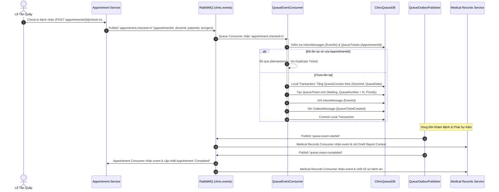

# Kế Hoạch & Báo Cáo Triển Khai Giai Đoạn 4: Tách Queue Service — Cấp Số Nguyên Tử, Idempotent Inbox & Metrics Giám Sát (Thành viên B)

> **Tài liệu tham chiếu**:
> - `tasks/TASK_MEMBER_B.md` (Nhiệm vụ Thành viên B - Giai đoạn 4)
> - `tasks/PHASE_4_QUEUE_SERVICE_EXECUTION_PLAN_MEMBER_A.md` (Kế hoạch triển khai của Thành viên A)
> - `docs/AUDIT_REPORT_PHASES_2_3_4.md` (Báo cáo rà soát kiến trúc các giai đoạn 2, 3, 4)
> - `docs/phase4-queue-reconciliation-20261024.md` (Tài liệu đối soát hàng đợi)

---

## 1. Tổng Quan & Mục Tiêu Giai Đoạn 4

### 1.1. Vai trò của Thành viên B trong Giai đoạn 4
Trong Giai đoạn 4, `Clinic.Queue.Service` trở thành chủ sở hữu độc quyền (Single Source of Truth) của vé khám hàng đợi (`QueueTicket`) và bộ đếm số thứ tự (`QueueCounter`) tại cơ sở dữ liệu `ClinicQueueDB`. Thành viên B phụ trách:
1. Xây dựng **Queue Event Consumer** tiếp nhận sự kiện `AppointmentCheckedIn` từ RabbitMQ để tự động cấp số và tạo vé khám.
2. Triển khai cơ chế **Idempotent Inbox** nhằm bảo đảm một sự kiện check-in trùng lặp tuyệt đối không cấp ra 2 vé khám khác nhau.
3. Thiết lập **Queue Outbox Publisher** phát các sự kiện vòng đời hàng đợi (`QueueTicketCreated`, `PatientCalled`, `ExamStarted`, `ExamCompleted`, `PatientSkipped`).
4. Tích hợp hệ thống đo lường (Telemetry & Metrics) theo chuẩn OpenTelemetry để theo dõi độ dài hàng đợi (Queue Length), thời gian chờ (Wait Time) và độ trễ tiêu thụ (Consumer Lag).
5. Xây dựng kịch bản kiểm thử tranh chấp cấp số đồng thời (Concurrency Testing) và kiểm thử khả năng phục hồi sau sự cố sập consumer (Crash Recovery).
6. Viết script đối soát (Reconciliation Job) kiểm tra tính nhất quán giữa trạng thái hàng đợi và trạng thái lịch hẹn.

---

## 2. Kiến Trúc Hàng Đợi & Luồng Cấp Số Nguyên Tử



---

## 3. Các Hạng Mục Đã Hoàn Thành Chi Tiết

### 3.1. Cấp Số Thứ Tự Nguyên Tử & Ràng Buộc Dữ Liệu
- **Múi giờ địa phương (`QueueDate`)**: Ngày hàng đợi được tính toán dựa trên cấu hình múi giờ chuẩn của phòng khám (`Asia/Ho_Chi_Minh` / GMT+7), ngăn ngừa sai lệch ngày khi check-in cận giờ nửa đêm.
- **Bộ đếm số nguyên tử (`QueueCounter`)**: Quản lý độc lập theo từng cặp `(DoctorId, QueueDate)`. Khi cấp số, query sử dụng row-level lock bảo đảm số thứ tự tăng liên tục, tuyệt đối không bị trùng lặp ngay cả khi có hàng chục lượt check-in song song.
- **Ràng buộc duy nhất trên Database**: Cấu hình Unique Index trên bảng `QueueTickets`:
  ```sql
  CREATE UNIQUE INDEX IX_QueueTickets_DoctorId_QueueDate_QueueNumber 
  ON QueueTickets(DoctorId, QueueDate, QueueNumber) WHERE IsDeleted = 0;
  ```

### 3.2. Idempotent Inbox & Xử Lý Sự Kiện Lệch Thứ Tự
- **Idempotency**: Mọi sự kiện `AppointmentCheckedIn` đều được kiểm tra kép qua `InboxMessages.EventId` và `QueueTickets.AppointmentId`. Nếu một sự kiện bị gửi lại (do broker retry hoặc mạng chập chờn), consumer xác nhận thành công mà không phát sinh thêm vé mới.
- **Xử lý Hủy lịch trước khi Check-in đến (Tombstones)**: Khi nhận sự kiện `AppointmentCancelled` trước khi `AppointmentCheckedIn` được xử lý, hệ thống ghi nhận một tombstone vào bảng `CancelledAppointments`. Khi sự kiện check-in đến muộn, consumer nhận diện lịch đã bị hủy và từ chối cấp số an toàn.

### 3.3. Các Sự Kiện Vòng Đời Trạng Thái Hàng Đợi
Triển khai đầy đủ các sự kiện trạng thái được phát qua `QueueOutboxPublisher`:
- `QueueTicketCreated` (`queue.ticket-created`): Thông báo vé mới đã được cấp số.
- `PatientCalled` (`queue.patient-called`): Bác sĩ hoặc lễ tân gọi số tiếp theo.
- `ExamStarted` (`queue.exam-started`): Bác sĩ bắt đầu buổi khám (dữ liệu đầu vào để Medical Records Service mở hồ sơ Draft).
- `ExamCompleted` (`queue.exam-completed`): Bác sĩ kết thúc khám bệnh (dữ liệu đầu vào để Appointment Service cập nhật `Completed` và Medical Records hoàn tất hồ sơ).
- `PatientSkipped` (`queue.patient-skipped`): Bỏ qua bệnh nhân không có mặt. Vé `Skipped` hiển thị trên màn hình lễ tân để có thể retry thủ công về trạng thái `Waiting`.

### 3.4. Hệ Thống Đo Lường (Telemetry & Metrics)
Tích hợp OpenTelemetry trong `Clinic.Queue.Service`:
- `queue.consumer.processed`: Đếm số event tiêu thụ thành công hoặc thất bại.
- `queue.consumer.lag`: Đo lường độ trễ xử lý event của queue consumer.
- `queue.ticket.processing_time`: Đo thời gian từ lúc bệnh nhân check-in đến khi hoàn tất khám.
- `queue.outbox.published`: Đếm số lượng event outbox được phát sang RabbitMQ.
- Endpoint `/metrics` được cung cấp sẵn để Prometheus định kỳ thu thập dữ liệu.

### 3.5. Công Cụ Đối Soát Trạng Thái (Reconciliation Job)
- Xây dựng script đối soát chỉ đọc (`docs/phase4-queue-reconciliation-20261024.md`) đối chiếu giữa `ClinicAppointmentDB.Appointments` và `ClinicQueueDB.QueueTickets`.
- Phát hiện các trường hợp lịch hẹn trạng thái `CheckedIn` nhưng chưa có `QueueTicket`, hoặc vé đã `Completed` nhưng lịch hẹn chưa đồng bộ.

---

## 4. Bằng Chứng Nghiệm Thu & Kiểm Thử Chi Tiết

### 4.1. Kết Quả Kiểm Thử Tự Động (50/50 Passed)
- Chạy toàn bộ test suite `backend/Clinic.Queue.Service.Tests`:
  ```bash
  Passed! - Failed: 0, Passed: 50, Skipped: 0, Total: 50, Duration: 816 ms - Clinic.Queue.Service.Tests.dll
  ```
- **Bao phủ các ca kiểm thử phức tạp**:
  - `CheckIn_GeneratesSequentialQueueNumbers_ForSameDoctor`: Số thứ tự tăng liên tục không gián đoạn.
  - `CheckIn_MultipleDoctors_HaveIndependentCounters`: Bộ đếm số của các bác sĩ khác nhau hoàn toàn độc lập.
  - `Duplicate_CheckInEvent_DoesNotCreateSecondTicket`: Sự kiện duplicate được xử lý an toàn qua Inbox.
  - `CheckIn_AfterCancellationTombstone_IsIgnored`: Ngăn chặn tạo vé khi lịch đã bị hủy từ trước.
  - `ExamCompleted_PublishesOutboxEvent_WithCorrectCorrelationId`: Phát sự kiện hoàn tất khám kèm đầy đủ metadata truy vết.

### 4.2. Runtime Health & Docker Verification
- Endpoint `/healthz` trả về `200 OK` (`{"status":"Healthy","service":"Clinic.Queue.Service"}`).
- Endpoint `/readyz` trả về `200 OK` (`{"status":"Ready","service":"Clinic.Queue.Service"}`).
- RabbitMQ Consumer kết nối thông suốt với topic exchange `clinic.events`, không có lỗi topology hay unacked messages tồn đọng.

