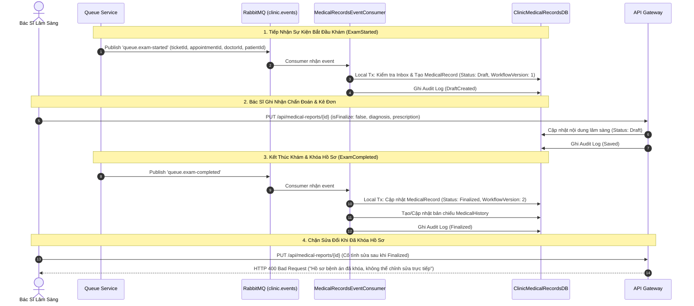

# Kế Hoạch & Báo Cáo Triển Khai Giai Đoạn 5: Tách Medical Records Service — Hạ Tầng Consumer, Xử Lý Sự Kiện Lệch Thứ Tự & Kiểm Toán Bệnh Án (Thành viên B)

> **Tài liệu tham chiếu**:
> - `tasks/TASK_MEMBER_B.md` (Nhiệm vụ Thành viên B - Giai đoạn 5)
> - `tasks/COMMON_REQUIREMENTS_AND_NOTES.md` (Yêu cầu kỹ thuật chung)
> - `docs/MEMBER_B_OPERATIONS_RUNBOOK.md` (Runbook vận hành & Rebuild projection)
> - `backend/Clinic.MedicalRecords.Service.Tests/MedicalRecordWorkflowTests.cs` (Bộ kiểm thử Workflow Bệnh án)

---

## 1. Tổng Quan & Mục Tiêu Giai Đoạn 5

### 1.1. Vai trò của Thành viên B trong Giai đoạn 5
Trong Giai đoạn 5, hệ thống bóc tách toàn bộ chức năng quản lý hồ sơ khám bệnh và lịch sử điều trị sang một dịch vụ độc lập: **Medical Records Service** (`Clinic.MedicalRecords.Service`) với cơ sở dữ liệu riêng `ClinicMedicalRecordsDB`. Thành viên B phụ trách:
1. Xây dựng **Medical Records Event Consumer** tiếp nhận các sự kiện bắt đầu khám (`ExamStarted`) và kết thúc khám (`ExamCompleted`) từ Queue Service qua RabbitMQ.
2. Xử lý bài toán sự kiện đến lệch thứ tự (Out-of-Order Events) và sự kiện trùng lặp (Duplicate Events) dựa trên cơ chế phiên bản luồng (`WorkflowVersion`).
3. Xây dựng bản chiếu lịch sử y tế (`MedicalHistory` Projection) với khả năng tái tạo (Rebuild) 100% từ dữ liệu gốc khi có sự cố mà không làm thay đổi hồ sơ lâm sàng.
4. Triển khai cơ chế kiểm toán truy vết (Audit Logging) cho mọi thao tác xem, sửa, và khóa bệnh án.
5. Viết bộ kiểm thử hợp đồng (Contract Tests) cho quy trình Lưu nháp (Save Draft) và Khóa bệnh án bất biến (Finalize Report).

---

## 2. Thiết Kế Kiến Trúc & Vòng Đời Hồ Sơ Bệnh Án



---

## 3. Các Hạng Mục Đã Hoàn Thành Chi Tiết

### 3.1. Consumer Tiếp Nhận Sự Kiện Hàng Đợi (`MedicalRecordsEventConsumer`)
- Kết nối tới RabbitMQ queue bền vững `q.medical-records.events` lắng nghe routing keys:
  - `queue.exam-started`: Tự động khởi tạo ngữ cảnh hồ sơ bệnh án mới ở trạng thái `Draft` với liên kết ổn định `AppointmentId` và `PatientId`.
  - `queue.exam-completed`: Cập nhật trạng thái sang `Finalized`, đồng thời ghi nhận vào bảng bản chiếu lịch sử y khoa của bệnh nhân.
- Cơ chế Idempotency: Kiểm tra kép qua bảng `InboxMessages`. Nếu nhận sự kiện duplicate, consumer xác nhận ngay mà không tạo bản ghi bệnh án thứ hai.

### 3.2. Cơ Chế Chống Hồi Quy Do Sự Kiện Đến Lệch Thứ Tự (`WorkflowVersion`)
- Trong môi trường phân tán, sự kiện `ExamCompleted` có thể đến trước `ExamStarted` (do độ trễ mạng hoặc retry):
  - Khi `ExamCompleted` đến trước: Service khởi tạo ngay bản ghi với trạng thái `Finalized` và gán `WorkflowVersion = 2`.
  - Khi `ExamStarted` đến muộn: Service kiểm tra thấy bản ghi đã tồn tại với `WorkflowVersion >= 2` $\rightarrow$ Giữ nguyên trạng thái `Finalized`, **tuyệt đối không hồi quy về `Draft`**, bảo đảm tính toàn vẹn dữ liệu lâm sàng.

### 3.3. Bản Chiếu Lịch Sử Y Tế (`MedicalHistory` Projection) & Khả Năng Tái Tạo
- Thực thể `MedicalHistory` được tách biệt làm read model tối ưu cho việc tra cứu tiền sử bệnh của bệnh nhân qua các đợt khám.
- Cơ chế Rebuild an toàn (`MedicalHistoryProjector.RebuildAsync`):
  - Cung cấp endpoint quản trị `POST /admin/medical-history/rebuild`.
  - Có thể xóa và tái tạo toàn bộ bản chiếu từ bảng sự kiện/hồ sơ gốc mà không làm thay đổi các trường lâm sàng hay dấu mốc thời gian cập nhật (`UpdatedAt`) của hồ sơ gốc.

### 3.4. Kiểm Toán Bảo Mật & Bảo Vệ Dữ Liệu Lâm Sàng
- Bảng kiểm toán `MedicalRecordAudits` lưu trữ: `MedicalRecordId`, `Action` (`DraftCreated`, `Saved`, `Finalized`, `Exported`, `Viewed`), `ActorId`, `ActorName`, `IpAddress`, `CorrelationId`, `Timestamp`.
- Tuân thủ quy định bảo mật: Tuyệt đối không log nội dung chẩn đoán bệnh án, tiền sử cá nhân hoặc kết quả xét nghiệm vào file log hệ thống hay dead-letter queue.

### 3.5. Kiểm Thử Hợp Đồng Bất Biến (Immutability Contract)
- Endpoint `PUT /api/medical-reports/{id}` hỗ trợ lưu nháp (`isFinalize = false`) không giới hạn số lần khi hồ sơ ở trạng thái `Draft`.
- Khi chuyển `isFinalize = true`: Hồ sơ chuyển sang `Finalized`. Mọi yêu cầu gọi lại `PUT` sau thời điểm này đều bị từ chối với mã lỗi `400 Bad Request` kèm thông báo bảo mật.

---

## 4. Bằng Chứng Nghiệm Thu & Kiểm Thử Chi Tiết

### 4.1. Kết Quả Kiểm Thử Đã Đạt (4/4 Passed)
Chạy toàn bộ test suite tại [`backend/Clinic.MedicalRecords.Service.Tests`](file:///d:/CODE/KHDV/Clinic_Appointment_Booking_Queue_Management_System/backend/Clinic.MedicalRecords.Service.Tests):
```bash
Passed! - Failed: 0, Passed: 4, Skipped: 0, Total: 4, Duration: 1 s - Clinic.MedicalRecords.Service.Tests.dll
```
1. `ExamStarted_CreatesOneDraft_WhenDuplicated`: Kiểm thử gửi 2 event `ExamStarted` cùng ID, xác nhận chỉ có 1 bản ghi `Draft` được tạo ra trong DB.
2. `CompletedBeforeStarted_NeverRegressesFromFinalized`: Kiểm thử gửi `ExamCompleted` trước `ExamStarted`, xác nhận hồ sơ đạt `Finalized` và không bị tụt về `Draft`.
3. `HistoryProjection_CanBeRebuiltWithoutChangingClinicalRecord`: Kiểm thử tái tạo read model `MedicalHistory`, xác nhận số lượng bản chiếu đúng và dấu thời gian của hồ sơ gốc giữ nguyên.
4. `MedicalReportsContract_SaveAndFinalize_EnforcesImmutability`: Kiểm thử toàn bộ vòng đời API: Lưu nháp $\to$ Chốt hồ sơ $\to$ Ngăn chặn sửa đổi sau khi chốt $\to$ Tra cứu danh sách theo trạng thái.

### 4.2. Runtime & Docker Health
- Service cấu hình độc lập tại cổng 5005 (`Clinic.MedicalRecords.Service`), kết nối tới database riêng `ClinicMedicalRecordsDB`.
- Health checks `/healthz` và `/readyz` cấu hình hoàn chỉnh trong `docker-compose.yml`.

