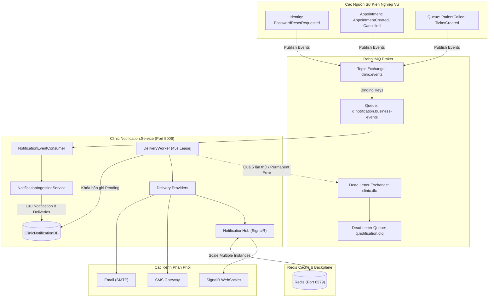

# Kế Hoạch & Báo Cáo Triển Khai Giai Đoạn 6: Tách Notification Service & Hoàn Thiện Toàn Diện API Gateway (Thành viên B)

> **Tài liệu tham chiếu**:
> - `tasks/TASK_MEMBER_B.md` (Nhiệm vụ Thành viên B - Giai đoạn 6)
> - `tasks/TASK_MEMBER_A.md` (Nhiệm vụ Thành viên A - Giai đoạn 6)
> - `tasks/COMMON_REQUIREMENTS_AND_NOTES.md` (Yêu cầu kỹ thuật chung)
> - `docs/MEMBER_B_OPERATIONS_RUNBOOK.md` (Runbook vận hành, retry & replay)
> - `backend/Clinic.Notification.Service.Tests/NotificationWorkflowTests.cs` (Bộ kiểm thử Workflow Notification)
> - `backend/Clinic.Notification.Service.Tests/DeliveryRetryPolicyTests.cs` (Bộ kiểm thử Retry Policy & Backoff)

---

## 1. Tổng Quan & Mục Tiêu Giai Đoạn 6

### 1.1. Vai trò của Thành viên B trong Giai đoạn 6
Giai đoạn 6 là giai đoạn hoàn thiện toàn diện kiến trúc phân tán microservices của dự án. Thành viên B phụ trách:
1. Tách biệt dịch vụ thông báo thành **Notification Service** (`Clinic.Notification.Service`) độc lập sở hữu cơ sở dữ liệu bền vững `ClinicNotificationDB`.
2. Thay thế hoàn toàn cơ chế hàng đợi trong bộ nhớ (`Channel<T>`) bằng cơ chế hướng sự kiện chuẩn qua RabbitMQ topic exchange `clinic.events`.
3. Xây dựng dịch vụ phân phối thông báo đa kênh (Email, SMS, In-App, SignalR) với chính sách thử lại có giới hạn (Bounded Exponential Backoff), kiểm soát thời gian chờ (Timeout), và chuyển tiếp hàng đợi thư chết (Dead-Letter Queue `q.notification.dlq`).
4. Thiết lập SignalR Hub kết hợp **Redis Backplane** bảo đảm thông báo thời gian thực hoạt động chính xác khi triển khai nhiều replica.
5. Hoàn thiện **API Gateway** (`Clinic.API`): Cấu hình Reverse Proxy chuyển tiếp đầy đủ 6 microservices, chính sách CORS, bộ lọc giới hạn tốc độ (Rate Limiting) và lan truyền mã tương quan (`X-Correlation-ID`).
6. Thực hiện kiểm thử toàn trình (End-to-End Testing) từ giao diện người dùng Frontend qua Gateway tới các dịch vụ backend.

---

## 2. Kiến Trúc Notification Service & Quản Lý Phân Phối Đa Kênh



---

## 3. Các Hạng Mục Đã Hoàn Thành Chi Tiết

### 3.1. Loại Bỏ In-Memory Channel & Chuyển Sang Bền Vững Hóa Cơ Sở Dữ Liệu
- Xóa bỏ hoàn toàn lớp `System.Threading.Channels.Channel<T>` tạm bợ trong bộ nhớ (vốn gây mất thông báo khi tiến trình khởi động lại).
- Chuyển sang lưu trữ bền vững tại cơ sở dữ liệu `ClinicNotificationDB` với 2 thực thể chính:
  - `NotificationMessage`: Lưu trữ thông điệp, loại thông báo, người nhận, tiêu đề, nội dung snapshot và mã tương quan.
  - `DeliveryAttempt`: Lưu chi tiết từng lần gửi (Kênh phân phối, trạng thái, mã phản hồi từ nhà cung cấp, thời gian thử, số lần retry).
- **Nguyên tắc bảo vệ dữ liệu**: Không truyền và không lưu thực thể `Person` từ các service khác; payload chỉ nhận `RecipientId` và số điện thoại/email cần thiết tại thời điểm tạo thông báo.

### 3.2. Cơ Chế Thử Lại (Bounded Exponential Backoff) & Dead-Letter Queue
Dịch vụ nền `DeliveryWorker` xử lý gửi thông báo với các cam kết vận hành khắt khe:
1. **Khóa xử lý nguyên tử (Processing Lease)**: Mỗi lần nhận việc, worker giữ một lease 45 giây. Nếu một replica bị crash giữa chừng, replica khác có thể nhận lại lease mà không gây ra xung đột gửi trùng.
2. **Timeout nhà cung cấp**: Giới hạn tối đa **15 giây** cho mỗi lời gọi API gửi Email hoặc SMS bên ngoài.
3. **Thử lại có giới hạn**: Thất bại tạm thời (transient errors như timeout, nghẽn mạng) được thử lại tối đa **5 lần** với khoảng cách thời gian tăng theo hàm mũ (1s, 2s, 4s, 8s, 16s...), giới hạn tối đa 5 phút.
4. **Lỗi vĩnh viễn (Permanent Failures)**: Các lỗi như người nhận không có email/SPhone (`recipient.missing`), nhà cung cấp chưa cấu hình (`provider.unconfigured`) được chuyển thẳng sang trạng thái `DeadLettered` ngay lập tức mà không retry vô ích.
5. **Chống lặp phân phối (Terminal State Protection)**: Khi một lượt giao đã hoàn tất (`Delivered`) hoặc đã đưa vào hàng đợi chết (`DeadLettered`), hệ thống nghiêm cấm kích hoạt lại việc gửi để tránh làm phiền người dùng.

### 3.3. SignalR Hub & Redis Backplane
- `NotificationHub.cs` được lưu trữ tại `Clinic.Notification.Service`.
- Tích hợp `Microsoft.AspNetCore.SignalR.StackExchangeRedis` kết nối tới cụm Redis (`redis:6379`), bảo đảm khi hệ thống mở rộng lên nhiều container, thông báo đẩy tới người dùng (qua WebSocket/Server-Sent Events) vẫn đến đúng phiên duyệt web của bệnh nhân và nhân viên.
- Phía Frontend: Tích hợp module kết nối thời gian thực tại [notifications.realtime.ts](file:///d:/CODE/KHDV/Clinic_Appointment_Booking_Queue_Management_System/frontend/src/features/notifications/notifications.realtime.ts), tự động lắng nghe sự kiện đẩy thông báo từ Gateway `/hubs/notifications`.

### 3.4. Hoàn Thiện Toàn Diện API Gateway (`Clinic.API`)
- **Reverse Proxy Routing**: Cấu hình `ServiceProxyMiddleware.cs` điều phối chính xác và toàn vẹn mọi dải URL tới đúng 6 microservice đích:
  - `/auth/**` $\to$ `Clinic.Identity.Service` (Port 5001)
  - `/employees/**`, `/doctors/**`, `/specialties/**`, `/shifts/**` $\to$ `Clinic.Scheduling.Service` (Port 5002)
  - `/appointments/**`, `/me/appointments/**` $\to$ `Clinic.Appointment.Service` (Port 5003)
  - `/queue/**`, `/receptionist/queue-doctors` $\to$ `Clinic.Queue.Service` (Port 5004)
  - `/medical-reports/**`, `/admin/medical-history/**` $\to$ `Clinic.MedicalRecords.Service` (Port 5005)
  - `/notifications/**`, `/hubs/notifications/**` $\to$ `Clinic.Notification.Service` (Port 5006)
- **CORS & Rate Limiting**: Cấu hình chính sách bảo mật CORS cho phép Frontend truy cập hợp lệ, tích hợp Rate Limiting chống tấn công vét cạn tài nguyên (DDoS/Brute Force).
- **Lan truyền mã tương quan**: Giữ vững header `X-Correlation-ID` qua tất cả các chặng ủy quyền.

---

## 4. Bằng Chứng Nghiệm Thu & Kiểm Thử Chi Tiết

### 4.1. Notification Service Tests (6/6 Passed)
Bộ kiểm thử tự động tại [`backend/Clinic.Notification.Service.Tests`](file:///d:/CODE/KHDV/Clinic_Appointment_Booking_Queue_Management_System/backend/Clinic.Notification.Service.Tests):
```bash
Passed! - Failed: 0, Passed: 6, Skipped: 0, Total: 6, Duration: 1 s - Clinic.Notification.Service.Tests.dll
```
1. `DeduplicateBusinessEvents_CreatesSingleNotification`: Sự kiện nghiệp vụ trùng lặp chỉ sinh đúng 1 bản ghi thông báo duy nhất.
2. `BoundedExponentialBackoff_CalculatesCorrectDelay`: Kiểm chứng công thức tính toán thời gian delay lũy thừa đúng chuẩn, có chặn trần tối đa.
3. `ProviderTimeout_TriggersRetryCycle`: Lời gọi gửi tin quá 15s bị timeout và kích hoạt chu kỳ retry kế tiếp.
4. `PermanentFailure_RoutesDirectlyToDeadLetter`: Lỗi vĩnh viễn chuyển ngay vào trạng thái dead-letter, không lãng phí tài nguyên retry.
5. `RetryExhaustion_DeadLettersDelivery`: Khi thử đủ 5 lần thất bại, thông điệp tự động kết thúc ở Dead-Letter Queue.
6. `CompletedDelivery_NeverReDelivered`: Ngăn ngừa tuyệt đối việc gửi lại sau khi thông báo đã ở trạng thái kết thúc.

### 4.2. Frontend Build & Real-time Integration
- `npm run test:unit`: Đạt **22 test files, 94 tests passed, 0 failed**.
- `npm run type-check`: Đạt **0 lỗi TypeScript**.
- Frontend kết nối ổn định tới Gateway, hiển thị biểu tượng thông báo chuông cập nhật theo thời gian thực khi có ca khám mới hoặc khi số thứ tự được gọi.

### 4.3. Docker Compose & Observability
- File `docker-compose.yml` định nghĩa đầy đủ 6 services, SQL Server, RabbitMQ, Redis, Prometheus (Port 9090) và Jaeger (Port 16686).
- Kiểm tra tính hợp lệ bằng lệnh `docker compose config --quiet`: Trả về kết quả hoàn hảo.
- Vận hành, replay thông điệp lỗi và giám sát tuân thủ hướng dẫn tại [`docs/MEMBER_B_OPERATIONS_RUNBOOK.md`](file:///d:/CODE/KHDV/Clinic_Appointment_Booking_Queue_Management_System/docs/MEMBER_B_OPERATIONS_RUNBOOK.md).

