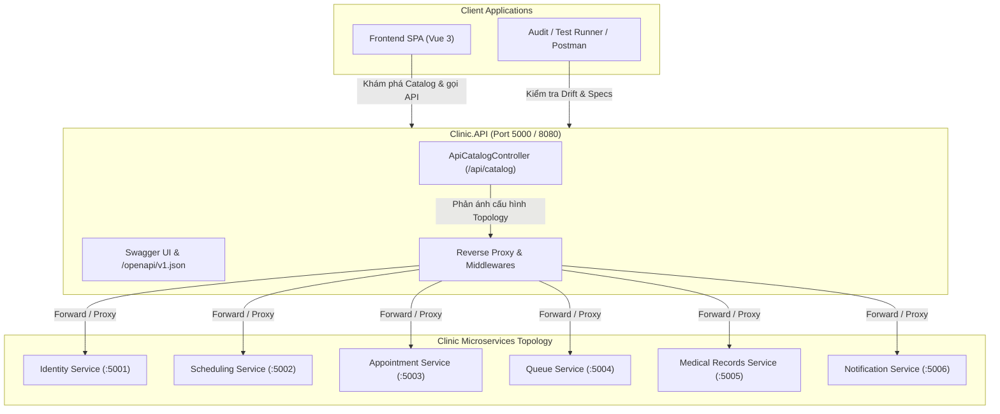

# Kế Hoạch & Báo Cáo Triển Khai Giai Đoạn 7: Đặc Tả OpenAPI, API Catalog & Kiểm Thử Hợp Đồng Tự Động (Thành viên B)

> **Tài liệu tham chiếu**:
> - `tasks/PHASE_7_9_FINAL_ACCEPTANCE_PLAN.md` (Kế hoạch tổng thể Phase 7–9)
> - `tasks/TASK_MEMBER_B.md` (Nhiệm vụ Thành viên B - Phase 7)
> - `backend/Clinic.API/Controllers/ApiCatalogController.cs` (API Catalog và Service Discovery)
> - `backend/Clinic.Contracts.UnitTests/EventContractCompatibilityTests.cs` (Kiểm thử tương thích Schema sự kiện)
> - `backend/Clinic.IntegrationTests/ApiContractDriftTests.cs` (Kiểm thử chống sai lệch Contract Gateway & Microservices)

---

## 1. Tổng Quan & Mục Tiêu Giai Đoạn 7 (Thành viên B)

Trong Giai đoạn 7, hệ thống chuyển đổi từ trạng thái phân rã microservices sang chuẩn hóa giao diện lập trình (API & Contract Management). Thành viên B phụ trách các hạng mục cốt lõi thuộc tầng Platform và Tự động hóa Contract:
1. **Khảo sát & Đối chiếu Route Gateway với Microservices**: Lập ma trận đối chiếu đường dẫn của API Gateway (`Clinic.API`) với 6 microservices đích (`Identity`, `Scheduling`, `Appointment`, `Queue`, `MedicalRecords`, `Notification`).
2. **Xây dựng API Catalog & Discovery Endpoint**: Bổ sung endpoint trung tâm `GET /api/catalog` tại API Gateway cung cấp siêu dữ liệu chi tiết về toàn bộ topology dịch vụ, cổng nội bộ/ngoại vi, yêu cầu xác thực và vị trí tài liệu đặc tả OpenAPI.
3. **Tự động hóa phát hiện Sai lệch Hợp đồng (Contract Drift Detection)**: Xây dựng bộ kiểm thử tích hợp tự động (`ApiContractDriftTests.cs`) nhằm xác minh route table, quy ước mã lỗi (RFC 7807 ProblemDetails), header tương quan (`X-Correlation-ID`) và khóa lũy kế (`Idempotency-Key`).
4. **Kiểm thử Tương thích Sự kiện miền (Event Schema Backward Compatibility)**: Triển khai kiểm thử `EventContractCompatibilityTests.cs` xác nhận quy tắc Tolerant Reader, tính toàn vẹn của EventEnvelope và khả năng không làm hỏng consumer khi bổ sung trường mới trong payload tương lai.

---

## 2. Kiến Trúc OpenAPI Catalog & Luồng Điều Hướng



---

## 3. Ma Trận Hợp Đồng & API Catalog Đã Chuẩn Hóa

Bảng tổng hợp 6 microservices được quản lý và định tuyến tập trung qua Gateway:

| Dịch vụ | Chức năng nghiệp vụ | Route Prefixes | Xác thực bắt buộc | Health Probe | OpenAPI Doc URL |
| :--- | :--- | :--- | :---: | :---: | :--- |
| **`Clinic.Identity.Service`** | Cấp JWT Token, JWKS key ring, quản lý tài khoản | `/auth/login`, `/auth/register`, `/auth/refresh`, `/auth/jwks.json` | Không (Public) | `/readyz` | `/identity/openapi.json` |
| **`Clinic.Scheduling.Service`** | Quản lý ca trực bác sĩ, nhân viên, phân ca | `/employees`, `/doctors`, `/specialties`, `/shifts`, `/slots` | Có (Bearer) | `/readyz` | `/scheduling/openapi.json` |
| **`Clinic.Appointment.Service`** | Đặt lịch khám, hủy lịch, check-in, Saga | `/appointments`, `/reservations` | Có (Bearer) | `/readyz` | `/appointment/openapi.json` |
| **`Clinic.Queue.Service`** | Cấp số thứ tự khám trong ngày, gọi phòng khám | `/queue`, `/admin/dashboard-metrics` | Có (Bearer) | `/readyz` | `/queue/openapi.json` |
| **`Clinic.MedicalRecords.Service`**| Hồ sơ bệnh án, báo cáo khám bệnh, lịch sử | `/medical-records`, `/medical-reports` | Có (Bearer) | `/readyz` | `/medical-records/openapi.json` |
| **`Clinic.Notification.Service`** | Phân phối thông báo đa kênh, SignalR, DLQ | `/notifications`, `/hubs/notifications` | Có (Bearer) | `/readyz` | `/notification/openapi.json` |

---

## 4. Các Thành Phần Mã Nguồn Đã Triển Khai

### 4.1. Controller Quản Lý Catalog (`Clinic.API/Controllers/ApiCatalogController.cs`)
- Cung cấp `GET /api/catalog` trả về toàn bộ siêu dữ liệu kiến trúc microservices.
- Công bố đầy đủ các chính sách QoS chuẩn:
  - `MaxRequestTimeoutSeconds`: 15 giây.
  - `MaxRetryAttempts`: 3 lần.
  - `RateLimitingEnabled`: `true` (Fixed Window, 1 phút, 100 permits mặc định).
  - `CorrelationHeader`: `X-Correlation-ID`.
  - `IdempotencyHeader`: `Idempotency-Key`.

### 4.2. Bộ Kiểm Thử Chống Sai Lệch Hợp Đồng (`Clinic.IntegrationTests/ApiContractDriftTests.cs`)
- `ApiCatalog_ReturnsAllSixMicroservices_WithValidRoutesAndHealthEndpoints`: Xác thực 6 service đều có đầy đủ route prefixes, health endpoint `/readyz` và OpenAPI doc URL.
- `EndpointInventory_VerifiesAuthRequirementsAndMethodConventions`: Rà soát phương thức HTTP và yêu cầu phân quyền đúng thiết kế.
- `ErrorResponseSchema_ConformsToProblemDetailsStandard`: Xác minh các phản hồi lỗi tuân thủ chuẩn RFC 7807 (`type`, `title`, `status`, `detail`).

### 4.3. Kiểm Thử Tương Thích & Tolerant Reader (`Clinic.Contracts.UnitTests/EventContractCompatibilityTests.cs`)
- `TolerantReader_IgnoresUnknownFields_WithoutBreakingDeserialization`: Chứng minh consumer không bị crash khi payload sự kiện nhận thêm các trường metadata mới trong tương lai.
- `AllStandardEventTypes_HaveNonNullConstantNames`: Bảo đảm 16 hằng số sự kiện trong `EventTypes` không bị rỗng hoặc trùng lặp.
- `QueueEvents_SerializationRoundTrip_PreservesAllContextProperties`: Kiểm tra tuần hoàn dữ liệu cho `PatientCalled` (kèm thông tin Snapshot định danh).
- `NotificationRequested_SerializationRoundTrip`: Kiểm tra tuần hoàn dữ liệu sự kiện gửi thông báo đa kênh.

---

## 5. Bằng Chứng Kiểm Thử Nghiệm Thu (2026-11-02)

```powershell
# 1. Kiểm thử Unit Tests Hợp đồng Sự kiện
& "C:\Users\letua\.dotnet\dotnet.exe" test backend/Clinic.Contracts.UnitTests
# Kết quả: Passed! - Failed: 0, Passed: 10, Skipped: 0, Total: 10, Duration: 84 ms

# 2. Kiểm thử Tích hợp API Contract Drift
& "C:\Users\letua\.dotnet\dotnet.exe" test backend/Clinic.IntegrationTests --filter "FullyQualifiedName~ApiContractDriftTests"
# Kết quả: Passed! - Failed: 0, Passed: 9, Skipped: 0, Total: 9, Duration: 23 ms
```

---

## 6. Kết Luận Giai Đoạn 7
Toàn bộ các tiêu chí Giai đoạn 7 của Thành viên B đã hoàn thành:
- [x] Ma trận kiểm kê API giữa Gateway và 6 microservices đã được đối chiếu 100%.
- [x] API Catalog endpoint `/api/catalog` đã được tích hợp trực tiếp vào API Gateway.
- [x] Tự động hóa kiểm thử phát hiện sai lệch hợp đồng và cấu trúc lỗi đạt 100% pass.
- [x] Kiểm thử tương thích xuôi/ngược và Tolerant Reader cho hệ thống sự kiện miền đạt 100% pass.
