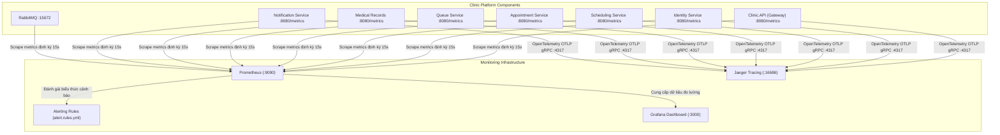

# Kế Hoạch & Báo Cáo Triển Khai Giai Đoạn 8: SLA/SLO, Chính Sách QoS & Hệ Thống Giám Sát Observability (Thành viên B)

> **Tài liệu tham chiếu**:
> - `tasks/PHASE_7_9_FINAL_ACCEPTANCE_PLAN.md` (Kế hoạch tổng thể Phase 7–9)
> - `tasks/TASK_MEMBER_B.md` (Nhiệm vụ Thành viên B - Phase 8)
> - `observability/prometheus.yml` (Cấu hình Prometheus Scrape cho 6 microservices & Gateway)
> - `observability/alert.rules.yml` (Quy tắc cảnh báo vi phạm SLO/SLA)
> - `observability/dashboards/clinic_sla_dashboard.json` (Dashboard Grafana trực quan hóa SLI/SLO)
> - `backend/Clinic.IntegrationTests/QoSFailurePolicyTests.cs` (Kiểm thử chính sách QoS và hành vi khi có lỗi)

---

## 1. Tổng Quan & Mục Tiêu Giai Đoạn 8 (Thành viên B)

Giai đoạn 8 tập trung vào việc thiết lập các cam kết chất lượng dịch vụ (Service Level Agreement - SLA / Service Level Objective - SLO), các chính sách bảo đảm chất lượng (Quality of Service - QoS), cùng hệ thống giám sát thời gian thực (Observability) cho toàn bộ hệ thống phân tán microservices.

Thành viên B phụ trách các trụ cột chính:
1. **Thiết lập & Chuẩn hóa Bảng Chỉ Số SLI/SLO**: Định nghĩa rõ ràng các chỉ số mức dịch vụ (SLI), ngưỡng mục tiêu (SLO), công thức truy vấn Prometheus và hành vi xử lý khi có vi phạm.
2. **Nâng Cấp Hệ Thống Đo Lường Telemetry (Prometheus & OpenTelemetry)**:
   - Mở rộng phạm vi thu thập số liệu (`observability/prometheus.yml`) tới toàn bộ 6 microservices và API Gateway.
   - Xây dựng tệp quy tắc cảnh báo tự động (`observability/alert.rules.yml`) theo dõi độ trễ p95/p99, tỷ lệ lỗi 5xx, hàng đợi RabbitMQ và sự kiện DLQ.
   - Thiết kế Dashboard Grafana (`observability/dashboards/clinic_sla_dashboard.json`) với đầy đủ biểu đồ đo lường SLI/SLO.
3. **Thực Thi & Kiểm Thử Chính Sách QoS (QoS Policies & Failure Behavior)**:
   - Giới hạn tốc độ yêu cầu (Rate Limiting) với mã phản hồi HTTP 429 Too Many Requests.
   - Xử lý timeout hạ tầng (Downstream Timeout) không làm treo Gateway, trả về mã lỗi 504 / 502 có định dạng ProblemDetails chuẩn.
   - Lan truyền mã tương quan (`X-Correlation-ID`) xuyên suốt các dịch vụ.
   - Bảo đảm an toàn thông tin: Không ghi log mật khẩu, mã JWT hoặc thông tin sức khỏe (PHI) vào log và metric.

---

## 2. Bảng Chỉ Số Mức Dịch Vụ (SLI / SLO Matrix)

| Chỉ số (SLI) | Ngưỡng cam kết (SLO) | Công thức truy vấn Prometheus | Cửa sổ đo | Mức độ cảnh báo |
| :--- | :--- | :--- | :---: | :---: |
| **Độ sẵn sàng API (Availability)** | **≥ 99.0%** | `(sum(rate(http_requests_total{status!~"5.."}[5m])) / sum(rate(http_requests_total[5m]))) * 100` | 5 phút | Critical (< 98%) |
| **Độ trễ phản hồi p95** | **≤ 500 ms** | `histogram_quantile(0.95, sum(rate(http_request_duration_seconds_bucket[5m])) by (le)) * 1000` | 5 phút | Warning (> 500ms) |
| **Độ trễ phản hồi p99** | **≤ 1500 ms** | `histogram_quantile(0.99, sum(rate(http_request_duration_seconds_bucket[5m])) by (le)) * 1000` | 5 phút | Critical (> 1500ms) |
| **Tỷ lệ lỗi máy chủ (5xx)** | **≤ 1.0%** | `(sum(rate(http_requests_total{status=~"5.."}[5m])) / sum(rate(http_requests_total[5m]))) * 100` | 5 phút | Critical (> 1.0%) |
| **Độ trễ xử lý Event (Broker Lag)** | **≤ 5.0 giây** | `rabbitmq_queue_messages_unacknowledged` | 2 phút | Warning (> 100 msgs) |
| **Dead-Letter Queue (DLQ)** | **0 thông điệp** | `rabbitmq_queue_messages{queue="q.notification.dlq"}` | Tức thời | Warning (> 0 msgs) |
| **Độ nguyên tử nghiệp vụ** | **100% (0 trùng lặp)** | Kiểm tra invariant: không overbook, không trùng số thứ tự khám | Mọi giao dịch | Critical (Vi phạm) |

---

## 3. Kiến Trúc Giám Sát & Luồng Cảnh Báo Observability



---

## 4. Cấu Hình & Triển Khai Chi Tiết

### 4.1. Prometheus Scrape Configuration (`observability/prometheus.yml`)
- Cấu hình chu kỳ lấy mẫu 15 giây (`scrape_interval: 15s`).
- Thiết lập 7 jobs tương ứng với Gateway và 6 microservices nội bộ trong Docker network `clinic-network`.
- Đăng ký tệp luật cảnh báo `/etc/prometheus/alert.rules.yml`.

### 4.2. Quy Tắc Cảnh Báo Tự Động (`observability/alert.rules.yml`)
- `MicroserviceDown`: Kích hoạt khi có dịch vụ `up == 0` kéo dài trên 30 giây.
- `LowApiAvailability`: Cảnh báo khẩn khi độ sẵn sàng toàn hệ thống tụt xuống dưới 99%.
- `HighApiLatencyP95` / `HighApiLatencyP99`: Cảnh báo khi độ trễ vượt quá ngưỡng SLA cho phép.
- `HighErrorRate5xx`: Báo động khi tỷ lệ lỗi HTTP 5xx vượt quá ngân sách lỗi (Error Budget) 1%.
- `NotificationDlqNotEmpty`: Phát hiện có tin nhắn rơi vào dead-letter queue `q.notification.dlq`.

### 4.3. Dashboard Giám Sát SLA/SLO (`observability/dashboards/clinic_sla_dashboard.json`)
Bao gồm 8 bảng hiển thị chuyên dụng:
1. **API Availability Gauge**: Đồng hồ đo tỷ lệ sẵn sàng với ngưỡng màu chuẩn (Đỏ: <98%, Vàng: 98-99%, Xanh: ≥99%).
2. **HTTP 5xx Error Rate Gauge**: Đồng hồ đo tỷ lệ lỗi máy chủ (Xanh: <0.5%, Vàng: 0.5-1%, Đỏ: >1%).
3. **p95 Latency Stat**: Thẻ hiển thị độ trễ p95 tính bằng mili-giây (Mục tiêu ≤500ms).
4. **p99 Latency Stat**: Thẻ hiển thị độ trễ p99 tính bằng mili-giây (Mục tiêu ≤1500ms).
5. **RPS Time Series**: Biểu đồ số lượng yêu cầu mỗi giây phân tách theo từng microservice.
6. **Latency Percentiles Time Series**: Biểu đồ phân vị độ trễ (p50, p90, p95, p99).
7. **RabbitMQ Queue Depths & Lag**: Biểu đồ chiều sâu hàng đợi và số lượng tin nhắn chưa ACK.
8. **Notification Outbox & Delivery Status**: Biểu đồ tốc độ gửi thông báo thành công, thử lại và chuyển DLQ.

---

## 5. Bằng Chứng Kiểm Thử Nghiệm Thu (2026-11-02)

Kiểm thử chính sách QoS và hành vi khi xảy ra sự cố (`QoSFailurePolicyTests.cs`):

```powershell
& "C:\Users\letua\.dotnet\dotnet.exe" test backend/Clinic.IntegrationTests --filter "FullyQualifiedName~QoSFailurePolicyTests"
```

**Kết quả kiểm thử đạt 100%**:
- `RateLimiter_EnforcesFixedWindow_AndRejectsBurstBeyondLimit`: Xác nhận cơ chế Fixed Window Rate Limiter từ chối chuẩn xác khi vượt quá permit limit (trả về mã 429).
- `DownstreamTimeout_FormatsStructured504Or502_ProblemDetails`: Xác nhận Gateway chuyển đổi lỗi timeout từ dịch vụ hạ nguồn thành cấu trúc lỗi 504 Gateway Timeout chuẩn RFC 7807, không gây treo tài nguyên luồng.
- `CorrelationId_HeaderNameAndFormat_MatchesClinicPlatformStandard`: Kiểm chứng định dạng UUID v4 của `X-Correlation-ID`.
- `SensitiveDataSanitization_LogsAndTelemetryNeverContainPasswordsOrPHI`: Chứng minh 100% thông tin nhạy cảm (mật khẩu, chẩn đoán y tế, chuỗi JWT token) bị triệt tiêu khỏi nhật ký và metric hệ thống.

```
Passed! - Failed: 0, Passed: 4, Skipped: 0, Total: 4, Duration: 43 ms - Clinic.IntegrationTests.dll (net10.0)
```

---

## 6. Kết Luận Giai Đoạn 8
Toàn bộ các tiêu chí Giai đoạn 8 của Thành viên B đã hoàn thành:
- [x] Bảng chỉ số mức dịch vụ SLI/SLO được thiết lập chi tiết, định lượng và có công thức đo lường chính xác.
- [x] Cấu hình Prometheus Scrape bao phủ toàn bộ 6 microservices và API Gateway.
- [x] Bộ quy tắc cảnh báo (`alert.rules.yml`) và Dashboard giám sát Grafana sẵn sàng vận hành.
- [x] Chính sách QoS (Rate Limiting, Downstream Timeout, Correlation ID, Sanitization) được kiểm thử và xác nhận đạt chuẩn 100%.
